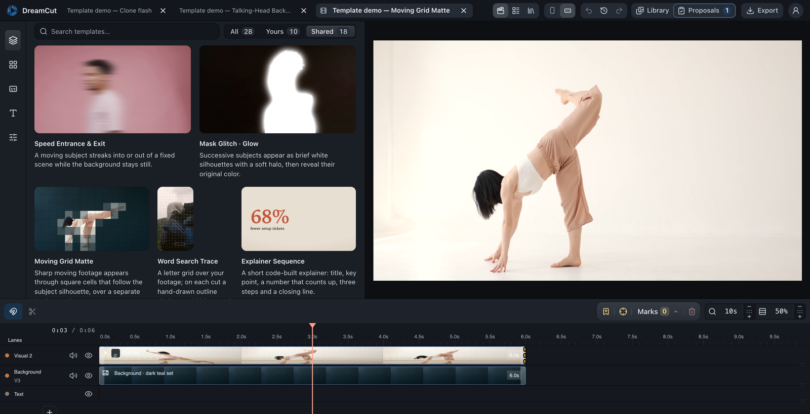

<p align="center">
  
</p>

<h1 align="center">DreamCut</h1>

<p align="center"><b>The open-source video editor where AI agents propose edits and you approve them.</b></p>

<p align="center">
  <a href="LICENSE"></a>
  <a href="https://www.npmjs.com/package/dreamcut"></a>
  
</p>

<p align="center"></p>

Tell Claude Code or Codex what you want. DreamCut builds it on a real timeline, with clips, captions,
masks, motion graphics and sound, and hands it back as a **proposal**. You preview it, tune it with
sliders, then apply or reject it. Everything runs locally and stays editable by hand.

## Templates

Effects your agent rebuilds with your own footage.

<table>
<tr>
<td><br><b>Clone Flash</b></td>
<td><br><b>Moving Grid Matte</b></td>
<td><br><b>Silhouette Window</b></td>
</tr>
<tr>
<td><br><b>Cross into Negative</b></td>
<td><br><b>Mask Glitch · Glow</b></td>
<td><br><b>Kinetic Type</b></td>
</tr>
</table>

**[Browse all templates →](docs/effects/README.md#all-templates)** · Footage from [Pexels](https://www.pexels.com/license/)

## Install

**With your agent** (Apple Silicon Mac; needs [Node.js](https://nodejs.org/) and `brew install ffmpeg`):

```bash
claude mcp add dreamcut -- npx -y dreamcut mcp
```

For Codex: `codex mcp add dreamcut -- npx -y dreamcut mcp`. Then tell your agent **"Open DreamCut."**
The first start downloads the editor (about 300 MB).

**From source** (Node 22 or 24, pnpm, FFmpeg, Chrome):

```bash
git clone https://github.com/lukemun/dreamcut.git && cd dreamcut && pnpm install && pnpm bootstrap && pnpm dev
```

Open http://127.0.0.1:3123, then run `claude` or `codex` in the repo folder; `.mcp.json` connects the agent.

## Your first edit

1. Create a project and drop in a few short clips.
2. Open **Templates**, pick one (try **Word Search Trace**) and click **Copy request**.
3. Paste it into your agent with your details: *"…with my clips, words FOG, HILL, DUSK, TRAIL"*.
4. Open **Proposals**, tune the sliders and click **Apply**. Undo works as usual.

## Data sharing

After an export, DreamCut shares that project's **editing history** (your directions, the agent's
proposals and what you applied or tuned) to improve the agent. **Never your media**: no video, audio,
images, file paths or transcripts. It's on by default; turn it off in **User → Settings**, or set
`DREAMCUT_CLOUD_INGEST_URL=off`.

## More

- [Contributing](CONTRIBUTING.md): set up, add a template, open a PR.
- [Architecture](docs/architecture/README.md) and [agent guide](AGENTS.md): how editing, proposals and rendering fit together.
- [Help and troubleshooting](.github/SUPPORT.md) · [Changelog](CHANGELOG.md) · [Security](.github/SECURITY.md)

Apache-2.0 ([license](LICENSE), [third-party notices](docs/legal/THIRD_PARTY_NOTICES.md),
[trademark policy](docs/legal/TRADEMARKS.md)). Optional cloud features (generation credits, shared
templates) use a free DreamCut account at [dreamcut.io](https://dreamcut.io).
