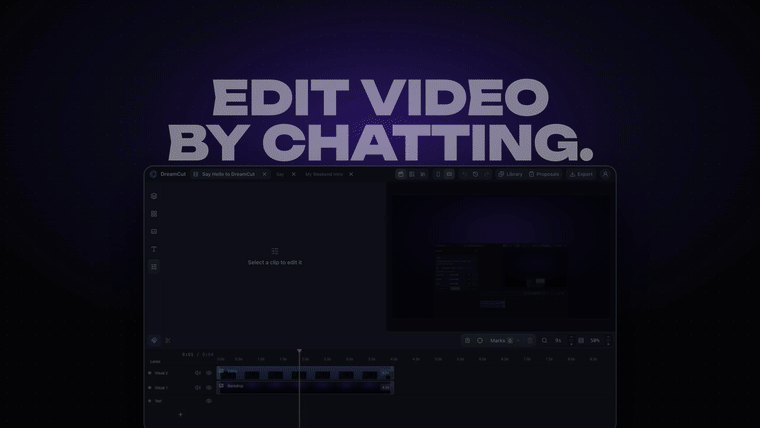
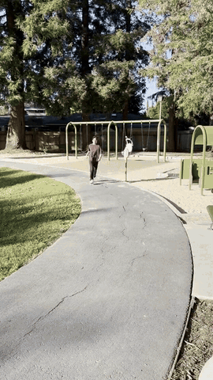
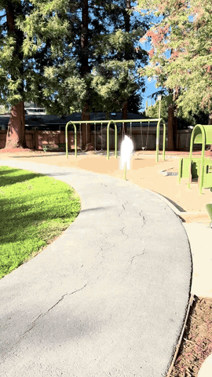
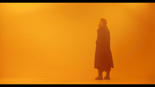

<p align="center">
  
</p>

<h1 align="center">DreamCut</h1>

<p align="center"><b>Open-source vibe editing for video.</b><br>A local video editor you drive from Claude Code or Codex.</p>

<p align="center">Needs a Mac with Apple Silicon (Windows is experimental) and Claude Code or Codex.<br>
Free and local; no account needed to edit.</p>

<p align="center">
  
  
</p>

<p align="center"></p>

Ask your agent for an edit, like *"cut the long pauses"* or *"put the headline behind me"*. It doesn't
touch your timeline. It sends you proposals instead.

## How it works: propose, tweak, accept

1. **You ask.** Type what you want in Claude Code or Codex, as many changes at once as you like.
2. **The agent proposes.** Each change arrives in the editor as its own card. A card can carry a few
   alternatives (three fonts, two music cues) for you to flip between.
3. **You preview and tweak.** Play each card in place on the real timeline. Every card comes with the
   dials that matter (size, position, timing, colour, strength) so you can finish it by hand.
4. **You accept or reject.** Press **A** to apply or **X** to reject, one card at a time. Nothing changes
   until you do, and every applied change can be undone.

Cards don't depend on each other, so you can settle them in any order while the agent works on the next ones.

## What it can do

- **Cuts and pacing.** Remove pauses, filler words and false starts; pick the best takes and join them on the words.
- **Captions.** Word-timed captions in ready-made looks, including captions that sit behind you.
- **Colour.** Grade and correct clips with exposure, white balance, colour wheels, curves and looks.
- **Transitions.** Fade, slide, wipe, whip, cube, page turn, film burn, camera flash and blackout.
- **VFX.** Speed ramps and hops, clones, white-flash masks, green-screen keys, glows and motion blur,
  built from editable layers you can tune.
- **Keyframes and camera moves.** Animate position, scale, rotation and opacity on any clip; push in,
  reframe and follow the subject.
- **Text and motion graphics.** Titles, lower thirds, kinetic type and animated graphics, placed in open
  space or behind you.
- **Cutouts and compositing.** Remove backgrounds, layer people over new scenes, track text onto moving
  surfaces and put footage onto screens.
- **Sound.** Choose and cut music to the beat, add sound effects that follow the action, and balance voice
  and music.
- **Templates.** Effects like the Speed effect and Flash Effect, rebuilt on your own footage.
- **B-roll and assembly.** Pull in supporting shots, build a first cut from a script, or compare versions side by side.
- **Generation.** Draft images, video, music and voiceover, review the prompt and price, then generate
  (paid credits through a DreamCut account).
- **Export.** Render for YouTube, TikTok, Reels and other formats.

<table>
<tr>
<td width="33%" align="center" valign="top"><br><b>Raw footage</b></td>
<td width="33%" align="center" valign="top"><br><b>Speed effect</b></td>
<td width="33%" align="center" valign="top"><br><b>Flash Effect</b></td>
</tr>
<tr>
<td width="33%" align="center" valign="top"><br><b>Clone Flash</b></td>
<td width="33%" align="center" valign="top"><br><b>Silhouette Window</b></td>
<td width="33%" align="center" valign="middle"><b><a href="docs/effects/README.md#all-templates">All templates →</a></b></td>
</tr>
</table>

## Recreate any effect

Seen an effect you want? Give your agent the tutorial or the video and your own footage:

```text
Run the recreate-effect workflow on this tutorial: <path or link to the video>
```

1. **Supply the reference.** A tutorial, a finished video that uses the effect, or a still of the look.
2. **The agent breaks it down** and builds an editable version on your footage, as a card you preview,
   tune and accept like any other edit. Tell it what's off and it corrects it.
3. **It saves the method as a template.** A fresh agent then rebuilds the effect from the saved steps
   alone and grades the result, so the template works without you in the loop.
4. **Use it again, or share it.** The template shows up in Templates for your next video. Open a pull
   request to add it for everyone ([how to contribute an effect](CONTRIBUTING.md#contribute-an-effect-or-editing-workflow)).

The workflow's skill is [template-authoring](.agents/skills/template-authoring/SKILL.md). Use footage you
have the right to share, and don't commit other people's videos.

## Install

Paste this into Claude Code or Codex:

```text
Follow the instructions at dreamcut.io/install
```

Then start a new chat and say **"Open DreamCut."** Runs on macOS (Apple Silicon); Windows is experimental.

<details>
<summary><b>Install in a terminal instead</b></summary>

**1. Prerequisites** (Git, Node.js 24, FFmpeg, Chrome). On a Mac with [Homebrew](https://brew.sh):

```bash
brew install git node@24 ffmpeg && brew install --cask google-chrome && brew link --overwrite --force node@24
```

On Windows (PowerShell):

```powershell
winget install Git.Git OpenJS.NodeJS.LTS Google.Chrome Gyan.FFmpeg
```

**2. DreamCut.** For Claude Code on a Mac:

```bash
claude plugin marketplace add lukemun/dreamcut-plugins
claude plugin install dreamcut@dreamcut
git clone https://github.com/lukemun/dreamcut.git ~/DreamCut
cd ~/DreamCut
corepack pnpm install
corepack pnpm bootstrap
```

For Codex, replace the first two lines with:

```bash
codex plugin marketplace add lukemun/dreamcut-plugins
codex plugin add dreamcut@dreamcut
```

On Windows, open a new PowerShell window after step 1, then:

```powershell
claude plugin marketplace add lukemun/dreamcut-plugins
claude plugin install dreamcut@dreamcut
git clone https://github.com/lukemun/dreamcut.git $HOME\DreamCut
cd $HOME\DreamCut
corepack pnpm install
corepack pnpm bootstrap
```

**3. Optional:** the caption, voice and cutout models (about 4 GB, once), then check what's ready:

```bash
node bin/dreamcut.mjs setup
node bin/dreamcut.mjs doctor
```

</details>

## Privacy

DreamCut runs on your computer and uploads nothing by default (it only checks GitHub for updates). Your footage stays local unless you send it
(a generation reference or a template you share), and your agent sends what it works on to its own provider.
If you sign in and turn on **Settings → Privacy → Share edits to improve DreamCut**, editing history,
suggested edits, feedback and tool-usage counts go to your DreamCut account. AI generation (images, video,
music, voiceover) runs through a DreamCut account on paid credits; editing needs no account.

## Contributing

Effects, fixes and features are welcome. See [CONTRIBUTING.md](CONTRIBUTING.md).

## License

[Apache 2.0](LICENSE) · [Third-party notices](docs/legal/THIRD_PARTY_NOTICES.md) ·
[Trademarks](docs/legal/TRADEMARKS.md) · [Privacy](https://dreamcut.io/privacy) ·
[Security](.github/SECURITY.md) · [Support](.github/SUPPORT.md) · [Code of conduct](CODE_OF_CONDUCT.md) · [Changelog](CHANGELOG.md)
