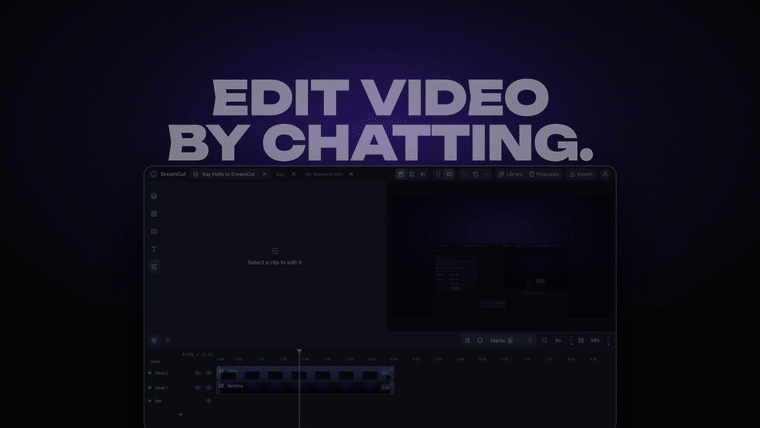

<p align="center">
  
</p>

<h1 align="center">DreamCut</h1>

<p align="center"><b>Invent the next trend in video.</b><br>The local agentic video editor behind an open catalog of edits.</p>

<p align="center">
  
  
</p>

<table>
<tr>
<td width="33%" align="center" valign="top"><br><b>Raw footage</b></td>
<td width="33%" align="center" valign="top"><br><b>Speed effect</b></td>
<td width="33%" align="center" valign="top"><br><b>Flash Effect</b></td>
</tr>
</table>

<p align="center"><b>One-click edits.</b></p>

<p align="center"></p>

**DreamCut is a video editor you drive by chatting.** It runs on your Mac. Ask Claude Code or Codex (the AI agents from
Anthropic and OpenAI) for an edit, like *"cut the long pauses"* or *"put the headline behind me"*, and it lands on a real timeline as a
proposal. Preview it, tune it with sliders, then apply it. Nothing changes on your timeline without your OK,
and every applied edit can be undone.

- **Spatial reasoning.** It knows where you are in the frame, so text can sit behind you or in open space.
- **Effects catalog.** Templates like the Speed effect, rebuilt on your own footage. Anyone can add one.
- **Motion graphics.** Titles, kinetic type, lower thirds and animated graphics, in a look you choose.
- **Claude does the editing.** Your agent cuts, captions, grades and adds sound; you make the calls.

Part of an open catalog of edits, built to reward the creators behind them. [Read the mission →](https://dreamcut.io/mission)

**Start here:** [Install](#install) · [Your first edit](#your-first-edit) · [Contribute an effect or edit](#contribute-an-effect-or-edit)

DreamCut runs from this repository on **macOS** (Apple Silicon first; Windows is experimental). You drive it
from Claude Code or Codex, which need a paid plan from Anthropic (Claude Pro or above) or OpenAI (a ChatGPT
plan that includes Codex); that usage is billed by them, separately from DreamCut.

## Install

Open Claude Code or Codex and say:

> Install DreamCut by following dreamcut.io/install.

Your agent installs everything: whatever your Mac is missing, the DreamCut plugin and the editor. It asks
before each step. On a new Mac you'll click **Install** for Apple's developer tools and type your password
for Node.js. Then start a new chat and say **"Open DreamCut."**

**Updates:** each time you open DreamCut it checks for a newer version and updates with your OK. Your
projects live outside the app, so updates never touch them.

<details>
<summary><b>Install it yourself</b></summary>

You need Git, [Node.js](https://nodejs.org/) 22 or 24 (not 23), [Google Chrome](https://www.google.com/chrome/)
and FFmpeg. With [Homebrew](https://brew.sh/): `brew install git node@24 ffmpeg`, then
`brew link --overwrite --force node@24`.

Connect your agent with the DreamCut plugin. Claude Code:

```bash
claude plugin marketplace add lukemun/dreamcut-plugins
claude plugin install dreamcut@dreamcut
```

Codex: `codex plugin marketplace add lukemun/dreamcut-plugins`, then `codex plugin add dreamcut@dreamcut`.

Install the editor where the plugin looks for it:

```bash
git clone https://github.com/lukemun/dreamcut.git ~/DreamCut
cd ~/DreamCut
corepack pnpm install
corepack pnpm bootstrap
```

Captions, "Enhance voice" and cutout templates need extra models (about 4 GB, once):
`node bin/dreamcut.mjs setup`. Check what's ready with `node bin/dreamcut.mjs doctor`. Then start a new chat
and say **"Open DreamCut."**

**Windows** (experimental): `winget install Git.Git OpenJS.NodeJS.LTS Google.Chrome Gyan.FFmpeg`, then the
same steps in PowerShell with `$HOME\DreamCut`.

**Tools showing up twice?** Remove the older connection: `claude mcp remove dreamcut -s user`
(Codex: `codex mcp remove dreamcut`). Updates only fast-forward, so a copy with your own commits is left
alone.

</details>

## Your first edit

1. In the editor, create a project and drop in a few short clips.
2. Open **Templates** and click one to select it (try **Word Search Trace**).
3. In your connected Claude Code or Codex chat, say where to use it:
   *"Use this on my clips, words FOG, HILL, DUSK, TRAIL"*.
4. Open **Proposals**, tune the sliders and click **Apply**. Undo works as usual.

## Templates

More effects your agent rebuilds with your own footage.

<table>
<tr>
<td width="50%" align="center"><br><b>Clone Flash</b></td>
<td width="50%" align="center"><br><b>Silhouette Window</b></td>
</tr>
</table>

**[Browse all templates →](docs/effects/README.md#all-templates)** · Speed effect and Flash Effect footage: the
DreamCut maintainer. Other template footage from [Pexels](https://www.pexels.com/license/).

## Contribute an effect or edit

A transition, a caption style, a new way to tell a story: if you made it, it belongs in the catalog. Pick
one route:

1. **Share it from the app.** Ask your agent to *"save this as a template"* and export the project, then
   open the template under **Templates** and choose **Share with DreamCut** (needs a free DreamCut account).
2. **Join the creator program.** On the [creator program page](https://dreamcut.io/creators), send the
   raw footage and assets, the final edit, an explanation of how you made it (a video or written), and
   filming directions for the footage it needs. No GitHub needed; we turn it into a template with your
   name on it.
3. **Build it yourself.** Ask your agent to *"recreate this effect as a DreamCut template"*, then open a pull
   request with a short demo. [CONTRIBUTING.md](CONTRIBUTING.md#contributing-an-effect) has the details.

Use only media you have the right to share.

## Your files

The editor runs on your computer, and your projects and footage stay there. DreamCut never uploads your
video, audio or images, except files you choose to send: references for cloud generation, or a template
you share with DreamCut.

### Help us improve

While you're signed in to DreamCut, editing history, suggested edits, feedback and tool usage are
uploaded to your account to improve the product, even if you never export. Signed out, nothing is uploaded, except one
anonymous install count the DreamCut plugin sends the first time DreamCut's tools start (the agent, the operating system and
the plugin version; no ID, path or email; skipped with `DO_NOT_TRACK=1` or `DREAMCUT_INSTALL_PING_URL=off`). Tool usage is daily counts of the DreamCut tools your
agent called and their failures, plus a short note when your agent had to work around a missing tool;
it carries no tool arguments or file paths. Sharing is on by default; turn it off in
**User → Settings → Privacy**, or set `DREAMCUT_CLOUD_INGEST_URL=off`.
No video, audio, images, frames, thumbnails or proxies are included.

Separately, your agent (such as Claude Code or Codex) may send content it works on,
including frames, to its provider under its own terms. Cloud generation also sends
reference files you explicitly provide for it.

## More

- [Help and troubleshooting](.github/SUPPORT.md) · [Changelog](CHANGELOG.md) · [Security](.github/SECURITY.md)

Open source under the [Apache License 2.0](LICENSE): use, change and share it for anything, including
commercial work ([third-party notices](docs/legal/THIRD_PARTY_NOTICES.md),
[trademark policy](docs/legal/TRADEMARKS.md)). Optional cloud features (generation credits, shared
templates) use a free DreamCut account at [dreamcut.io](https://dreamcut.io).
