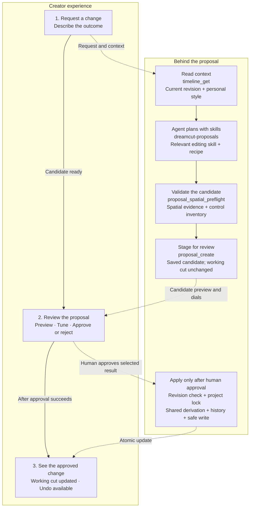

# DreamCut software architecture

DreamCut is a local, file-backed video editor with an agent interface. People and agents work with the same editable timeline, but through different authority boundaries: people edit directly and review proposals; agents prepare candidate edits and supply intent. Deterministic code resolves timing, geometry, and supported effects. Evidence tools make the resulting state inspectable.

This is the technical entry point, not a contribution checklist. It explains how the systems fit together and routes to their detailed designs. Architecture explains responsibilities and tradeoffs; [standards](../standards/README.md) define invariants and acceptance requirements; [skills](../../.agents/skills/README.md) describe task procedures; [CONTRIBUTING](../../CONTRIBUTING.md) explains how to submit changes.

See also [local dictation and Windows qualification](local-dictation-windows.md) for speech bundle ownership, cross-platform build steps and outstanding release gates.

## Proposal flow: from a request to an approved change

Start with the creator's three steps. **Proposals is one review experience:** watch the result, tune useful dials, and decide. The connected area below explains how the agent and software support that decision.

The top arrows summarize the creator's experience. The lower connections show the supporting responsibilities; these are not extra pages or separate deployed services. The agent uses tools to prepare a candidate. Only the creator's approval enters the application path.

- **Request:** the agent reads the current cut and applicable preferences, then uses skills to choose a treatment and prepare typed operations. Spatial placement starts with semantic intent and measured relationships; explicit X/Y/Z values are a supported fallback, never the default authoring path.
- **Review:** software derives the combined preview and factual change rows from the operations. The agent selects useful dials from the supported control inventory. Tuning changes the candidate; rejection leaves the working cut unchanged. Asking for a revision sends the request through preparation again.
- **Apply:** approval rechecks the working revision under the project lock and uses the shared derivation to write the chosen result. A stale candidate cannot overwrite a newer edit. History supports undoing both the applied edit and its review state.

## What is happening behind each step?

| Behind the experience | Actual software responsibility | Skills and architectural detail |
| --- | --- | --- |
| Understand the request | `timeline_get` supplies the edit, revision, and applicable preferences; editorial feedback records preserve the direction. | [dreamcut-proposals](../../.agents/skills/dreamcut-proposals/SKILL.md) guides proposal preparation. [Knowledge architecture](../agent-knowledge-architecture.md) separates project direction, personal style, and shared rules. |
| Choose the treatment | The agent composes supported operations and binds source assets. Spatial tools translate semantic intent and measured relationships into placement. | Task-specific skills such as [spatial-composition](../../.agents/skills/spatial-composition/SKILL.md), [mask-glitch](../../.agents/skills/mask-glitch/SKILL.md), and [sound-design](../../.agents/skills/sound-design/SKILL.md) supply methods. See [spatial engine](spatial-engine.md) and [effects and recipes](effects.md). |
| Check the draft and choose dials | `proposal_spatial_preflight` validates the exact draft and returns scoped spatial evidence and `control_inventory`. The agent chooses `review_controls` from supported fields and rechecks revised drafts. | [Proposal architecture](proposals.md) explains validation, control selection, and the limits of spatial evidence. |
| Present one reviewable result | `proposal_create` persists the candidate. `ProposalsPanel` presents it; `deriveProposalTimeline` derives the selected option, with supported review overrides, for playback. | [Proposal architecture](proposals.md) owns review semantics; [playback architecture](playback-rendering.md) owns showing the candidate. |
| Commit the creator's decision | Approval checks the revision under lock, derives the result, writes history and the timeline, and resolves proposal records. | [Project model](project-model.md) owns persistence and recovery. The agent cannot approve its own proposal. |

**Skills are instructions the agent reads, not services that the server automatically runs.** The request determines which specialist skills apply. Typed contracts and deterministic code enforce supported operations and writes; a skill's advice alone does not establish enforcement. The [proposal implementation map](proposals.md#implementation-map-and-limits) links these responsibilities to source files.

For example, “Add the masked flash and click here” uses `dreamcut-proposals`, `mask-glitch`, and `sound-design`, with the [masked flash + click recipe](../../.agents/skills/mask-glitch/references/masked-flash-click.md) supplying the coordinated visual and sound treatment. Those instructions become existing visual and audio operations in one proposal. The creator watches and tunes one audiovisual result. The [compound recipe architecture](compound-effect-recipes.md) explains the bindings and current limits; a generic recipe compiler and one-click preset are not yet implemented.

## Read by architectural question

| Question | Document | Boundary it explains |
| --- | --- | --- |
| How do model, view, controller and adapters divide work? | [Application layering](application-layering.md) | Pure decisions, orchestration, presentation and resource lifetimes |
| What is authoritative, and how are edits recoverable? | [Project model and persistence](project-model.md) | Timeline, metadata, original sources, derivatives, locks, history, and migration |
| How can we observe agent work without duplicating edit history? | [Agent activity and editorial evidence — proposed](agent-activity.md) | Model/tool/media capture, coverage, editorial links, and frozen evidence for retros and evals |
| Where does the desktop app store data, and what is collected for training and uploaded? | [Desktop data layout, training data and product signals](desktop-data-layout.md) | Six data classes, complete agent episodes with creator outcomes, capability-gap signals, opt-out upload policy |
| How does DreamCut ship as a local web app inside Claude Code and Codex, and share projects with a later desktop app? (decided direction) | [Local web app, agent plugin and library contract](web-desktop-library-contract.md) | Localhost editor in the agent app's browser, plugin install with no hosted MCP, visible DreamCut Library, shared library package, versioning and concurrent-writer rules |
| What is the current launch goal and its definition of done? | [Goal: DreamCut runs from inside Claude Code and Codex on macOS and Windows](local-web-launch-goal.md) | Done-means walkthrough, clean-machine acceptance matrix, milestones with exit checks |
| How can an LLM arrange objects without guessing coordinates? | [Spatial reasoning engine](spatial-engine.md) | Measured facts to text; semantic intent to geometry; explicit numeric fallback |
| How does a reference become an editable, reusable effect? | [Effects and recipe catalog](effects.md) | Reference analysis, runtime capability, preparation, recipe, evidence, and catalog |
| How do several effects become one reusable treatment? | [Compound effect recipes](compound-effect-recipes.md) | Shared anchors, picture/sound roles, project instances, and optional personal style |
| How does chat history survive reloads, restarts and provider changes? | [Provider-neutral chat history — proposed](agent-chat-history.md) | DreamCut-owned transcript, native resume as accelerator, replay into stateless local models |
| What remains before a desktop release? | [Release readiness](desktop-release-readiness.md) | Ordered build, clean-install, playback, diagnostics, distribution and update gates |
| How will the editor become a desktop app? | [Electron desktop migration — accepted plan](desktop-app-plan.md) | macOS-first shell, retained Next.js services, managed jobs, agent integration and packaged-build acceptance; development shell implemented, [acceptance audit](desktop-app-acceptance.md) tracks qualification gaps |
| How are the editor's surfaces and interactions organized? | [Editor UI architecture](editor-ui.md) | Workspace, selection, transient gestures, inspector domains, drawers, and playback lifetime |
| How can a model author motion graphics and sound people still edit on the timeline? | [Model-authored motion graphics and sound — experimental proposal](model-authored-motion-graphics.md) | Model owns the code, timeline owns placement and timing; optional controls, actors and hold markers; synthesized sound; append-only audit trail |
| How do many elements move together, and how is "when" anchored to words, beats and other elements? | [Shared camera and timing anchors — proposed initiative](camera-and-timing-anchors.md) | General camera any element can follow; one timing-anchor contract for visuals and sounds |
| Could every proposal keep its settings so dials reach them directly? | [Proposal building blocks — proposed](proposal-building-blocks.md) | Every proposal kind as blocks with typed settings, recompiled at every preview, dial move and approval; speed hops as the first worked example |
| How does an agent edit become a human decision? | [Proposals and review controls](proposals.md) | Candidate derivation, review cards, dial selection, preview, approval, and undo |
| How do preview and export stay aligned? | [Playback and rendering](playback-rendering.md#one-renderer-for-preview-and-export--accepted-2026-10-08) | One renderer choice for both; Browser GPU direction, Standard fallback, optional native GPU, and current implementation gaps |
| Where do shared rules, learned preferences, and evidence belong? | [Agent knowledge architecture](../agent-knowledge-architecture.md) | Standards, skills, recipes, personal taste, project direction, and enforcement |

Start with project model, then proposals and playback to trace one edit end to end. Read UI for interactive behavior, spatial for placement and assessment, and effects for extending creative capabilities. Knowledge ownership is cross-cutting and already has its own canonical architecture document; it is not duplicated here.

## Guiding decisions across the systems

- **People retain editorial authority.** Proposal state and working-cut state remain distinct until human approval.
- **Intent and computation have different owners.** Models choose meaning and treatment; deterministic tools own supported geometry, timing, measurements, and validation.
- **Editable structure is durable.** Original sources and independently meaningful actors survive changes; caches and preview proxies are replaceable.
- **Humans can edit without AI.** The visible timeline and controls must let a person understand, adjust and undo agent-authored work without code or conversation context. The [fresh-eyes acceptance check](../standards/editor-feature-integration.md#fresh-eyes-acceptance-check) tests this independently.
- **A creator sees one coherent editor.** Capabilities share task domains, control definitions, review semantics, and composition behavior.
- **Claims carry limits.** Evidence distinguishes measurement from inference, sampled from continuous coverage, and implemented behavior from proposed architecture.
- **Agent speed is a product concern.** Optimize the time from a creator's request to a reviewable proposal while preserving quality and required checks. Route evidenced improvements to the owning procedure or tool, reuse valid evidence, scope checks to their dependencies, and measure whether changes reduce waiting and rework.

Each detailed document describes the mechanism and tradeoff behind these principles rather than repeating a checklist.

[Agent efficiency](agent-efficiency.md) consolidates the measured workloads, reproduction commands, invalidation rules, and regression protection. Its scope is repeated verification and evidence processing; it does not establish a whole-agent speedup.

[Properties and Library recipes](properties-and-recipes.md) defines the target boundary between primitive inspector controls and workflows that compose them, with legacy migration and acceptance criteria.

## Status and maintenance

Reviewed against the local tree on 2026-09-28. These documents describe implementation structure and intended boundaries; they are not a release certification or a claim that all prescribed checks passed. The larger [spatial evidence design](../spatial-evidence-architecture.md) explicitly includes future work.

Keep a responsibility's explanation in its owning document. Link standards for normative detail, research for rationale, and code for implementation. When a boundary changes, update the owner and this map if necessary. Contribution setup, packaging, and PR instructions remain in CONTRIBUTING.

## Implementation references

- [Editing operator harness — local implementation spike](editing-operator-harness.md): compaction, durable sessions, safe recovery, visual model inputs, framework options and qualification gates. [Runbook](editing-operator-runbook.md) covers commands and current limits.

- [Cloud generation, credits and purchases](cloud-generation-and-credits.md): dreamcut.io accounts, the credit ledger, Stripe packs, and fal generation dispatched by pg_cron.

- [Agent model evaluation and usage accounting — proposed design](agent-model-evaluation-plan.md): current instrumentation boundaries, local/API comparisons, token accounting, and the evaluation rollout. Product branding is separate from evaluation implementation.

- [Editing implementation reference](editing-implementation-reference.md): operation payloads, bounded MCP writes, timeline recovery and media preparation; read the relevant section for implementation work.

- [Editing evaluation starter](editing-eval-starter.md): five synthetic proposal-component cases, local grading commands, and the path to full harness comparisons.

- [Linked-spacing evaluation pilot](citadella-eval-pilot.md): isolated Codex tools, frozen inputs, structural grading and remaining preview checks.

- [Editing eval registry](../evals/README.md): case names, tested capabilities, readiness and parked candidates.

- [Reusable cutout preparation](cutout-preparation.md): cached SAM jobs, immutable mask corrections, source images and preview readiness.

- [Agent tool capability registry and priorities](../tools/README.md): script dispositions, authoring contracts and per-capability evolution.

- [Agent preparation tools](agent-preparation-tools.md): readiness, image delivery, treatments, speech/caption compilation and dispatch accounting.

- [Tool discovery and executable recipes](tool-discovery-recipes.md): selective MCP
  exposure, fixed harness allowlists, one versioned compiler and comparison packets.

- [Configurable visual analysis](visual-analysis.md): local analyst delegation, purpose-based sampling, saved observations and cache/recovery boundaries.

- [Browser-first GPU playback — accepted decision](browser-first-gpu-playback.md): browser interface, end-to-end implementation sequence, coverage and performance acceptance, and future desktop boundary.
- [Browser GPU preview — bounded prototype](browser-gpu-preview-design.md): frame ownership, GPU composition, mask cache, fallback, diagrams and prototype measurements.

[Local installer builds and installed-app acceptance](local-installer-testing.md) documents versioned DMGs, package-integrity checks and native release gates.

[Asset packs from DreamCut Cloud](asset-packs.md) is the after-ship plan for fetching sound, music and visual packs (free and member) instead of bundling them.

[Bounded storage management](storage-management.md) records current disk-budget coverage and the plan for app-wide reservations, cache limits and safe cleanup.
