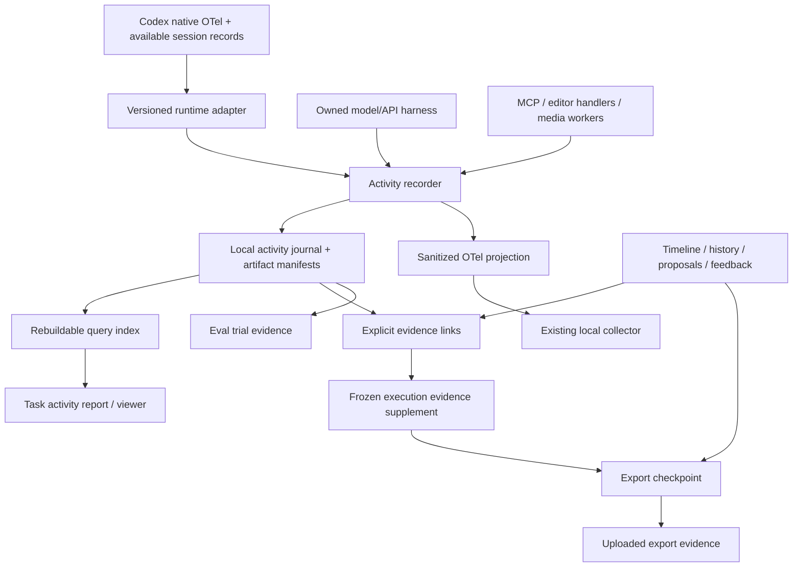

# Agent activity and editorial evidence

Status: target architecture with an initial session-capture slice, 2026-09-30. This document specifies implementation
boundaries; it does not enable capture, change retention, add a telemetry destination,
or extend mutation or learning authority. Existing behavior is described in
[observability](../observability.md), [project persistence](project-model.md).

## Implemented initial slice

A local repository-scoped session adapter now captures Codex and Claude tool requests
and results, including shell/file-change requests, redacted content, runtime-delivered
image counts and source references. It has resumable cursors, bounded event storage,
per-session reports and optional server-start lifecycle integration. See
[setup and exact limits](../observability.md#local-agent-activity-capture).

This is reconstructed session evidence, not prospective model-request instrumentation.
Claude normalization is covered by fixtures; live coverage depends on runtime versions.

Since 2026-10-10 the desktop chat also records each editing turn prospectively at the
runtime and tool boundaries: the activity journal under `profileDir()/activity-journal/`
(`desktop/activity-journal.mjs`, `src/lib/observability/activity-journal.ts`). An episode
is this design's run; `snapshots/` and `media/` are its hashed blobs; creator decisions on
proposals are `outcomes/`. See [desktop data layout](desktop-data-layout.md#activity-journal). The journal
does not yet implement artifact manifests, the timestamp accounting fix, the rebuildable
index, intermediate tuning capture or export-evidence supplements specified below. Those
remain target design. Current reports use native call IDs and source offsets, not invented task
attribution. The initial storage and retention limits are documented in the setup guide.

## Decision and purpose

Add a local activity journal that answers which capabilities an agent used, which
inputs it received, what it produced, how long it took, and which evidence is missing.
Join that journal to existing editorial records through explicit references. Do not
turn timeline history into a tool log or make tracing the source of truth for an edit.

The evaluated system is model plus harness, supplied context, tools, and editor.
Activity records support debugging and capability selection; outcome graders and
human review establish usefulness. Capturing an image proves delivery at a particular
boundary, not correct visual understanding. Full observability means documented
coverage of observable operations, not access to hidden reasoning or provider internals.

## Ownership and boundaries

| Record | Owns / question answered | Does not establish |
| --- | --- | --- |
| Timeline, metadata, media/provenance | Current composition, editable controls, source identity and rendering authority: what is the video now? | Agent effort, inspection or intent |
| History snapshots and chapters | Recoverable before/after state, operation and recorded actor attribution: what changed? | Every read, tool call, failed attempt or temporary preview |
| Proposals and resolutions | Offered options/controls, dependencies, acceptance/rejection, final applied overrides | A pending suggestion being applied; every intermediate tuning gesture |
| Feedback and review marks | Recorded direction, provenance, reasons when supplied, linked responses | Unrecorded conversation or inferred motive becoming a quotation |
| Activity journal (new) | Model/tool/media operations, input/output artifacts, failure/retry, timing and coverage: how was the work attempted? | Permission, edit authority, human satisfaction or an Undo source |
| Export checkpoint | Frozen export state and selected learning evidence at a defined boundary | Later events or live project state |
| Eval case and trial | Frozen task, allowed tools, rubric, configuration and measured attempt | An export, approval, or universal model capability |

History restoration changes the working state through the existing human-only path.
It never rewrites or deletes past execution events. The activity view shows a restore
linked to the restored snapshot, while its current outcome projection consults the
canonical proposal/history records. Ten tool attempts may produce one proposal;
one approval may produce several atomic history changes. These are not ten edits.

## Collection architecture



Three collection boundaries are necessary:

1. **Runtime boundary:** record model requests/responses when the harness owns them.
   Include exact assembled instructions/tool schema and multimodal inputs as local
   artifacts when capture is enabled. Desktop session records supply only the fields
   actually exposed by that runtime. They are a versioned compatibility adapter,
   not a guaranteed complete provider request or a new token ledger.
2. **Tool boundary:** wrap MCP dispatch and owning editor operations with context,
   start/finish/error events and artifact references. Instrument below the transport
   so direct CLI/server calls can be observed too. Keep dispatch and execution as
   separate linked spans, with one logical operation ID to avoid duplicate counts.
3. **Media/model boundary:** instrument preparation, segmentation, transcription,
   generation and verification owners. Record model/tool version, real source
   interval, settings and existing receipt IDs. An outer shell span alone cannot
   identify everything a script executed. Uninstrumented children remain opaque.

Do not infer a successful tool execution from a word appearing in a shell command.
Do not infer an entire skill was followed because its file was read. Record loaded
skill/version evidence separately from declared intent and validated behavior.

### OTel role

Use standard OTel trace/span relationships and GenAI/MCP conventions where supported;
pin the semantic-convention version and normalize provider differences in adapters.
OTel is the transport/interoperability layer, not the editorial database. The current
collector only has a log pipeline; receiving traces requires an explicit pipeline
addition. An external viewer cannot recover events the producers did not emit.
[OTel traces](https://opentelemetry.io/docs/concepts/signals/traces/) and
[GenAI conventions](https://github.com/open-telemetry/semantic-conventions-genai)
provide the common vocabulary.

Keep the current Next/Sentry provider ownership intact. Never install a competing
global provider to enable local capture. The journal recorder is independent of that
provider; sanitized export can happen in a separate process/adapter. Rich local
inputs and media references must never be forwarded through existing remote Sentry
hooks. Generic trace viewers are optional projections, not a required runtime service.

## Identity, causality and event contract

Proposed identifiers are versioned additions, not fields already accepted by APIs.

- `task_id`: one bounded user outcome; `run_id`: one agent attempt at it. A retry or
  benchmark repeat has a new run linked to its predecessor. A tool retry has its own
  attempt ID within the run. Coding, editing, and verification work have explicit roles.
- `session_id`, `turn_id`, runtime call ID: native provenance. A chat may contain
  several tasks and projects. Never charge all chat usage to its last open project.
- `event_id`, `producer_id`, per-producer sequence, schema/adapter version, source
  record reference: durable identity, deduplication and restart-safe import.
- `trace_id`, `span_id`, parent and explicit links: process/request nesting and
  asynchronous job causality. Tasks can span traces; reused artifacts can link many
  runs without pretending they were freshly computed.
- `project_id`, feedback IDs, proposal/option IDs, timeline/metadata revisions,
  transaction/history IDs, job/receipt IDs: links to the existing authoritative owners.

Runtime-to-editor context travels through validated headers or explicit CLI/job
context, then an async request context. These fields are correlation, not permission
or authenticated human identity. Persist the context in queued job records, so a
worker restart does not detach its outputs. Use existing edit attribution alongside
it; never relabel unknown historical actors as human or agent from timing alone.

Every event carries occurrence time when available, observed/ingested time separately,
status, evidence basis (`observed`, `declared`, `inferred`, `unknown`), and capture limits.
Use monotonic durations within a process. Show receipt-time fallback explicitly; do
not call it the original event time. Grouping by guessed timestamp is not causal proof.

Proposed event families:

| Family | Payload or linked detail |
| --- | --- |
| Task/run lifecycle | Scope, configuration fingerprints, start/finish/interrupted, coverage |
| Model request/response | Provider/model/runtime, actual input modalities, ordered content refs, settings, usage source, response/error |
| Tool start/finish | Logical tool, safe argument/result refs, status, child jobs, duration, retry link |
| Artifact prepared/delivered/submitted | Content identity, source mapping, recipient call and boundary confirmed |
| Verification | Question, checked revision, receipt, pass/fail/unknown and sampling limits |
| Proposal and history link | Canonical record IDs and revisions, not a competing copy of state |
| Review interaction | Control exposure, committed tuning/reset, option/session, before/after values |
| Coverage | Dropped/truncated/unsupported records, missing terminal event, unavailable content |

Consumption projections use one designated usage source per model response. Native
OTel usage remains canonical where available; session import enriches activity and
must not add its cumulative counters again. For owned API calls, designate that
adapter's terminal response as authority. Report cache/reasoning as subsets, unknown
cost as unknown, and pricing version separately. Do not sum overlapping parent and
child durations as elapsed time; distinguish waiting, compute and critical-path time.

## Multimodal and capability evidence

Represent the following states separately:

1. Source frame/clip extracted or prepared.
2. Image/audio/video artifact returned in a tool result to the runtime.
3. Artifact included in a model request, if observable.
4. Model returned a description or tool decision.
5. Independent validation or human review assessed the output.

Never collapse these into a boolean “vision used successfully.” Native multimodal
reasoning may be part of the main model call, with no separate VLM service call.
Segmentation such as SAM2 is a distinct capability and model invocation. OCR, speech
recognition, deterministic geometry, frame rendering and image generation are also
separate capability labels. Label classification inferred from legacy text as inferred.

An artifact manifest identifies content hash, media type, dimensions/duration, source
asset hash and frame timestamp/source interval, crop/resize transformation, producing
operation and consumer call. A contact sheet needs a map from its cells to source
frames; the count of image messages is not the count of inspected video frames.
Retain requested detail/resolution and actual transmitted representation when exposed.
Store video/audio source clocks separately from processing timestamps.

Desktop coverage may stop at tool-result delivery. Provider tokenization, image
resizing, hidden system context and internal reasoning may be unavailable. Show that
boundary instead of claiming exact request reconstruction. On owned API/local
runners, instrument the final request boundary. Every new runtime adapter must pass
a capability/coverage test before it is eligible for like-for-like comparisons.

## Local persistence, reliability and privacy

Proposed layout under `profileDir()/activity/`:

```text
runs/<run-id>/manifest.json       task/configuration/coverage and completion manifest
runs/<run-id>/events/<producer>.jsonl   one append writer per producer
blobs/<sha256>                   captured redacted text or diagnostic media
index.sqlite                    rebuildable search and correlation index
```

This is an append-only execution journal, not event-sourced timeline persistence.
Project records keep only validated evidence links in a versioned sidecar/extension;
existing media and receipt owners remain canonical. Cross-project runs are held at
profile level. A portable project export needs a selected evidence bundle; absolute
paths into another user's profile are not durable links.

Bound queues and artifact size. Use stable event IDs, incremental import cursors,
partial-line recovery and explicit completion manifests. Failed and interrupted runs
remain visible. Treat duplicate native and imported observations as evidence of the
same operation, not separate work. Unknown records are quarantined, not silently lost.
Capture all supported task events for evals; report any sampling or loss. An ordinary
editing operation must not fail merely because diagnostics are unavailable. An eval
with missing required evidence is `incomplete`, never a success with zero usage.

Separate local detailed capture from sanitized OTel export and from permission to
send evidence to a remote review model. Metadata mode retains IDs, capabilities and
counts; an explicitly enabled detailed mode retains redacted prompts, arguments,
outputs and referenced diagnostic media. Record excluded/truncated content. Never
capture credentials, entire process environments, unrelated conversations or hidden
reasoning. Existing session data being on disk does not authorize bulk collection.

Suggested initial limits, configurable before rollout: raw capture expires after
seven days and has a 1 GiB profile budget; pin the small evidence bundles cited by
evals or reviews until those records are deliberately removed. Prefer hash-checked
references to existing managed sources; copy ephemeral inputs only when needed and
capture is enabled. Budget exhaustion produces visible coverage loss, not silent
eviction of pinned evidence. Keep diagnostic artifact cleanup separate from source
media, history and approved-render cleanup. User deletion overrides retention pins;
leave explicit missing-evidence markers rather than retain hidden content.

## Review interaction boundary

The existing proposal resolution owns approval, rejection and final numeric overrides.
Intermediate tuning and resets need a separate durable review-interaction stream,
linked by proposal revision, option, control/actor ID and review session. Record
committed changes at gesture end, not every pointer move; record reset and exposure
separately. A shown control is not proof it was read. An untouched dial is not approval.

This fills the gap named in the [inspector audit contract](../standards/inspector-information-architecture.md#audit-tuning-and-improve-selection).
The view may combine these events with agent activity, but a creator action remains
human-attributed editorial evidence, not an agent tool call. Browser automation is
not automatically a human action. Temporary tuning does not mutate the live timeline.

## Retrospectives

Export retrospectives and skill learning are private DreamCut Cloud tooling, run manually
on uploaded export evidence; the editor no longer runs them (2026-10-24). The editor's part
is the frozen export checkpoint and its privacy-limited projection
([export evidence](../../src/lib/local-store/export-evidence.ts)). Any execution evidence
added to that packet stays bounded, cites exact event IDs and never changes preferences,
skills or the timeline on its own.

## User-facing report

Start with a read-only report per task: request and scope, linked result, capability
summary, chronological/nested operations, input/output thumbnails, errors/retries,
usage/time, and a prominent coverage statement. Filters distinguish editing, coding,
preparation and review. Expand an operation to its safe inputs, outputs and receipt.
Link history/proposal views in both directions; keep Activity and Edit history distinct.

Do not build a generic trace dashboard before validating the evidence. Later UI work
must use the editor's existing component owners and visual acceptance workflow.

## Implementation slices and acceptance

| Slice | Change | Evidence required before calling it complete |
| --- | --- | --- |
| 1. Reconstructed report | Read-only adapter for one selected runtime session; join available OTel and receipts; fix occurrence/observed-time handling | Correctly classifies text-only, image delivery, segmentation and opaque shell work; no invented request contents, project links or duplicated usage |
| 2. Durable capture | Event schema, bounded journal/artifacts, explicit task context; instrument MCP and media owners | Restart/import recovery, concurrent producers, retries, duplicate observations, recorder failure, schema changes and redaction fixtures |
| 3. Model boundaries | Owned API/local harness and versioned desktop adapter; exact exposure manifests where available | Same task distinguishes text-only, image supplied and failed image loading; two adapters report comparable fields and their gaps |
| 4. Editorial joins | Proposal/history links and committed review-interaction records | Stale/revised proposals, rejection, manual edits, reset, Undo/Redo and multi-project chats retain correct authorship and state authority |
| 5. Export evidence and evals | Frozen supplements, projection, retention pins and result links | Late events do not change a checkpoint; disabled sharing stays disabled; missing evidence stays unknown; no answer leakage into eval inputs |
| 6. Activity UI | Report navigation, evidence thumbnails and drilldown | A user can identify the input frames, model/tool, retries, controls and result without opening raw logs |

Measure recorder overhead with capture on/off, including larger image artifacts and
parallel tools; retain bounds before default enablement. Do not claim zero overhead.
Use synthetic fixtures to prove trace completeness against known expected operations,
then one explicitly scoped real task to validate usefulness. Keep model quality,
trace coverage and human acceptance as separate results.

The first implementation should be the report and adapters, with local OTel retained.
An optional off-the-shelf viewer can follow once stable spans exist; it does not own
our editorial joins, checkpoints, artifact lifetime or approval semantics.

## Implementation owners

- [MCP dispatch](../../mcp/server.mjs), [worker runner](../../src/lib/agent/worker-runner.ts), and [tool trial harness](../../scripts/lib/codex-tool-trial.mjs): capture and correlation boundaries.
- [Usage reader](../../src/lib/observability/model-usage.ts), [normalizer](../../src/lib/observability/model-event.ts), [collector](../../scripts/otel/collector.yaml): metadata/usage transport. The [native checkpoint reader](../../src/lib/observability/native-model-usage.ts) separately reconciles durable Codex session usage; never sum overlapping sources.
- [Edit attribution](../../src/lib/local-store/edit-attribution.ts), [store](../../src/lib/local-store/store.ts), [proposals](../../src/lib/local-store/proposals.ts): canonical editorial links and writes.
- [Editing memory/checkpoints](../../src/lib/local-store/editing-memory.ts), [export evidence](../../src/lib/local-store/export-evidence.ts): frozen evidence and its privacy projection.
- [Custom cutout receipts](../../src/lib/local-store/custom-cutouts.ts), [media-analysis worker](../../src/lib/media-analysis/worker.ts): examples of instrumenting actual capability execution.
- [Eval registry](../evals/README.md): case purpose/readiness; trial manifests reference activity runs without publishing private traces.
