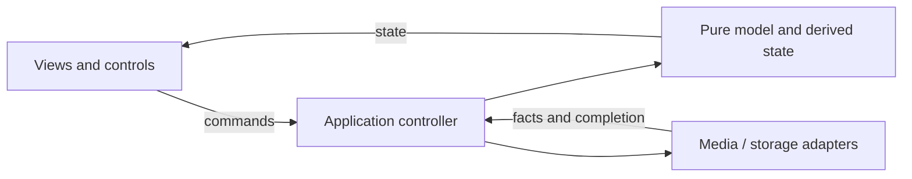

# Application layering: model, controller, view and media adapters

Status: adopted design guidance, 2026-09-29. Existing implementation is partially
aligned; this document does not claim a repository-wide refactor.

## Rationale and provenance

Make Trailer's `docs/standards/studio-architecture.md`,
`still-studio-mvc-architecture.md` and `video-studio-mvc-architecture.md` established
pure model transitions, controller-owned orchestration and thin views. DreamCut's
existing subsystem docs describe authorities, but did not state this cross-feature
layering as directly. This is a DreamCut adaptation, not a dependency on another
checkout. The private audit records the inspected revision and fingerprints.

The [research findings](../research/2026-09-29-preview-playback-architecture.md)
support separated presentation, explicit playback intent, measured readiness and
clock ownership. Our choice is a pure domain core plus application controllers and
media/storage adapters. MVC vocabulary is useful for the UI; it does not itself
specify a decoder scheduler or guarantee smooth playback.

## Responsibility map

| Layer | Owns | Must delegate |
| --- | --- | --- |
| Model | Source-time mapping, edit validation, derived composition, pure readiness/recovery decisions | React, DOM, network and persistence effects |
| Controller | User commands, async lifecycle, cancellation, revision checks, playback intent and coordinating adapters | Reusable timing/validation calculations to model |
| View | Render observable state, emit commands; local menus/focus/scroll | Business transitions, competing clocks, resource loading policy |
| Adapter | Browser media, file/API access, audio graph, renderer integration; facts/events back to controller | Editorial authority, independent timeline advancement |

## Applying the boundary

- Keep persisted timeline, temporary proposal candidate, transport state, and local UI
  state distinct. A buffering event changes transport readiness, not the saved edit.
- Normalize input once at the boundary. Preview and approval share proposal derivation;
  preview and export share source-time mapping and effect parameters.
- Controllers expose semantic commands and snapshots. Avoid views assembling raw API
  mutations or duplicating decision logic. Local visual UI state may remain in React.
- Side effects need an owner, cancellation and cleanup. Identity must survive a dial
  change, drawer toggle, rate change and temporary wait when the source remains the same.
- Browser media report readiness; one player session decides whether transport advances.
  A hidden warmer cannot declare another decoder ready.
- Extract coherent pure policies as they change; do not rename every hook or introduce
  a global store solely to conform to a pattern name.

## Current mapping and remaining work

| Responsibility | Current entry point | Status / next boundary |
| --- | --- | --- |
| Timeline commands and derived view | `useTimelineEditor.ts` | Large mixed controller; progressively extract resource orchestration |
| Edit derivation/persistence | `src/lib/agent`, `src/lib/local-store` | Shared derivation and safe-write contracts remain authoritative |
| Timing model | `src/lib/timeline`, `frame-runtime/preview-sync.ts` | Pure functions used by adapters |
| Transport controller | `frame-runtime/player.tsx`, `session.ts` | Session clock/readiness; separate explicit intent from temporary waiting |
| Media adapter | `frame-runtime/media.tsx` | Mounted decoder and source synchronization |
| Audio adapter | `timeline-preview-audio-engine.ts` | Persistent mixer; must obey the same intent/recovery rules |
| Warmup planning | `preview-warmup-plan.ts` | Pure bounded plan, separate DOM warmers; unified resource scheduler remains planned |

## Verification and rollout

Every boundary change should name its authority, inputs, outputs, lifecycle and
failure path. Test pure decisions, adapter integration and actual playback separately.
Use the [playback contract](../standards/playback-reliability.md) for timing/resource
changes and [renderer contract](../standards/renderer-contract.md) for parity.
Start with reproduced stalls, then consolidate loading ownership. A future scheduler
should prioritize actual incoming decoders, observe buffered source windows, release
obsolete work on seek and use explicit memory/concurrency budgets. Heavy-section
preview caching remains future work. No speculative rewrite or new framework is required.
