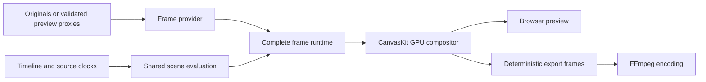

# Browser-first GPU playback

## Decision

Keep the browser editor and agent APIs as the supported interface. Browser GPU uses CanvasKit for composition; a future desktop shell can reuse the interface, project service and editing contracts. A native Rust GPU compositor is optional future work. The current Rust mode uses native decoding with browser composition.

The renderer selected beside the preview fullscreen control applies to both preview and export. Browser GPU exports through the same CanvasKit compositor and frame runtime. Standard remains the compatibility option. A failed GPU preview requires explicitly selecting and reviewing Standard before exporting; export does not silently change renderer.

## Ownership and fidelity

Scene admission checks supported properties before playback. Each frame waits for its required pictures, text and masks; incomplete packets cannot replace the visible frame. Decode samples, textures and intermediate surfaces have bounded session owners and explicit disposal. Cancellation and stale requests cannot publish into a replacement session.

Preview honors the selected proxy quality. Export resolves original source authority and waits for each output frame. Consequently preview and export share effect evaluation, but proxy resolution and final encoding may produce visible detail differences. GPU export retains authored audio through a separate PCM evaluation pass using the existing audio engine.

## Verification and limits

Regression tests cover source clocks, transforms, masks, captions, grading, transitions, frame budgets, cancellation and resource lifetimes. `scripts/verify-gpu-preview.ts` provides synthetic production-wrapper and encoded-output checks; `scripts/verify-playback-contract.ts` checks real-time transport and audio. Test receipts are local evidence, not portable performance guarantees.

Qualification depends on device, browser, codecs, ready proxies and effect combinations. Runtime capability checks remain authoritative; passing an individual fixture does not certify every combination. See [playback architecture](playback-rendering.md), [renderer contract](../standards/renderer-contract.md), [coverage](gpu-catalog-coverage.md) and [library evaluation](rendering-library-evaluation.md).
