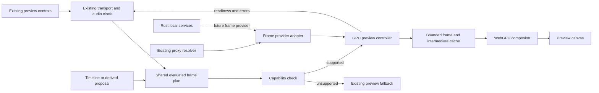
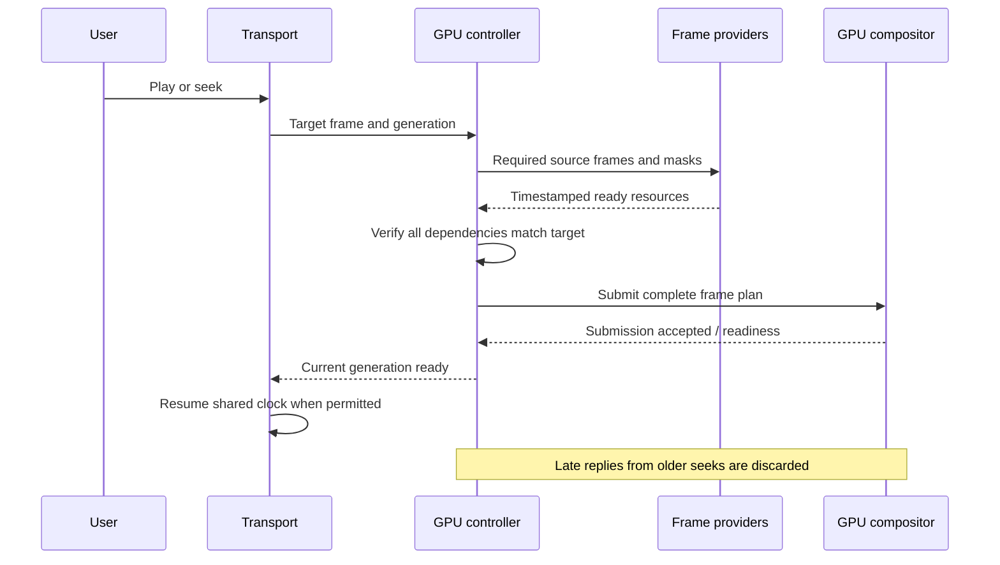
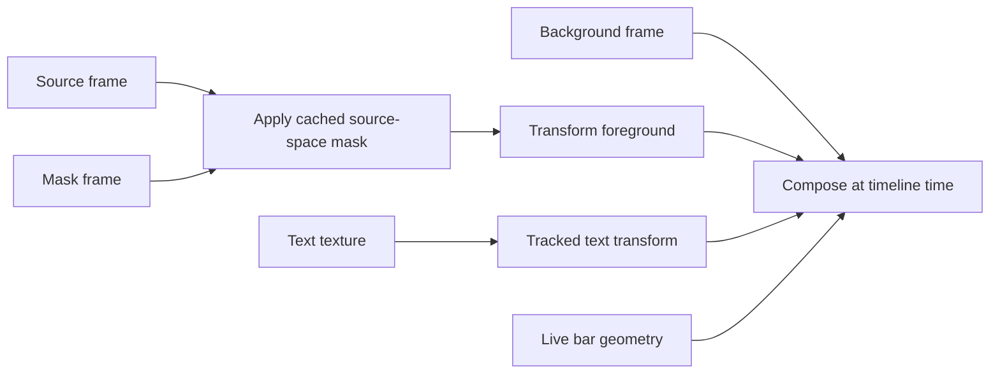

# Browser GPU preview — implementation design

The [accepted browser-first decision](browser-first-gpu-playback.md) extends this
prototype into the current end-to-end implementation goal. The evidence below
remains limited to the prototype; it does not establish full editor GPU support.
The later [matched preview/export decision](playback-rendering.md#one-renderer-for-preview-and-export--accepted-2026-10-08)
supersedes this prototype's preview-only target and independent renderer controls.
Its historical export exclusions below describe the prototype scope, not the
current product direction. The current architecture document tracks the newer GPU export implementation and its verification limits.

Date: 2026-10-06. Status: **opt-in editor prototype integrated; opt-in prototype implemented and tested; retain experimentally, no default rollout**.

This design implements a bounded browser WebGPU preview, using existing validated proxies and source-time mapping. Rust remains a local media/decode service and a possible future compositor adapter. This is **not** a complete Rust GPU engine or an export rewrite.

Background: [research findings](../research/2026-10-05-granular-preview-cache.md), [granular-cache investigation](granular-preview-cache-proposal.md), [current playback architecture](playback-rendering.md). The [renderer](../standards/renderer-contract.md), [playback](../standards/playback-reliability.md) and [proxy](../standards/preview-proxy-contract.md) contracts remain authoritative.

## Current acceptance ledger

This ledger summarizes evidence; the measured report below states coverage and limits.
The bounded prototype and acceptance experiments are complete. Earlier latency misses
and rollout limits are retained below; completion does not mean default promotion.

| Requirement | Current evidence | Limits and follow-up |
| --- | --- | --- |
| Real editor, unchanged defaults/timelines | Gear integration; independent control/layout review; unchanged timeline hashes in final read-only trials | No default rollout |
| Shared sources, timing and sound | Validated proxy resolver and revision invalidation; shared picture timing; GPU audio proof in clip and separate-track modes | Standard/GPU shared playback gates pass; subjective listening remains separate |
| Ball masks, bars, tracked text, transforms | Current 72-frame raw and encoded reference proof after shared drawing correction; seek identity | Bounded support only, not all effects |
| Atomic frames and bounded caching | Source-interval packet checks; stale generation, eviction pressure and cancellation tests | Network, codec, timeout and five replacement mounts now pass; total device-memory cleanup unmeasured |
| Unsupported fallback | Both other project copies; unavailable WebGPU; device loss during active playback | Limited integration coverage, not all-effects support |
| Warm latency targets | Final GPU p95 83.3 ms Play / 62.5 ms seek, 20 samples | Final sample meets targets; earlier seek miss and playback holds remain documented |
| Cold preparation, resources and stalls | Final GPU and Direct: five fresh browsers each, matching Full HD proxy hashes; GPU navigation p95 1.64 s | Smart five-run comparison complete with cached movies; resource limits documented below |
| Intermediate-cache/ROI decision | Byte-bounded decoded frames and reusable text textures; resource wait dominates measured CPU submission | 30 raster and 20 paired submission samples complete; defer ROI implementation |
| Required repository gates | Renderer: 46 effects, six transitions, 138 encoded frames plus tracked-surface proof; final code check: 2,147 pass / five skipped | Final code, UI and shared playback gates pass; native PR review/publication is separate |

## Outcome and scope

Pressing Play on a supported, ready-proxy edit should display live composed frames without preparing an encoded movie. Text, transforms and bar timing remain immediately adjustable. Cache reusable masks and other expensive intermediate results rather than automatically flattening every animated interval.

First target: opaque footage plus a synchronized foreground mask/cutout, basic transforms and opacity, rectangular bars, and tracked text. Include the timing actually used by the ball treatment, such as holds and existing speed mapping, through shared helpers. Synthetic fixtures establish support first; the real ball project is a later read-only acceptance case. Additional projects test ordinary footage and fallback behavior.

Out of initial scope: all effects, all blend modes, HDR, a general tiled renderer, segmentation during playback, automatic quality degradation, native GPU surfaces, and changing export output. Unsupported content must produce an explicit capability result and a whole-preview fallback, never disappear silently.

## Current versus proposed path

```mermaid
flowchart TB
  subgraph Current[Current prepared preview]
    A[Timeline and validated proxies] --> B[Browser or Rust source decode]
    B --> C[Browser composition]
    C --> D[Screenshot each frame]
    D --> E[Encode and assemble preview movie]
    E --> F[Decode movie and display]
  end
  subgraph Proposed[Proposed supported live path]
    G[Same timeline and validated proxies] --> H[Shared frame evaluation]
    H --> I[Bounded source frame queues]
    I --> J[GPU textures and cached mask or text]
    J --> K[WebGPU composition]
    K --> L[Display complete frame]
  end
```

The proposed path removes screenshot capture and movie encoding from ordinary interactive presentation. GPU readback is reserved for test comparisons and diagnostics. It does not promise zero-copy decoding; measure texture upload and copies on the actual device.

## Ownership and integration

One transport owns play intent, pause, seek, timeline position and recovery. The existing audio mixer remains the sound owner; the compositor never starts another soundtrack. Decoder queues and GPU completion report facts to that controller. Neither React rerenders nor a decoder callback independently advances the timeline.

Use the real editor's `TimelinePlaybackShell` for selection and lifecycle. Add an opt-in **GPU preview · Test** choice inside the existing gear settings; label it as a preview renderer, distinct from the source decoder. GPU mode uses its declared frame provider rather than implying the Rust selector controls it. Show a concise fallback reason and the effective renderer. Preserve saved default preferences and provide one-step return to the existing mode. Read the UI skill/component map before implementing these controls.

Keep the preview canvas stable across transport updates. React owns mounting and observable controls, not per-frame DOM reconstruction. Worker/offscreen use is capability-tested; an unsupported worker configuration may use a supported main-thread GPU adapter, but must be identified in benchmark receipts.

### Current prototype modules

These are the implemented ownership boundaries. Integration is experimental;
module existence does not establish the acceptance criteria below.

| Owner | Responsibility |
| --- | --- |
| `src/lib/timeline/media-picture-plan.ts` | Shared trim, speed-section and picture-hold evaluation |
| `src/lib/gpu-preview/scene.ts` | Complete-scene admission and supported frame/layer evaluation |
| `src/lib/gpu-preview/runtime.ts` | Decode, cache and compositor orchestration; transport readiness |
| `src/lib/gpu-preview/frame-controller.ts` | Current-generation, complete-frame packet ownership |
| `src/lib/gpu-preview/source.ts` | Existing verified proxy resolution and source identity |
| `src/lib/gpu-preview/browser-frame-provider.ts` | Bounded demux/WebCodecs source queues and release |
| `src/lib/gpu-preview/scene-draws.ts` | Validate all dependencies and prepare ordered draw commands |
| `src/lib/gpu-preview/compositor.ts` | WebGPU pipelines, textures and complete-frame submission |
| `src/lib/gpu-preview/frame-store.ts` | Byte-bounded decoded-frame cache with pinned leases |
| `src/lib/gpu-preview/text-raster.ts` and `text-cache.ts` | Shared-layout text rasterization and reusable glyph textures |
| `src/components/studio/timeline/GpuPlaybackComposition.tsx` | Stable canvas lifecycle and existing session readiness adapter |

Do not duplicate the timeline evaluator wholesale. Extract supported operation evaluation incrementally and make the existing path consume the same helpers where practical. Anything whose timing or visual semantics cannot yet be represented is unsupported. Export continues through its current implementation and provides a parity reference.

## Contracts

### Evaluated frame plan

Each immutable plan contains a revision/scene identity, seek generation, timeline frame/time, output dimensions, quality/color policy and ordered draw operations. Operations carry source content identity, stream identity, source presentation timestamp, transform, opacity, mask binding and dependency fingerprints. Text includes measured layout, font identity and tracked transform from the existing owner.

Use integer frame indices and rational time conversion at boundaries. Source selection follows presentation timestamps, including variable-frame-rate input; do not assume timeline frame N means source frame N. Reuse the current trim/rate/freeze mapping rather than inventing a second ramp model.

### Frame provider

A provider accepts source-window requests with priority and cancellation. It returns frames with their actual timestamp/duration, source identity, generation, color/alpha metadata, byte estimate and explicit release method. A request is satisfied only by the frame covering the authored source time under the declared sampling rule.

WebCodecs needs demuxing and seek indexing in addition to decoding. Select an existing compatible demux library after dependency/license review. Start decoding from the required keyframe, retain frames needed for imminent playback, and close discarded frames. Validate codec/configuration support before admitting the scene. Do not assume native alpha WebM support: use a verified mask-plus-RGB provider or explicitly fall back. A generic HTMLVideoElement snapshot does not establish exact frame ownership.

### GPU composition

Initial operations: textured quad, solid rectangle, ordinary opacity, normal alpha blend, mask sampling and tracked text texture. Preserve aspect fit, rotation, lane order, pixel geometry and existing source color interpretation. Specify straight/premultiplied alpha at every boundary; test colored transparent edges to catch halos. Start with the editor's SDR policy and make unsupported color modes explicit.

Font/layout readiness is a resource dependency. Rasterize text through the existing layout authority into a reusable texture; changing its transform must not rerasterize glyphs. A tracked quad needs the correct projective mapping, not a bounding-box approximation.

A new GPU backend necessarily has separate shader execution. Shared evaluated parameters plus pixel/encoded-reference tests establish parity; sharing a scene schema alone does not prove matching output.

## Complete-frame presentation and seeking

Warmup should prepare source frames and resources, not an encoded composition. Start with a small configurable internal look-ahead budget (for example 0.5 seconds), bounded by bytes and decoder capacity; tune from measurements rather than exposing another user dial.

Before initial Play or a seek, gate the shared transport on the actual resources and a complete current-generation frame. During playback, select all layers for one clock-derived target. Never combine a new foreground with an old background. If a complete frame misses its deadline, repeat the previous whole composite briefly; on a sustained miss, enter the existing coordinated wait state so audio and picture pause together. Define and test the transition threshold before rollout. Dropped/repeated frames must be counted, not hidden by an advancing playhead.

GPU submission, decode completion and screen presentation are distinct measurements. Keep submission timings separate from observable frame presentation; record the measurement method and its limits. Device loss clears invalid GPU handles and pauses playback. Recovery or fallback must resynchronize the same playhead and audio ownership before resuming.

## Granular cache and invalidation

| Change | Invalidate | Preserve when dependencies match |
| --- | --- | --- |
| Text content/font | Text texture and final composite | Video decode, source mask |
| Foreground position/scale | Transform evaluation and final composite | Source-space mask and decoded frame |
| Bar timing | Bar geometry and final composite | Mask, text texture, decode |
| Mask correction | Affected mask frames and downstream composites | Unchanged source RGB and unrelated intervals |
| Source/proxy replacement | Dependent decoded frames, masks and outputs | Unrelated sources |
| Seek or timing change | Pending generation and affected source-time selections | Valid content-addressed cached frames |

Cache keys include implementation version, relevant parameters, upstream fingerprints, timestamps, dimensions, quality and color/alpha conventions. Omit unrelated downstream properties from upstream keys. Bound RAM and estimated GPU memory, evict away from the active/look-ahead window, and release frames/textures explicitly. Avoid unbounded decoder creation for layered timelines. Initial budgets are experiment parameters recorded in receipts, not performance guarantees.

Spatial ROI is phase two: process a node's actual bounds plus declared support borders and inverse-transform input regions. Preserve full-region fallback for unknown support. A scissor rectangle alone is not evidence of reduced decode/effect work. Only retain ROI complexity if end-to-end measurements improve without clipped blur, mask or motion edges.

## Implementation milestones

1. **Baseline and contracts.** Reproduce existing failures, record per-stage costs, define frame-plan/provider/capability contracts, add pure timing and invalidation tests. Preserve failure receipts.
2. **Small GPU path.** Decode a validated opaque proxy, draw transforms/bars on a stable canvas, connect the real transport, test seeks and cancellation. Add bounded demux/decode queues and cleanup.
3. **Masked/tracked composition.** Add explicit mask frame pairing, cached text textures, existing tracked geometry and supported holds/rates. Prove source and layer timing against synthetic encoded references.
4. **Editor integration.** Add the experimental gear option and explicit fallback. Verify no double audio, no timeline mutations, persistent pause/play intent, and correct behavior without WebGPU.
5. **Performance experiments.** Compare direct, current Smart cache, live GPU and GPU with intermediate cache at identical source/quality. Add ROI as a separate ablation only after node-cache measurements.
6. **Acceptance report.** Test the ball treatment plus ordinary/animation-heavy project copies, record support coverage and failures, and decide retain/revise/reject. Do not promote the default automatically.

Implementation should stay in the existing isolated worktree if still suitable. Recheck branch, dirty work and server/storage roots before starting; do not overwrite ongoing edits or migrate user projects as part of the prototype.

## Tests and benchmark acceptance

Performance thresholds below are **targets**, not promises or current results:

| Measurement | Exploratory target |
| --- | --- |
| Play click → first new presented frame, already-open ready-proxy project | p95 ≤500 ms |
| Cold project open → first presented frame, proxies already available | p95 ≤2 s; report navigation and initialization separately |
| Warm seek → correct presented frame | p95 ≤100 ms |
| 30 fps critical processing path | p95 ≤33.3 ms; also report worst case and deadline misses |
| Playback fixture | No pause >250 ms; report repeated/dropped frames and real duration |
| Frame identity | No stale-generation or mixed-time composite |

Use at least 20 warm interactions and five isolated cold runs for an exploratory report, retain all samples, and state that this is not a release-grade tail-latency study. Record hardware/browser, effective adapter/provider, proxy hashes, raster, scene hash, cache state, budgets, first-play preparation, CPU/memory and GPU timing where actually available. Do not compare a lower-resolution candidate against a higher-resolution baseline without labeling it.

Required automated coverage:

- Timestamp selection, cuts, variable frame rate, trim, holds, authored rate changes and backward seeks.
- Same source requested by multiple layers; decoder reuse without incorrect time sharing.
- RGB/mask alignment, lane order, glyph/layout readiness, projective text, alpha edges and color.
- Late decode after seek, edits during playback, cache eviction, source replacement, unsupported effect, codec failure, GPU loss and repeated mount/unmount cleanup.
- Assert supported GPU trials issue no prepared-movie request; assert fallback trials identify their fallback and are excluded from GPU-only timing.
- Existing renderer/playback gates, affected family pixel proofs and real encoded synthetic reference comparisons. Export fixtures only; no user-project export is implied.
- `pnpm check:pr`, `pnpm verify:renderer`, `pnpm verify:playback`; UI changes also require `pnpm check:editor-ui`, typecheck and actual visual/interaction acceptance. New instruments follow the tool-authoring contract.

Review actual continuous playback at entry/exit, top-of-turn text, freeze/release and seeks. Stills and playhead advancement alone cannot prove smoothness or audio sync. Keep known legacy failures distinct from new regressions; unexplained failures remain rollout blockers. Use shared timing and current strict audio thresholds rather than relaxing them for this backend.

## Completion and decision

The goal is a working opt-in prototype, reproducible tests and a measured recommendation—not an assertion that all effects are now GPU-backed. Completion requires the real UI integration, supported-path correctness evidence, explicit unsupported coverage, repeatable performance receipts and documented remaining limits. If latency targets are missed, report the measured bottleneck and next decision rather than calling the target achieved. Default rollout requires a separate decision after acceptance.

## Future Rust desktop integration

A future Rust compositor may implement the same declarative frame plan and provider semantics, with shared conformance fixtures. Rust and TypeScript share serialized contracts and tested semantics, not an in-process abstract class. Desktop-native decode-to-texture and presentation need a separate platform design; avoid making raw RGBA-over-HTTP the permanent bridge. Nothing in this prototype requires replacing the React editor UI or changing saved timelines.

## Measured acceptance report

The prototype remains opt-in. Retain it for the supported composition family;
it is not ready for default rollout or a claim of faster playback across the
editor. Unsupported compositions use an explicit whole-preview fallback.

### Correctness and recovery

- The synthetic GPU comparison passes all 72 frames against the current standard
  renderer: maximum per-frame mean error 0.171/255 raw and 0.583/255 after encoding.
  Repeated out-of-order seeks preserve byte-identical pixels; text visibility and
  meaningful nonempty output are asserted. This fixture is 320 × 320, not an
  exhaustive high-resolution or cross-device pixel study.
- The shared renderer gate passes 46 effect cases, six transitions, 3D and 138
  encoded frames, plus the tracked-surface proof. Preview and export now share
  ordinary-video canvas sampling and source-primary interpretation.
- Standard and GPU synthetic playback pass embedded and separate-track audio,
  source-clock drift, repeated plays, random seeks and encoded timing/audio checks.
- The GPU lifecycle instrument verifies failed downloads, invalid codec bytes,
  the real 30-second frame timeout, successful replacement sessions, and five
  repeated mounts/seeks. Timeout retires the failed runtime before closing work,
  preserving the original failure instead of replacing it with a closed-runtime
  error. This does not measure total device-memory reclamation.
- Real-editor probes verify unsupported-content fallback on two additional
  read-only projects, unavailable WebGPU, and active-playback device loss followed
  by standard playback. Those are retained integration observations; they are not
  an all-effects or all-platform guarantee.

### Matched-quality performance

Five fresh-browser trials and twenty warm interactions use matching validated
proxy bytes at the same Full HD setting. Timelines are unchanged. Server disk
caches are retained: “cold” means a fresh browser, not deleted media/preparation
caches. Measurements use Chrome 154 on Apple M5 Pro with 48 GiB RAM.

| Measurement | Direct | Smart (movie cached) | GPU prototype |
| --- | ---: | ---: | ---: |
| Warm Play p95 | 81.6 ms | 133.0 ms | 83.3 ms |
| Warm seek p95 | 80.3 ms | 44.7 ms | 62.5 ms |
| Fresh navigation to motion p95 | 3.31 s | 1.54 s | 1.64 s |
| Observed playback gaps over 250 ms | 0 | 0 | 0 |
| Prepared movie requests | Not applicable | 5 ready-cache responses | 0 |

The final GPU sample meets the 500 ms warm Play, 100 ms seek and two-second
navigation targets. An earlier matched-quality GPU run measured 82.0 ms Play,
105.3 ms seek and 3.03 s navigation: keep those misses as evidence of variability.
The final rerun followed the allocation guard; these non-randomized runs do not
isolate its causal effect or establish a general speed advantage over Direct. The tested GPU benefit is complete same-time layer submission
without preparing an encoded movie. Warm seek includes automation acknowledgement;
no estimated overhead is subtracted to claim a pass.

GPU decoded-frame plus text-cache accounting peaks at 255.3 MiB. After removing
identical presentation observations within each run and excluding frame-zero
initialization, 560 observed presentations have resource-wait p95 20.2 ms, CPU
submission p95 0.7 ms, and combined p95 20.5 ms. Seven exceed 33.3 ms, with a
worst combined time of 40.5 ms. This observed subset does not prove every scheduled
frame was physically displayed.

CDP page TaskDuration at the end of cold playback ranges 2.06–2.18 seconds for GPU
and 2.98–3.11 seconds for Direct. JS heap snapshots range 241.5–261.6 MB and
185.6–205.1 MB respectively. Click-to-last-frame elapsed time ranges 3.83–3.91 seconds for Direct, 3.81–3.97
seconds for cached Smart, and 4.25–4.33 seconds for GPU on this approximately
3.77-second fixture. Even after first-motion delay, GPU takes 3.92–4.01 seconds
to traverse the remaining picture. Small readiness holds therefore still stretch
playback; zero observed gaps over 250 ms does not mean uninterrupted real-time
30 fps. All 113 possible GPU frame indices were observed in every final trial. These
submission observations still do not prove physical monitor presentation. This remains a rollout limitation.

These page metrics include initialization and do not measure
all process/device memory. Actual GPU execution and physical display timing are
not measured. GPU frame intervals are certified; Direct observations alone do not
certify atomic cross-layer presentation.

Smart completed five fresh-browser trials and twenty warm interactions with all
movie responses already cached. Its CDP TaskDuration ranges 1.59–1.67 seconds and
heap snapshots 183.9–209.2 MB. It meets all three startup/seek targets in that
cached condition. Earlier preparation after cache invalidation took approximately
23 and 58 seconds; these are separate observations, not a five-run uncached p95.
Earlier attempts also retained 255–293 ms stalls and one ready-job/no-motion
failure, so the final clean sample does not establish universal reliability.

Harness races with automatic end-of-playback and browser cleanup were corrected
without changing playback metrics. Final Smart trials report no cleanup warnings
or screenshot failures. Failed attempts remain in ignored local evidence. The
text-cache ablation is complete: 30 identical-raster samples show p95 0.2 ms
when rerasterizing versus below the browser timer resolution when reusing the
48,960-byte texture. Pixel hashes are identical. Fonts and the browser image cache
are warm in both conditions. Twenty paired full GPU submission/queue-completion
samples give p95 1.6 ms without text-intermediate reuse versus 1.0 ms with reuse.
Source frames stay cached; resolution is 320 × 320 and order is fixed uncached
then cached. This supports keeping the small text cache, not a claim of an
end-to-end editor speedup or evidence for spatial ROI.

### Spatial ROI decision

Defer spatial tiling/region-of-interest implementation. Measured source readiness
and decoding dominate CPU command submission on this fixture. This is an inference
for prioritization, not proof that GPU rendering is free. Measure actual GPU work
and larger effect families before adding tile invalidation, support borders and
seam complexity. Text/frame intermediate caching is implemented; spatial ROI
acceleration is not implemented or claimed.

### Reproduce and interpret evidence

Use an isolated local editor and project root, following the renderer contract.
The registered GPU verifier writes synthetic pixel/encoded and cache-ablation
receipts under `testing/results/gpu-preview/`. The playback verifier supports
`--gpu` (also `--mixed`) and `--gpu --gpu-lifecycle`; standard playback runs through
`pnpm verify:playback`. Read-only comparison trials use the registered
`benchmark-preview-playback` instrument with `live`, `selective` or `gpu` mode.
It verifies unchanged timeline hashes and source bytes. Private project identifiers,
source bindings, screenshots and experiment diaries stay in ignored local storage.

Known limits: one tested hardware/browser family, bounded supported effects,
no subjective listening certification, no total-device memory or GPU execution
measurement, and earlier cold-open/seek misses plus remaining small playback holds. Existing prepared and standard
paths remain available. No default promotion or user-project export is implied.

### Final validation and next decision

`pnpm check:pr` passes after the timeout-recovery fix (2,147 tests passed, five
skipped), including tool inventory, typecheck and effect validation.
`pnpm check:editor-ui`, the shared renderer gate, standard embedded/mixed playback,
GPU embedded/mixed playback, GPU lifecycle recovery, and the final GPU encoded/
cache proof pass within their stated coverage. The full code-check attempt before
this final run had an unrelated temporary-directory cleanup failure in the waveform
test; isolated and final full reruns pass, and that failure is retained locally.

Independent visual acceptance verifies the gear controls, GPU/quality selection,
keyboard opening/closing, and tall/wide menu fit at 1280 × 720 and 800 × 720.
Playback/seek observations and the real-editor benchmark complement that UI check.
No source, timeline or saved default was changed by the read-only trials. Changes
remain in the isolated development worktree; this is not a merge or PR-readiness
claim.

Next engineering priority: reduce source-ready waits and small transport holds,
measure high-resolution and cross-device behavior, and improve invalidation/startup
costs for prepared previews. Keep the architecture/provider contracts and small
intermediate cache. Defer spatial ROI and a native Rust compositor until those
measurements identify work they can materially remove.

The final allocation audit added a 128 MiB estimated budget for retained RGBA
upload canvases plus GPU copy textures, and a 64-active-layer cap. The compositor
rejects over-budget pictures before allocating/submitting them. Removed, resized
and newly external-video slots retire their obsolete surfaces before replacement.
This is separate from the 256 MiB decoded-frame and 32 MiB text-raster budgets;
driver overhead is not included. Two focused allocation/pruning tests, typecheck, the 72-frame encoded proof
and the five-run/20-interaction editor benchmark pass after this code change.
The final repository suite passes: 2,147 passed, five skipped, zero failures.
