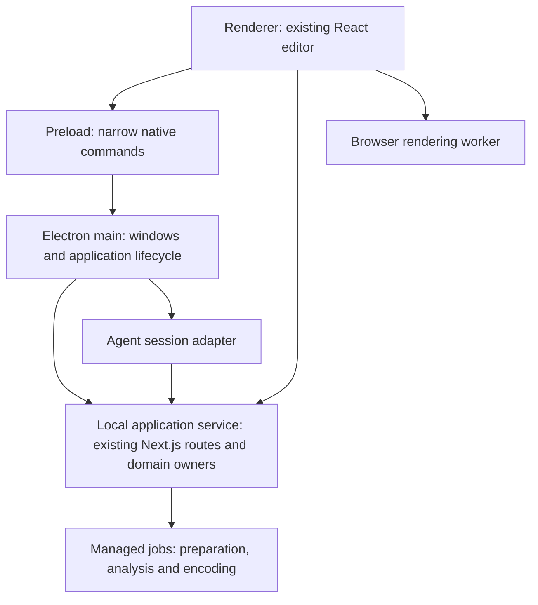

# DreamCut desktop application plan

Status: direction accepted 2026-10-08; development shell implemented, migration in progress. This document owns
migration scope and acceptance. It does not announce an available installer.

## Current progress

See the [requirement-by-requirement acceptance audit](desktop-app-acceptance.md) for
remaining work and the limits of each verification result.

The arm64 local qualification package runs the retained Next.js/React editor in
Electron 44.7.0 with an authenticated, app-managed loopback service. This remains
an unsigned local build, not a published installer or completed migration.

| Area | Evidence established | Remaining acceptance |
| --- | --- | --- |
| Shell and packaging | Production build, packaged service/proposal checks, bundled media-tool execution; source and symlink audits | Clean Mac without checkout/system Node, native opening across workspaces, optional-analysis readiness, write/offline cases |
| Playback | Computer-use play/pause/seek/replay/end checks on two existing projects with unchanged timelines; relocated packaged audio-mixer contract | Audible output/sync, fallback seek warning, matched renderer/export fixtures, performance measurements |
| Jobs and recovery | Managed worker interruption, service/main-host crash cleanup and preparation retry fixtures | Remaining nested launches, global concurrency, sleep and native recovery experience |
| Codex | Installed discovery, restricted session, text streaming/resume/cancel, pending proposal with unchanged timeline; synthetic image recognition with explicit output-emission instructions | Native chat acceptance, old journal/new conversation recovery, broader visual editing, concurrent-human-edit and failure qualification |
| Updates | Signing/notarization configuration, version/channel metadata, native manual-update owner and failure/shutdown tests | Actual signing/notarization and staged two-version install/data-preservation test; maintainer credentials/feed and media distribution prerequisites |
| Development and observability | Desktop development entry point and authenticated React/CSS rebuild transport fixture; opt-in/redaction tests and real main-process SDK and compiled service-hook capture through local collectors | Native visual React/CSS refresh/state retention and main/preload restart evidence; renderer capture, actual service-route triggering, remote ingestion and delivery limits |

The latest desktop suite has 73 passing tests; focused checks and package receipts
are recorded below. Unit tests are not native visual, audio, clean-install or signed
update acceptance. Computer use most recently reported the Mac locked; independent
engineering continues, while the blocked native interactions remain unverified.
See the [development workflow](../development-workflow.md) for commands and external
release prerequisites. The detailed progress record below preserves narrower test
scope and known failures; this table does not supersede the full phase requirements.

## Deferred workspace exploration

After desktop qualification, explore the creator's concern that opening bottom
Properties moves the timeline and that multiple sliding surfaces compete for space.
This is a request to compare interactions, not an approved layout change.
Compare a persistent right inspector, a bottom overlay and the current layout during
real editing. Consider a left navigation rail for switching workspace sections.
Selection should be able to update properties while a deliberately minimized panel
stays minimized. Evaluate whether preview and timeline remain usable for timing,
transitions and sound adjustments, alongside simple appearance changes. Let the
creator try the alternatives before choosing; do not fold this redesign into the
desktop migration acceptance criteria.

## Outcome and scope

Deliver a macOS-first Electron application that opens the existing DreamCut editor,
projects and managed media without requiring the creator to start a terminal server.
Keep the React interface, Next.js application services, file-backed project format,
proposal review and owned rendering runtime. Preserve browser development.

macOS is the first qualification target; CPU architectures must be explicitly listed
with each build. Windows and Linux are follow-up targets. The first delivery is a
locally reviewable packaged build; publishing a release requires a separate release
decision. Signing, notarization and update hosting depend on maintainer credentials
and infrastructure and must be reported separately from local build readiness.

## Decisions and current evidence

| Area | Current implementation | Desktop direction |
| --- | --- | --- |
| Interface | React, TypeScript, Tailwind and Next.js | Reuse the interface in an Electron window; retain Next.js initially |
| Rendering | Browser GPU worker, OffscreenCanvas, CanvasKit and browser decoding; Standard fallback | Preserve the selected compositor for preview and export; qualify inside packaged Chromium |
| Audio | Persistent media-element/Web Audio mixer | Retain initially; measure scheduling, seek recovery and underruns before considering AudioWorklet |
| Preparation | Local media preparation queue and spawned worker | Adapt lifecycle and resource paths for packaging, then consolidate background-job ownership |
| Persistence | File-backed projects, catalogs, history and safe-write layer | Preserve formats, locks, revisions, provenance and existing path overrides |
| Agent access | Existing editing tools and harness work | Add installed-Codex discovery and a supported session adapter; reuse application-owned editing capabilities |
| Distribution | Repository development workflow | Add Electron packaging, native integration, signing support and update infrastructure |

Source owners include `src/lib/gpu-preview/worker-client.ts`,
`src/lib/gpu-preview/worker.ts`,
`src/components/studio/timeline/timeline-preview-audio-engine.ts` and
`src/lib/local-store/media-preparation.ts`. Presence of code is not a packaged-runtime
performance result. Record tested Electron/Chromium, OS, architecture and codec
versions with qualification evidence.

Vite is a possible later simplification, not a requirement for the first desktop
build. Switching would require moving server routes into an application service.
AudioWorklet, a native compositor, a new state library and a new project database
are outside the initial migration. Adopt them only for a demonstrated requirement.

## Process ownership

The main process owns windows, native dialogs, project-open events and child-process
lifecycle. It must remain responsive while media work runs. The renderer retains
ordinary web privileges. A typed, validated preload bridge exposes bounded native
operations; it does not expose arbitrary shell execution or unrestricted filesystem
access to page code.

The packaged application service binds only to loopback on an app-managed port.
Define authentication, allowed origins, request validation and startup handoff for
that service. Loopback alone is not an authorization boundary. Authenticate media
and worker requests as well as mutations without leaking secrets into URLs or logs.
Preserve existing safe-write, stale-revision and proposal approval enforcement at
its owning layer. Restrict external navigation and open approved links through the
system browser rather than a privileged application window.

Choose an explicit supported Node execution strategy for the service and jobs.
Do not assume an installed Node, package manager, developer checkout or arbitrary
Electron `process.execPath` behaves like the current development Node executable.
Bundle runtime assets and qualified media binaries outside writable project data;
resolve resources independently of the process working directory and ASAR layout.
Store mutable data in durable user locations, preserving configured existing roots.

## Delivery sequence

### 1. Development shell and compatibility baseline

- Add Electron main/preload/build configuration and a documented desktop development
  command. Select and pin packaging tooling after checking compatibility with the
  retained Next.js server; do not make a Vite frontend migration incidental.
- In development, load the existing local development server. Manage only processes
  started by the desktop command; do not terminate an independently running server.
- Establish an isolated synthetic project fixture and record browser behavior before
  comparing the desktop window. Preserve unrelated working-tree changes.
- Verify React/CSS refresh in the running window, main/preload restart behavior,
  server startup failure, window close/reopen, and clean shutdown.

Exit evidence: runnable desktop development window; readable startup failures;
existing project open and preview work; no unintended project migration or edits.

### 2. Packaged application and native project access

- Package the production Next.js service and traced resources, runtime, fonts,
  CanvasKit/WASM, worker bundles and FFmpeg/FFprobe dependencies actually required.
  Inventory optional Python/model analysis dependencies and expose their readiness;
  missing optional analysis must not prevent basic project opening.
- Add native project/media selection using existing import and project controllers.
  Keep import separate from timeline placement. Preserve hashes and provenance.
- Handle application launch, second-instance/project-open requests, port collision,
  service health, failure recovery and orderly termination.
- Preserve existing project/profile/catalog locations; any necessary migration must
  be explicit, reversible and backed up. Updates must not replace user data.

Exit evidence: packaged app launches without the repository, system Node or package
manager; opens a fixture, imports media, previews it and reopens after restart.
Verify spaces/non-ASCII paths, missing media, offline local editing, and write errors.
Record which optional analyses require additional installation.

### 3. Managed background services

- Adapt existing preparation and analysis jobs before introducing another queue.
  Give jobs stable IDs, bounded concurrency, progress, cancellation and retry states.
- Move heavy library work to a managed service/utility process where needed. Preserve
  single ownership of project writes and cache invalidation across all clients.
- Define behavior when a window closes, the app quits, a job crashes or the machine
  sleeps. Resume only supported idempotent work; keep partial results distinguishable.

Exit evidence: import and analysis do not block navigation or playback; cancellation,
relaunch and crash recovery preserve originals and do not duplicate catalog entries.
Compare UI responsiveness and resource use on the same fixture before/after changes.

### 4. Installed Codex integration

- Inspect the installed CLI and current official integration documentation; choose
  a supported session interface after testing readiness, streaming, resume and cancel.
  Discovery includes explicit override and known install locations, with clear
  missing, signed-out and incompatible-version states.
- Reuse application tools and the existing harness; provide selected media, marks,
  playhead, project revision and pending generation target as explicit context.
- Keep session identity, project identity and audit correlation distinct. Define
  enforced tool/filesystem authority; prompts alone do not protect working projects.
- Preserve human proposal decisions and generation approval. Do not read or copy
  credential stores merely to detect login; use supported status/authentication flows.

Exit evidence: a disposable fixture receives one reviewable proposal through the
existing contract; cancel/resume, stale revision, concurrent human edits, missing
login and child-process failure behave predictably. No agent self-approval or direct
working-timeline mutation. Follow the [harness standard](../standards/agent-harness-authoring.md)
and [tool standard](../standards/tool-authoring.md).

#### Claude provider (implemented 2026-10-09, qualification pending)

The composer offers Codex or Claude plus that provider's model list; one global
choice is remembered. Each provider keeps separate ownership, journal, reset and
archive records under userData (Codex keeps its original paths and journal pin).
Both route tool calls through the same journaled, scope-checked editing bridge.

- Claude runs through `@anthropic-ai/claude-agent-sdk` (pinned) using the creator's
  existing Claude Code sign-in. When Claude is signed out, the chat offers *Sign in
  with Claude*. `desktop/agent-login.mjs` runs `claude auth login --claudeai`, which
  opens the browser and usually finishes on its own. If it can't, the creator pastes
  the code from the printed sign-in page. DreamCut checks the code's state against
  that page, sends only that code to the CLI's stdin, and never reads or stores
  credentials; they stay in Claude Code's store. One sign-in runs per host, through
  the `login` chat action, and API credential variables are stripped from its
  environment.
  Discovery prefers an installed `claude` (`--version`, `auth status`) and falls back
  to the SDK's bundled copy in development. Packaged builds exclude the ~220 MB bundled
  binary for now, so they require an installed Claude Code.
- The session has no built-in tools, `settingSources: []`, `strictMcpConfig`, a
  `dontAsk` permission mode with only `mcp__dreamcut__*` allowed, and one in-process
  MCP server backed by the shared bridge. It runs from an empty host-owned working folder.
  Startup refuses API-key credential sources, and API credential variables are removed
  from the environment so usage stays on the subscription. A first message that loads
  any other tool or server disconnects before work continues.
- The picker lists models without opening a conversation (`desktop/agent-models.mjs`): Claude Code's `initializationResult()` with no prompt, and `codex debug models`, cached per host, so a window never takes a project's lease just to show models. Only the focused window auto-connects. A live session's list stays authoritative; switching uses `setModel()`.
- Model list and switching use `initializationResult()` and `setModel()`. Resume uses
  the saved session ID, and replayed history shows visible text only. Stop uses `interrupt()`.

The browser editor uses the same owners. `desktop/chat-controller.mjs` is the
host-neutral controller behind both Electron IPC and the local web routes
(`/api/agent-chat/status`, `/api/projects/[id]/agent-chat` plus `/events`). Those
routes accept only same-origin requests to a loopback host, keep browser conversations
in a separate `browser-agent` data folder, and release an idle session after a minute
without listeners. Inside the desktop app (`DREAMCUT_SERVICE_TOKEN`), they are disabled.

Verified: unit tests with a scripted SDK (restrictions, key refusal, streaming,
model switch, stop, sign-in errors, resume, journaled tool calls over MCP), IPC
provider tests, and a no-message startup against installed Claude Code 2.1.212 that
returned its model list. Unverified: a signed-in live turn producing a proposal,
resume of a real transcript, the slash-command guard against the real CLI, packaged
build behavior, and native chat UI acceptance.

### 5. Qualification, updates and handoff

- Qualify browser and desktop behavior with the same synthetic sources: seeking,
  layered playback, audio timing, GPU fallback, source/proxy selection and matched
  preview/export. Export verification uses engineering fixtures only.
- Record startup, memory, seek latency and playback results on declared hardware;
  do not infer performance from library choices. Run required renderer and playback
  contracts for changed execution paths.
- Add signing/notarization configuration and an update channel with version metadata.
  Test update failure and data preservation locally/staged before any publication.
  Verify packaged resources again after update; do not download executable UI code
  as an unversioned substitute for an application release.
- Document installation, development, diagnostics, supported architectures/codecs,
  optional dependencies, known limitations and recovery in the owning guides.

Exit evidence: reproducible packaged local build and qualification receipt; signing
and update-delivery evidence or explicit external prerequisites. Release publication
is not part of this goal. An unsigned local build must not be described as a signed,
automatically updating public release.

## Verification and completion

Use [development workflow](../development-workflow.md), [application layering](application-layering.md),
[playback reliability](../standards/playback-reliability.md),
[renderer contract](../standards/renderer-contract.md) and
[editor feature integration](../standards/editor-feature-integration.md).
Run targeted lifecycle, service-boundary and packaging tests as each phase lands.
UI changes require `pnpm check:editor-ui`, `pnpm typecheck`, actual desktop interaction
checks and independent acceptance when required by the UI skill. Keep fixture data
and raw receipts private; publish only reusable sanitized documentation.

The implementation goal is complete when phases 1–5 have the declared evidence,
with externally unavailable signing/distribution prerequisites explicitly accounted
for. A documentation update, browser-only success, or development-server wrapper
alone does not establish packaged desktop readiness.

## Official implementation references

- [Electron process model](https://www.electronjs.org/docs/latest/tutorial/process-model)
- [Electron security recommendations](https://www.electronjs.org/docs/latest/tutorial/security)
- [Electron application distribution](https://www.electronjs.org/docs/latest/tutorial/distribution-overview)
- [Electron updates](https://www.electronjs.org/docs/latest/tutorial/updates)
- [Forge Vite integration](https://www.electronforge.io/config/plugins/vite) — optional;
  current documentation labels this plugin experimental, so verify status when choosing tooling.

Recheck current documentation and installed compatibility at implementation time.

## Research application and observability

The [desktop media stack findings](../research/2026-10-08-desktop-media-stack.md)
provide the evidence; the following are DreamCut implementation decisions:

- Keep the custom authenticated service and trace its dependencies separately from
  the Next.js route traces. Do not substitute standalone server output and assume
  it includes the custom service. Package runtime assets explicitly.
- Exclude projects, local media, credentials, analysis output and model environments
  from dependency tracing and staging. Validate package contents, native-module ABI,
  media-tool build configuration and notices before qualification.
- Treat worker transfer/lifetime, decoder configuration support and context recovery
  as explicit test cases. OffscreenCanvas alone does not establish responsiveness.
- Keep one telemetry owner per process. Existing Next.js client/server instrumentation
  owns web errors; `desktop/telemetry.mjs` adds main-process lifecycle failures and
  unhandled errors. Do not initialize a second renderer SDK over the existing one.
- Desktop reporting requires `SENTRY_ENABLED=1` and `SENTRY_DSN` in the launch
  environment. It reconstructs allowed event fields and uses fixed operation names;
  no project content, request context, breadcrumbs, screenshots, native dumps or
  automatic child-process command capture is enabled. Native crash detail and
  desktop performance tracing remain unimplemented; Next.js coverage is unchanged.
- Verify synthetic events through a local transport before testing the configured
  Sentry destination. Local redaction tests are not proof of remote ingestion.
  Source-map publishing credentials remain build-only and must never ship in the app.

Packaging status: builds in the full workspace exhausted disk and Node heap while
tracing local data. The production build now uses an isolated application source
directory, a sanitized environment and no webpack disk cache. The complete production
build passed with Node 24, including TypeScript, static pages and dependency tracing.
A local arm64 app bundle now launches its owned production service. Computer-use QA
opened an existing 7.5-second project and verified picture/playhead advancement,
end-of-playback, seeking back, replay and pause; the timeline hash was unchanged.
That project used Standard fallback because GPU preview rejected `source_width`.
An accessibility media warning appeared after seeking, though replay displayed
changing video frames. Audio fidelity, GPU playback, full resource coverage and
clean rebuild reproducibility remain unqualified. Package fixes include relative
dependency links, explicit Next runtime/configuration and effect-guide resources.
This is initial packaged playback evidence, not full desktop acceptance.

A second existing 31-second, multilayer project played to completion through computer
use, including later scenes and captions, without changing its timeline hash. Source
inspection found shared-library SFX references. Packaged data paths now support an
explicit workspace root and per-library overrides, with application user data as
the default; private libraries are not bundled. Nine desktop checks pass. Audio
output fidelity still requires a listening or captured-output check; a moving
playhead alone does not establish audible sound.
The packaged service was also checked against an existing shared-library WAV: an
authenticated byte-range request returned 206 and the requested 64 bytes; an
unauthenticated request was rejected. The app reopened successfully with the explicit
workspace root. This verifies media routing, not speaker output or audio/video sync.

Installed-Codex discovery is implemented in `desktop/codex-discovery.mjs` and wired
to the service's existing `DREAMCUT_CODEX_EXECUTABLE` adapter setting. A local check
with a minimal desktop PATH found CLI 0.162.0 and confirmed sign-in through its
supported `login status` command; no inference request was sent. Tests cover missing
installation, explicit-path precedence, relative-path rejection, login failure and
account-output exclusion. This is executable discovery, not proof of interactive
session integration, cancellation or enforced proposal-only editing authority.

Service shutdown now has a graceful request, bounded HTTP drain and forced-exit
fallback. A real Electron utility-process check against the packaged production
service passed startup, unauthenticated rejection, graceful stop and port closure.
Tests also prove an in-flight HTTP response completes before shutdown. This does
not yet establish draining/cancellation of spawned media jobs, crash recovery or
the full native-window quit path in a clean rebuilt bundle.

Worker runtime staging now includes `scripts`, `mcp` and the complete TypeScript
loader. The service configures inherited Node mode for Electron helper children.
A real utility-process probe executed typed code and the preparation worker against
an empty disposable queue, exited successfully and released its lock. Full media
processing, external tool availability, descendant ownership, cancellation and
crash recovery are still outstanding; existing detached jobs are not yet described
as fully managed desktop jobs.

The staged preparation check now processes a synthetic one-second SDR video with
audio: 30 preview frames, duration within tolerance, non-silent decoded audio,
unchanged source bytes and released lock all passed. It also passed with a minimal
Finder-style input PATH expanded by the desktop runtime environment. Media tools
are discovered in standard macOS locations; FFmpeg/ffprobe are still external
prerequisites. HDR/alpha recipes and managed-job recovery remain unqualified.

The shell startup handshake now validates the owned loopback address and removes
startup listeners on readiness, early exit, invalid response and timeout. Eighteen
desktop checks pass. Native Quit was exercised through computer use on the local
arm64 app with the current shell files: the main process exited with status zero
and its service listener closed. Relaunch with a minimal Finder-style PATH also
opened the existing workspace successfully. This bundle was refreshed in place for
QA, so clean package reproducibility remains outstanding. These checks cover an
idle application quit, not cancellation of active media jobs or crash recovery.

Media preparation launches now register with a desktop process owner installed by
the service. Quit drains HTTP requests, then signals owned worker process groups,
with a bounded grace period before forced termination; late launches are refused.
Browser-server and standalone CLI launches retain their existing behavior. Twenty
desktop checks and the background-worker adapter test pass, including termination
of a resistant worker and its descendant. The production preparation launcher was
also tested with disposable video: interruption stopped the worker, retry recovered
the existing queue to ready, the stale lock cleared and original bytes stayed equal.
TypeScript checking passed. This integration has not yet been rebuilt into the
production bundle. Other job launchers, independently detached descendants, service
crash cleanup and automatic relaunch recovery remain outside this verified coverage.

Desktop ownership now also covers direct launches for import processing, asset
creation, instrument separation, cutouts, agent preparation and visual analysis.
Existing queue persistence and explicit retry/provider-uncertainty rules are retained;
27 affected tests passed, with the opt-in live Codex test skipped. Typechecking and
a fresh isolated production build passed. The staged compiled Next route was tested
inside an Electron utility process using `desktop/verify-service-jobs.mjs`: a real
preparation request launched its worker, service quit removed that worker's process
group, and a second service retried to ready while preserving original bytes. No
provider calls or user-project writes were involved. This supersedes the earlier
source-only preparation limitation. Each additional job type still needs its own
packaged interruption qualification; independently detached descendants, render-cache
workers and cleanup after an abrupt service crash remain unfinished.

The Electron shell now mirrors worker-group registrations over the private service
channel and kills still-registered groups when the service exits unexpectedly.
It does not load PIDs from old job files. Twenty-two desktop checks pass. The compiled
preparation route was exercised with `verify-service-jobs.mjs --crash`: SIGKILL ended
the utility service, the shell guard removed its registered worker group, and a fresh
service retried the interrupted queue to ready with source hashes unchanged. This
qualifies service-crash cleanup for registered preparation workers, not main-process
crashes, the spawn-to-registration interval or independently detached descendants.
The native app still reports an unexpected service exit and asks for reopening;
automatic restart and restoration of the last view are not implemented.

Native project access is implemented in source: File → Open Project… (Command-O)
uses the macOS directory dialog, validates a readable project, and opens it in place.
Cancel performs no navigation or project writes. The native Menu/dialog are reused;
no inspector controls or layout panels are added. This is navigation, so it creates
no timeline Undo entry. Existing app navigation remains the home for projects already
in the active workspace. Opening a different parent directory creates a separate
service/window and isolated browser partition, preserving the earlier workspace's
jobs and avoiding loopback-cookie collisions. Quit stops all owned sessions; closing
a window on macOS keeps its service until app quit. The last selected folder is
remembered in app user data and validated on relaunch. Missing remembered folders
fall back to the default workspace. `--project <folder>` and macOS open-file requests
use the same validation. Names retain the editor's existing safe project-id rules;
spaces and Unicode are supported in parent paths, not new project-id syntax.

Twenty-four desktop checks, the editor UI gate and typechecking passed. Computer-use
verification and independent native-opening acceptance are unverified because the
Mac was locked when attempted. The running QA bundle has not yet received this
native-opening shell. Required next evidence: dialog cancel, a successful existing
project open, another workspace remaining usable, a malformed folder error, reopen
after quit and unchanged project hashes. Native media selection remains unfinished.

Native media selection retains Library's existing Import media control and HTML file
input, which uses Electron's native file chooser; a second import menu/controller is
unnecessary. `verify-media-import.mjs` exercised that control's compiled multipart
endpoint in an Electron utility service with a synthetic image, audio and video.
All three managed copies preserved bytes, original filenames and source hashes;
video preparation reached ready, and the fixture timeline stayed byte-identical.
Spaces/Unicode in the workspace path and an audio filename were covered. Optional
model analysis was deliberately left queued, with no provider calls. This establishes
the packaged-service intake path, not native chooser interaction or visual shelf
readiness; those remain pending computer-use verification after unlocking the Mac.

Local macOS packaging now stages FFmpeg and FFprobe with their transitive non-system
Mach-O dependencies, rewrites load commands to relative bundled paths, and ad-hoc
signs copied files. Installed tools are never modified. The observed bundle contains
94 files across 71 Homebrew packages (about 76 MiB before notices). Packaged launch
puts this bin directory first. A real Electron preparation worker passed its video,
audio, hash and lock checks with PATH limited to the bundled tools plus /usr/bin
and /bin, removing Homebrew executables from that qualification path. Twenty-five
desktop checks pass. The full app bundle still needs rebuilding and clean-Mac QA.

This tool set is for local qualification, not publication: FFmpeg's configuration
enables GPL components. Generated manifests retain hashes/configuration and available
license notices, mark distributionReady=false, and identify packages without notices.
Matching source archives, build recipes, complete notices, final signing/notarization
and distribution review are still prerequisites. No application license was changed.
[FFmpeg's official licensing guidance](https://ffmpeg.org/legal.html) is the source
for the license/configuration distinction and corresponding-source requirements.

A fresh, unpatched arm64 app was produced by `desktop/package.mjs --qualification`
under `.desktop-build/qualification-apps/`, including current native-opening shell,
worker guards and media tools. Its packaged service passed the real Electron import,
forced-service-crash/retry and bundled-tools preparation verifiers. All 188 filesystem
symlinks resolved inside Resources; current shell files matched source; all 94 native
tool hashes matched the generated manifest. This establishes a clean packaging run
and those packaged-resource paths, not bit-for-bit build reproducibility or clean-Mac
acceptance. The Mac was still locked on the next computer-use attempt, so the new
bundle's native-window, project-picker and media-picker checks remain unverified.

Codex integration now has a host-only stdio JSON-RPC transport based on the
[official app-server protocol](https://developers.openai.com/codex/app-server).
It initializes once, correlates requests, forwards events to the owning host,
bounds pending calls/response size/timeouts, stops its child on disconnect and
rejects all unsolicited host requests (no automatic approvals or credentials).
It is not exposed through renderer IPC or connected to editing tools yet.
A real installed-CLI readiness check initialized successfully, read sign-in state
and listed available models without a turn or inference request. Finder-style
fallback originally selected an older Homebrew CLI; it now checks the user's
standalone bin directory before Homebrew while preserving an explicitly supplied
PATH or executable override. The resulting check used CLI 0.162.0 and returned
seven available model entries without logging account identifiers. Twenty-nine
desktop tests pass. Real start/resume/stream/cancel and a project-scoped, proposal-only
tool boundary remain required before presenting this as usable editing chat.

The subsequent session qualification passed real start, streamed synthetic output,
durable resume and cancellation against CLI 0.162.0, with zero tool calls. Its own
disposable thread was archived and scratch directory removed. Cancellation must
wait for `turn/started`, since request acceptance can precede an active turn.
Thirty desktop tests pass, including a policy test for resolved paths, restricted
read roots and disabled inherited tools. The verifier command and inference cost
distinction are documented in the [development workflow](../development-workflow.md).

This CLI requires experimental named permission profiles for restricted reads;
the older `readOnly.access` shape is rejected. Both the selected profile and
`default_permissions` must be set for turn reloads, and the real executable path
must be launched so the sandbox can read its runtime. The host policy permits
project/runtime reads and the CLI's minimal system set, with network execution and
inherited shell/apps/plugins/web/MCP tools disabled. It does not modify the user's
global configuration. A renderer-safe adapter, durable ownership checks and the
proposal-only tool bridge remain outstanding; passing a tool-free protocol probe
does not prove that editing authority is correctly integrated.

`desktop/codex-session.mjs` now wraps the generic transport with a host-owned,
tool-free session API: send, cancel and close only. It creates its own thread,
pins permission settings, filters events by thread and turn, rejects overlapping
messages and oversized input, queues cancellation until the accepted turn starts,
and closes on an ambiguous start acknowledgement rather than risking duplicate
inference. Unexpected inherited MCP tools prevent exposure of the session.
Thirty-four desktop tests pass, including early notifications, foreign events,
queued cancellation, lost acknowledgements, disconnects and response deadlines.
The adapter also passed a real installed-CLI check for streamed output and queued
cancellation with zero tool calls (`desktop/verify-codex-adapter.mjs`). Its synthetic
test thread was archived afterward. Disconnects and the five-minute response limit
close the session and emit a bounded message without automatically retrying input.
Project ownership persistence/resume is now implemented when the host supplies its
app userData directory. The store keys canonical project paths, writes a private
atomic record containing only project path and thread ID, and rejects a mismatched
record. Resume uses only that saved ID and re-applies the restricted policy; failure
does not silently create a replacement conversation. The adapter verifier passed
close/reopen/resume on the same real thread before cancellation. Thirty-five desktop
tests pass, including ownership isolation, canonical-path aliases, private modes
and invalid records. No-turn/missing-thread recovery UX,
proposal tools and app lifecycle/UI wiring
remain required. The store is host-selected and is not an authentication boundary
against other software running as the same operating-system user.

Resumed sessions now emit a bounded display-only history event containing user and
assistant text. Reasoning, command/tool output, media paths and runtime metadata
are excluded by item-type projection; this is not redaction of secrets that a user
or assistant actually wrote in visible message text. History is capped at 200
messages and 1 MiB with an explicit omission flag. Thirty-seven desktop tests pass;
the real adapter verifier also confirms the earlier synthetic user/assistant pair
is restored after closing and reopening the connection. Rendering that history in
the desktop UI remains outstanding.

The single host now holds a per-canonical-project lease across asynchronous Codex
startup and shutdown. A competing open is rejected before spawning another process;
disconnect, timeout and explicit close share idempotent cleanup. The lease releases
after transport shutdown, and an old repeated close cannot release a newer session.
Thirty-nine desktop tests pass, including delayed startup/shutdown and competing
opens. This is an in-process guard: app wiring must keep session ownership in the
single Electron main host, rather than creating independent registries in each
workspace service. It does not coordinate unrelated processes or CLI sessions.

The existing editing MCP client can now authenticate to the desktop private local
service using a host-supplied token and workspace projects directory. Authentication
is constrained to local HTTP and redirects fail; the credential stays in the MCP
process rather than the Codex model session. A real MCP subprocess test passed
synthetic authenticated timeline/context reads while preserving project scope and
the no-approval/no-direct-write tool ceiling. Six affected tests and `check:tools`
passed. This reuses the existing harness authority owner; Codex dynamic-tool
registration, dispatch journaling and packaged Electron MCP execution are still
unconnected and unverified.

The unconnected Codex tool bridge now reuses editing MCP schemas and dispatch plus
the harness operation journal. It checks thread/turn/project scope before invoking
a registered tool, records before/after dispatch, and leaves uncertain outcomes
pending. The JSON-RPC transport accepts dynamic calls only with an explicit host
handler; all approval and credential requests remain denied. Forty-three desktop
tests pass. This is component evidence, not integrated editing: live registration,
real proposal creation, durable restart/reconciliation and app wiring remain open.

The session adapter now accepts a host-owned editing MCP client and operation
journal. New threads register the frozen dynamic-tool schemas; saved ownership
records include their fingerprint, and resume rejects a changed tool set. Pending
or unknown journal outcomes prevent reconnection. Cancellation is rechecked after
saving intent and before dispatch; close retains the project lease until any tool
callback settles. The app has not yet supplied these dependencies in production.

`desktop/verify-codex-tools.mjs` passed against CLI 0.162.0: a synthetic authenticated
MCP server returned a random value only through timeline_get, the model returned
that value, then close/reopen/resume produced a second journaled read on the same
thread. Only timeline_get was registered; no real project or write tool was used.
Forty-four desktop tests and check:tools pass. This proves live dynamic registration,
read dispatch, result delivery and resumed dispatch—not proposal mutation safety,
real media interpretation or full editing context. Those remain acceptance gates.

The proposal bridge has now been exercised against a real compiled Electron
utility service through the authenticated MCP process and operation journal.
`desktop/verify-proposal-bridge.mjs` creates only a disposable engineering fixture:
it stages a pending volume proposal, rejects a missing target, flags a stale draft,
and stages a correction referencing the earlier proposal. Approval is absent from
the registered tools. The fixture timeline remains byte-identical throughout.
Four dispatched calls are journaled; the denied approval attempt never dispatches.
The existing contract retains stale proposals with `stale: true`, rather than
rejecting their creation. This deterministic test proves the desktop transport's
proposal boundary; model-authored proposal quality, real creator context, visual
review and the final UI integration remain unverified. No proposal was approved.

`desktop/editing-session.mjs` now owns construction and teardown of a project's
editing MCP client, durable journal and Codex adapter. It loads a fixed family set,
checks current timeline/context availability before inference, budgets model/tool
calls and supplies versioned instructions for fresh context, feedback capture,
proposal preparation and human review. Its runtime boundaries remain the MCP
allowlist, journal and proposal service—not prompt wording. The service credential
is supplied to MCP only. Forty-six desktop tests and check:tools pass, including
resource ordering, cleanup after partial startup and host configuration scope.
The version-1 instructions have not yet passed a representative model-authored
editing comparison. Main-process IPC/UI wiring and lifecycle qualification of this
combined owner remain open. Journal exhaustion and abandoned-lease recovery still
need user-facing handling before production use.

Electron windows now register a narrow chat IPC owner. Only a registered window's
main frame can invoke send/cancel/disconnect; the host derives project identity
from the current same-origin project route and verifies its canonical directory
stays inside that workspace. Navigation and window closure dispose the old session;
startup rechecks navigation before sending. Renderer code receives neither raw IPC
nor service tokens, host paths, tool configuration or arbitrary Codex thread IDs.
The Codex child environment is reduced to home/path/temp/locale values. The preload
exports subscription cleanup and bounded chat methods, but no visible chat controls
have been added yet.

Forty-eight desktop tests pass, including frame/route rejection, navigation cleanup
and resource ownership. Packaging includes the new host modules and traces MCP
runtime dependencies; the harness is dynamically loaded from the packaged service
root. These packaging changes have not yet been rebuilt or tested in a native
window. Full Electron IPC execution, renderer integration and visual acceptance
remain outstanding; Node component tests do not establish them.

### Desktop chat UI review record (implementation, acceptance pending)

Creator task: describe an edit and receive a reviewable proposal. Canonical home:
Editor → header Chat → Editing chat. The control is desktop-only; browser use keeps
its existing external-agent workflow. The added header action is needed because
there was no in-app chat surface. It reuses Button, SlideOutDrawer and DrawerHeader;
it does not reorganize Properties, Library, timeline or proposal controls.

The controller hook owns subscription, messages, connection and request state.
Connect starts no inference. Send/⌘Enter starts a request; Stop interrupts it;
Disconnect closes the session; drawer close/Escape retains the live conversation.
Messages have no numeric units, keyframes or timeline Undo. Proposed edits remain
pending for the existing review/approval/Undo path. Ownership is saved immediately
before the first turn, avoiding a saved no-turn Codex thread that cannot resume.
Disconnect events dispose the host owner so a later connection can reopen cleanly.

Validation: check:editor-ui, typecheck and 48 desktop tests passed. Typecheck first
hit disk exhaustion while writing its cache; removing the obsolete, unlaunched
`.desktop-build/qualification-apps` generated bundle allowed the check to finish.
The older running `.desktop-build/apps` app and all projects were preserved. A new
qualification bundle must be built for the chat changes. Computer use confirmed
that the Mac remained locked. Tall/wide, narrow width, themes, keyboard interaction,
streaming scroll behavior and native IPC end-to-end checks are unverified. The
independent placement and fresh-eyes task (“ask for a quieter music proposal, stop
a response, reopen the conversation and find the pending review”) has not run.
This is not visual acceptance or completion of the deferred UI redesign.

The chat-enabled production build and fresh arm64 qualification package now pass.
Packaging initially exhausted disk during ordinary extra-resource copies; it now
uses APFS independent copy-on-write copies for staged service/media resources.
A packaged MCP launch then exposed a missing docs/tools/registry.json resource;
the package now explicitly includes that registry and traces the MCP server entry.
The final unpatched package passed verify-proposal-bridge using its own packaged
MCP module: pending proposal, missing target, stale flag, linked correction and
unchanged timeline. All 23 packaged host modules match source; all 200 symlinks
resolve inside Resources. This establishes packaged harness dependencies and the
service boundary. The new bundle is under .desktop-build/qualification-apps and
has not yet passed native-window chat, visual or clean-Mac acceptance. The older
running app remains separate under .desktop-build/apps.

The combined packaged editing owner passed one model-driven synthetic volume edit
against installed Codex: timeline context was read, material feedback recorded and
one pending proposal set the existing music clip volume to 0.6. The working timeline
remained byte-identical and no approval was called. The turn used 12 journaled tool
calls with three rejected preflight payloads before succeeding. This is a functional
baseline, not an efficiency or general editing-quality pass. The synthetic thread
was archived and fixture removed.

That trial exposed missing revision context: timeline_get returned timeline content
without the revision required by proposal creation. The timeline route now reads a
snapshot whose normalized timeline and SHA-256 revision derive from the same raw
file read. The snapshot test verifies exact-byte hashing and no migration writeback.
This source change still needs a new packaged build. The proposal schema also
remains too opaque for a tool-only model (the proposal argument is a generic object);
authoritative structured contract exposure and a matched rerun remain outstanding.

Proposal tools now advertise the canonical structured schema, generated into
mcp/proposal-schema.json from the application validator. check:tools verifies parity;
MCP client validation rejects malformed bodies before HTTP dispatch. Five MCP tests,
registry/parity checks and typecheck pass. Runtime refinements, mutation counts and
project/source validation still run in the service. The first trial's 12 calls and
three invalid preflights remain the baseline; package rebuild and a matched trial
are required before claiming a reduction. This is a schema-2 MCP contract; legacy
schema-1 HTTP normalization remains unchanged.

The revision/schematic changes now have a fresh production build and arm64
qualification package. Codex 0.162.0 initially rejected draft-07 tuple item arrays
at tool registration. The desktop bridge projects those arrays to anyOf item
schemas, preserving bounds; the untouched MCP schema and application validator
still enforce positional types. A no-inference ephemeral probe accepted the full
projected proposal schema. All 49 desktop tests pass.

The rebuilt packaged combined-owner volume trial then passed: feedback recorded,
one model-authored pending proposal, no working-timeline changes, 10 journaled tool
calls and one failed tool call. The earlier baseline was 12 calls with three
rejected preflights. This single matched fixture suggests less schema repair; it
is not general editing-quality or latency evidence. The failed call's details
were not retained, so its cause is not established. The verifier now reports the
failure count explicitly. Synthetic fixtures were removed and the owned model
thread archived. Packaged schema/bridge bytes match source; all packaged symlinks
resolve within Resources. Native-window chat and visual/audio acceptance remain
outstanding, with broader UI redesign still deferred.

Release configuration now defines local/preview/stable channel metadata, explicit
HTTPS feed destinations, and optional signing/notarization flags. Packaging signs
only after the final resource copy and symlink relocation, includes media binaries,
verifies the signature and optionally notarizes through a Keychain profile. No
signing or Apple upload was performed. Three policy tests cover local defaults,
unsafe feed rejection, unsigned channel rejection and credential-free metadata.
Runtime updater wiring, signed two-version installation/data preservation, actual
certificate/notarization qualification and hosted delivery remain incomplete.

The unsigned qualification package rebuilt successfully with local release metadata
(version 0.1.0, darwin arm64, null update feed). All 52 desktop tests passed. Its
packaged proposal boundary verifier again passed pending creation, missing target,
stale flag, correction linkage and unchanged timeline. This validates the ordinary
packaging path after release configuration changes, not the unexecuted signing or
notarization branches.

Runtime update wiring now reuses Electron's native updater with a manual
DreamCut → Check for Updates… action. Creator task: obtain a newer desktop build;
canonical home: the native application menu, independent of project selection or
workspace layout. Native menu/dialog owners provide keyboard and platform styling;
no editor primitive, panel or inspector row is replaced. The action is additional
because no update entry existed. Check & Download is explicit; Cancel starts no
request; Later defers restart. Updating has no timeline Undo or animation/unit.
A local build has no feed and reports unavailable. A release checks its metadata
and Developer ID signature before contacting its HTTPS feed. Installation waits
for owned sessions/jobs to stop. Failed checks permit manual retry; server details
are not exposed. Shutdown waits for every session even if one fails and retains
failed ownership for retry.

Five updater tests exercise event failures, duplicate-check prevention, signature
rejection, metadata mismatch, drain ordering and unavailable local builds. These
are injected-adapter tests, not signed installation/data-preservation evidence.
Native-menu visual/keyboard and independent fresh-eyes acceptance could not run:
computer use again reported the Mac locked. Actual signed updates still require
maintainer credentials and a staged two-version feed. Broad UI redesign remains
deferred.

The local qualification bundle rebuilt with the updater; packaged main/updater
modules match source. All 57 desktop tests, check:editor-ui and typecheck passed.
No real update check, download, installation or publication was performed.

Desktop tool images now pass through the shared harness adapter with strict image
validation and bounded decoding. Delivery receipts distinguish encoded evidence
from unavailable evidence. An adaptation failure after execution keeps the journal
acknowledgement and explicitly forbids mutation replay; it does not falsely report
that nothing changed. Fourteen focused adapter/bridge tests, all 58 desktop tests,
and check:tools passed. Production build initially failed in the Google font
loader, then passed on one retry. The completed qualification package passed the
proposal boundary check and decoded/adapted a synthetic PNG using its packaged
adapter/dependencies.

Live visual interpretation remains unqualified. The first randomized-stripe test
identified the final image but made three tool calls instead of one. Two subsequent
single-call trials reported no visible word/image. Inspection of the last owned
synthetic thread's dynamic-tool item confirmed success plus the expected text and
PNG data URL. That receipt does not prove model-visible delivery or interpretation.
The source verifier retains strict output/call-count assertions; no acceptance
criterion was weakened to turn these failures green. Owned synthetic threads were
archived and fixture directories removed. Investigate the installed Codex dynamic
tool/model boundary before claiming visual editing readiness.

The visual-delivery investigation found that the installed Codex dynamic-tool
wrapper exposes a string, not MCP's content object. Its versioned source documents
text/image-URL concatenation. A matched test with explicit wrapper emission
instructions read the verification text and randomized stripe order correctly on
both initial and resumed turns, with exactly two tool calls total. The production
editing instructions now include the same tested constant (instruction version 2).
No code-mode feature overrides were retained. This resolves the bounded synthetic
failure, not broader visual editing quality. Version-1 journal recovery/migration
remains outstanding and fails explicitly rather than silently changing provenance.

The instruction-version-2 qualification package passed the combined Codex owner
volume fixture: feedback recorded, one pending proposal and byte-identical working
timeline. It used nine tool calls with two failed calls. This is functional evidence,
not a monotonic efficiency improvement over earlier trials. All 58 desktop tests
and check:tools passed; synthetic test data was removed and its model thread archived.

Conversation recovery now exposes Chat → New conversation → Start new conversation.
Creator task: start fresh after a completed conversation, changed tool registration
or instruction version. The shared Button and existing chat footer own presentation;
this adds an explicit recovery control because Connect/Disconnect only resume saved
ownership. Confirmation explains retention; Cancel changes nothing. It has no numeric
units, animation or timeline Undo. The host closes its current owner, archives exact
journal/ownership bytes, and the hook clears visible messages only after success.
Connect then starts a new conversation. Prior Codex conversations and proposals are
retained. Concurrent sends now also use an immediate busy guard.

The recovery marker makes a partially completed archive resumable without mixing
old conversation ownership with a fresh journal. Live ownership and pending/unknown
(or unfamiliar) tool outcomes block reset. Reopening the conversation settles an
unknown outcome as `unconfirmed` and tells the agent to check state before repeating it;
see [Agent session health](../development-workflow.md#agent-session-health). Native visual, narrow width, themes,
keyboard and independent fresh-eyes acceptance (“start fresh after a connection
error and find your existing pending proposal”) remain unverified while computer use
is locked. Backend tests cover archive integrity, interrupted reset, IPC confinement
and lease ownership across startup/teardown.

Recovery changes passed the production build, all 63 desktop tests, check:tools,
check:editor-ui and typecheck. The fresh qualification package's recovery modules
match source, and its proposal boundary smoke test passed again. Native recovery
interaction/visual acceptance and unknown-outcome reconciliation remain incomplete.

A real Electron Sentry SDK/local HTTP collector test found that a scoped synthetic
attachment survived event reconstruction. The capture boundary now clears attachment
hints; shared Next.js error/transaction capture applies the same fix. The real SDK
then delivered exactly one sanitized error event, with no synthetic secret, attachment,
home path or hostname in the envelope. Opt-out sent no event. No external telemetry
was transmitted. All 64 desktop tests, the shared Sentry-options test and typecheck
passed; the production build passed. This establishes local main-process explicit
capture, not remote ingestion/symbolication, renderer/service or native crash capture.

The rebuilt package also passed the same real-SDK loopback collector test using its
own telemetry module and packaged Sentry dependency. External ingestion remains
unverified; no external event was sent during qualification.

Relocated-package qualification exposed missing `zod` in the preparation worker:
NFT could not parse its TypeScript dependency graph, and earlier in-checkout tests
resolved the repository copy. Packaging now discovers transitive external packages
with esbuild before NFT copies their runtime closure. A regression test checks
transitive TypeScript imports, excludes built-ins, never executes source and rejects
missing packages. All 65 desktop tests pass. The rebuilt qualification app passed
image/audio/video import and video readiness from a temporary location outside the
checkout with an empty HOME and bundled/system-only PATH; original hashes and the
timeline were preserved. This is relocation evidence, not OS-denied filesystem
isolation or clean-Mac/native-window qualification. Computer use still reported the
Mac locked; current-build playback acceptance and broader UI redesign remain deferred.

The real desktop development service passed a disposable React/CSS refresh fixture:
authenticated `/_next/hmr` connected, an unauthenticated connection was rejected,
source edits produced rebuild events and changed served markup/styles, and service
shutdown was graceful with the refresh socket open. Stylesheet URLs change across
builds; the verifier follows the current HTML link rather than reading a stale asset.
This does not establish native visual refresh, React state retention or main/preload
restart behavior. No editor source or user project was modified by the fixture.

A main-host crash fixture exposed a detached preparation group surviving Electron’s
utility-service teardown. The service now starts an independent Node cleanup process
before accepting work. It receives only live process-group registrations on private
IPC; loss of the service connection terminates the still-owned groups. Normal exits
release registrations, and cleanup failure stops the service instead of accepting
unguarded work. No persisted project PID is used by this cleanup owner.

The forced-host-crash fixture now observes both utility service and stopped worker
group exiting. The service-crash/relaunch fixture still recovers preparation to ready
with unchanged original bytes. All 67 desktop tests pass, including resistant-group
cleanup and released-group preservation. These fixtures do not qualify sleep/wake,
all nested launch sites or the native recovery interface.

The rebuilt qualification package with the cleanup process included passed the
relocated image/audio/video import and preparation fixture with empty HOME and
bundled/system-only PATH. Original media hashes and timeline bytes stayed unchanged.
The real development-service refresh/shutdown fixture also passed after this change.

Background launch audit (current source): the seven preparation/import/generation/
instrument/cutout/agent-preparation/visual-analysis launchers already use
`spawnBackgroundWorker`. The HyperFrames action route now uses that owner too. Its
per-composition exclusion no longer releases another request’s running action when
a duplicate is rejected. A route test verifies one launch across repeated concurrent
requests, normal completion and refusal during desktop shutdown; action/worker tests
and typecheck pass. This source change is included in the rebuilt qualification app recorded below.

Remaining lifecycle and package gaps from this audit:

- The HyperFrames package-manager dependency identified here is resolved by the
  follow-up below. Browser preview/check/render dependencies remain unqualified.
- Request-bound `execFile` work in captions, waveform preparation, beat analysis,
  catalog audio preview and compound previews does not use the background owner.
  Some operations have timeouts; that is not proof of host-crash cleanup.
- The opt-in still-render CLI can start a detached reusable worker with idle cleanup;
  idle cleanup is not application ownership. Its browser descendants need separate
  qualification before claiming coverage for all nested launches.
- Synchronous media probes/processing can still block their calling service. Global
  scheduling, playback responsiveness and resource measurements remain open.

The current host-crash test establishes cleanup for registered preparation groups,
not all subprocesses listed above. Broader UI redesign remains deferred.

The latest production build and qualification package now include the animation
worker-ownership and concurrency fix. The exact bundle passed relocated import/
preparation with empty HOME and bundled/system-only PATH. Its service/MCP proposal
fixture also passed pending creation, hidden approval capability, missing-element
rejection, stale-draft marking and pending correction; timeline bytes were unchanged.
The animation route regression test lives under local-store so the normal test
command includes it. Native playback/audio and visual acceptance remain unverified
on this build while computer use reports the Mac locked.

Animation runtime follow-up: the editor action route launches its TypeScript worker
through the current Node/Electron executable; the worker resolves and launches the
pinned HyperFrames CLI directly. Neither launch requires `pnpm` on the user’s PATH.
Packaging explicitly traces that CLI and the TypeScript worker. The launcher disables
HyperFrames telemetry and automatic skill updates. Existing human render approval
validation is unchanged.

After one intermittent Next font-loader failure, the rebuilt production service and
qualification app passed. The relocated package, with empty HOME and only bundled/
system PATH, reported the pinned CLI version and created a blank landscape animation
through the authenticated editor endpoint. Image/audio/video import, readiness,
original hashes and timeline preservation also passed. Focused action/ownership
tests, typecheck and check:tools passed. This qualifies blank scaffolding and CLI
startup, not browser-based animation check/preview/render or optional model/cloud
features; dependency tracing reported missing optional paths, so those require
behavioral qualification before being claimed. Native editor playback remains open.

The relocated-package fixture now copies only engineering test files into the clone
and runs the shipped audio mixer/manifest with the app’s Node executable and bundled
FFmpeg/ffprobe. All six existing audio tests pass: one-second output has exactly
48,000 stereo float samples; 2x/0.5x pitch-preserving cases stay within 3 Hz of
440 Hz; the non-preserving 2x case stays within 3 Hz of 880 Hz; half-gain RMS ratio
stays within 0.03 of 0.5; the final 10 ms retains the required audible tail. Manifest
cases cover continuous gain/silence, run splits at loops/cuts/rate changes and tempo
filter bounds; a pre-aborted media process rejects. Runtime implementation files are
unchanged, and only synthetic audio is produced. Existing relocated import/scaffold
and byte-preservation checks also pass.

This is bounded packaged export-audio evidence, not audible Electron playback,
audio/video synchronization, a browser/desktop pixel comparison or matched rendered
video. Those acceptance requirements remain open.

Request-command ownership follow-up: waveform, beat-analysis and catalog-audio
preparation now use a text-command runner that delegates to the desktop worker owner.
Outside the desktop host, it retains the existing execFile path. Desktop execution
bounds stdout/stderr, enforces existing timeouts, rejects failed/missing commands and
waits for process closure before callers can publish caches or clean temporary data.
The worker owner retains private-group and host-crash cleanup responsibility.

Lifecycle tests cover text output, nonzero exit, missing executable, output overflow,
SIGTERM-resistant timeout, shutdown refusal and ordinary CLI fallback. A real owned
waveform/catalog fixture observes all five expected commands, meaningful peaks,
validated preview creation, no remaining owned child and unchanged source bytes.
Existing waveform/catalog/beat tests (including the local synthetic detector) and
typecheck pass. This source change is not yet rebuilt into the qualification app.
Caption/compound-preview commands, reusable still workers, global scheduling and
native responsiveness remain open; this does not claim all subprocess coverage.

Caption and compound-preview commands now use the same desktop-owned text runner.
The compound fixture passes through ordinary and desktop-owned command execution,
including alpha, source timing, unchanged timeline and stale/forged receipt checks.
Caption shutdown refusal is tested twice to prove busy-state release; timeline bytes
remain unchanged. Existing caption binding/timing cases and typecheck pass. No
transcription/alignment model installation or user caption generation was performed.

The production service and qualification app were rebuilt with all five request-bound
command integrations (waveform, beat analysis, catalog audio, captions and compound
preview). The relocated fixture now observes the waveform decode registration on the
actual service IPC channel and verifies nonempty peaks. It also passes media readiness,
blank animation scaffolding and the six packaged audio tests, with original hashes and
timeline bytes preserved. This supersedes the earlier “not yet rebuilt” notes for these
changes. Remaining subprocess sites, scheduling and native QA stay open.

Codex transport lifetime follow-up: a stopped protocol-only child survived a forced
Electron-host exit before the transport registered its group with the independent
private-IPC cleanup process. The connection now registers/releases that group and
closes the cleanup owner during normal failure/close. The forced-host-crash fixture
passes for both source and packaged transport modules, with zero model calls. All
67 desktop tests, installed Codex readiness and check:tools pass. The rebuilt package
also passes the existing pending-proposal/stale/correction/timeline-preservation
fixture. This is local process cleanup evidence, not provider-side cancellation,
unknown mutation reconciliation or native chat acceptance.

Packaged MCP helper follow-up: the server’s prior `pnpm <script>` launcher could not
work with the minimal packaged manifest. Its fixed six-command allowlist now resolves
owned TypeScript script paths and runs them through the current Node/Electron runtime
and tsx. Output buffers are bounded during capture; timeout waits for killed-helper
closure before returning failure. Script identity is never a model-selected path or
shell command. Existing tool/argument/project/approval gates remain in force.

The editing MCP child now receives the host-selected basic runtime environment
(PATH/HOME/TMPDIR/locale only), so packaged media tools are discoverable. Tests reject
unknown script names and Node-option promotion, check output limits/timeouts and
exclude unrelated environment fields. Production build, packaging and check:tools
pass. The relocated package’s real MCP connection runs the allowed project-health
instrument without a package manager; its project report and unchanged timeline are
verified. The verifier’s initial extra-argument request was correctly refused by the
harness and replaced with the existing supported invocation, without widening access.
All other relocated media/waveform/scaffolding/mixer checks pass. Browser-based
frame-state and the other helpers retain their separate runtime qualification needs.

### Packaged local-helper cleanup qualification

The fixed MCP helper launcher terminates its private POSIX process group on normal
helper exit and timeout, including descendants retaining output pipes. Production
build and qualification packaging passed. The relocated verifier now runs five
helper tests with bundled Electron and packaged dependencies, empty HOME and
bundled/system-only PATH. Those tests and the existing managed import, waveform,
animation scaffold, MCP project-health and six audio-contract checks passed. Source
hashes and the fixture timeline were preserved. This does not cover forced MCP/host
death or native playback; current native acceptance remains blocked by the locked
Mac. The broader UI redesign remains deferred.

MCP disconnect qualification: input closure aborts active fixed local helpers and
refuses new launches after closure. A real MCP fixture closes stdin while a helper
and nested child hold output pipes; both terminate and the server exits without a
late result. The qualification package includes the updated MCP sources, reusing
the verified frontend build. Six helper/disconnect tests and the relocated media,
animation, waveform, project-health and audio checks pass. Forced host death and
service-owned HTTP job cancellation remain separate acceptance items.

### Packaged desktop service telemetry

Desktop service Sentry initialization selects a reconstructed error policy under
the host-owned service root: arbitrary messages/tags/context/attachments are
excluded, with logs and transactions disabled. Opt-in remains required. Source
SDK/privacy tests, typecheck, production build and packaging pass. The relocated
package fixture loads compiled Next instrumentation and calls its real registration
and request-error hooks; the synthetic private sentinel and machine identity are
absent from collected envelopes, and one expected error arrives. Source SDK imports
are bundled by Next and are not runtime package dependencies for this check.
The collector waits for the expected error rather than treating the first SDK
envelope as completion. Existing relocated import, animation, waveform, MCP/helper
and audio checks still pass. Actual failing-route triggering, renderer capture,
remote delivery and symbolication remain separate qualifications.

Remembered-project saves now use unique exclusively created temporary files instead
of a shared `last-project.json.tmp`, avoiding concurrent-open races and preserving
existing temporary symlink targets. Twenty concurrent saves retain a complete valid
record and unchanged project bytes. All 68 desktop tests and the updated relocated
package check pass; native chooser/relaunch and power-loss cases remain unverified.
The frontend build is reused for this host-only change. Dotted project names remain
an integration gap between native/store validation and chat/recipe validation.

Dotted-project integration follow-up: desktop chat/session ownership and MCP
recipe/search validation now match the project store’s bounded folder-name rules.
The earlier documented mismatch is resolved in these owners. Seventy-three targeted
tests and the updated relocated package check pass, including dotted project
ownership and read-only search, while traversal and overlong IDs remain rejected.
The frontend build is unchanged; native chooser-to-chat acceptance is still pending.

Desktop Stop now bypasses the send queue, with cancellation epochs preventing a
request stopped during connection/context preparation from later starting inference.
The existing turn-scoped interrupt remains authoritative after turn creation. All
70 desktop tests and relocated packaged chat/session checks pass. A normal send
returns after start acknowledgement; the defect concerned pending preparation or
acknowledgement, not every full response. Native interaction and provider-side
operation cancellation remain separate qualification questions.

Window disposal closes the active editing transport before draining queued work,
so a pending send cannot hold cleanup behind itself. Disposal is idempotent and
removes its navigation listeners. The editing owner also refuses inference after
closure during asynchronous context/charge work. All 72 desktop tests and the
relocated packaged chat/session checks pass. Native Quit/close acceptance and
arbitrarily hung startup dependencies remain outside this bounded proof.

Forced service shutdown now awaits an actual UtilityProcess exit; refused or
unconfirmed termination rejects the shutdown promise and therefore blocks update
installation. All 73 desktop tests pass. `verify-service-stop.mjs` proves the
forced-exit ordering with a real utility process, and the relocated verifier runs
the same fixture against the packaged host. Existing relocated checks remain green.
Signed updates, native Quit and full descendant lifetime coverage remain pending.

MCP helper crash cleanup now reuses the independent IPC-lifetime guard, whose
canonical modules are shared under `mcp/` and copied into the packaged host. A real
forced MCP-server termination removes an active helper and nested child in both
source and relocated packaged fixtures. All 80 targeted tests and registry checks
pass. Ownership does not extend to separately detached descendants or service-owned
HTTP jobs. Native playback and full host-level qualification remain outstanding.

Shared crash-guard regression checks passed against current packaged service and
transport modules: forced Electron-host death removes the service/media-worker
group and the protocol-only Codex child (zero model calls). Separate service-crash
and graceful-quit preparation fixtures both recover to ready on relaunch, with
original bytes unchanged. Installed Electron fixture hosts provide this evidence;
native app-window/audio acceptance remains blocked by the locked Mac.

Import write-recovery qualification found and fixed unregistered copies/links after
source-manifest commit failure. Cleanup requires durable evidence that the newly
created asset was not registered; committed or ambiguous states retain the media.
Five ingestion tests pass, including a post-rename flush failure and path retry.
The rebuilt relocated app passes actual read-only media/project directory failures
through the upload route: original bytes, manifest, timeline and directory entries
are preserved, and retry after permission restoration adds one asset. Typecheck,
registry checks, build and packaging pass. Arbitrary post-commit processing failures
and power-loss behavior remain unqualified.

Preparation/import startup now uses a service-process reservation keyed by absolute
queue path, preventing duplicate launches before disk ownership is established.
Source and relocated-package tests produce four launches from 400 requests across
four project/queue combinations; failure/exit permit retry without late old events
releasing replacements. Real media preparation, typecheck, build and registry checks
pass. Existing durable queues and disk ownership remain authoritative. App-wide
concurrency, sleep behavior and measured responsiveness remain unfinished.
