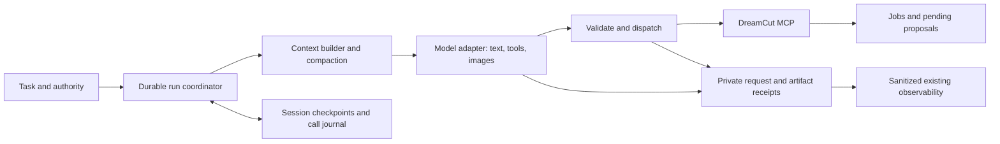

# Editing operator harness

Status: local implementation spike, 2026-10-01. The runnable first slice is described in the [operator runbook](editing-operator-runbook.md). Sections below retain the broader target design and explicitly identify acceptance work still outstanding. This applies the [harness foundations research](../research/2026-09-30-editing-harness-foundations.md); it does not certify production editing quality.

## Implemented first slice

- A bounded tool-only runner, SDK MCP client, original-schema validation, fixed capability ceiling and project scope. No shell or human-approval tool is exposed.
- A local llama.cpp adapter with actual multimodal tool content, private request receipts, runtime text tokenization, conservative image allowances and reported token usage. The generation schema narrows long strings to 256 characters for this runtime; dispatch still validates the original schemas.
- File-backed session leases, persisted intent/results, preserved budgets, safe resume and compaction at complete tool-exchange boundaries. Unknown side effects block instead of replaying.
- An optional LangGraph/SQLite coordinator that persists interrupts and acknowledged results alongside the file session. The graph never dispatches external effects itself. Node 24 is required for the qualified native SQLite build.
- Deterministic timeline context preparation archives original results, minifies JSON and omits only UI waveform `_peaks` arrays with explicit receipts. Initial context supplies preferences; full timeline/feedback is read through the tool before editing.
- Metadata-only usage export to the existing local collector for the operator CLI. Rich evidence stays in ignored local files; telemetry is best effort and is not the recovery authority.
- Synthetic discovery and visual qualification through the same runner, plus deterministic recovery, compaction and restart tests. See the [case contract](../evals/local-harness-qualification.md).

This is deliberately a hybrid spike: owned policy/conversation/budgets plus optional framework persistence. It is not a measured conclusion that LangGraph improves speed or that a second journal is the final architecture. Real editing, repeated model compaction, automatic reconciliation by proposal/job identity, reconnect recovery, media offloading and multi-provider end-to-end qualification remain acceptance work.

## Recommendation

Own the editing policy, context assembly, provider adapters and evals. Evaluate **LangGraph.js with a persistent local checkpointer** for the durable execution loop before implementing a custom checkpoint engine. Keep the MCP boundary and human proposal review unchanged. The pinned spike is now implemented as an optional coordinator; no performance advantage has been established.

| Option | Documented capability / our assessment | Decision for the first slice |
| --- | --- | --- |
| Small custom runner | Our discovery loop already controls messages and supplied tools. We would need to implement and maintain persistence, replay and recovery semantics. | Retain as the transparent reference adapter and comparison baseline. |
| LangGraph.js | Checkpoint persistence, interrupts and configurable failure handling; see findings H02–H04, H10. Our assessment: a useful reusable execution core while keeping domain policy explicit. | Spike SQLite-backed restart and interrupted-call reconciliation; pin versions and inspect the chosen checkpointer's guarantees. |
| Deep Agents.js | Broader context, filesystem, delegation and intervention facilities; see H10. Our assessment: useful reference, but its larger action surface needs careful restriction for a tool-only editor. | Reconsider if skill loading and context management become substantial custom work. Do not enable shell/filesystem powers merely to obtain compaction. |

MIT licensing is documented in H10; inference, hosting and operational costs are separate. No paid hosted control plane is proposed. The spike must establish the chosen local package configuration actually runs without one.

## Historical starting point (2026-09-30)

The following table records the pre-spike inspection, not the current capability inventory. See the implemented slice above for subsequent work. Local audit fingerprints and commands are retained in ignored `private/research/harness-foundations/`.

| Area | Inspected implementation | Remaining work for an editing operator |
| --- | --- | --- |
| Model loop | [Ollama discovery runner](../../mcp/ollama-discovery-eval.mjs) supplies schemas each turn, bounds turns/calls, records responses and reported usage. | General task inputs, provider-neutral messages, durable state and modality adaptation. It currently serializes the complete tool result as text. |
| Discovery | [Owned bridge](../../mcp/progressive-eval-client.mjs) refreshes registration after catalog loading and list-change notifications. | Production MCP lifecycle and reconnect policy; this bridge is a short-lived synthetic probe, not a production service. Native client refresh remains separately qualified. |
| Recovery | [Tool error adapter](../../mcp/tool-runtime.mjs) preserves typed errors; [application error helper](../../src/lib/agent/tool-error.ts) carries recovery instructions. | Classify outcomes and implement bounded, operation-aware recovery. Returning an error to the model is not a durable retry policy. |
| Visual evidence | [Evidence owner](../../src/lib/agent/timeline-evidence.ts) and [preparation architecture](agent-preparation-tools.md) provide verified image content. | Translate image blocks into actual provider image inputs, then prove delivery and interpretation independently. |
| Persistence | Runner writes manifests and turn logs. | Restart entry point, authoritative call journal, session lease, checkpoint schema and unresolved-call reconciliation. Saved transcripts alone do not provide these. |
| Observability | [Dispatch records](../../mcp/tool-runtime.mjs), [activity capture](agent-activity.md), [usage reporting](../observability.md) have distinct coverage. | Join owned model requests, media delivery and operations with stable IDs; avoid duplicate usage counts. |

Do not equate the native Codex/Claude agent's capabilities with our small local-model loop. A passing discovery fixture is not an editing, compaction, crash-recovery or vision pass.

## Boundaries and state ownership

The timeline remains the editing source of truth. Proposal records own draft/review state; job records own preparation progress; preferences own creator style. A session checkpoint owns conversation and execution progress only. Resuming cannot restore an old timeline, grant approval, resurrect an expired workspace grant or overwrite a human correction. Keep this workflow in CLI/chat initially.

Use a durable `session_id`, a `run_id` per attempt, model-response IDs, logical operation IDs and separate dispatch-attempt IDs. Store typed messages, exact tool-schema fingerprint, prompt/skill versions, model/runtime/template identity, current task/constraints, project/proposal/job references, consumed budgets and checkpoint version. Keep large images and tool output as hash-addressed private artifacts with retention pins for resumable sessions. Reuse the activity schema/owners where applicable rather than creating another unrelated trace format.

## 1. Provider and MCP adapter

Use a canonical message representation with ordered text/image/resource blocks, explicit tool-call/result pairing and typed errors. Adapters translate it to each provider format without silently flattening images, discarding call IDs, losing required reasoning/signature fields, or enabling unsupported modalities. Retain opaque provider continuation fields only with that provider; a model switch creates a new run from portable task state.

At startup qualify model identity, runtime version, chat template, context limit, tool support, image support and usage fields. For local GGUFs also record model/projector hashes. llama.cpp is a candidate serving route for existing GGUF/projector pairs (H09); compatibility must be tested for each exact pair. Download completion does not establish serving compatibility. Run one large local model at a time initially and measure peak memory, load time and decode speed independently.

After MCP reconnect: initialize, verify catalog/authority, restore only permitted loaded families, and refresh actual schemas. Validate calls against the schemas supplied for that model turn. A family load cannot authorize a guessed tool in the same model-generated parallel batch. Keep tool output as untrusted task data; it cannot enlarge the allowlist or rewrite instructions. Load applicable skills through a bounded reader/bundled manifest, not arbitrary repository or shell access.

## 2. Resumable sessions and safe side effects

Proposed states: `ready`, `model_pending`, `tool_pending`, `waiting_job`, `waiting_human`, `blocked`, `completed`, `cancelled`. Maintain one active writer per session, with a lease and checkpoint schema migration policy.

Persist the intended operation and arguments hash before dispatch. Persist its result and stable proposal/job/artifact references before making the next model request. On crash, a pending operation is **unknown**, not failed. Query the owning tool's result/status by durable reference or idempotency key. Never replay a possibly completed proposal creation, import or charged generation blindly. For owners without deduplication or lookup, stop with retained work until the outcome can be reconciled. A checkpoint library does not supply exactly-once semantics across external effects (the replay warning in H03 motivates this design).

Resume reconstructs context from the checkpoint plus fresh timeline revision, proposal states, applicable preferences and job status. If these changed, reconcile the task before another mutation. Preserve previous run evidence. MCP transport resumption (H06) is distinct from this application-level recovery.

Cancellation stops new dispatch, records pending operations and requests cancellation only where the tool supports it. A worker may continue after the harness stops; resume inspects its status. Pausing for proposal review observes the editor's human decision; a model message saying “approved” never supplies it.

## 3. Error recovery policy

This table is the target recovery policy. The implementation currently bounds typed read retries and invalid-argument repair, refreshes stale state and stops on transport exceptions with unknown outcomes. It does not automatically reconnect or retry a provider timeout.

| Failure class | Proposed action |
| --- | --- |
| Malformed model arguments | Return the exact validation error; allow one corrected attempt. Never silently reinterpret IDs or units. |
| Missing prerequisite | Follow the typed recovery action using an allowed preparation tool, then revalidate. Preserve cached work. |
| Stale timeline / proposal / evidence | Re-read current state; regenerate affected evidence and revise the candidate through the normal proposal path. |
| Transient transport or provider failure | At most two retries with backoff/jitter within the shared time/cost budget; reconcile side effects first. |
| Unknown outcome after timeout | Resolve by operation/job/proposal identity. No automatic mutation retry without deduplication or proof of no effect. |
| Permission, missing capability, unsupported modality, exhausted budget | Stop with a specific blocker and retained artifacts; no shell fallback or hidden model substitution. |
| Repeated equivalent failure | Detect the same error plus normalized arguments/state; stop instead of spending the remaining budget in a loop. |

Retries, model repairs, job polls and compaction all consume the run budget. Polls use backoff and deadlines; a successful status lookup is not a successful job. Framework defaults (H04) must be overridden where they conflict with tool authority or side-effect safety.

## 4. Compaction and context budgets

Begin with a measured budget, not a fixed “compact every N turns.” Count system instructions, skills, tool schemas, text, images and reserved output space. Use the provider tokenizer/estimator where available; label estimates and record actual usage. An overflow is a controlled checkpoint/block, not silent truncation.

Proposed order: remove duplicated schemas/results from the prompt projection; replace older bulky results with verified artifact references; keep recent complete call/result pairs; then summarize older conversation if still needed. Retain original records so summaries can be rebuilt from evidence rather than repeatedly compressing summaries.

Keep deterministic state outside the generated summary: current request, explicit locked choices, authority limits, revisions, proposal/job IDs, pending calls, source windows, budgets and unresolved questions. Validate those fields before adopting a new context. Record compactor model/version, input/output hashes, source event range, token reduction, latency and cost. A summary is fallible derived data; it never becomes permission or creator preference.

Compact at a settled boundary without splitting an in-flight tool exchange. Afterward reload relevant skills and fresh project state, retain pointers to visual artifacts, and reattach pixels when the next question needs them. Text about an image is not a substitute for resending its pixels. Tune thresholds with preservation and editing tests (H01), not token reduction alone.

## 5. Real visual input and evidence quality

For each MCP image block, validate MIME/bytes/dimensions and provenance, preserve its frame/time label, and map it into the provider's image field (H07–H09). If the provider disallows image blocks in tool results, deliver a documented associated image message without breaking the call/result pair. Test that mapping per adapter. Do not put base64 in ordinary text.

Record artifact hash, timeline/proposal revision, source time, crop/resize transformations, model request ID and delivery status. Distinguish requested, retrieved, encoded, sent, rejected and interpreted. Request receipts establish delivery; visual-only questions with hidden ground truth establish interpretation.

Start with contact sheets and selected full-resolution frames through existing evidence tools. Add local crops for fine mask boundaries. Motion needs ordered time samples or a qualified video path; sound needs audio evidence or an explicit unavailable result. Avoid claiming continuity from a still. This extends the existing [context/media application](../wiki/context-and-media-intake-architecture-reference.md), not a second source-clock or evidence cache.

## 6. Observability, costs and reproducibility

Emit linked events for model requests, tool attempts/results, job waits, checkpoints, resumes, compaction and modality delivery. Record offered versus invoked tools, reported input/output/cache usage, time to first token, inference time, warmup, total time to reviewable proposal and failure category. Treat missing usage as unknown. Report API cost only from dated model pricing and recorded usage; keep local wall time and memory separate from API spend.

The [current collector](../../scripts/otel/collector.yaml) has a metadata-only log pipeline. Reuse it for compatible events; adding traces requires an explicit pipeline/schema change, **not another collector**. Rich session state stays local outside telemetry. Do not expand remote Sentry capture or register a competing provider. OTel conventions should be version-pinned (H11). Timeline history, durable session state and best-effort telemetry remain separate authorities.

Freeze model weights/API ID, serving runtime, projector/template, prompt/skills, tool registry, fixture and grader per comparison. Capability probes should include schema features, tool errors, Unicode, multiple calls, images and unsupported inputs. Maintain visible scope gaps: provider internals and hidden reasoning are not observable simply because we own the outer loop.

## Implementation sequence and acceptance gates

The table below describes acceptance targets. Discovery and visual probes are runnable; restart, recovery and compaction have deterministic component coverage. Complete model-driven versions of B–E remain outstanding. Consult the [qualification contract](../evals/local-harness-qualification.md) rather than treating this roadmap as test results.

| Slice | Deliverable | Required evidence |
| --- | --- | --- |
| A — adapters and visual delivery | Generalize canonical messages, production MCP client and one local adapter; qualify each exact model/runtime. | `visual-input-delivery-v1`: choose a property visible only in randomized pixels, neutral filenames, no answer in text; image-omitted and corrupt-image controls. Existing discovery still passes. |
| B — durable execution spike | LangGraph versus minimal owned checkpoint comparison; local persistence, lease, call journal and reconcile path. | `resume-side-effects-v1`: kill before dispatch, after server effect but before acknowledgement, and after checkpoint. Resume without duplicate proposals/jobs; unresolved outcomes block safely. |
| C — recovery and steering | Error classes, bounded retry/polling, stale-state handling, cancellation and revised user request. | `tool-recovery-v1`: typed prerequisite, invalid arguments, transient error, unknown timeout; `resume-human-change-v1`: preserve a human edit and revoked grant. |
| D — compaction | Context measurement, result offload, validated summary and restore. | `compaction-preserves-edit-v1`: forced compaction retains locked choices, corrections, IDs and pending work across several cycles; score task success, retention, tokens and latency against no-compaction control. |
| E — integrated editing | Frozen linked-spacing fixture using the same MCP and proposal rules. | Structural/control checks plus human motion/sound review, with one correction and one interruption. Never self-approve. |

For each case publish its purpose, inputs, allowed actions, expected state, limits, grader and readiness. Keep ground truth outside the model's reachable tools. Use deterministic transport/failure fixtures before repeated paid/local model trials. Then report repeated trial counts and per-dimension results; do not collapse delivery, recovery, speed and editorial usefulness into one score.

## Deferred choices and refresh policy

Defer multi-agent orchestration, a general memory database, autonomous skill changes, full-video streaming and a new observability UI until a measured task needs them. The first operator needs a small plan and bounded skill retrieval; it does not need to reproduce every coding-agent feature.

Before the implementation spike, pin package/runtime versions and confirm SQLite checkpointer support, tool-result image mapping, model templates and licensing for the selected artifacts. Recheck these when a model, runtime, MCP schema or provider API changes; rerun affected capability and recovery gates. Review this research monthly during active harness development and before architecture adoption. This is a review recommendation, not a scheduled automation.

Sources: [external findings and source inventory](../research/2026-09-30-editing-harness-foundations.md). Decisions, thresholds and sequencing here are DreamCut recommendations. Implementation evidence is recorded separately in the runbook and qualification contract; the research alone establishes no runtime capability.
