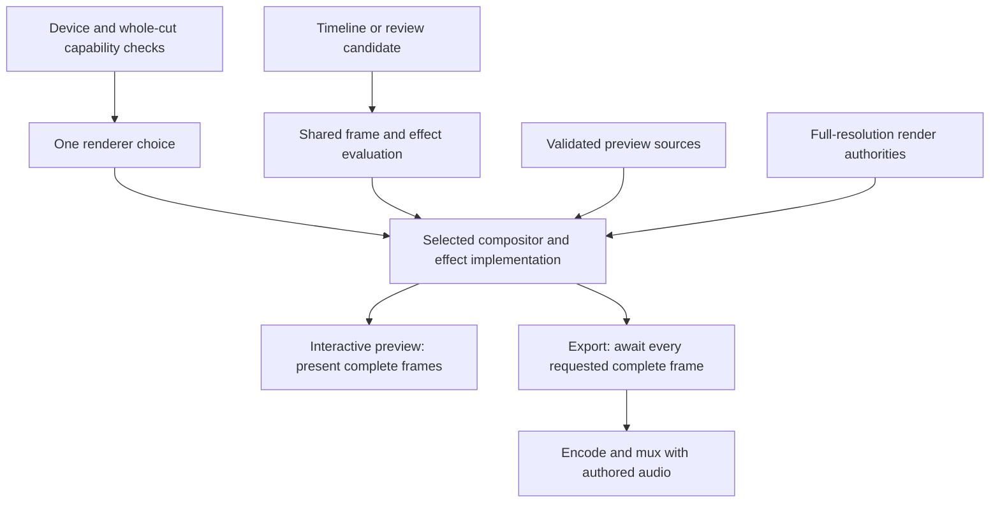
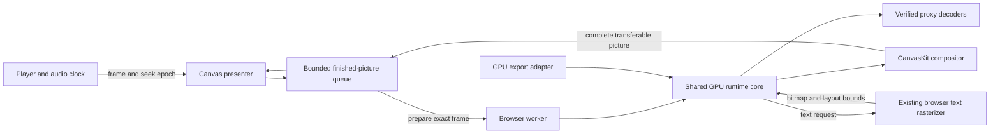
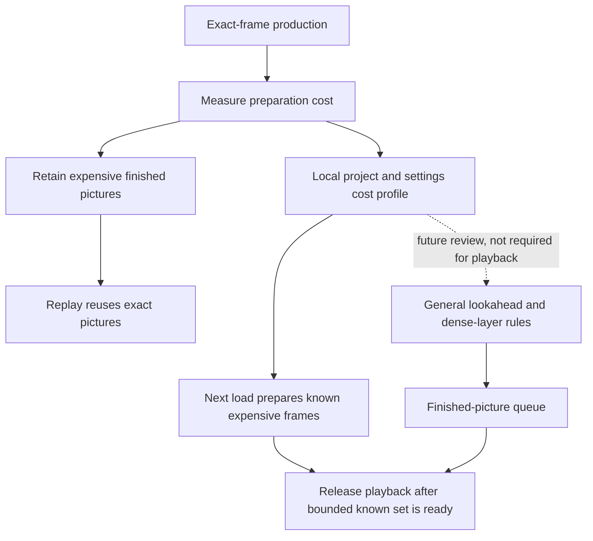

# Playback and rendering architecture

[Architecture overview](README.md) · Matched-renderer decision accepted 2026-10-08; current implementation and remaining migration work are distinguished below.

## Responsibility and design decision

The [accepted browser-first GPU decision](browser-first-gpu-playback.md) records
Browser GPU qualification and its limits. The matched preview/export decision below
extends that work; existing preview checks do not establish GPU export support.

Preview and export consume the same edit semantics: source windows, timeline clocks, layer order, captions, transforms, and effects. Their execution needs differ. Interactive playback must respond quickly and preserve its live media session; export must evaluate requested frames and produce the declared delivered streams.

The architecture shares composition and deterministic evaluation while allowing separate media transport and scheduling. It does not require preview to decode the same large media file as export, and it does not allow a proxy to silently become delivery authority.

### One renderer for preview and export — accepted 2026-10-08

The creator chooses one renderer for the cut. Its compositor and effect implementation
must own both preview and final export. Independently selecting a preview renderer
and an export renderer is transitional UI, not the intended product architecture.

| Renderer | Intended role | Current implementation |
| --- | --- | --- |
| Browser GPU (CanvasKit) | Preferred direction for interactive editing and matching export on supported machines | Preview and exact-frame GPU export are wired through the same CanvasKit runtime; export qualification remains bounded by the evidence below. CanvasKit uses WebGL2; the current runtime also requires WebGPU initialization. |
| Standard | Compatibility renderer for unsupported browser/device/codec/effect cases, with matching Standard export | Existing browser composition and Chrome/FFmpeg export. Retained as a supported fallback, not an assurance that every GPU-less machine will work; browser decoding and drawing may themselves use acceleration. |
| Rust GPU | Possible future native compositor with matching preview and export, justified by measured capability or performance needs | Not implemented. A desktop app may reuse Browser GPU; desktop packaging does not require a native renderer. A future native service could also feed the browser interface. |
| Rust/FFmpeg decoder with browser composition | Existing experimental alternative, retained during migration | Rust supplies source frames; the browser composes effects. It is not Rust GPU and must not be presented as such. Matching Rust preview/export uses that hybrid path. |

Browser GPU is the preferred implementation direction, not a claim that it is
fastest on every machine. Source decoding, composition, and output encoding are
separate responsibilities. The same compositor can display frames interactively
and render exact requested frames for an encoder without rewriting the audio or
FFmpeg delivery pipeline.

### GPU-first feature rule — decided 2026-10-09

Browser GPU (CanvasKit) is the default renderer and the one DreamCut is built for.
Anything new must work there before it ships: effects, caption and text styles,
animations, transitions, panel presets and new element props. New work is
admitted when `gpuSceneCapabilityIssues(…, "canvaskit")` in
`src/lib/gpu-preview/scene.ts` reports no issues, and a CanvasKit frame proof shows
the intended pixels. Something that renders only in Standard is incomplete and
must not be shown in the editor as an available choice.

- Standard stays a compatibility fallback for older capability gaps and unsupported
  devices. It is not a place to land new features. Shrink the existing gaps listed
  in [GPU catalog coverage](gpu-catalog-coverage.md); do not add to them.
- Props that never draw pixels (placement bookkeeping, provenance, receipts) are
  exempted explicitly in `scene.ts` with a comment. They must never block GPU
  admission by accident.
- `src/components/studio/timeline/gpu-admission-contract.test.ts` enforces this for
  everything an editor panel can add. Register each new preset catalog or payload
  builder there. A failing case is fixed by adding GPU support or by not offering
  the choice. Never skip the issue to make the test pass.
- Agent-authored writes get the same check at runtime. `assertGpuWriteAdmissible`
  in `src/lib/timeline/gpu-write-admission.ts` projects the derived timeline through
  the shared composition adapters and rejects any CanvasKit issue the write adds.
  `validateEditorAgentProposalAgainstProject` runs it for every proposal option, and
  `writeTimeline` runs it for leased `agent_workspace` writes. `source` issues are
  exempt because media preparation is checked separately.



The media inputs above belong to separate preview/export sessions, not simultaneous
source choices. Preview quality remains independent of renderer choice; final export
must not inherit a lower-resolution proxy merely to match preview pixels.

**Fallback must preserve the pair.** Resolve and visibly identify the effective
renderer for the whole cut. If Browser GPU cannot support it, offer a switch to
Standard for both preview and export; allow the creator to review that appearance.
Never review GPU output and silently export Standard, or switch only selected export
frames to another renderer. A failed export must stop with an actionable error.
Snapshot the renderer, implementation version and media authorities into each render
job and its receipt so later setting changes cannot alter an in-flight job.

**Alignment means shared visual semantics and rendering code.** At identical source,
resolution, color policy, fonts and renderer version, test the uncompressed frame
results for determinism and preview/export equality. At normal preview quality,
proxy detail and resampling can differ from final delivery; lossy encoding and the
viewer's color handling can also change displayed pixels. These do not excuse
different timing, omitted effects, broken tracking or inconsistent layer composition.

### Implemented GPU export and remaining qualification

`render-frame` now has an exact-frame CanvasKit session using `GpuPreviewRuntime`
in explicit rendering mode. That mode selects original/render-authority video and
still files and original caption video fills; it never manufactures proxy-validation
receipts. Every frame awaits a complete packet. Unsupported effects, unsupported
source formats/color interpretation and resource limits reject the export without
substituting another compositor. The current decoder still requires normalized SDR
video with supported browser codecs and orientation; original HDR/rotated sources
are not silently converted or replaced by preview proxies.

Tracked jobs, the render API and CLI accept `gpu` alongside `standard` and `rust`.
The GPU path encodes in the page at every export size: each drawn canvas becomes a
WebCodecs `VideoFrame` (a 720p/480p export first draws it once more at the smaller size),
the browser's H.264 encoder (hardware first: VideoToolbox on macOS; level 5.1, or 5.2 for
4K above 30 fps) compresses it at about 0.16 bits per pixel, and only the Annex B stream
returns to Node (`src/lib/render/canvas-encoder.ts`). The frames split into contiguous
segments, one per page, each page in its own browser so each has its own GPU process; a
page draws its segment in order, half a second of frames per round trip, and the segments
join end to end before FFmpeg copies them into the MP4 with the screenshot path's colour
tags. Page counts follow the computer (`src/lib/render/export-parallelism.ts`): about one
per three cores within a third of total memory (macOS "free" memory is not a usable signal),
at most three picture segments because they share the video-decoding hardware, all of them
for the CPU-bound audio pass. `DREAMCUT_EXPORT_WORKERS` overrides the count. A browser
without the encoder, and `DREAMCUT_EXPORT_CAPTURE=screenshot`, keep PNG intermediates and libx264.
Authored audio uses a separate Standard frame-evaluation pass to produce PCM,
preserving the existing audio clock/gain logic. In that pass each frame only renders
its media to read their sound samples; it does not wait for pictures, seeks or effects.
Receipts identify CanvasKit composition separately from source decoding.

Measured 2026-10-13 on an M5 Pro (18 cores, 48 GB), a 102 s timeline with seven alpha cutouts,
exported from the editor's Export dialog:

| Export | Time |
| --- | --- |
| 1080p, PNG screenshots (before) | 11 min 13 s |
| 1080p, in-page encode, one page | 57 s |
| 1080p, 3 picture segments + 6 audio workers | 51 s |
| 4K (3840 × 2160), 3 picture segments | 69 s |

Pictures alone: 1 segment 43.9 s, 2 32.4 s, 3 32.7 s, 4 32.8 s, 6 36.3 s; with 4 segments
each page's source-frame wait rose from about 6 to 16–19 ms per frame (shared decoding
hardware). Against the screenshot export: video PSNR 48.9 dB average, 42.8 dB worst frame,
45–49 dB on the frames either side of each segment join; audio bit-identical. Files are
about 10 Mbps at 1080p and 34 Mbps at 4K, where libx264 CRF 18 gave about 3.5 Mbps at 1080p.
DreamCut does not pre-render in the background while someone edits (that spends battery on
work an edit may discard); it reuses the previous export's chunks instead.

#### HDR export and SDR placement — decided 2026-10-28

The opt-in HDR export (`dynamic_range: "hdr"`, GPU only) writes 10-bit HLG BT.2020 VP9 and places
SDR white at BT.2408 reference white, HLG 75% (10-bit limited Y 721, about 203 nits on a 1000-nit
reference display; `src/lib/color/hdr-encode.ts`). How that white looks depends on the viewer's
display headroom, measured on a synthetic HLG wedge (HEVC Main10 and VP9 profile 2, identical):

| HLG signal | 0.50 | 0.65 | 0.70 | 0.75 | 0.80 | 0.90 | 1.00 |
| --- | --- | --- | --- | --- | --- | --- | --- |
| macOS Core Image, ≥3× EDR headroom (linear, 1 = UI white) | 0.25 | 0.55 | 0.74 | **1.00** | 1.36 | 2.56 | 4.93 |
| macOS `CIToneMapHeadroom`, 2× headroom | 0.23 | 0.50 | 0.66 | **0.89** | 1.14 | 1.58 | 2.00 |
| macOS, no headroom (SDR) | 0.14 | 0.29 | 0.38 | **0.50** | 0.62 | 0.82 | 1.00 |
| Chrome 152 2D canvas (sRGB code value) | 0.39 | 0.57 | 0.64 | **0.73** | 0.81 | 0.91 | 1.00 |

Safari and Chrome hand HLG video to the macOS compositor on an EDR display, so SDR-origin layers
match the page only with at least 3× headroom; with less (a bright screen, many external HDR
monitors, or SDR output) their white drops to half the light and the video looks dim and grey.
The Standard export always shows its white at UI white. A brighter SDR placement (for example SDR
white at HLG 0.85–0.90) is not a standard choice: BT.2408 sets graphics white at 75%, and on a
capable screen that placement would show text and UI at 1.4–2.6× page white. DreamCut keeps
BT.2408 and instead makes Standard the default for YouTube and social: the Export dialog and the
render API warn when HDR is picked for a timeline that is not mostly HDR camera footage
(`src/lib/render/dynamic-range.ts`, at least half the running time). YouTube's own HDR-to-SDR
conversion for viewers without HDR displays was not measured.

#### Export chunk reuse

GPU exports work in fixed 60-frame chunks, each its own H.264 stream opening with a key
frame (`src/lib/render/export-chunks.ts`). A chunk's picture fingerprint is the GPU
renderer's own evaluated scene for each of its frames (every visible layer with its element,
resolved geometry, effects and source time), the bytes of every file those scenes read, the
renderer code and the export settings (size, frame rate, bitrate, codec). Its sound
fingerprint covers every clip that can sound within a second of it. A re-export renders only
chunks whose fingerprint changed, evaluates sound only for chunks whose sound changed, and
joins everything end to end. Preview proxies never take part: export always draws
full-quality sources, so the preview quality someone edits at cannot leak into an export, and
a different export size or frame rate reuses nothing. An asset the hasher cannot verify makes
that chunk render every time. Absolute file-system strings in props (provenance receipts)
stay in the scene fingerprint as text but are not hashed as files, since drawing never reads them.

Measured 2026-10-13 on the same 102 s timeline (one export at a time, 1080p): first export 55 s
(fills the cache), unchanged re-export 18 s (52/52 picture and 52/52 sound chunks reused),
re-export after one caption edit at 40.5 s 21 s (51/52 reused). Against a full uncached
export of the same edit every frame was at least 44 dB and the re-rendered chunk
bit-identical; audio identical to the original export throughout. Fingerprinting costs about
2–4.5 s per export (scene evaluation for 3,061 frames, memoized file hashes).

The gear now exposes one **Renderer for preview & export** control using the shared
`NativeSelect`, replacing the two independent choices. New profiles choose Browser
GPU; existing consistent choices are preserved. Conflicting legacy choices or
unavailable Rust require an explicit selection before export. This is a local
preference change, not a timeline edit, so timeline Undo is unaffected; selecting a
previous renderer reverses it. A GPU failure may show a labeled Standard recovery
preview, but export stays blocked until the creator chooses a working renderer.
Changing preview quality continues to leave final source authority untouched.

The existing GPU verifier's `DREAMCUT_GPU_EXPORT_PROOF=1` mode covers the production
capture route, equal-input raw frames, encoded-frame comparison, out-of-order seeks,
authored PCM comparison, a short 1080p portrait export and unsupported-content
rejection. Run receipts define actual results. Synthetic coverage does not certify
every source format, effect combination, 4K workload or device. Live popup acceptance
and a full representative delivery-resolution project sweep remain separate checks.

## Desktop packaging boundary

The [accepted Electron migration plan](desktop-app-plan.md) reuses these rendering
and audio owners. The development shell is implemented; packaged delivery remains pending and does not imply
a native compositor, a Vite migration or AudioWorklet adoption. The existing GPU
worker and OffscreenCanvas path remain the starting point. Packaged Chromium must
be qualified separately for codecs, GPU initialization, worker/WASM resources,
audio recovery and matched preview/export before claiming desktop parity.

## Consumers and data flow

```text
working timeline OR temporary candidate + metadata
  → normalized composition inputs and source-time mappings
  → shared composition and effect/geometry evaluation
      ├─ player session + preview media bindings → interactive preview
      └─ explicit render job + render authorities
          → browser frame evaluation + audio export → encoded output
```

The working timeline remains authoritative after export; the resulting file is a delivery artifact, not the next editable project. A proposal candidate can be previewed without writing that timeline. Workspace aspect/layout changes do not change the delivery canvas.

## Runtime and media ownership

The owned frame runtime supplies frame context, sequence-local time, media evaluation, resource readiness, and a session. The player advances or seeks that session and presents playback controls. Source clocks map trim and playback rate to media time; preview audio/mixer ownership and readiness must avoid competing audible or advancing authorities.

The composition evaluates actors and effects from those inputs. Static geometry and supported spatial projection share resolvers with the [spatial engine](spatial-engine.md). Source files under `src/lib/remotion/` retain historical naming; imports and the owned runtime determine execution, not that directory name.

Prepared proxies are separate, validated bindings for interactive use. Missing or stale required preview preparation fails explicitly rather than causing an unbounded fallback to an unsuitable source. Export uses declared render authorities and timeline-owned audio. UI changes such as drawer interaction or preview expansion should preserve the player, playhead, and decoders.

Both preview engines use the same validated, selected proxy binding. The shared
prepared picture cache includes the effective proxy URL and completed quality proof;
replacement proxies invalidate that picture cache. Its picture pass uses those proxies,
while a separate audio pass retains the original audio authorities. Rust consumes the
same bindings in live and prepared modes. Engine selection never selects a different quality tier.

Local 8-bit JPEG/PNG stills also receive disposable, lossless PNG previews through
the serial `editor-still-v1` preparation cache. Runtime hydration carries the selected
quality and source-bound receipt into the canonical playback plan. Standard, GPU
and Rust share that binding; exports keep the original source. EXIF orientation is
normalized, alpha is retained, and data-channel treatments bypass photographic
resizing. The original remains playable while preparation runs. Higher-depth or
recognized HDR inputs remain on their original source pending a preserving recipe.
The default transparent proxy has a 960-pixel long edge; explicit lightweight and
balanced settings retain their smaller bounds. Old default alpha packages upgrade
in the background, with the previous validated file retained until completion.

A preview-quality change prepares replacements in the background. A previously prepared proxy remains usable only while its source binding and proxy validation remain valid; a failed quality upgrade does not discard that usable preview. The editor continues polling pending upgrades. Preparation gates apply to video clips at the playhead, while mounted-media readiness checks handle actual decoding and buffering. A failed or unfinished asset elsewhere in the project must not block the current shot.

## Implementation map

| File | Responsibility |
| --- | --- |
| [frame-runtime/index.tsx](../../src/lib/frame-runtime/index.tsx) | Composition context and frame/sequence primitives |
| [frame-runtime/player.tsx](../../src/lib/frame-runtime/player.tsx) | Interactive player API, controls, and session lifetime |
| [frame-runtime/session.ts](../../src/lib/frame-runtime/session.ts), [media.tsx](../../src/lib/frame-runtime/media.tsx) | Runtime resource/media coordination and media components |
| [TimelineComposition.tsx](../../src/lib/remotion/TimelineComposition.tsx) | Composition of timeline visuals and treatments |
| [TimelinePreviewAudioMixer.tsx](../../src/components/studio/timeline/TimelinePreviewAudioMixer.tsx) | Preview audio integration |
| [usePreviewReadiness.ts](../../src/components/studio/timeline/usePreviewReadiness.ts) | Editor readiness coordination |
| [render/pipeline.ts](../../src/lib/render/pipeline.ts), [browser-renderer.ts](../../src/lib/render/browser-renderer.ts) | Delivery pipeline and browser frame rendering |
| [audio-manifest.ts](../../src/lib/render/audio-manifest.ts), [audio-export.ts](../../src/lib/render/audio-export.ts) | Timeline-derived audio planning and export |
| [render-jobs.ts](../../src/lib/local-store/render-jobs.ts), [scripts/render.ts](../../scripts/render.ts) | Explicit job lifecycle and CLI entry |

## Playback preferences

The preview transport's gear beside fullscreen owns the single renderer choice,
preparation mode and preview quality. Browser GPU means CanvasKit for both preview
and export; developer-only alternate compositor trials belong in engineering
fixtures. Standard and Rust use their corresponding export backends. GPU prepares
its resources automatically; Standard and Rust retain the existing complete, direct
and experimental cache modes. These scheduling choices do not select an export
compositor. A separate renderer preference is no longer exposed for export.

Engine and preparation preferences persist in browser storage and are shared across tabs.
Disabling preparation releases pending jobs immediately, including late start
responses; completed disk caches remain reusable. Changing it does not mutate the
timeline or remount the transport. The settings panel stays available when transport
is gated, uses native popover dismissal, and fits either side of its trigger as
space permits in both layouts and fullscreen.

### CanvasKit GPU trial setup

After `pnpm install`, start an isolated editor using a disposable project root:

```bash
TIMELINE_PROJECTS_DIR=/absolute/path/to/project-copies \
DREAMCUT_PROFILE_DIR=/absolute/path/to/trial-profile \
TIMELINE_NEXT_DIST_DIR=.next-gpu-trial \
TIMELINE_EDITOR_MODE=development \
pnpm exec next dev --turbopack -H 127.0.0.1 -p 3145
```

In the preview gear choose **Renderer for preview & export → Browser GPU**. CanvasKit is now its
compositor for both preview and export; this does not select Rust or change media
source authority. Alternate custom-compositor experiments remain in the engineering
fixtures and do not override the paired product renderer.
CanvasKit loads its installed JavaScript and
Wasm from the same local editor origin; no separate native Rust build is required.

Both adapters use the shared source bindings, complete-frame scheduler and audio
transport. CanvasKit uses WebGL2 for composition; the current adapter also requires
WebGPU initialization. Unsupported capabilities fail explicitly into the existing
Standard recovery path. This remains a trial, not a claim of full device or effect
coverage. The [current qualification snapshot](browser-first-gpu-playback.md#current-qualification-snapshot)
records acceptance evidence and remaining work.

CanvasKit validates the whole frame before drawing to a private surface. Source
uploads are then created, drawn, flushed and released one layer at a time. The
128 MiB compositor budget accounts for the largest live layer plus output surfaces,
colour resources and reusable Skia cache, rather than summing all layer uploads.
The cache limit shrinks when a large layer needs that space. This does not resize
sources or alter proxy selection. An individually oversized layer still fails with
required and available memory; only a complete frame reaches the visible canvas.
Driver overhead and decoded-source caches have separate accounting. The GPU
verification instrument includes a five-layer allocation and rejected-frame
presentation regression (`layer-budget.json`).

Export reserves a separate bounded 256 MiB compositor allowance because original
images can be larger than interactive proxies. It retains the same per-layer
validation and release policy; it does not lower source quality to satisfy the
preview allowance. This allowance excludes decoder caches and driver overhead.

Sequential decoding retains at most two samples when it needs the next presentation
timestamp. Original WebM samples may omit duration; their display interval then ends
at the next actual timestamp. Positive durations may bridge only a timestamp-rounding
gap of at most 1 ms, verified against that next sample. Larger explicit gaps and
unknown final-sample duration fail instead of extending EOF. The cache consumes the
resolved display interval without modifying media timestamps. Tests cover unknown
and quantized durations, cancellation, resource cleanup and missing-frame rejection.

The pinned Mediabunny 1.61.3 dependency carries a pnpm patch for transparent-frame
cleanup. Parallel alpha merges can finish out of order; closing the decoder must
release completed samples waiting behind an unfinished merge, as well as results
that arrive after shutdown. The patch covers the source, ESM runtime and public
CommonJS entry points. `mediabunny-sample-lifecycle.test.ts` exercises the installed
wrapper with controlled worker completion and verifies ownership without relying
on nondeterministic garbage collection. Revalidate this patch when upgrading the
dependency; do not suppress its resource warnings.

## Tradeoffs and verification boundaries

Shared geometry reduces semantic drift but cannot prove decoder behavior, font readiness, encoded pixels, or real-time continuity on its own. Unit tests establish bounded calculations. Pixel/conformance checks establish specific rendered cases. Real playback establishes continuity under a particular workload. These are complementary forms of evidence.

The [renderer contract](../standards/renderer-contract.md), [playback reliability standard](../standards/playback-reliability.md), and [proxy contract](../standards/preview-proxy-contract.md) own acceptance requirements. Rendering remains an explicit delivery action; architecture inspection does not trigger an export. Unsupported effects, spatial assessment gaps, and unverified playback workloads retain their limits rather than inheriting blanket support from the shared runtime.

### Transparent video presentation

Surface-attached text follows the decoded frame presented by the video canvas
during preview. A session-local observation channel publishes the browser's
video-frame timestamp after drawing and updates the attachment in the same
callback. It does not drive transport or change saved timing. A visible,
fingerprint-matched full-source cutout can supply the presentation clock while
it covers the original. Export retains the authored frame/source mapping.
The surface tracking fixture checks the observation binding and export isolation;
the playback instrument's `--surface` case checks matching text/picture timestamps
through rate changes and replay. These checks do not certify the accuracy of an
individual paper's measured corners.

`AlphaVideo` retains the native decoder and shared source clock, but presents decoded
RGBA frames on a transparent canvas. While the decoder seeks, the last complete
canvas remains visible. Exact export seeks invoke the same registered draw callback.
This avoids using an accelerated video overlay as the visible alpha surface beneath
nested filters. Moving Scratchpad width/color filter the canvas itself, keeping the
edge and subject on one image. `scripts/verify-alpha-preview.ts` covers repeated
playback, random seeks, visible background/subject/outline pixels and a synthetic
encoded result; it does not establish performance for unlimited alpha layers.

## Loading, buffering and recovery boundaries

[Application layering](application-layering.md) owns the general model/controller/view
split. [Research findings](../research/2026-09-29-preview-playback-architecture.md)
record the external evidence. Our application of it is:

1. The composition selects validated preview sources and source-time windows.
2. `preview-warmup-plan.ts` plans bounded ahead loading (18 seconds, selected assets).
   Separate DOM warmers prime caches; actual video sequences generally premount five
   seconds early. Transition-specific overrides can use shorter windows.
3. The player session owns advancing time and aggregated readiness. The mixer supplies
   the preferred media clock; recorded clip audio can also participate in readiness.
   Its `PlaybackTransport` (`src/lib/frame-runtime/transport-clock.ts`) advances time from
   `performance.now()` or the audio clock; animation frames only present it, a ~100 ms
   transport timer keeps time and end-of-timeline moving when animation frames are
   starved, and buffering holds picture and sound together.
4. `media-recovery.ts` is a pure stalled-load policy plus a cancellable browser watcher.
   The composition and mixer adapters share it. It requests one reload of a paused,
   idle, unready decoder after two seconds without progress (four for a stalled seek); readiness still gates resume.
5. The view observes status. It does not move media clocks to make loading disappear.

Temporary waiting and user pause have distinct semantics in both player and mixer.
Recovery observers run even while the timeline is held, and are disposed on unmount.
The bounded reload addresses an idle decoder failure mode; it is not a solution for
all network delays, expensive compositing or decode overload.

### Connection budget: media and streams on their own loopback names

The editor is plain HTTP/1.1, and a browser opens at most six connections per host:port,
shared by every tab. Paused `<video>`/`<audio>` downloads and the per-project mixer audio
elements each hold one, and the agent-chat event stream holds one per tab, so Apply,
timeline reads and polls used to queue behind them for tens of seconds. The browser pools
by host *name*, so `src/lib/loopback-transport.ts` moves long-lived traffic off the page's
name without changing any stored URL:

- `mediaTransportUrl` sends playback media (composition `Media`, mixer audio, the GPU
  decoder's range reads, filmstrip and hold-frame capture) to the sibling name: a page on
  `127.0.0.1:<port>` loads media from `localhost:<port>` and the reverse. Only file routes
  served by `streamFileResponse`/`thumbnailResponse` are rewritten; those answer the
  editor's same-port loopback origins with `Access-Control-Allow-Origin` (echoed),
  `Vary: Origin` and exposed range headers, so `crossOrigin="anonymous"` media stays
  drawable in WebGL/CanvasKit. Export (`rendering`) keeps the given source.
- `streamTransportUrl` opens event streams on `[::1]:<port>`, which carries nothing else.
  `pnpm dev`/`pnpm review` (`scripts/server-with-otel.ts`) relay `::1` to the 127.0.0.1
  server and the `pnpm editor` proxy also listens on `::1`. Where `::1` does not answer,
  the page falls back to a same-origin stream. A hidden tab without a live agent session
  closes its stream and reloads the saved conversation when shown.

API writes stay same-origin only; the events route accepts the sibling origin for its
read-only stream.

### Next architecture step — planned, not implemented

Consolidate hidden warmers and actual decoder preparation behind a session resource
scheduler with source-window readiness, budgets and cancellation. Keep upcoming
media off the active blocking set. Plan in source time, accounting for speed/trim,
and report the blocking resource plus buffered range. Avoid increasing preload counts
without measuring resource contention. The bounded selective-range implementation is described below; a general effect dependency graph remains future work.

The current clock selector tests whether the external mixer actually supplies a
finite clock, not merely whether its callback exists. In-composition audio followers
correct small drift by rate; a wait does not switch them to paused exact-seek policy.

### Higher-resolution prepared previews

User → Settings → Preview quality includes Full HD (up to 1920 × 1080) and
4K (up to 3840 × 2160), with portrait equivalents and no enlargement of smaller
sources. Alpha keeps its 960 × 540 bounds. These are 30 fps prepared derivatives,
not original-file or native-frame-rate playback. The completed package tier is
separate from the requested tier so pending/failed replacements retain usable media.
The transient, server-measured proxy proof carries the allowed completed tier.

Playback quality is chosen per project (`preview-settings.json` keeps one entry per project id)
and starts on Automatic. Automatic resolves to the smallest tier that fills the player's settled
long edge in screen pixels, up to the project's output size, allowing 15% enlargement
(`automaticPreviewQuality`). The editor reports a new tier after the player keeps a size for
1.5 s; fullscreen never reports, and the project re-prepares only when the resolved tier changes.
Media referenced from another project is prepared at that project's quality.

For real-footage comparisons, run `pnpm benchmark-editor <id> --base
http://127.0.0.1:3123 --at <seconds> --runs 3 --label <quality>` after preparation
finishes. The existing first-load probe now records decoded video dimensions and
browser total/dropped-frame counters at its media snapshots alongside startup and
stall observations. Counters are cumulative per mounted node, not a whole-timeline
FPS score; remounts reset them. This muted headless probe does not establish audible
sync, subjective motion quality or interactive GPU performance. Compare the same
range and browser, then watch and listen in the editor. No project export is needed.

### Selective prepared playback

The selective block adapter (used by the experimental cache modes, not the default
full-preparation mode) supports compositions up to 1,800 frames at 30 fps. Its
base overlap planner identifies bounded ranges around
video overlaps, alpha clips and video transitions, with two frames of entry context
and one frame after the end. Ordinary sections remain live. Adjacent ranges merge;
if there are more than sixteen, the smallest gaps merge first to bound resources
without dropping difficult frames. Longer edits retain live playback and the existing
preparation-limit notice.

`prepared-playback-plan.ts` separates independent sound lanes and a closed set of
ordinary topmost captions from prepared picture. These remain live, using the same
composition and audio owners. Interleaved captions, media-filled text, caption
transitions, unknown caption properties and text-dependent visual effects remain
baked together. Embedded clip sound stays in the prepared file; the external mixer
continues to own standalone sound, so it does not duplicate baked audio.

Disposable prepared picture uses server-validated, declared preview sources for silent video clips. Audible clips and clips with a volume envelope retain their render source so preparation cannot drop embedded sound. Source windows, geometry and the original frame clock are unchanged; export still uses the original render authority. Both source and proxy identities participate in cache invalidation. Editor-only thumbnails and hydration metadata are stripped with the shared runtime-prop sanitizer, so an audio proposal does not invalidate otherwise identical picture.

`usePreparedPlaybackBlocks` retains up to 64 block leases across proposal switches.
New picture inputs debounce briefly; switching away does not cancel work, and
returning to a retained ready version does not re-request preparation. The local pool
starts at most two jobs at once. Invalid picture inputs hide their stale blocks
synchronously. Only an unfinished range at the playhead blocks playback. If playing
reaches that range, playback resumes at the same frame when ready; explicit pause
or seek cancels that automatic resume.

The hybrid composition uses the original absolute frame clock for live text and a
local clock for each prepared range. During a prepared block it parks the hidden live
composition at the first following frame, keeping its decoder warm without animating
all the expensive layers underneath. Ready block decoders premount one second ahead.
Full-composition preparation remains available to internal fixtures and clients.
This is conservative selective preparation, not an arbitrary dependency-graph cache:
unsupported interactions can still invalidate more picture than strictly necessary.

The project-scoped prepared-preview route calls the detached local preparation worker
through `render/prepared-client.ts`; Next reloads do not own its lifetime. It never
writes a timeline, approves a proposal, or creates a delivery export/history entry.
`prepared-runtime.ts` bundles the existing render-frame surface and worker into a
content-addressed `.dreamcut-preview/<version>` generation. React/frame-runtime,
composition code and bundled fonts are pinned; the worker serves no HMR client.
Only the build dependency graph, lockfile, font files and source-root configuration
version a generation. An unrelated editor file or public asset does not invalidate it.

`PreparedPreviewJobs` persists job ids, immutable inputs, ownership sequences and
shared leases atomically. A worker restart requeues unfinished jobs with the same id
and reuses completed checksummed sections. A loopback control token and exclusive
process lease prevent cross-process control and duplicate workers. Idle workers exit
after ten minutes and reconnect on demand. There are two render slots and a bounded
FIFO queue per generation. Up to two retries handle transient browser interruptions;
invalid sources and deterministic errors fail immediately with their actual message.

Temporary media lives in `instruments/.prepared-playback/<version>`. Source bytes
are checked before publication and on status/file reads; output hashes are verified.
Completed MP4s survive player release and can be reused across reloads/undo. macOS
uses the installed Chrome manifest for browser identity; other platforms scope reuse
to the worker process. Final previews and section artifacts each have a 256 MiB
budget per project/generation, excluding active work. Runtime generations and their
journals are retained on disk; there is no cross-generation disk budget yet.
Remote, missing and unverifiable assets fail closed. `local-store/render-assets.ts`
is the shared project/catalog/public URL resolver for preparation serving and cache
fingerprinting, including Music, Sound effects, Images, Visuals and mask directories.

Timestamp and independent-decoder hydration fields do not affect prepared picture
identity; actual text, timing, layer and source changes still invalidate it. Render
uses authored canvas geometry with a reduced device pixel ratio (at most 1280 on the
long edge when even dimensions allow), lossless frame capture and two workers.
It retains 30 fps and original render authorities; final export resolution is unchanged.
Completed video becomes Ready after muxing, dependency verification and checksum,
before browser teardown. Teardown still occupies its slot until resources close.

`pnpm verify:prepared-playback` exercises cancellation, request-order races, stale and
corrupt cache rejection, three browser replays, immediate invalidation on text edit,
Play gating, a single decoder, audio presence, exact encoded frame count, and six
sampled comparisons to settled renderer frames around a layer entry. It is a synthetic
engineering fixture and leaves no changes to creator timelines. Independent UI review
covers preparation, retry/help legibility and dark/light status contrast.

### Incremental prepared sections

All projects using prepared playback now render through the shared section cache in
`render/prepared-sections.ts`. Windows of up to 60 frames, within the requested absolute range, retain the original absolute
composition clock and full render context. Keys use the existing closed temporal
scope contract; boundary neighbours and caption geometry dependencies remain included.
Unknown or coupled effects conservatively retain full composition dependencies.
Changing global dimensions, duration, lane order or renderer code invalidates all
sections. A local independent change reuses unaffected sections, across reloads too.

Preparation runs at most two sections concurrently per job, with one capture page
per section and at most two active jobs. Progress aggregates completed work and
never moves backwards when sections finish out of order. Assembly retains source
frame order; failures drain active work before cleanup and never publish a partial
preview. Sections with no overlapping audible actors write exact-length silent
PCM directly, avoiding a browser pass. Gain envelopes conservatively count as
potential audio. This changes scheduling and removes redundant silence work;
it does not lower picture quality or alter export rendering.

Section video and 48 kHz stereo float PCM are checksummed, with receipts published
last. Interrupted sections cannot become hits. Completed sections survive cancellation.
The final join copies the video streams and encodes concatenated PCM once to avoid
per-section AAC padding. Playback still uses one composed decoder and waits for the
join; progressive playback and playhead-priority streaming are not implemented.
The 60-second duration bound remains; preparation now covers ordinary and layered compositions.
Section artifacts have a separate 256 MiB budget, pruned after active readers finish.
`prepared-sections.test.ts` covers local reuse, conservative boundaries, corruption,
source changes, cancellation, exact joined frame count and audio continuity. The
prepared playback browser fixture spans two sections and compares frames on both
sides of their join to the settled renderer.

Prepared playback shows a shaded, theme-aware Preparing percentage in the preview’s
top-right corner and removes it at readiness. The editor opts into Player’s
`autoPlayWhenReady`: a blocked-to-ready transition starts playback once from the
beginning. Repeated ready status polls do not undo
a user pause. Ordinary players keep their existing behavior.

The local section benchmark reduced a four-second synthetic preview's preparation
from 15.619 s to 7.258 s after a later-layer scale edit (one of two sections reused).
This is measured on a 160×160 fixture, not a general latency guarantee. The browser
proof uses the playback contract's explicit autoplay policy; autoplay-permission
recovery is not certified by that test. It checks 120 encoded frames and eight
settled-frame comparisons, including frames 59, 60 and 61 across the section join.

### Separate prepared picture and sound

Picture keys omit standalone audio/music/SFX lanes and known sound-only gain and
volume-envelope controls. Picture fades, transitions, timing and unknown effect
properties remain in the key. PCM has its own full composition/dependency key.
A sound-only edit reuses every valid picture segment, evaluates the same owned
composition clock for audio samples without screenshots or video encoding, and
remuxes once. Audio evaluation still settles the composition's media resources;
this is not yet a dedicated audio-only composition graph. Coupled/unknown effects
retain conservative full-context invalidation.

`pnpm exec tsx scripts/verify-prepared-worker.ts` kills a synthetic worker after its
first completed section, recovers the same job, verifies catalog audio, changes
gain and requires zero newly rendered picture sections. It probes 121 encoded
frames and the measured gain ratio. The regular prepared-playback browser proof
checks warm reload, composed motion, text invalidation and encoded frame parity.
Local verification recorded all three picture sections reused after a gain edit,
a 3.004× encoded amplitude ratio for a 3× gain change, and a 511 ms warm browser
reload on the separate four-second fixture. These are fixture measurements, not
latency guarantees for full-size creator projects.

A denied automatic Play attempt is recoverable on the next Play gesture: only a
`NotAllowedError` is cleared, while decoding/resource failures remain visible.
Session regression tests and an in-app denied-autoplay → manual Play → seek check
cover this recovery separately from fixtures launched with autoplay permission.

### Selective playback verification

`pnpm verify:prepared-blocks` uses synthetic footage to verify bounded preparation,
live text/audio edits without picture requests, A/B/A cache reuse, three playback
handoffs, encoded frame count and pixel parity before/inside/after the prepared block.
The hybrid fixture is preview-only; exports still use the authoritative full timeline.

Browser captures force sRGB. Encoding converts to a declared BT.709 YUV matrix
while preserving the sRGB transfer and BT.709 primaries via frame metadata. This
avoids an extra color conversion when prepared footage is decoded in the viewer.

## Experimental native picture backend

The opt-in [Rust preview and export backend](../../native/preview/README.md) replaces
video source decoding inside the existing editor and tracked export pipeline.
Each mounted source instance owns its decoder identity, including unnamed textures
and instances with duplicate titles. A shared file URL does not imply a shared
source clock; independent offsets must not force the same decoder to seek backward.
Shared TypeScript adapters own source clocks and geometry; Rust/FFmpeg supplies
validated RGBA sources. The browser retains full composition, effects, text and
tracking, with the existing audio mixer/export pipeline.

Native preview alternates two complete browser scenes. Sources settle before effect
draws, then all layers publish together. Frame-driven scenes use `effectDrawMode:
"settled"` to suppress independent alpha/chroma/LUT redraw loops; the frame session
owns those draws. Standard live preview keeps its continuous effect callbacks.
This is a hybrid CPU-decoding path with outstanding real-time and representative
acceptance checks, not a native GPU renderer or a completed migration.

## Shared preparation backend contract

The editor's **Playback mode → Prepare before playing** uses one preparation
lifecycle for Standard and Rust. `PreparedPreviewInput.backend` selects the picture
decoder; `preparedBackendOptions` adapts it to the shared browser compositor.
The detached worker serves the same native frame handler as the live editor.
Audio preparation keeps original media authorities and does not use Rust picture
proxies as audio sources.

Both backends use `PreparedPreviewPool`, `PreparedPreviewJobs`, two-second section
caching, checksummed outputs, retry/cancellation and the same completed-file player.
Backend identity and the immutable runtime (including the available Rust binary)
prevent reuse of artifacts from incompatible renderer versions. Known independent
sections may reuse unchanged picture; coupled effects retain conservative invalidation.

This first shared implementation prepares the complete cut before releasing playback,
with the existing one-minute duration bound. It begins automatically when the editor
loads or its picture changes, reports progress, and autoplays on readiness while
preserving a subsequent manual pause. This trades cold-start latency for predictable
playback; it is not rolling-buffer playback. The explicit **Play directly** mode
retains each engine's live renderer and may buffer. A short lookahead is insufficient
when a renderer is slower than playback; incremental playback requires a separately
verified throughput policy and seamless segment delivery before replacing this gate.

`verify-prepared-playback.ts` runs the same synthetic preparation, replay, cache
reload, invalidation and encoded picture/audio checks for either backend. Set
`DREAMCUT_VERIFY_NATIVE=1` to exercise Rust preparation. Fixtures never edit a
creator timeline or create a delivery export.


## Experimental rolling and smart caches

The preview gear offers **Rolling cache · Test** and **Smart cache · Test** alongside
complete preparation and direct playback. The default remains complete preparation.
Both experiments use the same backend adapters, verified proxy selection, section
worker, block player and persistent audio mixer. The selected engine prepares
complex pictures; ordinary uncached footage uses browser video decoding to avoid
the native RGBA transfer cost for simple shots. They do not change export behavior.

`preview-cache-plan.ts` uses a stable two-second grid. Rolling prepares every grid
section. Smart selects sections containing overlaps, alpha, transitions, animation
or unknown visual treatments; ordinary clips and supported topmost captions remain
live. Adjacent selected sections become one effect job, amortizing capture setup;
the worker still stores and reuses two-second sections underneath. Unknown properties are conservative. This is a classification heuristic, not
a measured GPU cost model. A complex edit may still select every section.

The queue prioritizes the active section, then future sections, then passed sections.
A seek reprioritizes queued work without restarting active captures. At most two block
jobs are active, each with at most two section captures. An unfinished active section
holds playback; it does not display unprepared layers. Smart cache waits for the
remaining contiguous effect run before entering it, avoiding repeated preparation
stops inside one effect; distant effects do not gate an ordinary current shot. Ready sections use the complete
picture while the ordinary composition is parked and hidden. All sound stays on one
mixer across these handoffs. The existing one-minute limit applies to both experiments.

`VideoRenderSession` amortizes Chromium launch and composition setup across sections
within a job. It permits one capture at a time, reloads on composition/configuration
changes and closes on failure/cancellation. Two leased sessions match the worker's
bounded section concurrency. Sessions are not shared across independent effect jobs. Adjacent smart ranges are
grouped specifically to benefit from this reuse. Section keys omit the outer
request window, so a section captured independently can also serve a larger request
when its own range, composition dependencies and runtime match exactly.

Picture sections contain no temporary AAC track. Muxing silent AAC into each section
before concatenation introduced an approximately 21 ms picture timestamp offset.
The worker now joins picture-only sections and muxes authoritative audio once.
`verify-prepared-blocks.ts` asserts exact frame timestamps as well as encoded frame
count, seven boundary pixel comparisons and three playback handoffs.

### Measurement and limits

`pnpm exec tsx scripts/verify-video-render-session.ts` compares fresh and retained
capture sessions using synthetic media, forward/backward ranges, configuration
changes and exclusive-use rejection. One local 160×160 trial measured subsequent
two-frame captures at 245–267 ms with reuse versus 2,186–2,189 ms fresh, with exact
decoded encoded-pixel identity. This measures setup amortization, not editor startup
or a full-project speed guarantee.

`TIMELINE_EDITOR_BASE_URL=<local-editor> pnpm exec tsx
scripts/benchmark-preview-playback.ts <project> <standard|rust>
<live|prepared|rolling|selective>` measures the actual editor in isolated browser
contexts without changing the working timeline or the creator's saved settings.
Its private receipt includes first playhead advance, interruptions over 250 ms,
completion, errors, request states and media observations. Existing server cache
state is retained and reported; the first run is not automatically a cold run.
Muted headless observations do not prove audible sync or subjective motion quality.

Block identities still include full picture input. Server section reuse is narrower
only for proven independent dependencies; unknown/coupled effects invalidate
conservatively. Rolling preparation cannot sustain cold playback if production is
slower than consumption. These modes remain experiments until representative real
editor measurements establish better startup **and** reliable handoffs.


The editor cancels queued/in-progress preparation for superseded picture identities
as soon as the current input changes. Completed alternatives remain reusable. A late
start response for a cancelled identity is released rather than published; completed
server sections can still serve a later request. This prevents asynchronous proxy
hydration from filling both capture slots with obsolete versions of the same effect.
The pool's standalone retention API still permits deliberate in-flight retention;
the editor hooks explicitly select the current identity set.


### Local experiment result (2026-10-05)

Recommendation: retain the shared hybrid direction, not blanket pre-rendering of
anything animated. These are opt-in experiments; none replaces the current default.

One 24.5-second portrait workload, identical resolved inputs and preview quality:

| Preparation strategy | Cold API readiness | Warm API readiness |
| --- | ---: | ---: |
| Original full preparation | 70.791 s | 87 ms |
| Full preparation with retained capture sessions | 58.314 s | 74 ms |
| Selective, separate two-second jobs (6 s of picture) | 29.145 s | 173 ms |
| Selective, grouped effect job (same 6 s of picture) | 18.425 s | 63 ms |

Each row is one isolated empty-cache/warm pair on an Apple M5 Pro, not a statistical
latency guarantee. The authored canvas was 1080×1920; the unchanged preview raster
was 540×960. API readiness is not browser startup. Private source material and raw
receipts remain outside the repository.

Real-editor warm hybrid playback covered the 24.47-second measured window in
24.73–24.89 seconds with no observed interruptions over 250 ms. Keeping Rust RGBA
transport on the ordinary live portion instead took 30.63–31.45 seconds. This is why
the selected backend now prepares effects while browser decoding handles ordinary
footage. Playhead timing and muted headless observations do not establish subjective
picture quality or audible sync.

The strategy is not universally faster: a separate 46.17-second effects-heavy
workload selected roughly 91% of the picture for caching. Its initial trial took
97.7 seconds to first advancement (including existing partial-cache reuse), then
played in real time. A warm run started in 2.36 seconds without measured stalls.
Direct Standard started in 1.52 seconds with one 0.59-second startup interruption
and otherwise real-time progression. The static complexity classifier is too broad
for that workload; animation alone is not proof that caching is required.

A universal automatic policy still needs measured resource costs and synchronization
risk, finer effect dependencies, and a faster compositor for work that truly cannot
run live. The current Rust backend is a source decoder feeding the browser, not a
native GPU timeline renderer. Changing implementation language alone does not remove
capture, pixel-transfer or whole-composition invalidation costs.

Acceptance remains incomplete: complete-preparation proofs passed on both backends,
as did mixed-audio playback, surface tracking and interrupted-worker cache reuse.
A selective fixture later displayed its first cached frame at an interior seek; the
renderer fade parity gate also failed, and the embedded-audio live proof timed out.
These failures remain blockers to promoting the experimental modes. Timing results
are not a substitute for frame-readiness and synchronization acceptance.

A subsequent isolated selective proof passed seven pixel samples, exact timestamps,
three replays and out-of-order seeks (10–44 ms). The earlier intermittent failure
remains unresolved; a successful retry does not close it.

That retry emitted its passing assertions but required termination during cleanup;
it is not a clean process-level pass.

### GPU layered-source lookahead

The GPU runtime retains up to eight active forward decoder streams, allocated on
use. This avoids repeatedly retiring and restarting decoders for a background plus
six independently timed alpha layers. The generic provider retains its configurable
limit; cancellation and retirement still apply backpressure at that limit.

Speculative source frames may use half the existing 256 MiB decoded-frame store.
The planner first reserves the earliest missing sample of upcoming sources within
its 30-frame horizon (at most eight sources), then fills consecutive complete
pictures within the remaining budget. This prevents dense current layers from
consuming the entire lookahead budget before an upcoming background can initialize.
Readiness still requires all current-frame dependencies; speculative partial
entrance samples never authorize presentation of an incomplete frame.

These are source-decoding optimizations, not a rendered-transition cache. Eight
sources and the decoded-frame budget remain bounds, not smooth-playback guarantees.
Decoder-owned queues, encoded caches, GPU textures and text are separate allocations.

### Browser GPU worker and complete-picture buffer

Browser GPU preview now separates transport, production, and display. It uses the
same scene evaluation, CanvasKit composition, verified media authority, and effect
parameters as Browser GPU export. The worker is an execution boundary, not a new
renderer or clock.



- The Player remains the sole clock. Frame requests go directly to its registered
  canvas presenter; React control updates are throttled, while audio and frame
  listeners still receive transport updates. A missing complete picture holds
  picture and sound together; partial layers never substitute for a finished frame.
- One producer prepares a forward queue while paused and playing. Startup waits
  for the bounded runway and the Play UI update to settle rather than starting
  audio with only a single ready picture.
  It holds at most two seconds and 96 MiB of display pictures. Composition still
  runs at selected output dimensions; delivery copies cover the actual preview's
  physical pixels. Resize/fullscreen rebuilds the display buffer. Export always
  uses its requested output resolution.
- When that immediate queue is full, spare producer time prepares dense overlaps
  of three or more transparent video layers within the next twelve seconds. A
  second bounded budget (at most 96 MiB) retains those exact complete pictures.
  Ordinary foreground requests always take scheduling priority. The heuristic
  chooses work only; it cannot change which layers the shared runtime renders.
- CanvasKit uploads source canvases directly as textures. Its CPU readback image
  helper is not used for source uploads. Temporary textures retain explicit
  ownership and are released after drawing each actor.
- The GPU path disables legacy hidden-video warmers and optional DOM hold-frame
  captures. Its own exact-frame runtime owns those resources. Source entrance
  warming stays bounded and does not advance the transport.
- The worker imports the DOM-free runtime core. Text measurement stays in the
  existing browser implementation, with bounded text caches on both sides and
  explicit bitmap transfer/close ownership. The browser/export runtime entry
  preserves its default text owner for existing integrations.
- Seek epochs cancel pending work and discard ordinary queued pictures; the
  bounded replay cache below survives transport changes. While paused, the
  presenter coalesces seeks (`paused-seek-coalescer.ts`): a scrub step arriving
  while a picture is in flight replaces one deferred target instead of cancelling
  that decode. Each finished picture is shown while dragging and the latest target
  is always rendered last, so the settled frame stays exact. A deferred target up to
  half a second ahead keeps the sequential decoders rather than restarting them at
  a keyframe. Scene revisions, size
  changes and teardown invalidate all pictures. Late work is discarded and closed.
  Worker boot, failures, lost devices,
  pending text, and pending picture requests have explicit lifecycle handling.
- The fixed worker endpoint bundles owned source with the existing esbuild
  dependency. It fingerprints inputs before and after compilation and shares
  concurrent builds. No project assets, credentials, or arbitrary paths become
  executable inputs. A regression gate prevents DOM/font dependency bloat.

This buffer is transient. It does not claim unlimited-layer real-time first-pass
playback: slow transparent-video decoding can still exhaust the runway.

**Replay segment cache (2026-10-09).** While playing, the worker encodes each finished
delivery picture into one-second compressed segments (`replay-segment-cache.ts`; hardware
H.264, then VP9/VP8). A segment is kept only when every frame from its key frame was
composited in order. Later playback of the same scene decodes those segments instead of
decoding sources and compositing again, so a second pass does not buffer. Decoding streams
a few frames ahead and releases shown frames, staying within a hardware decoder's small
output pool. Boundaries:

- Recording follows playing order, not segment starts: a stretch that starts mid-second (Play
  after a seek) is kept from its first frame; pictures prepared ahead of a paused frame are
  recorded and may come from the cache (the paused frame itself is always composited live);
  a picture the in-order producer finds already made out of order (dense or remembered costly
  frames) is copied to the recording (`GpuPictureQueue.onPassed`); a picture made again after a
  cancelled render does not restart it. `data-gpu-replay-segments` adds `skipped` (encoder fell
  behind), `restarted` and the latest `restarts`.
- Preview playback only. Segments are lossy. When paused, the viewer re-composites any
  frame it showed from the cache, and frame capture waits for that exact picture. Export
  never reads segments.
- Scope is one worker: one scene and one delivery size. A scene update clears the cache.
  Rebuilding identical preview input does not (the presenter compares content, not object
  identity). A resize or teardown discards the worker and its segments.
- Memory only, bounded at 512 MiB of encoded data, least-recently-replayed first. Nothing
  is written to disk. `data-gpu-replay-segments` reports segments, bytes, hits, recordings
  and failures. Continuous presentation-gap telemetry is retained on
`data-gpu-playback-metrics`; isolated fast frames are not smoothness evidence.

The presentation trace flags gaps greater than 250 ms and retains the latest 32
within the current transport epoch, including resource wait and draw timings.
It is browser-session diagnostic evidence, separate from the project cost hints
below, and not a proven classification of buffering: background tabs and main-thread scheduling
can also produce gaps. Preparation combines bounded lookahead, transparent-layer heuristics and the
measured producer-cost hints described below. Presentation-gap reports are not
persisted or automatically promoted into global rules.

### Automatic project replay preparation

Accepted: repeated slow preparation should change scheduling through deterministic
code, without an agent, a learning session, or an editorial mutation.



The Browser GPU queue retains pictures whose measured producer cost exceeds the
larger of 16 ms or one frame interval. It ranks them by cost, with a stable frame
number tie-break, and keeps at most one additional display-buffer capacity
(maximum 96 MiB). These pictures survive transport seeks and replay. Scene changes,
worker replacement, output/display-size changes and disposal release them. The
rolling queue and general dense-overlap cache retain their existing budgets; total
finished-picture storage is at most three capacities (288 MiB at ordinary supported
sizes), separate from decoded sources, text and GPU resources.

Project-specific preparation hints persist in this browser origin's local storage
under `dreamcut.gpu-replay-costs.v1`. A SHA-256 identity covers project, complete
composition inputs, source/proxy fields, output size/fps/duration, display buffer
settings and a policy version. The stored record contains only the identity,
update time and numeric frame/cost/observation samples, not source paths, captions
or pixels. It retains up to 12 identities and 256 expensive frames per identity;
writes are coalesced and quota/private-mode failures cannot fail playback.

On a matching subsequent load, the highest-cost hints that fit the current replay
budget become preparation targets, even beyond the normal lookahead horizon. The
producer first fills the immediate runway, then those known targets. Startup waits
for both; the existing coordinated readiness gate holds picture and audio. Within
the session, retained pictures need no re-rendering on replay. Persisted hints only
schedule fresh rendering, so they cannot substitute stale pixels for changed media.
Any composition/settings change uses a different identity; invalidation is currently
conservative at the whole-composition level, not per-element.

This closes the automatic loop for measured production bottlenecks within the cache
budget. It does not guarantee that all glitches disappear on replay: audio stalls,
main-thread stalls, unobserved frames, new resource failures, and expensive ranges
larger than the budget remain separate cases. A visible continuous-playback picture request that waits over 250 ms also adds a
hint. Startup, seeks, pauses, superseded requests and visibility changes exclude
this wait signal. Presentation gaps alone do not add hints: background tabs and
interface stalls are not trusted evidence of renderer cost. The separate presentation trace
continues to report observable gaps. Hints are local to the browser origin/profile,
not yet project-folder files or cross-device telemetry. Future learning reviews may
use this bounded evidence to improve general criteria, but no automatic promotion,
AI dependency or remote collection is implemented.

Play releases after half a second of contiguous pictures plus the remembered costly frames of the
next 4 seconds; costly frames further on keep warming while it plays (`readyAhead`'s
`costlyUntil`). Waiting for a 2 s runway and every remembered frame to the end of the timeline
delayed the first frame by seconds on dense previews.

**Buffer once (2026-10-26).** Play, and any playing picture that is not ready (the producer fell
behind), then hold picture and sound for a runway the measured producer needs to play through
(`playback-runway.ts`, `GpuPictureQueue.holdRunway`): the producer's in-order throughput (pictures
per second of production time over the last 30, without the slowest tenth) against frame rate ×
playback rate, over the next 20 s or the rest of the timeline, with a 1.25 margin, at least half a
second and at most the display buffer. A producer as fast as playback needs only the half second.
When even a full buffer cannot cover the deficit, playback holds once per buffer, not per frame.
`data-gpu-runway` reports the last hold (runway, measured and consumed rates).

Regression coverage: repeated expensive-frame requests render once across replay;
scene invalidation closes retained pixels; persisted targets within the costly-frame bound gate
startup until ready, and later ones do not; cost-based eviction stays bounded; profile identity isolates
projects, edits and settings; unavailable storage remains nonfatal. Tests live in
`gpu-picture-queue.test.ts` and `gpu-replay-profile.test.ts`.

### Proposal previews prepared ahead

Implemented 2026-10-23 (`src/lib/local-store/proposal-ready-preview.ts`). With the Browser GPU
renderer chosen, proposals are never flattened: the GPU path draws every layer, and switching to
the Standard renderer for a flattened block made playback buffer. With another renderer, previewing
a selection asks `POST /timeline/proposals/ready-preview` with the ticked options, and a ready
flattened video plays as a prepared block for its range. Flattening starts only once the preview
has loaded and the player has been stopped for 1.5 s. The server then derives the draft the way
approval does, and the shared preparation worker renders that stretch (the lead-in, the change and
0.5 s after it). There is one such job per project, and a newer selection cancels the one still
rendering. The preparation worker and its Chrome renders run at the lowest CPU priority, so they
use only what the editor leaves free. Cards are not flattened when they are created: queuing every
new card's render held two headless Chrome renders busy and starved the editor's own replay.

Replaying the same selection on an unchanged timeline reuses the last fetched draft object for
object, so the GPU keeps its installed scene and prepared pictures.

The key covers the selected options, their tuning and the timeline revision. A
retuned draft, a different set of ticks or any timeline change misses and plays live.
Proposals that are not at 30 fps, longer than 60 s, or over 256 composition elements
are not prepared. Job files follow the preparation worker's existing lifecycle;
`projects/<id>/preprocess/proposal-ready-previews/` holds only small key records.

Verified on glass-split-rebuild:
- One card (230 frames) was ready in about 100 s.
- All 8 cards (672 frames, 55 layers) took several minutes.
- The editor mounted the ready video as the active block.
- Creating 8 cards with a render each made Replay slow to start. On a copy of the project, with the
  GPU renderer, Replay of all 8 cards now starts moving in 2.5–2.6 s, against 11–17 s when each
  Replay re-fetched and reinstalled the draft.

Smooth playback speed is unverified, because the background browser pane ran at
1.5 animation frames per second.

The offline renderer bundle stubs `@sentry/*`. Error reporting stays in the editor,
and Sentry's Next.js package would otherwise pull Node-only modules into the
browser renderer and break every prepared build.
