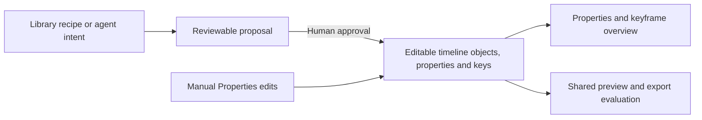

# Properties and Library recipes

[Editor UI](editor-ui.md) · [Effects architecture](effects.md) · [Compound recipes](compound-effect-recipes.md)

Both workspaces share the domain tabs, visual choices and collapsible
keyframe header described here. This is a UI organization and persistent-tuning
contract; it does not claim every legacy preset compiles to editable keyframes.

## Decision

Properties exposes the fundamental editable state of the selected item. Library
contains reusable effects as recipes: workflows that arrange sources, layers,
operators, parameters and keyframes into a result. People and agents author the
same underlying state. An agent's involvement does not change where a property
lives or create a separate kind of timeline.

A **property** is a value on an editable object, such as horizontal position,
scale, opacity, mask feather or glow radius. A **keyframe** changes a supported
property over its declared clock. An **operator** supplies a reusable processing
capability, such as blur, a shape mask, chroma key or an alpha glow, with its own
meaningful controls. A **recipe** coordinates these building blocks over time or
across objects, often including source preparation and audio.

A recipe can be as small as a slow push: a scale curve and optional position
curves. Its small size does not justify a second movement model. Conversely,
blur remains an operator even though its renderer needs several calculations.
The test is editing responsibility, not implementation size.

The diagram describes the existing approval boundary. It does not introduce a
generic recipe compiler. Current skill-owned execution and bounded compilers
remain as described in the compound-recipe architecture.

## Surface ownership

| Surface | Owns | Example |
| --- | --- | --- |
| Properties → Templates | Discovery, construction workflow, requirements, recipe version and examples | Slow push, pop-in plus white flash, masked scene handoff |
| Proposal review | A candidate result, scoped tuning and the approval decision | Adjust the push distance before approving |
| Timeline | Objects, layers, timing, source handles, groups and relationships | Picture, subject cutout, flash overlay and click remain identifiable |
| Properties → Layout | Position, size/scale, rotation where supported, crop and compositing geometry | Edit a push's end scale or horizontal keyframe |
| Properties → Color / Mask / Audio / Text | Each domain's values and supported keys | Animate exposure in Color; gain in Audio |
| Properties → Effects | Persistent tuning of applied effects and directly applicable basic operators | Select an applied glow to tune it, or add a supported basic operator |
| Keyframe header | Selected-item time overview, grouped point navigation and values | Jump to a time, inspect keys, retime a grouped moment |

### Discovery, proposal tweaks and persistent tuning

Library owns discovery and construction of reusable treatments. Proposal tweaks
adjust a candidate before approval. Properties exposes the persistent controls
for the applied result afterward. An effect's useful controls remain reachable
without reopening the original conversation or asking the agent to tune it.

Properties shows applied effects and basic operators that can be added directly to
the selected clip. Selecting an applied effect reveals its controls below without
making an edit. Adding a supported independent operator establishes static defaults
as one undoable edit. Do not show a clickable More effects catalog or Apply with
agent actions here. Treatments requiring agent construction belong in Library →
Recipes, including source preparation, choreography, additional actors and sound.
Existing applied treatments retain their supported persistent controls.

Library may offer Apply with agent to prepare a request with treatment and target
context. That action does not apply or approve an edit; the creator adds voice or
text direction and reviews the resulting proposal. Properties remains the home for direct controls on the applied result.

Proposal tweaks and persistent Properties controls use the same parameter
identity, labels, units, supported ranges and deterministic field bindings.
Proposal controls address the candidate; Properties controls address the applied
timeline. Approval carries the tuned values into the result. Main versus Advanced
presentation may differ with scope, but a useful supported dial must not disappear
on approval. Unsupported persistent tuning is an explicit integration gap.

An applied effect may group useful controls over several building blocks. Those
controls are views/adapters over the canonical fields, never a second copy of
“effect settings.” Layout, Mask, Color and individual keyframes continue to edit
those same fields. Compound controls declare their affected objects and commit
atomically. After manual edits invalidate an adapter's assumptions, show the
modified state and retain access to the underlying controls; never silently
rebuild the recipe. Baked assets expose only controls actually supported by their
editable construction.

Property homes are unchanged by animation. A keyed scale still lives in Layout;
a keyed glow radius still lives with Glow. The shared keyframe header is another
view of those same values and clocks, not a second storage or animation model.
It uses line markers for grouped moments; individual property rows retain their
diamonds. Collapsing it changes presentation only.

## What changes in the inspector design

Remove Movement and its Still / Slow push / Pan selector. Layout already owns
the underlying size and position controls and their diamonds. Do not move that
preset picker into Layout, and do not add a second path or amplitude control
that independently overrides those values. A person can build the movement by
editing keys directly; a recipe can author the same construction.

Rename Motion to Animation in the current walkthrough, retaining one category
navigation level and scrollable sections. This is a transitional home for the
existing entrance/exit and native reveal controls, not permission to accumulate
new bundled effects. The remaining preset selectors need classification before
production migration. If their controls reduce entirely to ordinary property
curves, their creation belongs in Library and their results belong in the
canonical domains. A final Animation tab must earn its place through distinct
native time-based operators; if none remain, remove it rather than leave an
empty or generic keyframe tab.

Entrance and Exit describe phases, not fundamental property ownership. An
opacity fade is an opacity curve. A compound spring entrance is a recipe when
it composes transforms, opacity and timing. A native handwriting reveal may
retain stroke-specific controls if those are a real reusable operator with a
defined clock; it must not be presented as ordinary scale/position automation.

Sections group related controls that may be used together. Disclosures hide
optional detail in place. Nested tabs require substantial, mutually exclusive
workspaces, not a selector and duration. Applied-object selection is distinct:
one selected mask/glow instance can have a detail editor without creating a
second category-navigation level.

## Recipe application and subsequent editing

1. Bind a recipe version to actual sources, target objects and time anchors.
2. Prepare assets where required, preserving sources and provenance.
3. Produce supported operations and an editable candidate. Unsupported mechanics
   are capability gaps; do not invent property fields or hide a flattened render.
4. Review and approve through the existing proposal system. Preview and approval
   derive the same state; approval and Undo preserve all affected state together.
5. Inspect and tune the resulting actors, operators and keys through normal
   Properties and timeline controls without requiring chat.

Recipe provenance can describe how an edit was constructed. It must not become
a competing authority that reapplies the original recipe after a manual change.
Reapplying or regenerating requires an explicit new action with a visible scope;
never overwrite subsequent keyframe edits silently.

Recipe-level tuning may be useful during proposal review. Such a control is an
adapter that deterministically changes underlying fields, with atomic preview,
commit, reset and Undo. It is not an additional independently persisted value
that fights those fields. After arbitrary manual edits, a recipe summary must
show that it was modified or stop offering unsupported round-trip tuning. A
generic linked-control lifecycle is still implementation work.

## Migration inventory

| Existing item | Target classification | Required work |
| --- | --- | --- |
| Movement / Slow push / Pan in walkthrough | Library recipe over Layout keys | Removed from design; preserve existing property keys |
| Native `animationIn` / `animationOut` preset fields | Legacy time-based preset mechanism | Inventory renderer behavior; compile only equivalent supported curves; preserve old playback until migration is proven |
| Word entrance presets | Text-specific temporal behavior | Do not label their whole-block exit fade as a per-word exit |
| Subject Flash / Subject Glow | Independent operators | Keep static defaults, supported numeric fields and explicit keyframing |
| Mask Glitch / coordinated flash and click | Library recipe | Preserve picture, mask and sound roles and anchors |
| Camera reveal / falling letters / contour growth / traveling aura | Requires operator-versus-recipe decomposition | Trace each saved field and clock; isolate general operators before replacing bundled controls |
| Prepared cutout / Scratchpad | Preparation and source-aware treatment | Preserve restoration dependencies; never pretend baked pixels expose nonexistent primitive controls |
| Stabilization | Source preparation capability | Keep preparation status and recovery distinct from authored transform animation |
| Boundary transition | Relationship between adjacent clips | Retain boundary-owned duration and supported parameters, not a clip movement preset |

No migration rewrites existing timelines merely by opening Properties. Keep
legacy readers/renderers until equivalent playback, tuning and Undo are tested.
Document parameters that are static today; do not add decorative diamonds.
Rotation, specialized text and source-speed clocks require their actual capability
contracts, not a blanket promise that everything is keyframeable.

## Implementation status: effects tuning

The production Effects section keeps directly applicable Flash/Glow choices visible,
selects one applied instance for tuning, and includes an applied Moving Grid Matte
in that selection. Existing parameter controls, persistence, reset and Undo owners
are reused. Unapplied operators requiring preparation are omitted for that clip.
Library owns the recipe catalog and its portable copy-to-chat request. The editor
has no embedded chat bridge. Properties does not fetch the recipe catalog or offer
agent-request actions.

Media uses Layout, Color, Mask, Effects, Animation, conditional Audio, and Timing.
Captions use Text, Layout, Animation, and Timing. Audio uses Audio and Timing.
Both workspaces render the same inspector body. Text treatment choices use visual
samples; prepared media fills, scorecards and camera reveals expose their existing
controls when applied, rather than being construction shortcuts on ordinary text.

The keyframe header previews ordinary property and volume-envelope drafts through
the existing resolved-target preview path. Escape and collapse clear the draft;
commit remains one saved edit. Speed keys retain their timing adapter and apply on
commit because they change clip duration and source-time mapping.

Generic compound-recipe adapters are a separate capability migration. Existing
independent controls edit approved timeline fields; richer recipes require the
per-feature binding work described above.

## Required decisions for new features

Before adding a feature, record:

1. Whether it is a property, independent operator, preparation capability or
   recipe, and which surface owns its creation and subsequent tuning.
2. Its real saved fields, target objects, units, supported ranges and clocks,
   including whether each field is static or keyframeable.
3. The shared control and binding used before and after approval, including any
   compound adapter and its behavior after manual edits.
4. Its tile state and action: select applied or Add effect in Properties; agent construction in Library.
5. Preview, cancel, reset, disable, remove and Undo semantics where applicable.

A feature is not fully integrated merely because the agent can create it. Its
meaningful supported controls must remain usable after approval. Use the
[editable parameter contract](../standards/editable-parameter-contract.md) and
[shared controls](../standards/editor-controls.md) for implementation.

## Acceptance for implementation

- Selecting an applied effect changes selection only; its controls appear below.
- Properties contains no recipe catalog or agent-application actions. Library
  request preparation preserves the timeline and approval boundary.
- A value tuned in proposal review survives approval and appears with the same
  meaning in Properties; editing either its grouped control or canonical domain
  row updates the same saved state. Reset and Undo respect the declared scope.
- A person can construct a pan manually from Layout keys and change a
  recipe-authored pan through those exact same rows.
- Editing a recipe-authored end keyframe survives seeking, reload and subsequent
  unrelated edits; no hidden preset restores the original value.
- Preview, committed timeline and export use identical objects, field bindings
  and clocks. Speed steps retain their source-boundary semantics.
- Keyframe header edits and domain rows agree at the same time; grouped retiming
  and deletion are atomic. Recipe-wide tuning declares its wider scope.
- Adding a standalone operator does not create a recipe's timing or extra actors.
- A creator can understand, tune, reset and Undo each meaningful building block
  without the agent or the conversation that produced it.
- Both workspace layouts and supported selection types use the same owners and
  interactions. Fresh visual-only placement and task checks accompany code tests.

The design prototype validates navigation and simulated edits only. It cannot
prove renderer parity, recipe compilation, persistence or sound.

## Clip animation versus a transition

Entrance and Exit animate one selected item at its own start/end. A transition
belongs to the join of two adjacent picture clips. The timeline join and the
Animation panel’s contextual next-clip link open a separate join inspector without
writing history. Choosing a visual type adds the transition. Existing joins expose
type, actual duration bounds and removal. Gaps, missing neighbors and too-short
clips show the validator’s unavailable reason. This supersedes the transitional
implementation embedding transition controls below Entrance/Exit.

## Recipe discovery versus transition samples

Classify by the task the creator performs, not by the word “effect” or whether an
agent can perform it. A one-clip treatment belongs in Properties → Effects; a
simple relationship between adjacent clips belongs in the join inspector. Recipe
discovery is for constructing an edit from prepared assets, layers and coordinated
action. A recipe may end with a scene handoff without becoming a simple transition.

| Example | Home and reason |
| --- | --- |
| Film Burn, Camera Flash, Blackout | Native join transitions with Duration, Strength and Peak hold. Removed from Library/Guide recipe cards; credited reference studies remain documentation. Blackout is a dip through black, not a lens-cover footage recreation. |
| Whip Pan | Native Whip in the join inspector; remove the separate recipe card. Captured directional motion and source handles still matter. |
| Mask Glitch subject handoff | Recipe: isolate the incoming subject, stage white and colour layers, then coordinate the scene change. |
| Subject Flash / Subject Glow | Basic operators in Properties → Effects on supported subjects; not Mask Glitch recipes. |
| Speed entrance/exit, Layered Paper Cutout, Scene Portal | Recipes: prepare footage or cutouts and coordinate multiple editable parts. |

`src/lib/effects/placement.ts` owns the current boundary-study exclusion and public
home labels. Shared studies cannot reappear in recipe discovery merely because they
have a recreation video. User-only recipes keep their authored workflow and are not
classified by title matching. The catalog preserves evidence independently of UI
placement; hiding a study neither deletes it nor upgrades its native support.

Properties previews are recorded from a real 9:16 sample timeline through the
production renderer. Every transition uses the same distinct A/B photographs (a cloudy lake overlook and a sunset shoreline);
Subject Flash and Subject Glow use the same isolated subject and background.
Each recording is 31 frames at 30 fps, including a 15-frame (0.5 second) treatment
and short before/after holds. Its poster is extracted from the encoded first frame.

`RecordedEffectPreview` owns playback for both transition and clip-effect choices.
Pointer enter or keyboard focus plays; pointer leave, blur, leaving the viewport,
or hiding the page pauses and seeks to zero. Only one sample plays at a time.
Previewing does not select or apply anything. Selection uses the existing control
and Undo path. Recipes retain their separate full demonstrations in Library.

The reusable photo set and its licenses live in
`public/inspector-previews/photos/CREDITS.md`. Do not use private project media in
public controls. Refresh recordings with
`pnpm exec tsx scripts/record-inspector-previews.ts <sample-project-id> --photos`.
The recorder checks source hashes against the public sample set and substitutes
photographs in an in-memory engineering fixture; it never writes or approves the
working timeline. Changes to the editable sample reel still use proposals.
The older owned illustrations remain available for existing teaching references.
Include an entry and recording whenever a supported transition is added.

Whip overlaps the outgoing and incoming shots through a directional blur pulse;
it must not expose a hard wipe edge. Cube rotates adjacent rigid faces about a
shared centre, with a common edge at every progress value. Page turn remains a
single hinged sheet above a flat incoming image. Recorded samples must demonstrate
these differences. Transition tile labels and previews share a centered axis.

The manifest records source/output hashes, dimensions, frame rate and frame count.

### Transition control consistency

The join inspector uses one scrolling body in both workspace layouts. Every numeric
parameter uses `InspectorPropertyControl` and `SliderScrubControl`: label, slider,
exact value, matching keyboard and button steps, unit, and reset. Keep the unit with
the number group when wrapping; never allocate a narrower grid track than the input.
Duration is total seconds; Strength is maximum cover; Peak hold is the fraction of
duration at maximum cover, with the equivalent seconds explained beside the control.
Parameter drafts preview, Escape cancels, and commit/reset use the existing transition
patch and Undo path. Changing selection clears the preview.

The timeline join has one persistent visual button. Its accessible DOM target sits
over the same canvas geometry and remains transparent. Hover changes the existing
button's border without introducing another glyph, overlay, or clip highlight.

The control audit covers all nine transition types with rendered-component checks.
Independent visual inspection covered tall/wide layouts at 1280 and 900 pixels and
tall at 760 pixels, including the accent controls and Page turn/Cube inspectors.
Remaining acceptance gaps: physical pointer hover and live commit/cancel/reset/Undo
were not exercised. A separate narrow-window header overflow was observed at 760
pixels; it is outside the transition panel and remains unresolved.

### Saved personal recipes

Named private setting bundles share Properties → Templates discovery and its User-only
filter. They are not a separate User tab. My Style holds automatically applicable
personal guidance; recipes are deliberately chosen for an edit. Legacy
`personal-styles` storage and tool names remain compatibility details, retaining
immutable revisions and pinned proposal references. Their recipe details expose
saved settings and the existing request handoff. They are labeled saved recipes,
not verified recreations, until appropriate evidence exists.
