# Make an effect with your own assets

Every recipe includes an input brief and build instructions. Demonstrations are optional; when present, they show the actual construction. Select it in Templates and tell your agent which files to use. The agent prepares the construction; you review the proposed edit and fine-tune its persistent controls. Generation needs a separate reviewed draft and authorization.

[All effects](README.md#all-templates) · [Contribute an effect](creator-template.md) · [Evidence and packaging](README.md)

<a id="fx-12"></a>

## Shopping basket fills as items are picked

**FX-12 · Reference example** · [Owning skill](../../.agents/skills/video-compositing/SKILL.md)

**Home:** Properties → Templates.

### Demonstration

No recreated demo yet. · [Reference](media/FX-12.mp4)

Reference credit: @celfstudies; https://www.instagram.com/reel/DdN_aljAIY0/. Rights basis: licensed.

Basket remains stable across cuts and each selected product appears once, stays inside the basket and persists through following shots.

### What you supply

- **Shopping footage:** Supply the shopping clips in order and identify each pickup.
- **Basket and products:** Supply a basket image and a clear image of each product. DreamCut can prepare separate cutouts; identify which items should accumulate.

### Supply your own or generate inputs

A basket or product artwork can be generated. Use consistent perspective and lighting; real product labels need supplied artwork.

Generation suitability is guidance, not proof of a tested generated-input workflow. Ask the agent to stage any needed assets in Library → Generate, then review the model, prompt and settings before generating.

### How the effect is built

1. Prepare the basket and product cutouts.
2. Keep the basket in one position across shots and add each product on its pickup.
3. Check that earlier products remain inside the basket.

### Ask your agent

Select this template in Templates, then tell your agent which files to use. Your agent works from this request; it prepares a proposal for you to review, never an edit or a generation on its own.

```text
Use the video-compositing skill for "Shopping basket fills as items are picked" (recipe: FX-12).
For a shared catalog recipe, read docs/effects/catalog.json entry FX-12 and its owning skill before preparing the edit.
Follow the FX-12 recipe and its success criteria, adapting the construction to my supplied assets.
My inputs and target: [attach or identify my files, target clips, order and desired timing].
Shopping footage: Supply the shopping clips in order and identify each pickup.
Basket and products: Supply a basket image and a clear image of each product. DreamCut can prepare separate cutouts; identify which items should accumulate.
How it works: Prepare the basket and product cutouts. Keep the basket in one position across shots and add each product on its pickup. Check that earlier products remain inside the basket.
Input generation guidance: A basket or product artwork can be generated. Use consistent perspective and lighting; real product labels need supplied artwork.
Read the current timeline, applicable preferences and available media. Ask for missing inputs; do not assume example assets are mine. If generation is needed, prepare a visible draft and wait for my generation authorization.
Preserve original sources and unrelated edits. Keep meaningful layers and tuning controls editable. For an existing edit, propose changes for my review; do not apply or approve them.
This is a reference-only candidate. Assess feasibility and explain capability gaps before promising a recreation.
Known limitations: Reference analyzed; no verified recreation packaged.
Preview the result, check the full transition or animation and report anything unverified.
```

### Evidence and limits

- Reference analyzed; no verified recreation packaged.

[Technical recipe and evidence](catalog.json) · [Skill receipt](../../.agents/skills/video-compositing/references/effect-evidence.json)

<a id="fx-14"></a>

## Floating translucent project screen

**FX-14 · Reference example** · [Owning skill](../../.agents/skills/video-compositing/SKILL.md)

**Home:** Properties → Templates.

### Demonstration

No recreated demo yet. · [Reference](media/FX-14.mp4)

Reference credit: @celfstudies; https://www.instagram.com/reel/DdN_aljAIY0/. Rights basis: licensed.

Screen is readable, translucent and does not cover the subject unintentionally.

### What you supply

- **Laptop footage:** Supply a shot with room for a floating screen above the laptop.
- **Screen content:** Supply the original screen recording or screenshot and the interval to show.

### Supply your own or generate inputs

A generic laptop background can be generated. Supply actual screen content when text or interface accuracy matters.

Generation suitability is guidance, not proof of a tested generated-input workflow. Ask the agent to stage any needed assets in Library → Generate, then review the model, prompt and settings before generating.

### How the effect is built

1. Fit the screen content above the laptop.
2. Adjust transparency and placement while keeping it readable.
3. Preserve the timing of a moving screen recording.

### Ask your agent

Select this template in Templates, then tell your agent which files to use. Your agent works from this request; it prepares a proposal for you to review, never an edit or a generation on its own.

```text
Use the video-compositing skill for "Floating translucent project screen" (recipe: FX-14).
For a shared catalog recipe, read docs/effects/catalog.json entry FX-14 and its owning skill before preparing the edit.
Follow the FX-14 recipe and its success criteria, adapting the construction to my supplied assets.
My inputs and target: [attach or identify my files, target clips, order and desired timing].
Laptop footage: Supply a shot with room for a floating screen above the laptop.
Screen content: Supply the original screen recording or screenshot and the interval to show.
How it works: Fit the screen content above the laptop. Adjust transparency and placement while keeping it readable. Preserve the timing of a moving screen recording.
Input generation guidance: A generic laptop background can be generated. Supply actual screen content when text or interface accuracy matters.
Read the current timeline, applicable preferences and available media. Ask for missing inputs; do not assume example assets are mine. If generation is needed, prepare a visible draft and wait for my generation authorization.
Preserve original sources and unrelated edits. Keep meaningful layers and tuning controls editable. For an existing edit, propose changes for my review; do not apply or approve them.
This is a reference-only candidate. Assess feasibility and explain capability gaps before promising a recreation.
Known limitations: Reference analyzed; no verified recreation packaged.
Preview the result, check the full transition or animation and report anything unverified.
```

### Evidence and limits

- Reference analyzed; no verified recreation packaged.

[Technical recipe and evidence](catalog.json) · [Skill receipt](../../.agents/skills/video-compositing/references/effect-evidence.json)

<a id="fx-06"></a>

## Gesture-matched outfit change

**FX-06 · Reference example** · [Owning skill](../../.agents/skills/visual-timing/SKILL.md)

**Home:** Properties → Templates.

### Demonstration

No recreated demo yet. · [Reference](media/FX-06.mp4)

Reference credit: @celfstudies; https://www.instagram.com/reel/DdN_aljAIY0/. Rights basis: licensed.

Hand continuity disguises the outfit change; no accidental motion reversal.

### What you supply

- **Two outfit takes:** Film the same hand gesture in both outfits with the camera, framing and lighting unchanged. Leave footage before and after the gesture.

### Supply your own or generate inputs

Paired generated takes may not preserve hands, identity or motion. Filmed matching takes are the more controllable input; inspect any generated pair before planning the cut.

Generation suitability is guidance, not proof of a tested generated-input workflow. Ask the agent to stage any needed assets in Library → Generate, then review the model, prompt and settings before generating.

### How the effect is built

1. Find matching points in the hand gesture.
2. Align the body and hand positions, then cut at the gesture peak.
3. Check the movement through the join.

### Ask your agent

Select this template in Templates, then tell your agent which files to use. Your agent works from this request; it prepares a proposal for you to review, never an edit or a generation on its own.

```text
Use the visual-timing skill for "Gesture-matched outfit change" (recipe: FX-06).
For a shared catalog recipe, read docs/effects/catalog.json entry FX-06 and its owning skill before preparing the edit.
Follow the FX-06 recipe and its success criteria, adapting the construction to my supplied assets.
My inputs and target: [attach or identify my files, target clips, order and desired timing].
Two outfit takes: Film the same hand gesture in both outfits with the camera, framing and lighting unchanged. Leave footage before and after the gesture.
How it works: Find matching points in the hand gesture. Align the body and hand positions, then cut at the gesture peak. Check the movement through the join.
Input generation guidance: Paired generated takes may not preserve hands, identity or motion. Filmed matching takes are the more controllable input; inspect any generated pair before planning the cut.
Read the current timeline, applicable preferences and available media. Ask for missing inputs; do not assume example assets are mine. If generation is needed, prepare a visible draft and wait for my generation authorization.
Preserve original sources and unrelated edits. Keep meaningful layers and tuning controls editable. For an existing edit, propose changes for my review; do not apply or approve them.
This is a reference-only candidate. Assess feasibility and explain capability gaps before promising a recreation.
Known limitations: Reference analyzed; no verified recreation packaged.
Preview the result, check the full transition or animation and report anything unverified.
```

### Evidence and limits

- Reference analyzed; no verified recreation packaged.

[Technical recipe and evidence](catalog.json) · [Skill receipt](../../.agents/skills/visual-timing/references/effect-evidence.json)

<a id="fx-07"></a>

## Foot-to-camera location change

**FX-07 · Reference example** · [Owning skill](../../.agents/skills/visual-timing/SKILL.md)

**Home:** Properties → Templates.

### Demonstration

No recreated demo yet. · [Reference](media/FX-07.mp4)

Reference credit: @celfstudies; https://www.instagram.com/reel/DdN_aljAIY0/. Rights basis: licensed.

Shoe trajectory and camera angle connect without a conspicuous jump.

### What you supply

- **Two location takes:** Film a low-angle shoe approach in the first location and retreat in the second. Match direction and apparent shoe size; retain the full approach and retreat.

### Supply your own or generate inputs

Generated paired motion needs inspection for shoe shape, direction and scale continuity. Matching filmed takes are preferable for an exact join.

Generation suitability is guidance, not proof of a tested generated-input workflow. Ask the agent to stage any needed assets in Library → Generate, then review the model, prompt and settings before generating.

### How the effect is built

1. Match the shoe coverage and camera angle.
2. Cut while the shoe obscures the scene.
3. Check that the retreat continues the incoming movement.

### Ask your agent

Select this template in Templates, then tell your agent which files to use. Your agent works from this request; it prepares a proposal for you to review, never an edit or a generation on its own.

```text
Use the visual-timing skill for "Foot-to-camera location change" (recipe: FX-07).
For a shared catalog recipe, read docs/effects/catalog.json entry FX-07 and its owning skill before preparing the edit.
Follow the FX-07 recipe and its success criteria, adapting the construction to my supplied assets.
My inputs and target: [attach or identify my files, target clips, order and desired timing].
Two location takes: Film a low-angle shoe approach in the first location and retreat in the second. Match direction and apparent shoe size; retain the full approach and retreat.
How it works: Match the shoe coverage and camera angle. Cut while the shoe obscures the scene. Check that the retreat continues the incoming movement.
Input generation guidance: Generated paired motion needs inspection for shoe shape, direction and scale continuity. Matching filmed takes are preferable for an exact join.
Read the current timeline, applicable preferences and available media. Ask for missing inputs; do not assume example assets are mine. If generation is needed, prepare a visible draft and wait for my generation authorization.
Preserve original sources and unrelated edits. Keep meaningful layers and tuning controls editable. For an existing edit, propose changes for my review; do not apply or approve them.
This is a reference-only candidate. Assess feasibility and explain capability gaps before promising a recreation.
Known limitations: Reference analyzed; no verified recreation packaged.
Preview the result, check the full transition or animation and report anything unverified.
```

### Evidence and limits

- Reference analyzed; no verified recreation packaged.

[Technical recipe and evidence](catalog.json) · [Skill receipt](../../.agents/skills/visual-timing/references/effect-evidence.json)

<a id="fx-08"></a>

## Objects float in → scene switches → white blips

**FX-08 · Partial recreation · read limitations** · [Owning skill](../../.agents/skills/mask-glitch/SKILL.md)

**Home:** Properties → Templates.

### Demonstration

[Recreated demo](media/FX-08-recreation.mp4) · [Reference](media/FX-08.mp4)

Reference credit: @celfstudies; https://www.instagram.com/reel/DdN_aljAIY0/. Rights basis: licensed.

Recreation credit: DreamCut dinosaur/bird example; supplied photos. Rights basis: owned.

Objects enter separately over the outgoing shot, land without jumping when the background switches, then blip white within their own silhouettes. Reuse with a different number and type of objects.

### What you supply

- **Starting scene:** Supply one photo or video to begin on.
- **Destination scene:** Supply one scene with the objects already in their final arrangement. Identify the objects and their entrance order; DreamCut prepares their cutouts.

### Supply your own or generate inputs

Either scene can be generated. Generate the destination composition first and extract its objects so their positions match at the handoff.

Generation suitability is guidance, not proof of a tested generated-input workflow. Ask the agent to stage any needed assets in Library → Generate, then review the model, prompt and settings before generating.

### How the effect is built

1. Separate the chosen objects from the destination scene.
2. Bring them over the starting scene in the chosen order.
3. Switch to the destination after they land, then flash their silhouettes white.

### Ask your agent

Select this template in Templates, then tell your agent which files to use. Your agent works from this request; it prepares a proposal for you to review, never an edit or a generation on its own.

```text
Use the mask-glitch skill for "Objects float in → scene switches → white blips" (recipe: FX-08).
For a shared catalog recipe, read docs/effects/catalog.json entry FX-08 and its owning skill before preparing the edit.
Follow the FX-08 recipe and its success criteria, adapting the construction to my supplied assets.
My inputs and target: [attach or identify my files, target clips, order and desired timing].
Starting scene: Supply one photo or video to begin on.
Destination scene: Supply one scene with the objects already in their final arrangement. Identify the objects and their entrance order; DreamCut prepares their cutouts.
How it works: Separate the chosen objects from the destination scene. Bring them over the starting scene in the chosen order. Switch to the destination after they land, then flash their silhouettes white.
Input generation guidance: Either scene can be generated. Generate the destination composition first and extract its objects so their positions match at the handoff.
Read the current timeline, applicable preferences and available media. Ask for missing inputs; do not assume example assets are mine. If generation is needed, prepare a visible draft and wait for my generation authorization.
Preserve original sources and unrelated edits. Keep meaningful layers and tuning controls editable. For an existing edit, propose changes for my review; do not apply or approve them.
Known limitations: Batched pop-ins adapt the reference rather than reproducing its individual float trajectories. No new input trial or fresh frame-by-frame fidelity review was performed for this packaging.
Preview the result, check the full transition or animation and report anything unverified.
```

### Evidence and limits

- Batched pop-ins adapt the reference rather than reproducing its individual float trajectories.
- No new input trial or fresh frame-by-frame fidelity review was performed for this packaging.

[Technical recipe and evidence](catalog.json) · [Skill receipt](../../.agents/skills/mask-glitch/references/effect-evidence.json)

<a id="fx-11"></a>

## Drinks enter before their background

**FX-11 · Reference example** · [Owning skill](../../.agents/skills/video-compositing/SKILL.md)

**Home:** Properties → Templates.

### Demonstration

No recreated demo yet. · [Reference](media/FX-11.mp4)

Reference credit: @celfstudies; https://www.instagram.com/reel/DdN_aljAIY0/. Rights basis: licensed.

No clipped fingers, changing edges or jump when destination shot takes over.

### What you supply

- **Starting and drinks shots:** Supply the outgoing shot and an incoming shot of hands holding the drinks. Keep hands and cups fully in frame and retain movement around the intended cut.

### Supply your own or generate inputs

Generated hands and cups must remain consistent across frames. Still images can support a simpler cutout version, but will not recreate moving hands.

Generation suitability is guidance, not proof of a tested generated-input workflow. Ask the agent to stage any needed assets in Library → Generate, then review the model, prompt and settings before generating.

### How the effect is built

1. Isolate the moving hands and drinks from the incoming shot.
2. Show those layers over the outgoing shot.
3. Switch the background when the layers align with the incoming picture.

### Ask your agent

Select this template in Templates, then tell your agent which files to use. Your agent works from this request; it prepares a proposal for you to review, never an edit or a generation on its own.

```text
Use the video-compositing skill for "Drinks enter before their background" (recipe: FX-11).
For a shared catalog recipe, read docs/effects/catalog.json entry FX-11 and its owning skill before preparing the edit.
Follow the FX-11 recipe and its success criteria, adapting the construction to my supplied assets.
My inputs and target: [attach or identify my files, target clips, order and desired timing].
Starting and drinks shots: Supply the outgoing shot and an incoming shot of hands holding the drinks. Keep hands and cups fully in frame and retain movement around the intended cut.
How it works: Isolate the moving hands and drinks from the incoming shot. Show those layers over the outgoing shot. Switch the background when the layers align with the incoming picture.
Input generation guidance: Generated hands and cups must remain consistent across frames. Still images can support a simpler cutout version, but will not recreate moving hands.
Read the current timeline, applicable preferences and available media. Ask for missing inputs; do not assume example assets are mine. If generation is needed, prepare a visible draft and wait for my generation authorization.
Preserve original sources and unrelated edits. Keep meaningful layers and tuning controls editable. For an existing edit, propose changes for my review; do not apply or approve them.
This is a reference-only candidate. Assess feasibility and explain capability gaps before promising a recreation.
Known limitations: Reference analyzed; no verified recreation packaged.
Preview the result, check the full transition or animation and report anything unverified.
```

### Evidence and limits

- Reference analyzed; no verified recreation packaged.

[Technical recipe and evidence](catalog.json) · [Skill receipt](../../.agents/skills/video-compositing/references/effect-evidence.json)

<a id="fx-16"></a>

## Restaurant builds over the shot, then becomes the scene

**FX-16 · Reference example** · [Owning skill](../../.agents/skills/video-compositing/SKILL.md)

**Home:** Properties → Templates.

### Demonstration

No recreated demo yet. · [Reference](media/FX-16.mp4)

Reference credit: @celfstudies; https://www.instagram.com/reel/DdN_aljAIY0/. Rights basis: licensed.

Staged objects align to the incoming exterior; the glitch and flash resolve cleanly as part of the same scene handoff.

### What you supply

- **Walking and restaurant shots:** Supply the outgoing walk and destination exterior. Identify the signs or lanterns that should appear first; keep them unobstructed in the destination.

### Supply your own or generate inputs

A restaurant exterior can be generated; exact signs need supplied artwork. Extract reveal pieces from the same exterior so they fit when the scene switches.

Generation suitability is guidance, not proof of a tested generated-input workflow. Ask the agent to stage any needed assets in Library → Generate, then review the model, prompt and settings before generating.

### How the effect is built

1. Extract the chosen exterior details.
2. Reveal the pieces over the walk in order.
3. Align them to the exterior, switch scenes and add the requested glitch or flash accent.

### Ask your agent

Select this template in Templates, then tell your agent which files to use. Your agent works from this request; it prepares a proposal for you to review, never an edit or a generation on its own.

```text
Use the video-compositing skill for "Restaurant builds over the shot, then becomes the scene" (recipe: FX-16).
For a shared catalog recipe, read docs/effects/catalog.json entry FX-16 and its owning skill before preparing the edit.
Follow the FX-16 recipe and its success criteria, adapting the construction to my supplied assets.
My inputs and target: [attach or identify my files, target clips, order and desired timing].
Walking and restaurant shots: Supply the outgoing walk and destination exterior. Identify the signs or lanterns that should appear first; keep them unobstructed in the destination.
How it works: Extract the chosen exterior details. Reveal the pieces over the walk in order. Align them to the exterior, switch scenes and add the requested glitch or flash accent.
Input generation guidance: A restaurant exterior can be generated; exact signs need supplied artwork. Extract reveal pieces from the same exterior so they fit when the scene switches.
Read the current timeline, applicable preferences and available media. Ask for missing inputs; do not assume example assets are mine. If generation is needed, prepare a visible draft and wait for my generation authorization.
Preserve original sources and unrelated edits. Keep meaningful layers and tuning controls editable. For an existing edit, propose changes for my review; do not apply or approve them.
This is a reference-only candidate. Assess feasibility and explain capability gaps before promising a recreation.
Known limitations: Reference analyzed; no verified recreation packaged.
Preview the result, check the full transition or animation and report anything unverified.
```

### Evidence and limits

- Reference analyzed; no verified recreation packaged.

[Technical recipe and evidence](catalog.json) · [Skill receipt](../../.agents/skills/video-compositing/references/effect-evidence.json)

<a id="fx-15"></a>

## Laptop-edge scene wipe

**FX-15 · Reference example** · [Owning skill](../../.agents/skills/recreate-effect/SKILL.md)

**Home:** Properties → Templates.

### Demonstration

No recreated demo yet. · [Reference](media/FX-15.mp4)

Reference credit: @celfstudies; https://www.instagram.com/reel/DdN_aljAIY0/. Rights basis: licensed.

Reveal hugs the moving laptop edge without exposing wrong-side pixels.

### What you supply

- **Closing laptop shot:** Film the lid closing with its moving edge visible throughout the intended wipe. Leave time before and after the action.
- **Destination shot:** Supply the scene that should appear behind the lid.

### Supply your own or generate inputs

The destination can be generated. A generated laptop shot must have a continuous, trackable lid edge; inspect it before using it.

Generation suitability is guidance, not proof of a tested generated-input workflow. Ask the agent to stage any needed assets in Library → Generate, then review the model, prompt and settings before generating.

### How the effect is built

1. Track the moving lid edge.
2. Reveal the destination only on the uncovered side.
3. Check the edge and foreground occlusion through the whole wipe.

### Ask your agent

Select this template in Templates, then tell your agent which files to use. Your agent works from this request; it prepares a proposal for you to review, never an edit or a generation on its own.

```text
Use the recreate-effect skill for "Laptop-edge scene wipe" (recipe: FX-15).
For a shared catalog recipe, read docs/effects/catalog.json entry FX-15 and its owning skill before preparing the edit.
Follow the FX-15 recipe and its success criteria, adapting the construction to my supplied assets.
My inputs and target: [attach or identify my files, target clips, order and desired timing].
Closing laptop shot: Film the lid closing with its moving edge visible throughout the intended wipe. Leave time before and after the action.
Destination shot: Supply the scene that should appear behind the lid.
How it works: Track the moving lid edge. Reveal the destination only on the uncovered side. Check the edge and foreground occlusion through the whole wipe.
Input generation guidance: The destination can be generated. A generated laptop shot must have a continuous, trackable lid edge; inspect it before using it.
Read the current timeline, applicable preferences and available media. Ask for missing inputs; do not assume example assets are mine. If generation is needed, prepare a visible draft and wait for my generation authorization.
Preserve original sources and unrelated edits. Keep meaningful layers and tuning controls editable. For an existing edit, propose changes for my review; do not apply or approve them.
This is a reference-only candidate. Assess feasibility and explain capability gaps before promising a recreation.
Known limitations: Reference analyzed; no verified recreation packaged.
Preview the result, check the full transition or animation and report anything unverified.
```

### Evidence and limits

- Reference analyzed; no verified recreation packaged.

[Technical recipe and evidence](catalog.json) · [Skill receipt](../../.agents/skills/recreate-effect/references/effect-evidence.json)

<a id="fx-02"></a>

## Paper unfolds across cuts, then becomes a handheld title

**FX-02 · Reference example** · [Owning skill](../../.agents/skills/recreate-effect/SKILL.md)

**Home:** Properties → Templates.

### Demonstration

No recreated demo yet. · [Reference](media/FX-02.mp4)

Reference credit: @celfstudies; https://www.instagram.com/reel/DdN_aljAIY0/. Rights basis: licensed.

Paper opens into readable artwork and transitions into the handheld card without a visible positional jump.

### What you supply

- **Title artwork and scenes:** Supply the exact title artwork and ordered background shots.
- **Paper and handoff footage:** Supply an unfolding paper sequence or ask in chat for a plan. For a handoff into a real card, film the same artwork at the intended size and angle.

### Supply your own or generate inputs

Paper textures or unfolding frames can be generated, but text, folds and the handoff pose need verification. Keep exact title lettering as supplied artwork.

Generation suitability is guidance, not proof of a tested generated-input workflow. Ask the agent to stage any needed assets in Library → Generate, then review the model, prompt and settings before generating.

### How the effect is built

1. Prepare unfolding paper states around the title artwork.
2. Time the unfolding across the selected shots.
3. Match the final paper pose to the filmed card, preserving any hand in front.

### Ask your agent

Select this template in Templates, then tell your agent which files to use. Your agent works from this request; it prepares a proposal for you to review, never an edit or a generation on its own.

```text
Use the recreate-effect skill for "Paper unfolds across cuts, then becomes a handheld title" (recipe: FX-02).
For a shared catalog recipe, read docs/effects/catalog.json entry FX-02 and its owning skill before preparing the edit.
Follow the FX-02 recipe and its success criteria, adapting the construction to my supplied assets.
My inputs and target: [attach or identify my files, target clips, order and desired timing].
Title artwork and scenes: Supply the exact title artwork and ordered background shots.
Paper and handoff footage: Supply an unfolding paper sequence or ask in chat for a plan. For a handoff into a real card, film the same artwork at the intended size and angle.
How it works: Prepare unfolding paper states around the title artwork. Time the unfolding across the selected shots. Match the final paper pose to the filmed card, preserving any hand in front.
Input generation guidance: Paper textures or unfolding frames can be generated, but text, folds and the handoff pose need verification. Keep exact title lettering as supplied artwork.
Read the current timeline, applicable preferences and available media. Ask for missing inputs; do not assume example assets are mine. If generation is needed, prepare a visible draft and wait for my generation authorization.
Preserve original sources and unrelated edits. Keep meaningful layers and tuning controls editable. For an existing edit, propose changes for my review; do not apply or approve them.
This is a reference-only candidate. Assess feasibility and explain capability gaps before promising a recreation.
Known limitations: Reference analyzed; no verified recreation packaged.
Preview the result, check the full transition or animation and report anything unverified.
```

### Evidence and limits

- Reference analyzed; no verified recreation packaged.

[Technical recipe and evidence](catalog.json) · [Skill receipt](../../.agents/skills/recreate-effect/references/effect-evidence.json)

<a id="fx-05"></a>

## Persistent time and activity labels

**FX-05 · Reference example** · [Owning skill](../../.agents/skills/video-typography/SKILL.md)

**Home:** Properties → Templates.

### Demonstration

No recreated demo yet. · [Reference](media/FX-05.mp4)

Reference credit: @celfstudies; https://www.instagram.com/reel/DdN_aljAIY0/. Rights basis: licensed.

Labels remain legible and update exactly on chapter boundaries.

### What you supply

- **Footage and chapter labels:** Supply the footage, the exact time and activity text for each chapter, and when each chapter begins and ends.

### Supply your own or generate inputs

Background footage may be generated. Keep time and activity labels as editable text instead of generating them into the picture.

Generation suitability is guidance, not proof of a tested generated-input workflow. Ask the agent to stage any needed assets in Library → Generate, then review the model, prompt and settings before generating.

### How the effect is built

1. Create separate time and activity text layers.
2. Keep their position consistent across chapters.
3. Update the text at each chapter boundary and check legibility.

### Ask your agent

Select this template in Templates, then tell your agent which files to use. Your agent works from this request; it prepares a proposal for you to review, never an edit or a generation on its own.

```text
Use the video-typography skill for "Persistent time and activity labels" (recipe: FX-05).
For a shared catalog recipe, read docs/effects/catalog.json entry FX-05 and its owning skill before preparing the edit.
Follow the FX-05 recipe and its success criteria, adapting the construction to my supplied assets.
My inputs and target: [attach or identify my files, target clips, order and desired timing].
Footage and chapter labels: Supply the footage, the exact time and activity text for each chapter, and when each chapter begins and ends.
How it works: Create separate time and activity text layers. Keep their position consistent across chapters. Update the text at each chapter boundary and check legibility.
Input generation guidance: Background footage may be generated. Keep time and activity labels as editable text instead of generating them into the picture.
Read the current timeline, applicable preferences and available media. Ask for missing inputs; do not assume example assets are mine. If generation is needed, prepare a visible draft and wait for my generation authorization.
Preserve original sources and unrelated edits. Keep meaningful layers and tuning controls editable. For an existing edit, propose changes for my review; do not apply or approve them.
This is a reference-only candidate. Assess feasibility and explain capability gaps before promising a recreation.
Known limitations: Reference analyzed; no verified recreation packaged.
Preview the result, check the full transition or animation and report anything unverified.
```

### Evidence and limits

- Reference analyzed; no verified recreation packaged.

[Technical recipe and evidence](catalog.json) · [Skill receipt](../../.agents/skills/video-typography/references/effect-evidence.json)

<a id="fx-10"></a>

## Lunch before/after match cut

**FX-10 · Reference example** · [Owning skill](../../.agents/skills/visual-timing/SKILL.md)

**Home:** Properties → Templates.

### Demonstration

No recreated demo yet. · [Reference](media/FX-10.mp4)

Reference credit: @celfstudies; https://www.instagram.com/reel/DdN_aljAIY0/. Rights basis: licensed.

Plate positions feel continuous while food state changes.

### What you supply

- **Before and after lunch:** Film both states from the same angle with the plates in matching positions. Leave extra footage around the planned join.

### Supply your own or generate inputs

Paired images can be generated, but plate placement and viewpoint must match. Inspect the pair before committing to a match cut.

Generation suitability is guidance, not proof of a tested generated-input workflow. Ask the agent to stage any needed assets in Library → Generate, then review the model, prompt and settings before generating.

### How the effect is built

1. Choose corresponding frames.
2. Align plate positions and scale.
3. Cut between the food states while retaining the original footage.

### Ask your agent

Select this template in Templates, then tell your agent which files to use. Your agent works from this request; it prepares a proposal for you to review, never an edit or a generation on its own.

```text
Use the visual-timing skill for "Lunch before/after match cut" (recipe: FX-10).
For a shared catalog recipe, read docs/effects/catalog.json entry FX-10 and its owning skill before preparing the edit.
Follow the FX-10 recipe and its success criteria, adapting the construction to my supplied assets.
My inputs and target: [attach or identify my files, target clips, order and desired timing].
Before and after lunch: Film both states from the same angle with the plates in matching positions. Leave extra footage around the planned join.
How it works: Choose corresponding frames. Align plate positions and scale. Cut between the food states while retaining the original footage.
Input generation guidance: Paired images can be generated, but plate placement and viewpoint must match. Inspect the pair before committing to a match cut.
Read the current timeline, applicable preferences and available media. Ask for missing inputs; do not assume example assets are mine. If generation is needed, prepare a visible draft and wait for my generation authorization.
Preserve original sources and unrelated edits. Keep meaningful layers and tuning controls editable. For an existing edit, propose changes for my review; do not apply or approve them.
This is a reference-only candidate. Assess feasibility and explain capability gaps before promising a recreation.
Known limitations: Reference analyzed; no verified recreation packaged.
Preview the result, check the full transition or animation and report anything unverified.
```

### Evidence and limits

- Reference analyzed; no verified recreation packaged.

[Technical recipe and evidence](catalog.json) · [Skill receipt](../../.agents/skills/visual-timing/references/effect-evidence.json)

<a id="fx-19"></a>

## Dinner before/after match cut

**FX-19 · Reference example** · [Owning skill](../../.agents/skills/visual-timing/SKILL.md)

**Home:** Properties → Templates.

### Demonstration

No recreated demo yet. · [Reference](media/FX-19.mp4)

Reference credit: @celfstudies; https://www.instagram.com/reel/DdN_aljAIY0/. Rights basis: licensed.

Bowl center and scale agree across the cut.

### What you supply

- **Before and after dinner:** Film the full and empty bowl from the same viewpoint with the bowl centered in the same place. Leave footage around the join.

### Supply your own or generate inputs

Paired images can be generated if bowl shape, center and camera angle stay consistent; inspect those details before use.

Generation suitability is guidance, not proof of a tested generated-input workflow. Ask the agent to stage any needed assets in Library → Generate, then review the model, prompt and settings before generating.

### How the effect is built

1. Choose matching bowl views.
2. Align center and size.
3. Cut between states and check the visual continuity.

### Ask your agent

Select this template in Templates, then tell your agent which files to use. Your agent works from this request; it prepares a proposal for you to review, never an edit or a generation on its own.

```text
Use the visual-timing skill for "Dinner before/after match cut" (recipe: FX-19).
For a shared catalog recipe, read docs/effects/catalog.json entry FX-19 and its owning skill before preparing the edit.
Follow the FX-19 recipe and its success criteria, adapting the construction to my supplied assets.
My inputs and target: [attach or identify my files, target clips, order and desired timing].
Before and after dinner: Film the full and empty bowl from the same viewpoint with the bowl centered in the same place. Leave footage around the join.
How it works: Choose matching bowl views. Align center and size. Cut between states and check the visual continuity.
Input generation guidance: Paired images can be generated if bowl shape, center and camera angle stay consistent; inspect those details before use.
Read the current timeline, applicable preferences and available media. Ask for missing inputs; do not assume example assets are mine. If generation is needed, prepare a visible draft and wait for my generation authorization.
Preserve original sources and unrelated edits. Keep meaningful layers and tuning controls editable. For an existing edit, propose changes for my review; do not apply or approve them.
This is a reference-only candidate. Assess feasibility and explain capability gaps before promising a recreation.
Known limitations: Reference analyzed; no verified recreation packaged.
Preview the result, check the full transition or animation and report anything unverified.
```

### Evidence and limits

- Reference analyzed; no verified recreation packaged.

[Technical recipe and evidence](catalog.json) · [Skill receipt](../../.agents/skills/visual-timing/references/effect-evidence.json)

<a id="fx-20"></a>

## Remove-to-show title reveal — provisional

**FX-20 · Reference example** · [Owning skill](../../.agents/skills/video-typography/SKILL.md)

**Home:** Properties → Templates.

### Demonstration

No recreated demo yet. · [Reference](media/FX-20.mp4)

Reference credit: @celfstudies; https://www.instagram.com/reel/DdN_aljAIY0/. Rights basis: licensed.

Define what is removed or moved away and what it reveals, then verify the revealed title follows that interaction. Exact mechanism remains pending.

### What you supply

- **Background and title:** Supply the background, exact title and secondary text. Describe what should move away to reveal the title; this reference mechanism is still provisional.

### Supply your own or generate inputs

The background or covering object can be generated. Keep lettering editable and settle the reveal action before generating assets.

Generation suitability is guidance, not proof of a tested generated-input workflow. Ask the agent to stage any needed assets in Library → Generate, then review the model, prompt and settings before generating.

### How the effect is built

1. Agree on the object or action that uncovers the title.
2. Create editable title layers.
3. Build and inspect the reveal; report any departure from the reference.

### Ask your agent

Select this template in Templates, then tell your agent which files to use. Your agent works from this request; it prepares a proposal for you to review, never an edit or a generation on its own.

```text
Use the video-typography skill for "Remove-to-show title reveal — provisional" (recipe: FX-20).
For a shared catalog recipe, read docs/effects/catalog.json entry FX-20 and its owning skill before preparing the edit.
Follow the FX-20 recipe and its success criteria, adapting the construction to my supplied assets.
My inputs and target: [attach or identify my files, target clips, order and desired timing].
Background and title: Supply the background, exact title and secondary text. Describe what should move away to reveal the title; this reference mechanism is still provisional.
How it works: Agree on the object or action that uncovers the title. Create editable title layers. Build and inspect the reveal; report any departure from the reference.
Input generation guidance: The background or covering object can be generated. Keep lettering editable and settle the reveal action before generating assets.
Read the current timeline, applicable preferences and available media. Ask for missing inputs; do not assume example assets are mine. If generation is needed, prepare a visible draft and wait for my generation authorization.
Preserve original sources and unrelated edits. Keep meaningful layers and tuning controls editable. For an existing edit, propose changes for my review; do not apply or approve them.
This is a reference-only candidate. Assess feasibility and explain capability gaps before promising a recreation.
Known limitations: Reference analyzed; no verified recreation packaged.
Preview the result, check the full transition or animation and report anything unverified.
```

### Evidence and limits

- Reference analyzed; no verified recreation packaged.

[Technical recipe and evidence](catalog.json) · [Skill receipt](../../.agents/skills/video-typography/references/effect-evidence.json)

<a id="fx-scratchpad"></a>

## White paper outline

**FX-SCRATCHPAD · Partial recreation · read limitations** · [Owning skill](../../.agents/skills/scratchpad-treatment/SKILL.md)

**Home:** Properties → Templates.

### Demonstration

[Recreated demo](../../public/guide/effects/scratchpad-silhouette-after.png) · [Reference](../../public/guide/effects/scratchpad-silhouette-before.png)

Reference credit: Madeleine Price Ball / Wikimedia Commons, CC0 1.0. Rights basis: licensed.

Recreation credit: Existing DreamCut image-generated variant of the CC0 silhouette. Rights basis: synthetic.

White edge wraps the full silhouette without clipping. Subject pixels and pose remain unchanged when applying the current skill.

### What you supply

- **Artwork:** Supply a cutout, logo or silhouette. If it has a background, ask in chat to cut it out first.
- **Border preference:** Describe the border width and whether the paper edge should look smooth or rough.

### Supply your own or generate inputs

The base artwork can be generated. Applying the outline should preserve its pixels and pose; the historical example changes pose and is not a fidelity pass.

Generation suitability is guidance, not proof of a tested generated-input workflow. Ask the agent to stage any needed assets in Library → Generate, then review the model, prompt and settings before generating.

### How the effect is built

1. Preserve the original artwork.
2. Add a continuous white border with room around the edges.
3. Check corners and crop edges for clipping.

### Ask your agent

Select this template in Templates, then tell your agent which files to use. Your agent works from this request; it prepares a proposal for you to review, never an edit or a generation on its own.

```text
Use the scratchpad-treatment skill for "White paper outline" (recipe: FX-SCRATCHPAD).
For a shared catalog recipe, read docs/effects/catalog.json entry FX-SCRATCHPAD and its owning skill before preparing the edit.
Follow the FX-SCRATCHPAD recipe and its success criteria, adapting the construction to my supplied assets.
My inputs and target: [attach or identify my files, target clips, order and desired timing].
Artwork: Supply a cutout, logo or silhouette. If it has a background, ask in chat to cut it out first.
Border preference: Describe the border width and whether the paper edge should look smooth or rough.
How it works: Preserve the original artwork. Add a continuous white border with room around the edges. Check corners and crop edges for clipping.
Input generation guidance: The base artwork can be generated. Applying the outline should preserve its pixels and pose; the historical example changes pose and is not a fidelity pass.
Read the current timeline, applicable preferences and available media. Ask for missing inputs; do not assume example assets are mine. If generation is needed, prepare a visible draft and wait for my generation authorization.
Preserve original sources and unrelated edits. Keep meaningful layers and tuning controls editable. For an existing edit, propose changes for my review; do not apply or approve them.
Known limitations: Historical generated example changes the source pose; it is a style example, not a passing source-preservation trial. Static effect uses image evidence rather than a video clip.
Preview the result, check the full transition or animation and report anything unverified.
```

### Evidence and limits

- Historical generated example changes the source pose; it is a style example, not a passing source-preservation trial.
- Static effect uses image evidence rather than a video clip.

[Technical recipe and evidence](catalog.json) · [Skill receipt](../../.agents/skills/scratchpad-treatment/references/effect-evidence.json)

<a id="fx-inverse-captions"></a>

## Inverse Video captions — Blue steel option

**FX-INVERSE-CAPTIONS · Reference example** · [Owning skill](../../.agents/skills/video-typography/SKILL.md)

**Home:** Properties → Templates.

### Demonstration

No recreated demo yet. · [Reference](../../public/guide/effects/blue-steel-caption-reference.png)

Reference credit: @anderson.taii / Anderson Tai; https://www.instagram.com/reel/Da0d8suu6kJ/; source frame 2 at 24 fps. Rights basis: licensed.

Glyphs invert the composed background, producing blue steel over warm skin and charcoal over light clothing. Text remains native and speech timing remains source-bound. Verify new-footage contrast and word-change motion before claiming the reference recreated.

### What you supply

- **Background and words:** Supply the background footage and exact caption text. For speech, supply the original recording; DreamCut prepares reviewed word timing.

### Supply your own or generate inputs

Background visuals can be generated. Captions remain native text; speech timing comes from the actual recording.

Generation suitability is guidance, not proof of a tested generated-input workflow. Ask the agent to stage any needed assets in Library → Generate, then review the model, prompt and settings before generating.

### How the effect is built

1. Prepare caption text and timing.
2. Apply the Inverse Video treatment with the Blue steel option.
3. Check readability over changing backgrounds.

### Ask your agent

Select this template in Templates, then tell your agent which files to use. Your agent works from this request; it prepares a proposal for you to review, never an edit or a generation on its own.

```text
Use the video-typography skill for "Inverse Video captions — Blue steel option" (recipe: FX-INVERSE-CAPTIONS).
For a shared catalog recipe, read docs/effects/catalog.json entry FX-INVERSE-CAPTIONS and its owning skill before preparing the edit.
Follow the FX-INVERSE-CAPTIONS recipe and its success criteria, adapting the construction to my supplied assets.
My inputs and target: [attach or identify my files, target clips, order and desired timing].
Background and words: Supply the background footage and exact caption text. For speech, supply the original recording; DreamCut prepares reviewed word timing.
How it works: Prepare caption text and timing. Apply the Inverse Video treatment with the Blue steel option. Check readability over changing backgrounds.
Input generation guidance: Background visuals can be generated. Captions remain native text; speech timing comes from the actual recording.
Read the current timeline, applicable preferences and available media. Ask for missing inputs; do not assume example assets are mine. If generation is needed, prepare a visible draft and wait for my generation authorization.
Preserve original sources and unrelated edits. Keep meaningful layers and tuning controls editable. For an existing edit, propose changes for my review; do not apply or approve them.
This is a reference-only candidate. Assess feasibility and explain capability gaps before promising a recreation.
Known limitations: No new-footage recreation packaged for this recipe. Exact original font and blend preset are unconfirmed. Aligned single-word captions do not yet support a downward entrance at each word; independently timed word clips can approximate it. Colour depends on the underlying footage; this is not a fixed blue gradient.
Preview the result, check the full transition or animation and report anything unverified.
```

### Evidence and limits

- No new-footage recreation packaged for this recipe.
- Exact original font and blend preset are unconfirmed.
- Aligned single-word captions do not yet support a downward entrance at each word; independently timed word clips can approximate it.
- Colour depends on the underlying footage; this is not a fixed blue gradient.

[Technical recipe and evidence](catalog.json) · [Skill receipt](../../.agents/skills/video-typography/references/effect-evidence.json)

<a id="fx-film-burn"></a>

## Film Burn

**FX-FILM-BURN · Partial recreation · read limitations** · [Owning skill](../../.agents/skills/recreate-effect/SKILL.md)

**Home:** Properties → transition join.

### Demonstration

[Recreated demo](media/stock-transitions/film-burn-practice.mp4) · [Reference](media/anderson-taii/film-burn-reference.mp4)

Reference credit: @anderson.taii / Anderson Tai; https://www.instagram.com/reel/Da0d8suu6kJ/; muted reference excerpt. Rights basis: licensed.

Recreation credit: Pexels footage (Pexels License): pexels.com/video/8148429/, pexels.com/video/34736308/; DreamCut recreation with the native transition, rendered from a pending demo proposal.. Rights basis: pexels-license.

Preserve sources and editable layers; reproduce the observed scene handoff on new inputs. Compare reference-relative entrance, peak, cut and settled frames at normal speed.

### What you supply

- **Two shots:** Supply both original shots with extra footage around the cut.
- **Optional burn texture:** Supply a cleared film-burn texture if you want a particular look; otherwise describe the warmth and strength.

### Supply your own or generate inputs

An abstract burn texture can be generated if desired. Generation is optional; the flare timing and intensity remain editable.

Generation suitability is guidance, not proof of a tested generated-input workflow. Ask the agent to stage any needed assets in Library → Generate, then review the model, prompt and settings before generating.

### How the effect is built

1. Layer a warm flare across the join.
2. Cut near its peak.
3. Fade the flare away to reveal the incoming shot.

### Ask your agent

Select this template in Templates, then tell your agent which files to use. Your agent works from this request; it prepares a proposal for you to review, never an edit or a generation on its own.

```text
Use the recreate-effect skill for "Film Burn" (recipe: FX-FILM-BURN).
For a shared catalog recipe, read docs/effects/catalog.json entry FX-FILM-BURN and its owning skill before preparing the edit.
Follow the FX-FILM-BURN recipe and its success criteria, adapting the construction to my supplied assets.
My inputs and target: [attach or identify my files, target clips, order and desired timing].
Two shots: Supply both original shots with extra footage around the cut.
Optional burn texture: Supply a cleared film-burn texture if you want a particular look; otherwise describe the warmth and strength.
How it works: Layer a warm flare across the join. Cut near its peak. Fade the flare away to reveal the incoming shot.
Input generation guidance: An abstract burn texture can be generated if desired. Generation is optional; the flare timing and intensity remain editable.
Read the current timeline, applicable preferences and available media. Ask for missing inputs; do not assume example assets are mine. If generation is needed, prepare a visible draft and wait for my generation authorization.
Preserve original sources and unrelated edits. Keep meaningful layers and tuning controls editable. For an existing edit, propose changes for my review; do not apply or approve them.
Known limitations: Procedural gradient approximates the flare; a photographed burn texture is not used. Study envelope is 0.6 s, an intentional timing adaptation. Normal-speed fidelity to the reference and dedicated creator-flow acceptance remain incomplete. Reference excerpts are muted; isolated sound cues were not analysed.
Preview the result, check the full transition or animation and report anything unverified.
```

### Evidence and limits

- Procedural gradient approximates the flare; a photographed burn texture is not used.
- Study envelope is 0.6 s, an intentional timing adaptation.
- Normal-speed fidelity to the reference and dedicated creator-flow acceptance remain incomplete.
- Reference excerpts are muted; isolated sound cues were not analysed.

[Technical recipe and evidence](catalog.json) · [Skill receipt](../../.agents/skills/recreate-effect/references/effect-evidence.json)

<a id="fx-mask-glitch"></a>

## Mask Glitch

**FX-MASK-GLITCH · Partial recreation · read limitations** · [Owning skill](../../.agents/skills/mask-glitch/SKILL.md)

**Home:** Properties → Templates.

### Demonstration

[](../../public/recipe-previews/mask-glitch/result.mp4)

Each next bobblehead pose appears in the middle of the current scene in white, returns to its own colours, then its own scene replaces the background. Normal speed; each lead-in lasts 5 frames, 2 white and 3 in colour.

**You supply**

| Starting scene | Next scene | Next scene |
| --- | --- | --- |
|  |  |  |

**DreamCut prepares**

| Cut-out · pointing | Cut-out · thumbs up |
| --- | --- |
| 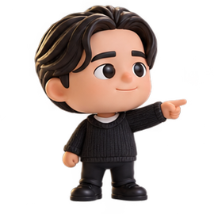 | 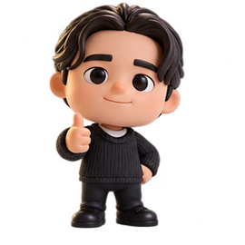 |

| 1 · Start | 2 · White subject | 3 · Original color | 4 · Scene changes |
| --- | --- | --- | --- |
|  |  |  |  |

Subject: the bobblehead (owned). Scenes: library photos from Unsplash (Unsplash License). Built as an editable DreamCut timeline. Catalog evidence below is separate.

[Recreated demo](../../public/recipe-previews/mask-glitch/result.mp4) · [Reference](media/anderson-taii/mask-glitch-reference.mp4)

Reference credit: @anderson.taii / Anderson Tai; https://www.instagram.com/reel/Da0d8suu6kJ/; muted reference excerpt. Rights basis: licensed.

Recreation credit: Bobblehead poses (owned) over library photos from DreamCut's image catalog (Unsplash License); DreamCut Mask Glitch template teaching media (still poses with keyframed subject_flash).. Rights basis: licensed.

Every lead-in frame contains the white silhouette or original-color subject mask; no disappearance before the incoming scene. White and colour masks share alpha and geometry and match the incoming picture; preserve unchanged sources and editable layers. Verify on another incoming subject before promoting the recipe to complete.

### What you supply

- **Ordered shots:** Supply the outgoing and incoming footage in order. Identify the subject to appear early; it should have visible, separable edges. DreamCut prepares the matching cutouts.

### Supply your own or generate inputs

Source scenes can be generated. Derive both the white and original-color subject from the same incoming footage so their silhouettes match.

Generation suitability is guidance, not proof of a tested generated-input workflow. Ask the agent to stage any needed assets in Library → Generate, then review the model, prompt and settings before generating.

### How the effect is built

1. Isolate the incoming subject.
2. Show its white silhouette, then its original color over the outgoing shot.
3. Switch to the incoming scene without a gap or positional jump.

### Ask your agent

Select this template in Templates, then tell your agent which files to use. Your agent works from this request; it prepares a proposal for you to review, never an edit or a generation on its own.

```text
Use the mask-glitch skill for "Mask Glitch" (recipe: FX-MASK-GLITCH).
For a shared catalog recipe, read docs/effects/catalog.json entry FX-MASK-GLITCH and its owning skill before preparing the edit.
Follow the FX-MASK-GLITCH recipe and its success criteria, adapting the construction to my supplied assets.
My inputs and target: [attach or identify my files, target clips, order and desired timing].
Ordered shots: Supply the outgoing and incoming footage in order. Identify the subject to appear early; it should have visible, separable edges. DreamCut prepares the matching cutouts.
How it works: Isolate the incoming subject. Show its white silhouette, then its original color over the outgoing shot. Switch to the incoming scene without a gap or positional jump.
Input generation guidance: Source scenes can be generated. Derive both the white and original-color subject from the same incoming footage so their silhouettes match.
Read the current timeline, applicable preferences and available media. Ask for missing inputs; do not assume example assets are mine. If generation is needed, prepare a visible draft and wait for my generation authorization.
Preserve original sources and unrelated edits. Keep meaningful layers and tuning controls editable. For an existing edit, propose changes for my review; do not apply or approve them.
Known limitations: Lead-in is lengthened from the 5-frame default to 9 frames so the steps read at gallery size; continuous coverage intentionally differs from the reference pulse/off cadence. No dedicated Mask Glitch preset; matte preparation and native layer composition remain the supported route. Exact source-reference fidelity remains incomplete.
Preview the result, check the full transition or animation and report anything unverified.
```

### Evidence and limits

- Lead-in is lengthened from the 5-frame default to 9 frames so the steps read at gallery size; continuous coverage intentionally differs from the reference pulse/off cadence.
- No dedicated Mask Glitch preset; matte preparation and native layer composition remain the supported route.
- Exact source-reference fidelity remains incomplete.

[Technical recipe and evidence](catalog.json) · [Skill receipt](../../.agents/skills/mask-glitch/references/effect-evidence.json)

<a id="fx-camera-flash"></a>

## Camera Flash

**FX-CAMERA-FLASH · Partial recreation · read limitations** · [Owning skill](../../.agents/skills/recreate-effect/SKILL.md)

**Home:** Properties → transition join.

### Demonstration

[Recreated demo](media/stock-transitions/camera-flash-practice.mp4) · [Reference](media/anderson-taii/camera-flash-reference.mp4)

Reference credit: @anderson.taii / Anderson Tai; https://www.instagram.com/reel/Da0d8suu6kJ/; muted reference excerpt. Rights basis: licensed.

Recreation credit: Pexels footage (Pexels License): pexels.com/video/8970054/, pexels.com/video/3010130/; DreamCut recreation with the native transition, rendered from a pending demo proposal.. Rights basis: pexels-license.

Preserve sources and editable layers; reproduce the observed scene handoff on new inputs. Compare reference-relative entrance, peak, cut and settled frames at normal speed.

### What you supply

- **Two shots and cut point:** Supply the outgoing and incoming shots and identify where the switch should happen.

### Supply your own or generate inputs

No generated flash asset is needed. Either source shot can be generated separately if desired.

Generation suitability is guidance, not proof of a tested generated-input workflow. Ask the agent to stage any needed assets in Library → Generate, then review the model, prompt and settings before generating.

### How the effect is built

1. Build a brief white wash.
2. Switch shots at the flash peak.
3. Clear the wash quickly so the new scene reads.

### Ask your agent

Select this template in Templates, then tell your agent which files to use. Your agent works from this request; it prepares a proposal for you to review, never an edit or a generation on its own.

```text
Use the recreate-effect skill for "Camera Flash" (recipe: FX-CAMERA-FLASH).
For a shared catalog recipe, read docs/effects/catalog.json entry FX-CAMERA-FLASH and its owning skill before preparing the edit.
Follow the FX-CAMERA-FLASH recipe and its success criteria, adapting the construction to my supplied assets.
My inputs and target: [attach or identify my files, target clips, order and desired timing].
Two shots and cut point: Supply the outgoing and incoming shots and identify where the switch should happen.
How it works: Build a brief white wash. Switch shots at the flash peak. Clear the wash quickly so the new scene reads.
Input generation guidance: No generated flash asset is needed. Either source shot can be generated separately if desired.
Read the current timeline, applicable preferences and available media. Ask for missing inputs; do not assume example assets are mine. If generation is needed, prepare a visible draft and wait for my generation authorization.
Preserve original sources and unrelated edits. Keep meaningful layers and tuning controls editable. For an existing edit, propose changes for my review; do not apply or approve them.
Known limitations: Seven-frame 30 fps study is shorter than the reference interval; exact exposure curve remains unverified. Normal-speed fidelity to the reference and dedicated creator-flow acceptance remain incomplete. Reference excerpts are muted; isolated sound cues were not analysed.
Preview the result, check the full transition or animation and report anything unverified.
```

### Evidence and limits

- Seven-frame 30 fps study is shorter than the reference interval; exact exposure curve remains unverified.
- Normal-speed fidelity to the reference and dedicated creator-flow acceptance remain incomplete.
- Reference excerpts are muted; isolated sound cues were not analysed.

[Technical recipe and evidence](catalog.json) · [Skill receipt](../../.agents/skills/recreate-effect/references/effect-evidence.json)

<a id="fx-blackout"></a>

## Blackout

**FX-BLACKOUT · Partial recreation · read limitations** · [Owning skill](../../.agents/skills/recreate-effect/SKILL.md)

**Home:** Properties → transition join.

### Demonstration

[Recreated demo](media/stock-transitions/blackout-practice.mp4) · [Reference](media/anderson-taii/blackout-reference.mp4)

Reference credit: @anderson.taii / Anderson Tai; https://www.instagram.com/reel/Da0d8suu6kJ/; muted reference excerpt. Rights basis: licensed.

Recreation credit: Pexels footage (Pexels License): pexels.com/video/18005884/, pexels.com/video/9130084/; DreamCut recreation with the native transition, rendered from a pending demo proposal.. Rights basis: pexels-license.

Preserve sources and editable layers; reproduce the observed scene handoff on new inputs. Compare reference-relative entrance, peak, cut and settled frames at normal speed.

### What you supply

- **Cover and uncover takes:** End the first take by fully covering the lens. Start the next with the lens covered, then uncover it. Match hand direction and retain the covered portions.

### Supply your own or generate inputs

Generated takes must actually reach full coverage and keep consistent movement. A simple fade to black is a different treatment from the demonstrated lens-cover join.

Generation suitability is guidance, not proof of a tested generated-input workflow. Ask the agent to stage any needed assets in Library → Generate, then review the model, prompt and settings before generating.

### How the effect is built

1. Find full darkness in both takes.
2. Join them while the lens is covered.
3. Check that covering and uncovering feel like one motion.

### Ask your agent

Select this template in Templates, then tell your agent which files to use. Your agent works from this request; it prepares a proposal for you to review, never an edit or a generation on its own.

```text
Use the recreate-effect skill for "Blackout" (recipe: FX-BLACKOUT).
For a shared catalog recipe, read docs/effects/catalog.json entry FX-BLACKOUT and its owning skill before preparing the edit.
Follow the FX-BLACKOUT recipe and its success criteria, adapting the construction to my supplied assets.
My inputs and target: [attach or identify my files, target clips, order and desired timing].
Cover and uncover takes: End the first take by fully covering the lens. Start the next with the lens covered, then uncover it. Match hand direction and retain the covered portions.
How it works: Find full darkness in both takes. Join them while the lens is covered. Check that covering and uncovering feel like one motion.
Input generation guidance: Generated takes must actually reach full coverage and keep consistent movement. A simple fade to black is a different treatment from the demonstrated lens-cover join.
Read the current timeline, applicable preferences and available media. Ask for missing inputs; do not assume example assets are mine. If generation is needed, prepare a visible draft and wait for my generation authorization.
Preserve original sources and unrelated edits. Keep meaningful layers and tuning controls editable. For an existing edit, propose changes for my review; do not apply or approve them.
Known limitations: The outgoing cover is a body passing the lens, not a hand; the incoming uncover is a pack moving out of frame rather than a hand pulled away. Black hold timing at 30 fps differs from the reference's eight frames at 24 fps. Normal-speed fidelity to the reference and dedicated creator-flow acceptance remain incomplete. Reference excerpts are muted; isolated sound cues were not analysed.
Preview the result, check the full transition or animation and report anything unverified.
```

### Evidence and limits

- The outgoing cover is a body passing the lens, not a hand; the incoming uncover is a pack moving out of frame rather than a hand pulled away.
- Black hold timing at 30 fps differs from the reference's eight frames at 24 fps.
- Normal-speed fidelity to the reference and dedicated creator-flow acceptance remain incomplete.
- Reference excerpts are muted; isolated sound cues were not analysed.

[Technical recipe and evidence](catalog.json) · [Skill receipt](../../.agents/skills/recreate-effect/references/effect-evidence.json)

<a id="fx-whip-pan"></a>

## Whip Pan

**FX-WHIP-PAN · Partial recreation · read limitations** · [Owning skill](../../.agents/skills/recreate-effect/SKILL.md)

**Home:** Properties → transition join.

### Demonstration

[Recreated demo](media/stock-transitions/whip-pan-practice.mp4) · [Reference](media/anderson-taii/whip-pan-reference.mp4)

Reference credit: @anderson.taii / Anderson Tai; https://www.instagram.com/reel/Da0d8suu6kJ/; muted reference excerpt. Rights basis: licensed.

Recreation credit: Pexels footage (Pexels License): pexels.com/video/32287884/, pexels.com/video/31397167/; DreamCut recreation with the native transition, rendered from a pending demo proposal.. Rights basis: pexels-license.

Blend follows real incoming camera-turn motion, rather than a held first frame before the turn starts. Full-frame shots overlap without a travelling dividing edge or exposed gutter. Incoming source clock continues across the join without frozen or repeated motion; preserve full original sources. Review at normal speed and repeat with another shot pair before marking complete.

### What you supply

- **Matching camera turns:** Supply the full outgoing and incoming shots with camera travel in the same screen direction. Include the incoming turn before the intended start, not only an already-trimmed clip.

### Supply your own or generate inputs

Generated footage needs real, continuous directional movement and spare frames before the incoming start. Blur alone cannot supply that motion.

Generation suitability is guidance, not proof of a tested generated-input workflow. Ask the agent to stage any needed assets in Library → Generate, then review the model, prompt and settings before generating.

### How the effect is built

1. Choose the developed camera turn in the incoming shot.
2. Blend into its moving lead-in frames while matching direction.
3. Tune duration and blur; check that motion continues without a frozen or repeated boundary.

### Ask your agent

Select this template in Templates, then tell your agent which files to use. Your agent works from this request; it prepares a proposal for you to review, never an edit or a generation on its own.

```text
Use the recreate-effect skill for "Whip Pan" (recipe: FX-WHIP-PAN).
For a shared catalog recipe, read docs/effects/catalog.json entry FX-WHIP-PAN and its owning skill before preparing the edit.
Follow the FX-WHIP-PAN recipe and its success criteria, adapting the construction to my supplied assets.
My inputs and target: [attach or identify my files, target clips, order and desired timing].
Matching camera turns: Supply the full outgoing and incoming shots with camera travel in the same screen direction. Include the incoming turn before the intended start, not only an already-trimmed clip.
How it works: Choose the developed camera turn in the incoming shot. Blend into its moving lead-in frames while matching direction. Tune duration and blur; check that motion continues without a frozen or repeated boundary.
Input generation guidance: Generated footage needs real, continuous directional movement and spare frames before the incoming start. Blur alone cannot supply that motion.
Read the current timeline, applicable preferences and available media. Ask for missing inputs; do not assume example assets are mine. If generation is needed, prepare a visible draft and wait for my generation authorization.
Preserve original sources and unrelated edits. Keep meaningful layers and tuning controls editable. For an existing edit, propose changes for my review; do not apply or approve them.
Known limitations: Neither shot contains a captured camera whip; the native smear supplies all sideways motion. Precise fidelity to the Instagram reference remains incomplete. Moving overlap requires sufficient incoming head handles; with insufficient handles the renderer holds the head frame.
Preview the result, check the full transition or animation and report anything unverified.
```

### Evidence and limits

- Neither shot contains a captured camera whip; the native smear supplies all sideways motion.
- Precise fidelity to the Instagram reference remains incomplete.
- Moving overlap requires sufficient incoming head handles; with insufficient handles the renderer holds the head frame.

[Technical recipe and evidence](catalog.json) · [Skill receipt](../../.agents/skills/recreate-effect/references/effect-evidence.json)

<a id="fx-negative-pop"></a>

## Negative Pop

**FX-NEGATIVE-POP · Reference example** · [Owning skill](../../.agents/skills/mask-glitch/SKILL.md)

**Home:** Properties → Templates.

### Demonstration

No recreated demo yet. · [Reference](media/sunglasses/negative-reference.jpg)

Reference credit: @cgouldfish / Cade; https://www.instagram.com/reel/DbA5MAIthut/. Rights basis: licensed.

Match the chosen negative/original timing map Preserve alpha and silhouette alignment Keep the negative treatment scoped to the portrait

### What you supply

- **Subject and background:** Supply the original image or footage and identify the subject. DreamCut prepares an isolated version and a matching negative.

### Supply your own or generate inputs

The source can be generated. Derive the negative from that same source rather than generating a second, potentially different subject.

Generation suitability is guidance, not proof of a tested generated-input workflow. Ask the agent to stage any needed assets in Library → Generate, then review the model, prompt and settings before generating.

### How the effect is built

1. Isolate the subject and prepare a registered negative.
2. Show the negative briefly.
3. Return to the original color while leaving the background independently editable.

### Ask your agent

Select this template in Templates, then tell your agent which files to use. Your agent works from this request; it prepares a proposal for you to review, never an edit or a generation on its own.

```text
Use the mask-glitch skill for "Negative Pop" (recipe: FX-NEGATIVE-POP).
For a shared catalog recipe, read docs/effects/catalog.json entry FX-NEGATIVE-POP and its owning skill before preparing the edit.
Follow the FX-NEGATIVE-POP recipe and its success criteria, adapting the construction to my supplied assets.
My inputs and target: [attach or identify my files, target clips, order and desired timing].
Subject and background: Supply the original image or footage and identify the subject. DreamCut prepares an isolated version and a matching negative.
How it works: Isolate the subject and prepare a registered negative. Show the negative briefly. Return to the original color while leaving the background independently editable.
Input generation guidance: The source can be generated. Derive the negative from that same source rather than generating a second, potentially different subject.
Read the current timeline, applicable preferences and available media. Ask for missing inputs; do not assume example assets are mine. If generation is needed, prepare a visible draft and wait for my generation authorization.
Preserve original sources and unrelated edits. Keep meaningful layers and tuning controls editable. For an existing edit, propose changes for my review; do not apply or approve them.
This is a reference-only candidate. Assess feasibility and explain capability gaps before promising a recreation.
Known limitations: No redistributable recreation is packaged yet; recreate on cleared footage before marking this partial again. The earlier private recreation baked the inversion into the derivative; there is no native negative-amount dial. Exposure and contrast are reviewable shading controls. Reference negative duration is eight frames at 30 fps; a one-second hold is only an inspection aid.
Preview the result, check the full transition or animation and report anything unverified.
```

### Evidence and limits

- No redistributable recreation is packaged yet; recreate on cleared footage before marking this partial again.
- The earlier private recreation baked the inversion into the derivative; there is no native negative-amount dial. Exposure and contrast are reviewable shading controls.
- Reference negative duration is eight frames at 30 fps; a one-second hold is only an inspection aid.

[Technical recipe and evidence](catalog.json) · [Skill receipt](../../.agents/skills/mask-glitch/references/effect-evidence.json)

<a id="fx-scene-portal"></a>

## Scene Portal

**FX-SCENE-PORTAL · Reference example** · [Owning skill](../../.agents/skills/video-compositing/SKILL.md)

**Home:** Properties → Templates.

### Demonstration

No recreated demo yet. · [Reference](media/sunglasses/portal-reference.jpg)

Reference credit: @cgouldfish / Cade; https://www.instagram.com/reel/DbA5MAIthut/. Rights basis: licensed.

Inserted video follows the region without rim spill Wrapping remains legible during motion No empty frame at scene handoff

### What you supply

- **Host footage:** Supply footage with a clearly bounded region where the other scene should appear. Keep that region visible through the transition.
- **Insert and destination:** Supply the moving insert and destination footage. Describe when the portal should become the full scene; DreamCut prepares tracking and masks.

### Supply your own or generate inputs

Host or insert footage can be generated. The host needs a stable, trackable region; inspect geometry before attempting the portal.

Generation suitability is guidance, not proof of a tested generated-input workflow. Ask the agent to stage any needed assets in Library → Generate, then review the model, prompt and settings before generating.

### How the effect is built

1. Track and mask the chosen region.
2. Fit the moving insert inside it.
3. Coordinate the zoom and full-scene handoff, checking edges throughout.

### Ask your agent

Select this template in Templates, then tell your agent which files to use. Your agent works from this request; it prepares a proposal for you to review, never an edit or a generation on its own.

```text
Use the video-compositing skill for "Scene Portal" (recipe: FX-SCENE-PORTAL).
For a shared catalog recipe, read docs/effects/catalog.json entry FX-SCENE-PORTAL and its owning skill before preparing the edit.
Follow the FX-SCENE-PORTAL recipe and its success criteria, adapting the construction to my supplied assets.
My inputs and target: [attach or identify my files, target clips, order and desired timing].
Host footage: Supply footage with a clearly bounded region where the other scene should appear. Keep that region visible through the transition.
Insert and destination: Supply the moving insert and destination footage. Describe when the portal should become the full scene; DreamCut prepares tracking and masks.
How it works: Track and mask the chosen region. Fit the moving insert inside it. Coordinate the zoom and full-scene handoff, checking edges throughout.
Input generation guidance: Host or insert footage can be generated. The host needs a stable, trackable region; inspect geometry before attempting the portal.
Read the current timeline, applicable preferences and available media. Ask for missing inputs; do not assume example assets are mine. If generation is needed, prepare a visible draft and wait for my generation authorization.
Preserve original sources and unrelated edits. Keep meaningful layers and tuning controls editable. For an existing edit, propose changes for my review; do not apply or approve them.
This is a reference-only candidate. Assess feasibility and explain capability gaps before promising a recreation.
Known limitations: No redistributable recreation is packaged yet; recreate on cleared footage before marking this partial again. The earlier private recreation used prepared tracking/warping rather than native adjustable geometry. That recreation's alpha overlay began visibly 34 source frames late; inspect baked alpha onsets, since a timing-only correction does not remove a baked delay. Reference scene changes and timing were not matched exactly.
Preview the result, check the full transition or animation and report anything unverified.
```

### Evidence and limits

- No redistributable recreation is packaged yet; recreate on cleared footage before marking this partial again.
- The earlier private recreation used prepared tracking/warping rather than native adjustable geometry.
- That recreation's alpha overlay began visibly 34 source frames late; inspect baked alpha onsets, since a timing-only correction does not remove a baked delay.
- Reference scene changes and timing were not matched exactly.

[Technical recipe and evidence](catalog.json) · [Skill receipt](../../.agents/skills/video-compositing/references/effect-evidence.json)

<a id="fx-clone-converge"></a>

## Clone Converge

**FX-CLONE-CONVERGE · Partial recreation · read limitations** · [Owning skill](../../.agents/skills/video-compositing/SKILL.md)

**Home:** Properties → Templates.

### Demonstration

[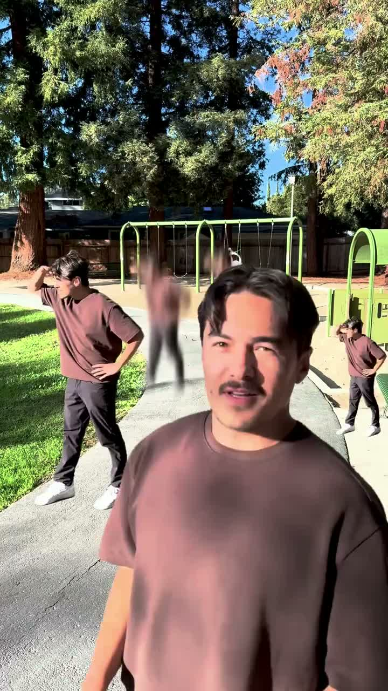](../../public/recipe-previews/clone-converge/result.mp4)

Moving copies flash into place, then rush into the live foreground together before the original line continues. Normal speed, silent teaching preview. The example’s words, stops and grade are not fixed template settings.

**You supply**

| Your take |
| --- |
|  |

**DreamCut prepares**

| Moving copies · finished-result illustration |
| --- |
| 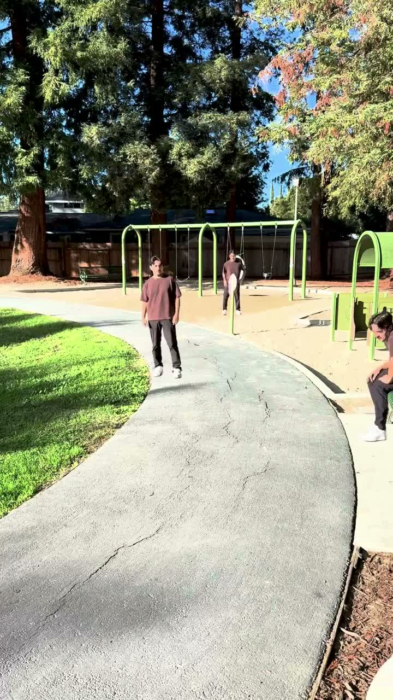 |

| 1 · Copies flash in | 2 · Copies wait | 3 · Rush to the foreground | 4 · One live foreground |
| --- | --- | --- | --- |
| 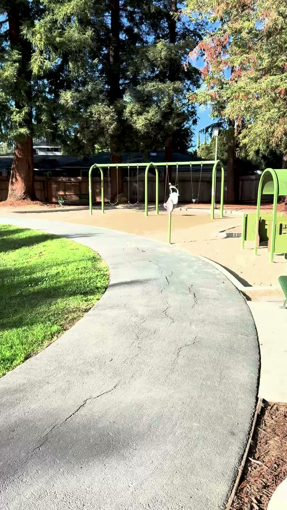 |  |  | 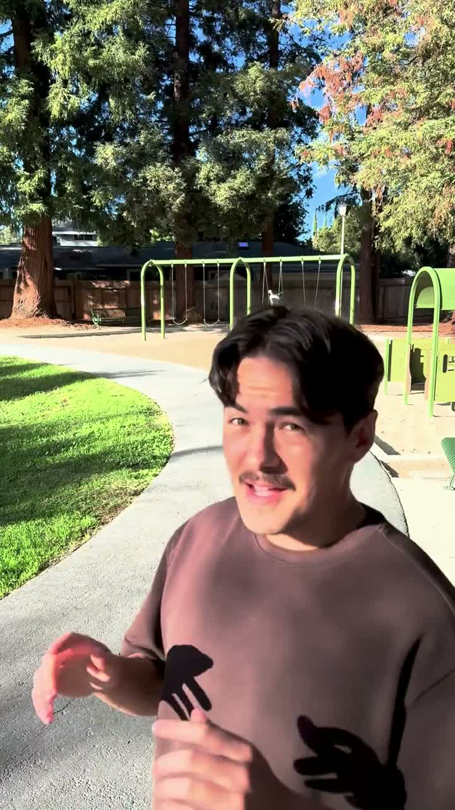 |

Finished result and the matching source-take preview explicitly authorized by their creator for this shared Clone Converge card. Catalog evidence below is separate.

[Recreated demo](../../public/recipe-previews/clone-converge/result.mp4) · [Reference](../../public/recipe-previews/clone-converge/result.mp4)

Reference credit: Finished Clone Converge result and matching source-take preview explicitly authorized by their creator for the shared Catalog card.. Rights basis: owned.

Recreation credit: Finished Clone Converge result and matching source-take preview explicitly authorized by their creator for the shared Catalog card.. Rights basis: owned.

Waiting copies remain live at normal speed Every travelling copy ends behind the foreground on one shared frame Original speech continues after a live beat Timing and sound controls remain source-safe across their supported ranges

### What you supply

- **Lock the camera:** Film the person stopping in several places, then approaching the camera and saying the line. Keep each stop live for a few extra moments.
- **Film the empty set:** Record the same framing and light with nobody in the shot.
- **Choose the stops and line:** Say which stops and spoken line to keep. Exact marks help; DreamCut can inspect missing marks.

### Supply your own or generate inputs

Supply filmed footage for the live movement and speech. DreamCut prepares moving cutouts; generation is not needed.

Generation suitability is guidance, not proof of a tested generated-input workflow. Ask the agent to stage any needed assets in Library → Generate, then review the model, prompt and settings before generating.

### How the effect is built

1. Measure usable live stop windows and prepare source-matched moving cutouts.
2. Flash the waiting copies into place over the empty set, then bring in the live foreground.
3. Rush every background copy behind the foreground on the same frame, with linked shutters, movement sounds and one impact.
4. Leave a live beat before the original speech; expose timing and sound controls and verify timing extremes.

### Ask your agent

Select this template in Templates, then tell your agent which files to use. Your agent works from this request; it prepares a proposal for you to review, never an edit or a generation on its own.

```text
Use the video-compositing skill for "Clone Converge" (recipe: FX-CLONE-CONVERGE).
For a shared catalog recipe, read docs/effects/catalog.json entry FX-CLONE-CONVERGE and its owning skill before preparing the edit.
Follow the FX-CLONE-CONVERGE recipe and its success criteria, adapting the construction to my supplied assets.
My inputs and target: [attach or identify my files, target clips, order and desired timing].
Lock the camera: Film the person stopping in several places, then approaching the camera and saying the line. Keep each stop live for a few extra moments.
Film the empty set: Record the same framing and light with nobody in the shot.
Choose the stops and line: Say which stops and spoken line to keep. Exact marks help; DreamCut can inspect missing marks.
How it works: Measure usable live stop windows and prepare source-matched moving cutouts. Flash the waiting copies into place over the empty set, then bring in the live foreground. Rush every background copy behind the foreground on the same frame, with linked shutters, movement sounds and one impact. Leave a live beat before the original speech; expose timing and sound controls and verify timing extremes.
Input generation guidance: Supply filmed footage for the live movement and speech. DreamCut prepares moving cutouts; generation is not needed.
Read the current timeline, applicable preferences and available media. Ask for missing inputs; do not assume example assets are mine. If generation is needed, prepare a visible draft and wait for my generation authorization.
Preserve original sources and unrelated edits. Keep meaningful layers and tuning controls editable. For an existing edit, propose changes for my review; do not apply or approve them.
Known limitations: Agent-built native recipe; no dedicated compiled preset or one-click certification. Raw preparation, another performer, listening and continuous-motion sensory acceptance remain unverified. Teaching preview is silent. Its line, positions and grade are examples, not fixed template settings.
Preview the result, check the full transition or animation and report anything unverified.
```

### Evidence and limits

- Agent-built native recipe; no dedicated compiled preset or one-click certification.
- Raw preparation, another performer, listening and continuous-motion sensory acceptance remain unverified.
- Teaching preview is silent. Its line, positions and grade are examples, not fixed template settings.

[Technical recipe and evidence](catalog.json) · [Skill receipt](../../.agents/skills/video-compositing/references/effect-evidence.json)

<a id="fx-speed-entrance-exit"></a>

## Speed Entrance & Exit

**FX-SPEED-ENTRANCE-EXIT · Implemented template · built with your agent** · [Owning skill](../../.agents/skills/speed-entrance-exit/SKILL.md)

**Home:** Properties → Templates.

### Demonstration

[](../../public/recipe-previews/speed-entrance-exit/result.mp4)

The bobblehead streaks into the empty set in a sideways blur, lands sharp and crosses its arms, then streaks out the other side while the set stays still. Normal speed; it streaks in over 5 frames and out over 2.

**You supply**

| Moving pose, cut out | Pose to hold | Same shot, empty |
| --- | --- | --- |
| 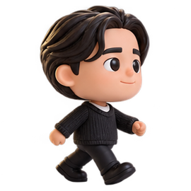 | 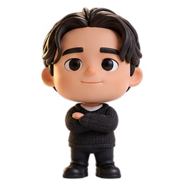 |  |

**DreamCut prepares**

| Pose keyed with sideways blur |
| --- |
|  |

| 1 · Empty set | 2 · Streaks in | 3 · Lands and holds | 4 · Streaks out |
| --- | --- | --- | --- |
|  |  |  |  |

Subject: the bobblehead (owned). Empty set: Mohammadreza Charkhgard on Unsplash (Unsplash License). Built as an editable DreamCut timeline. Catalog evidence below is separate.

A moving subject streaks into or out of a fixed scene while the background stays still.

### What you supply

- **Performance footage:** Use a locked camera and keep the whole subject visible. Record the gesture before each entrance or exit and leave time on both sides.
- **Matching empty background:** Record the same scene without the subject, preserving camera position, lighting and framing.

### Supply your own or generate inputs

Use the reference to plan a fully clothed fictional performer in a fixed scene. Generate clean ordinary motion and a matching background; build the speed movement and blur in DreamCut, not into the generated footage.

Generation suitability is guidance, not proof of a tested generated-input workflow. Ask the agent to stage any needed assets in Library → Generate, then review the model, prompt and settings before generating.

### How the effect is built

1. Prepare moving subject masks on the original source clock.
2. Place the subject over the matching empty scene.
3. Keyframe the cut-out from where the subject is to another place (off frame, or the next marked stop) over a few frames with directional blur; never speed the footage up. Check the full movement and expose a hold per stop.

### Ask your agent

Select this template in Templates, then tell your agent which files to use. Your agent works from this request; it prepares a proposal for you to review, never an edit or a generation on its own.

```text
Use the speed-entrance-exit skill for "Speed Entrance & Exit" (recipe: FX-SPEED-ENTRANCE-EXIT).
Read the FX-SPEED-ENTRANCE-EXIT construction brief in src/lib/effects/promoted-recipes.ts and its owning skill before preparing the edit.
Build Speed Entrance & Exit from my performance footage or my still poses, and the matching empty background. Follow the speed-entrance-exit skill: send one hop_sequence card with the template set to entrance_exit, first_entrance and a closing_exit out the side, so I streak into frame, stand, and streak out again (the card lets me keep me in frame instead); never play the footage faster. Each stop is either a window of my footage (its cut-out, with settle and takeoff from visual_activity_prepare holds) or a still pose (the pose I stand in, and a walking pose for the streaks if I have one). If I marked stops, hop from each to the next. Put a whoosh from the Speed hops sounds (sfx_search "speed whoosh") on every landing and on the exit in the same card. Preserve the original performance, check the complete motion at normal speed and propose it for me to review.
My inputs and target: [attach or identify my files, target clips, order and desired timing].
Performance footage: Use a locked camera and keep the whole subject visible. Record the gesture before each entrance or exit and leave time on both sides.
Matching empty background: Record the same scene without the subject, preserving camera position, lighting and framing.
How it works: Prepare moving subject masks on the original source clock. Place the subject over the matching empty scene. Keyframe the cut-out from where the subject is to another place (off frame, or the next marked stop) over a few frames with directional blur; never speed the footage up. Check the full movement and expose a hold per stop.
Input generation guidance: Use the reference to plan a fully clothed fictional performer in a fixed scene. Generate clean ordinary motion and a matching background; build the speed movement and blur in DreamCut, not into the generated footage.
Read the current timeline, applicable preferences and available media. Ask for missing inputs; do not assume example assets are mine. If generation is needed, prepare a visible draft and wait for my generation authorization.
Preserve original sources and unrelated edits. Keep meaningful layers and tuning controls editable. For an existing edit, propose changes for my review; do not apply or approve them.
Known limitations: Whatever the camera cropped stays cropped: a subject cut off at the frame edge streaks in cut off. A fixed camera and matching empty background are the supported starting point. Moving cameras require additional tracking. Fresh-input reuse and complete unaided editing acceptance remain to be checked.
Preview the result, check the full transition or animation and report anything unverified.
```

### Evidence and limits

- Whatever the camera cropped stays cropped: a subject cut off at the frame edge streaks in cut off.
- A fixed camera and matching empty background are the supported starting point. Moving cameras require additional tracking.
- Fresh-input reuse and complete unaided editing acceptance remain to be checked.

<a id="fx-speed-hops-to-camera"></a>

## Speed hops

**FX-SPEED-HOPS-TO-CAMERA · Implemented template · built with your agent** · [Owning skill](../../.agents/skills/speed-entrance-exit/SKILL.md)

**Home:** Properties → Templates.

### Demonstration

[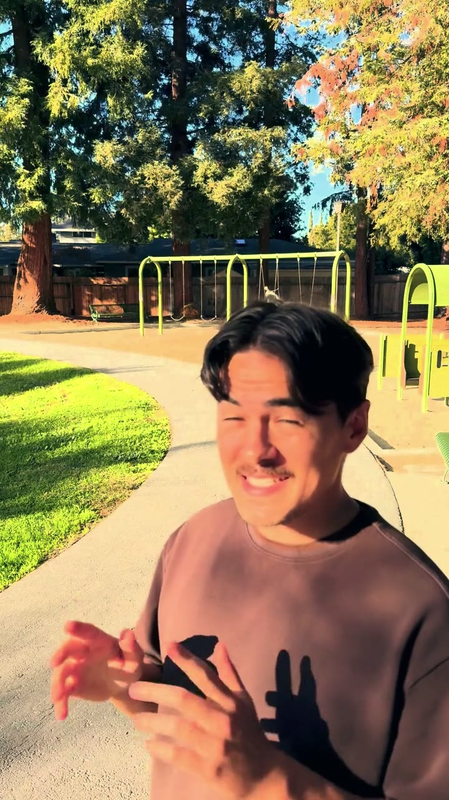](../../public/recipe-previews/speed-hops-to-camera/result.mp4)

A streak from stop to stop down the path, landing standing at each one, then a line said in front of the camera and a streak out of frame. Normal speed; each stop holds for 3 frames and each streak takes 2, so the line starts at 2 seconds. Sound off here; the edit puts a whoosh on every hop.

**You supply**

| Your take |
| --- |
|  |

**DreamCut prepares**

| Cut-out of you |
| --- |
| 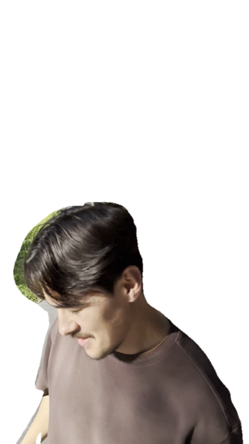 |

| 1 · First stop | 2 · Streaks to the next | 3 · Says the line | 4 · Streaks out |
| --- | --- | --- | --- |
| 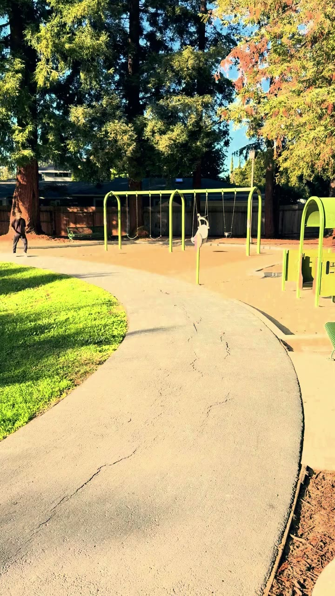 |  | 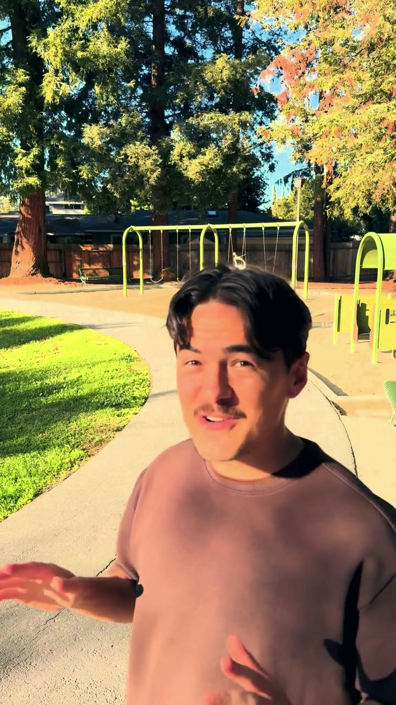 | 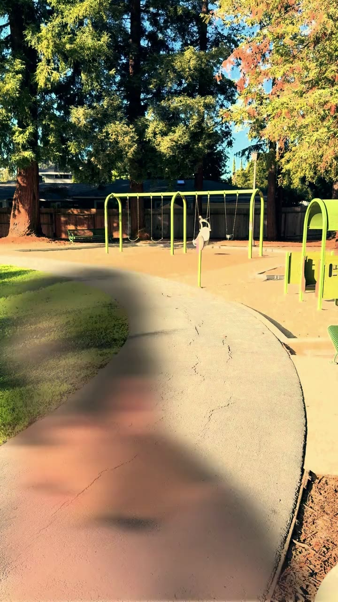 |

Subject and footage: the DreamCut owner (owned). Effect inspired by a speed-effect tutorial by Marvin Appiah Korang. Catalog evidence below is separate.

You streak from stop to stop across a still scene, land standing at each one, arrive in front of the camera to say your line, then streak out of frame, with a whoosh on every hop.

### What you supply

- **One locked-off take:** Use a tripod. Start recording on the empty scene (a clean slate with nobody in it) for a couple of seconds, then walk in, stand still for a moment at each stop, finish in front of the camera, say your line and walk out of frame.
- **Marks where you stop:** Mark each stop, and where you finish talking, in Storyboard or on the clip.

### Supply your own or generate inputs

Use the reference to plan a fully clothed fictional performer in a fixed scene. Generate clean ordinary motion that starts on the empty scene; build the hops, blur and sounds in DreamCut, not into the generated footage.

Generation suitability is guidance, not proof of a tested generated-input workflow. Ask the agent to stage any needed assets in Library → Generate, then review the model, prompt and settings before generating.

### How the effect is built

1. Cut you out at each stop and measure when you settle and when you take your next step.
2. Streak a cut-out of you from each stop to the next over a few frames with blur pointed the way you travel, landing standing on the live footage; never speed the footage up.
3. Play your line live, streak you out of frame when you finish, and put a whoosh on every hop. Hold, hop length and blur become dials in time order.

### Ask your agent

Select this template in Templates, then tell your agent which files to use. Your agent works from this request; it prepares a proposal for you to review, never an edit or a generation on its own.

```text
Use the speed-entrance-exit skill for "Speed hops" (recipe: FX-SPEED-HOPS-TO-CAMERA).
Read the FX-SPEED-HOPS-TO-CAMERA construction brief in src/lib/effects/promoted-recipes.ts and its owning skill before preparing the edit.
Build Speed hops from my locked-off take and my marked stops. Follow the speed-entrance-exit skill (Mark to mark): move a cut-out of me between keyframed places with blur, never by playing the footage faster. Use the first seconds of the take, before I walk in, as the empty scene. Open on me at the first stop, streak mark to mark and land standing at each with a brief live hold, and fit it to my take: as many stops as I marked, and if I speak at the last one, play my line live. End with me streaking out of frame (past the camera after a line to camera, otherwise out the side) unless I say to stay; the card lets me switch it. Measure each stop's settle and takeoff with visual_activity_prepare holds at my marks, keep cropped edges off screen, and send one hop_sequence card with the template set to speed_hops, a closing_exit, and the Speed hops sounds (sfx_search "speed whoosh") as its landing and exit sounds, so every hop and the exit have a whoosh in the same card. Leave out captions, colour grading and music, check every landing at normal speed, and propose it for me to review.
My inputs and target: [attach or identify my files, target clips, order and desired timing].
One locked-off take: Use a tripod. Start recording on the empty scene (a clean slate with nobody in it) for a couple of seconds, then walk in, stand still for a moment at each stop, finish in front of the camera, say your line and walk out of frame.
Marks where you stop: Mark each stop, and where you finish talking, in Storyboard or on the clip.
How it works: Cut you out at each stop and measure when you settle and when you take your next step. Streak a cut-out of you from each stop to the next over a few frames with blur pointed the way you travel, landing standing on the live footage; never speed the footage up. Play your line live, streak you out of frame when you finish, and put a whoosh on every hop. Hold, hop length and blur become dials in time order.
Input generation guidance: Use the reference to plan a fully clothed fictional performer in a fixed scene. Generate clean ordinary motion that starts on the empty scene; build the hops, blur and sounds in DreamCut, not into the generated footage.
Read the current timeline, applicable preferences and available media. Ask for missing inputs; do not assume example assets are mine. If generation is needed, prepare a visible draft and wait for my generation authorization.
Preserve original sources and unrelated edits. Keep meaningful layers and tuning controls editable. For an existing edit, propose changes for my review; do not apply or approve them.
Known limitations: Whatever the camera cropped stays cropped; a close-up leaves by lunging past the camera instead of sliding. Needs a fixed camera and a take that starts on the empty scene; moving cameras need tracking first. The hop sounds come from the Library's speed whoosh set (members). Built and tuned on one take (a walk toward the camera with six stops); other footage is untested.
Preview the result, check the full transition or animation and report anything unverified.
```

### Evidence and limits

- Whatever the camera cropped stays cropped; a close-up leaves by lunging past the camera instead of sliding.
- Needs a fixed camera and a take that starts on the empty scene; moving cameras need tracking first.
- The hop sounds come from the Library's speed whoosh set (members).
- Built and tuned on one take (a walk toward the camera with six stops); other footage is untested.

<a id="fx-flash-effect"></a>

## Flash effect

**FX-FLASH-EFFECT · Implemented template · built with your agent** · [Owning skill](../../.agents/skills/mask-glitch/SKILL.md)

**Home:** Properties → Templates.

### Demonstration

[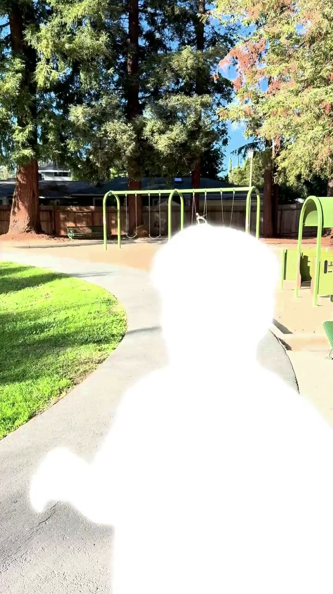](../../public/recipe-previews/flash-effect/result.mp4)

Poses flash in one after another down the path toward the camera, each white for a frame, then the take goes live. Normal speed; a new pose every 4 frames, each white for one frame. Sound off here; the edit puts a shutter click on every flash.

**You supply**

| Your take |
| --- |
|  |

**DreamCut prepares**

| Cut-out of you |
| --- |
| 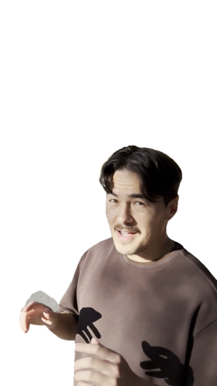 |

| 1 · First pose flashes | 2 · Shows in colour | 3 · Next pose flashes | 4 · Live at the camera |
| --- | --- | --- | --- |
| 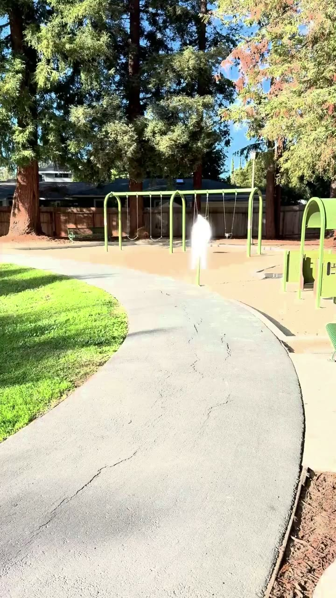 | 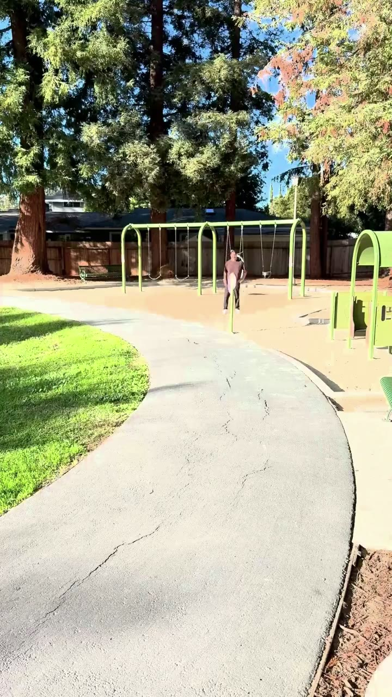 | 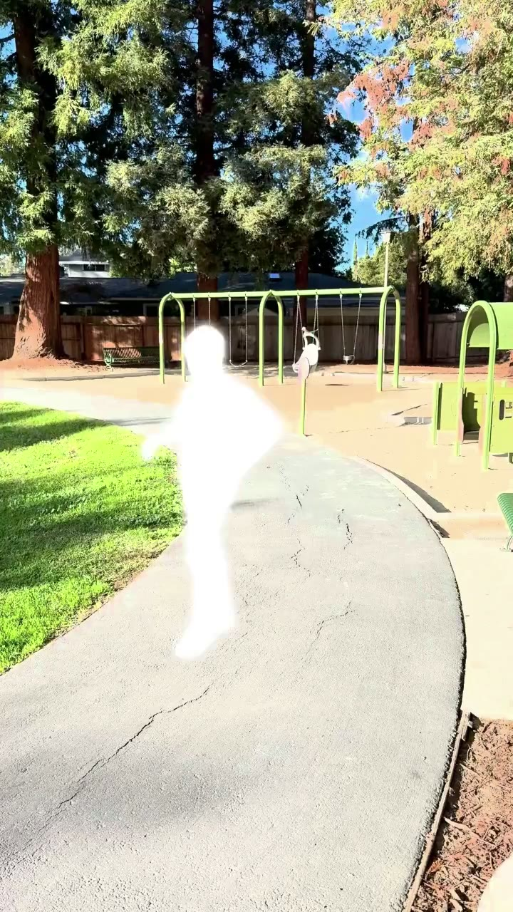 | 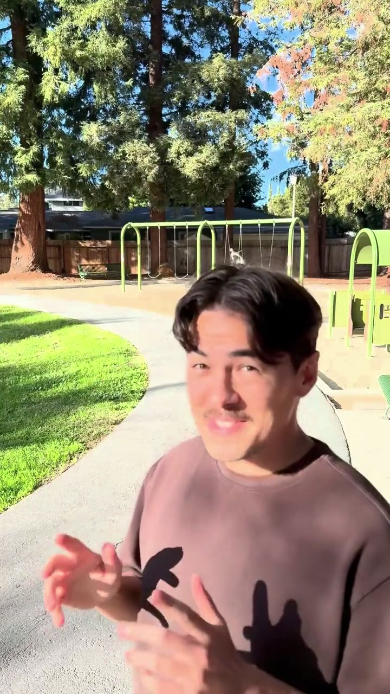 |

Subject and footage: the DreamCut owner (owned). Effect after The Flash Effect by futurist__ (Marvin Appiah Korang). Catalog evidence below is separate.

You flash from pose to pose toward the camera: each pose lands as a white silhouette for one frame with a camera shutter click, then the take goes live for your line.

### What you supply

- **One locked-off take of your walk to the camera:** Use a tripod. Start recording on the empty scene for a couple of seconds, then walk from the back of the scene to the camera through several places, and say your line at the camera.
- **Marks where you flash:** Optional: mark each pose you want in Storyboard or on the clip. Without marks, six to eight poses are spread along your walk.

### Supply your own or generate inputs

Use the reference to plan a fully clothed fictional performer walking toward a fixed camera. Generate clean ordinary motion that starts on the empty scene; build the flashes, glow and clicks in DreamCut, not into the generated footage.

Generation suitability is guidance, not proof of a tested generated-input workflow. Ask the agent to stage any needed assets in Library → Generate, then review the model, prompt and settings before generating.

### How the effect is built

1. Cut you out at each pose, keeping poses off the frame edge.
2. Show each pose for a few frames over the empty scene, white for its first frame with a glow, with a shutter click on every flash.
3. Play your line live from the last pose. Time per pose, white flash, glow and click volume become dials.

### Ask your agent

Select this template in Templates, then tell your agent which files to use. Your agent works from this request; it prepares a proposal for you to review, never an edit or a generation on its own.

```text
Use the mask-glitch skill for "Flash effect" (recipe: FX-FLASH-EFFECT).
Read the FX-FLASH-EFFECT construction brief in src/lib/effects/promoted-recipes.ts and its owning skill before preparing the edit.
Build the Flash effect from my locked-off take. Follow the mask-glitch skill's Flash effect template: cut me out at each pose (my marks, or six to eight poses spread along the walk, none on the frame edge or moving sideways), use the start of the take as the empty scene, and send one card with a flash_sequence block so my poses replace each other with a one-frame white flash and glow and a shutter click (the Library's Camera 02 Shutter Click, sfx_search "camera shutter click") on every flash. If I speak at the end, play my line live after the last pose. Leave out titles, captions, colour grading and music. Check each flash frame and the live join, and propose it for me to review; never apply it.
My inputs and target: [attach or identify my files, target clips, order and desired timing].
One locked-off take of your walk to the camera: Use a tripod. Start recording on the empty scene for a couple of seconds, then walk from the back of the scene to the camera through several places, and say your line at the camera.
Marks where you flash: Optional: mark each pose you want in Storyboard or on the clip. Without marks, six to eight poses are spread along your walk.
How it works: Cut you out at each pose, keeping poses off the frame edge. Show each pose for a few frames over the empty scene, white for its first frame with a glow, with a shutter click on every flash. Play your line live from the last pose. Time per pose, white flash, glow and click volume become dials.
Input generation guidance: Use the reference to plan a fully clothed fictional performer walking toward a fixed camera. Generate clean ordinary motion that starts on the empty scene; build the flashes, glow and clicks in DreamCut, not into the generated footage.
Read the current timeline, applicable preferences and available media. Ask for missing inputs; do not assume example assets are mine. If generation is needed, prepare a visible draft and wait for my generation authorization.
Preserve original sources and unrelated edits. Keep meaningful layers and tuning controls editable. For an existing edit, propose changes for my review; do not apply or approve them.
Known limitations: Needs a fixed camera and a take that starts on the empty scene; moving cameras need tracking first. A pose the frame crops shows its cropped edge on the white frame; poses are the agent's choice unless you mark them. The shutter click is a members sound in the Library. Built on one take (a walk toward the camera with seven poses); other footage is untested.
Preview the result, check the full transition or animation and report anything unverified.
```

### Evidence and limits

- Needs a fixed camera and a take that starts on the empty scene; moving cameras need tracking first.
- A pose the frame crops shows its cropped edge on the white frame; poses are the agent's choice unless you mark them.
- The shutter click is a members sound in the Library.
- Built on one take (a walk toward the camera with seven poses); other footage is untested.

<a id="fx-mask-glitch-glow"></a>

## Mask Glitch · Glow

**FX-MASK-GLITCH-GLOW · Implemented template · built with your agent** · [Owning skill](../../.agents/skills/mask-glitch/SKILL.md)

**Home:** Properties → Templates.

### Demonstration

[](../../public/recipe-previews/mask-glitch-glow/result.mp4)

The bobblehead appears over the empty set as a glowing white silhouette giving a thumbs up, then shows its own colours as the halo fades. Normal speed; the pose is white for 0.12 seconds and the halo is gone by 0.4 seconds.

**You supply**

| Pose | Same shot, empty |
| --- | --- |
|  |  |

**DreamCut prepares**

| Cut-out pose |
| --- |
|  |

| 1 · Empty set | 2 · White with a halo | 3 · Original color | 4 · Pose holds |
| --- | --- | --- | --- |
| 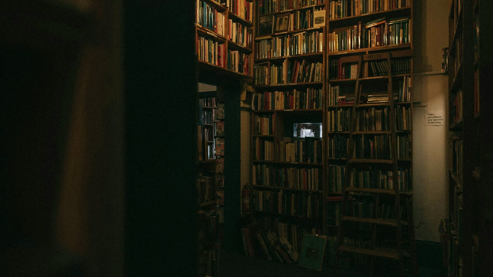 |  |  |  |

Subject: the bobblehead (owned). Empty set: Kevin Laminto on Unsplash (Unsplash License). Built as an editable DreamCut timeline. Catalog evidence below is separate.

Successive subjects appear as brief white silhouettes with a soft halo, then reveal their original color.

### What you supply

- **Ordered pose or performance takes:** Film several distinct poses with the camera locked, preserving the whole body and hands.
- **Matching empty background:** Keep the camera and lighting fixed while recording the scene without the performer.

### Supply your own or generate inputs

Generate a fictional fully clothed performer with clear separated poses and a stable background. Use the reference for staging; create the flashes, glow and reveal timing as editable DreamCut controls.

Generation suitability is guidance, not proof of a tested generated-input workflow. Ask the agent to stage any needed assets in Library → Generate, then review the model, prompt and settings before generating.

### How the effect is built

1. Isolate each subject or pose with source-timed masks.
2. Sequence the subjects over the separate background.
3. Time a brief white flash and optional glow, then restore original color; expose spacing and glow controls.

### Ask your agent

Select this template in Templates, then tell your agent which files to use. Your agent works from this request; it prepares a proposal for you to review, never an edit or a generation on its own.

```text
Use the mask-glitch skill for "Mask Glitch · Glow" (recipe: FX-MASK-GLITCH-GLOW).
Read the FX-MASK-GLITCH-GLOW construction brief in src/lib/effects/promoted-recipes.ts and its owning skill before preparing the edit.
Use the Mask Glitch · Glow template in the mask-glitch skill to build successive pose reveals from my footage over the matching empty background. Prepare source-timed subject masks. Time a short white flash and optional alpha-derived glow on each editable subject, then reveal its normal color. Expose spacing, flash timing, glow strength and radius through supported controls. Keep each subject and the background editable, inspect moving edges and normal-speed playback, and propose changes to my existing edit.
My inputs and target: [attach or identify my files, target clips, order and desired timing].
Ordered pose or performance takes: Film several distinct poses with the camera locked, preserving the whole body and hands.
Matching empty background: Keep the camera and lighting fixed while recording the scene without the performer.
How it works: Isolate each subject or pose with source-timed masks. Sequence the subjects over the separate background. Time a brief white flash and optional glow, then restore original color; expose spacing and glow controls.
Input generation guidance: Generate a fictional fully clothed performer with clear separated poses and a stable background. Use the reference for staging; create the flashes, glow and reveal timing as editable DreamCut controls.
Read the current timeline, applicable preferences and available media. Ask for missing inputs; do not assume example assets are mine. If generation is needed, prepare a visible draft and wait for my generation authorization.
Preserve original sources and unrelated edits. Keep meaningful layers and tuning controls editable. For an existing edit, propose changes for my review; do not apply or approve them.
Known limitations: Thin details the cutout misses, such as fine chains or loose strands, show the background through the white silhouette and its halo. The halo follows subject alpha; it is not an exact reproduction of a third-party glow kernel. Fresh-input reuse and independent unaided editing acceptance remain to be checked.
Preview the result, check the full transition or animation and report anything unverified.
```

### Evidence and limits

- Thin details the cutout misses, such as fine chains or loose strands, show the background through the white silhouette and its halo.
- The halo follows subject alpha; it is not an exact reproduction of a third-party glow kernel.
- Fresh-input reuse and independent unaided editing acceptance remain to be checked.

<a id="fx-moving-grid-matte"></a>

## Moving Grid Matte

**FX-MOVING-GRID-MATTE · Implemented template · built with your agent** · [Owning skill](../../.agents/skills/video-compositing/SKILL.md)

**Home:** Properties → Templates.

### Demonstration

[](../../public/recipe-previews/moving-grid-matte/result.mp4)

The bobblehead's sharp footage shows only through square cells that follow its outline as it runs and cartwheels, over a separate dark background. Normal speed; the cells follow the bobblehead frame by frame.

**You supply**

| Moving subject | Background |
| --- | --- |
|  |  |

**DreamCut prepares**

| Moving mask |
| --- |
|  |

| 1 · Cells follow its shape | 2 · It runs, the cells move | 3 · Cartwheel, new cells |
| --- | --- | --- |
|  |  |  |

Subject: the bobblehead (owned). Background: Pexels video 9732065 (Pexels License). Built as an editable DreamCut timeline. Catalog evidence below is separate.

Sharp moving footage appears through square cells that follow the subject silhouette, over a separate background.

### What you supply

- **Moving subject footage:** Supply a continuous shot with a clear silhouette and spare space around the moving subject.
- **Background:** Choose the separate scene or image visible outside the grid silhouette.

### Supply your own or generate inputs

Generate an ordinary continuous shot with stable anatomy and framing. Prepare its matching mask, then create the square-cell treatment in DreamCut; do not generate the grid into the footage.

Generation suitability is guidance, not proof of a tested generated-input workflow. Ask the agent to stage any needed assets in Library → Generate, then review the model, prompt and settings before generating.

### How the effect is built

1. Prepare a grayscale subject mask covering the complete source interval.
2. Bind the mask to the continuous original clip and enable Moving Grid Matte.
3. Tune cell size, coverage and grid lines while retaining a separate background.

### Ask your agent

Select this template in Templates, then tell your agent which files to use. Your agent works from this request; it prepares a proposal for you to review, never an edit or a generation on its own.

```text
Use the video-compositing skill for "Moving Grid Matte" (recipe: FX-MOVING-GRID-MATTE).
Read the FX-MOVING-GRID-MATTE construction brief in src/lib/effects/promoted-recipes.ts and its owning skill before preparing the edit.
Build Moving Grid Matte from my moving subject clip and chosen background. Follow the Moving Grid Matte template in the video-compositing skill. Prepare a grayscale rotoscope bound to the source clock, retain one continuous sharp original clip, and use the native Moving Grid Matte controls. Expose cell size, mask coverage, grid strength and grid width. Keep the background separate, verify mask coverage throughout the interval, and propose changes to my existing edit.
My inputs and target: [attach or identify my files, target clips, order and desired timing].
Moving subject footage: Supply a continuous shot with a clear silhouette and spare space around the moving subject.
Background: Choose the separate scene or image visible outside the grid silhouette.
How it works: Prepare a grayscale subject mask covering the complete source interval. Bind the mask to the continuous original clip and enable Moving Grid Matte. Tune cell size, coverage and grid lines while retaining a separate background.
Input generation guidance: Generate an ordinary continuous shot with stable anatomy and framing. Prepare its matching mask, then create the square-cell treatment in DreamCut; do not generate the grid into the footage.
Read the current timeline, applicable preferences and available media. Ask for missing inputs; do not assume example assets are mine. If generation is needed, prepare a visible draft and wait for my generation authorization.
Preserve original sources and unrelated edits. Keep meaningful layers and tuning controls editable. For an existing edit, propose changes for my review; do not apply or approve them.
Known limitations: Each cell shows the original shot as filmed, including its own background inside the square. Replacing footage requires a matching mask covering the selected source interval. The four grid controls are static. Exact reference fidelity and continuous fine-edge quality are not certified.
Preview the result, check the full transition or animation and report anything unverified.
```

### Evidence and limits

- Each cell shows the original shot as filmed, including its own background inside the square.
- Replacing footage requires a matching mask covering the selected source interval.
- The four grid controls are static. Exact reference fidelity and continuous fine-edge quality are not certified.

<a id="fx-paper-cutout"></a>

## Paper cutout

**FX-PAPER-CUTOUT · Implemented template · built with your agent** · [Owning skill](../../.agents/skills/scratchpad-treatment/SKILL.md)

**Home:** Properties → Templates.

### Demonstration

[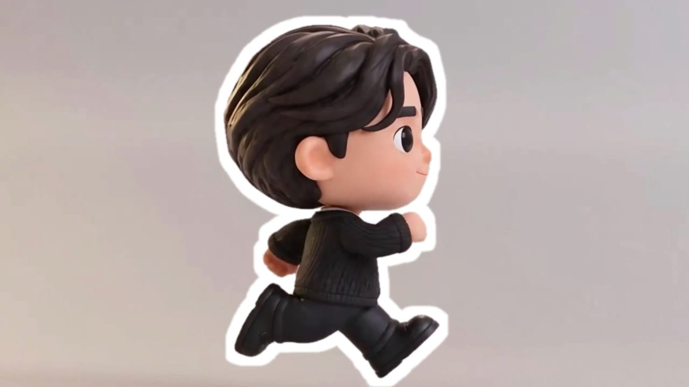](../../public/recipe-previews/paper-cutout/result.mp4)

The bobblehead is cut out of the moving shot and outlined in thick white paper that follows it as it runs, then the outline turns red through a cartwheel. Normal speed; the outline appears at 1.0 s and changes colour at 3.6 s.

**You supply**

| Shot with the subject |
| --- |
| 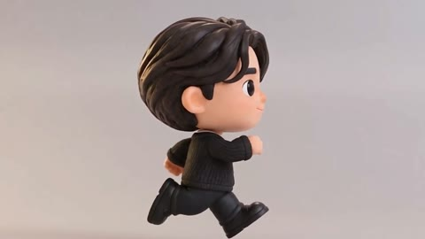 |

**DreamCut prepares**

| Moving cutout |
| --- |
| 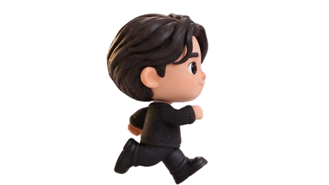 |

| 1 · Original shot | 2 · Paper outline | 3 · Outline follows it | 4 · Any outline colour |
| --- | --- | --- | --- |
| 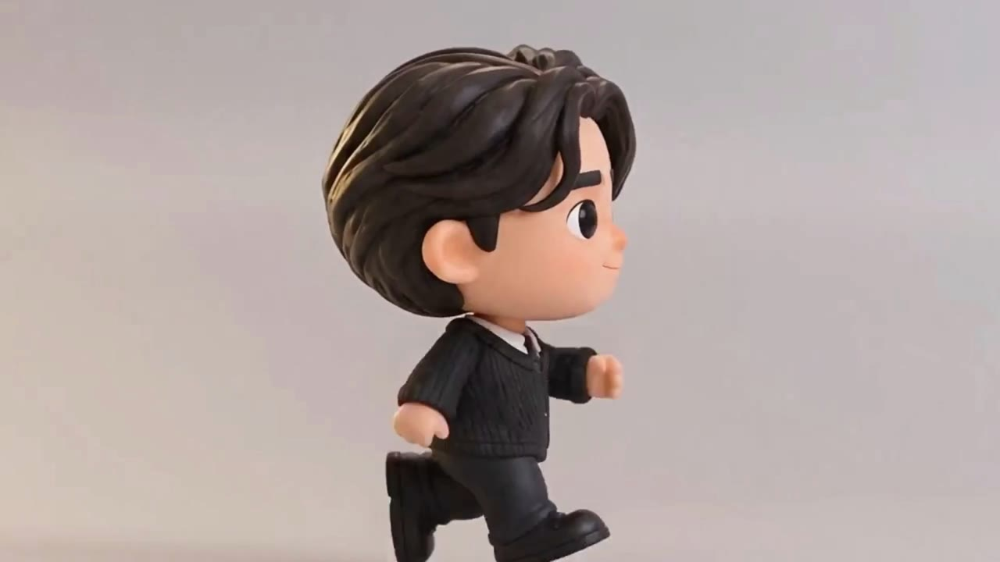 | 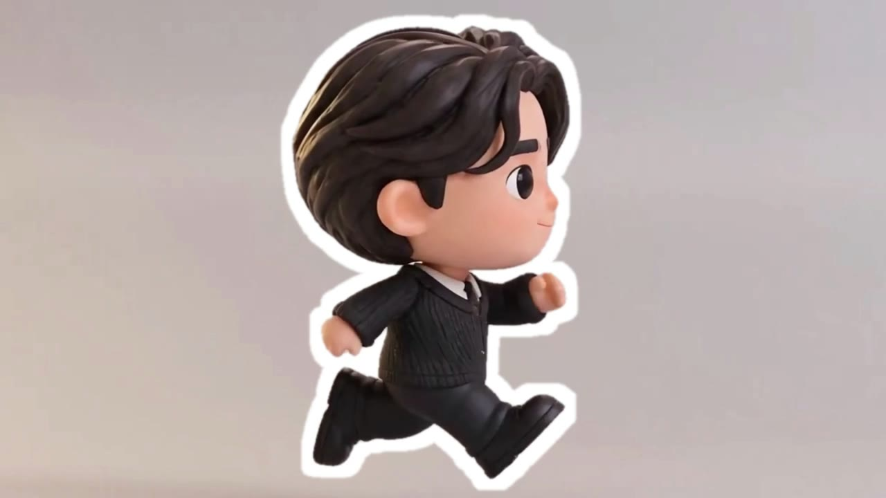 |  | 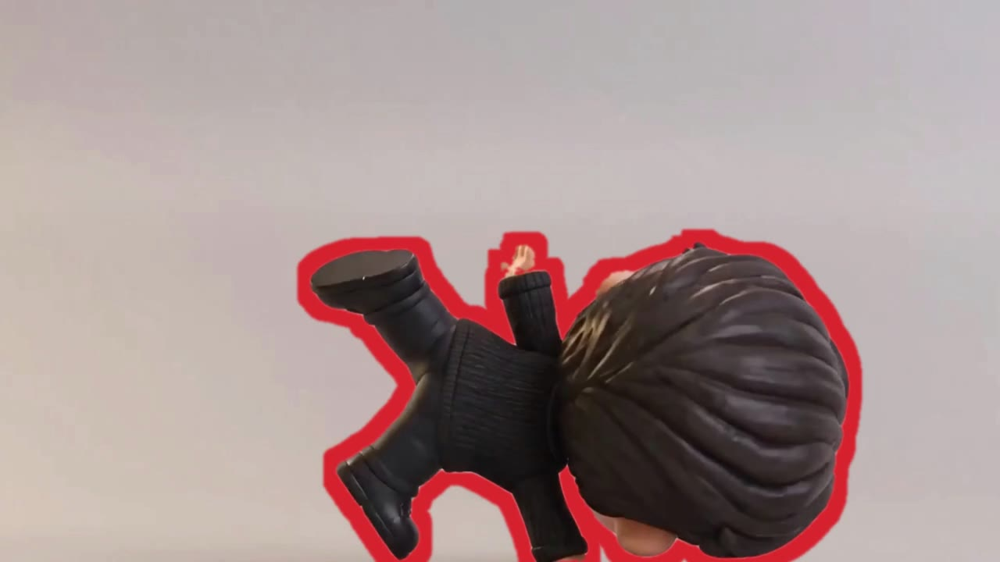 |

Subject and shot: the bobblehead (owned). Built as an editable DreamCut timeline. Catalog evidence below is separate.

Your subject is cut out of the moving shot and outlined in thick paper, like a scrapbook sticker.

### What you supply

- **A shot with the subject:** Film the person moving freely with a little space around them, against a background that differs from their clothes and hair. Keep them in view for the whole moment; if several people appear, say who to cut out.

### Supply your own or generate inputs

The shot can be generated. The moving cutout and the paper outline are made in DreamCut.

Generation suitability is guidance, not proof of a tested generated-input workflow. Ask the agent to stage any needed assets in Library → Generate, then review the model, prompt and settings before generating.

### How the effect is built

1. Cut out the subject from the shot under the mark, following them as they move.
2. Place the cutout over the shot on the same moment, with a thick paper outline.
3. Expose the outline width, size, position and outline color.

### Ask your agent

Select this template in Templates, then tell your agent which files to use. Your agent works from this request; it prepares a proposal for you to review, never an edit or a generation on its own.

```text
Use the scratchpad-treatment skill for "Paper cutout" (recipe: FX-PAPER-CUTOUT).
Read the FX-PAPER-CUTOUT construction brief in src/lib/effects/promoted-recipes.ts and its owning skill before preparing the edit.
Build Paper cutout on [SUBJECT] at [MARK OR TIME]. Follow the Paper cutout template in the scratchpad-treatment skill: prepare a moving cutout of the subject with cutout_prepare over the source window under the mark, then propose the cutout as its own clip above the shot, aligned to the same source moment, with sticker_outline on, a [COLOR, default white] paper outline about 14 px wide, and size and position set explicitly. Expose Paper outline, Size, Horizontal and Vertical as the main dials and Outline color under Advanced. Propose it for me to review.
My inputs and target: [attach or identify my files, target clips, order and desired timing].
A shot with the subject: Film the person moving freely with a little space around them, against a background that differs from their clothes and hair. Keep them in view for the whole moment; if several people appear, say who to cut out.
How it works: Cut out the subject from the shot under the mark, following them as they move. Place the cutout over the shot on the same moment, with a thick paper outline. Expose the outline width, size, position and outline color.
Input generation guidance: The shot can be generated. The moving cutout and the paper outline are made in DreamCut.
Read the current timeline, applicable preferences and available media. Ask for missing inputs; do not assume example assets are mine. If generation is needed, prepare a visible draft and wait for my generation authorization.
Preserve original sources and unrelated edits. Keep meaningful layers and tuning controls editable. For an existing edit, propose changes for my review; do not apply or approve them.
Known limitations: The outline follows the cutout, so anything the cutout misses, such as a hand or a hat brim, has no outline. Fine hair and motion blur give a slightly soft outline edge. The outline width is fixed in pixels; it does not grow with Size.
Preview the result, check the full transition or animation and report anything unverified.
```

### Evidence and limits

- The outline follows the cutout, so anything the cutout misses, such as a hand or a hat brim, has no outline.
- Fine hair and motion blur give a slightly soft outline edge.
- The outline width is fixed in pixels; it does not grow with Size.

<a id="fx-word-search-trace"></a>

## Word Search Trace

**FX-WORD-SEARCH-TRACE · Implemented template · built with your agent** · [Owning skill](../../.agents/skills/motion-graphics/SKILL.md)

**Home:** Properties → Templates.

### Demonstration

[](../../public/recipe-previews/word-search/result.mp4)

A letter grid sits over your footage. On each cut, a hand-drawn outline circles one hidden word, and every outline stays on screen. Normal speed; each outline draws in 0.6 seconds.

**You supply**

| Shot 1 | Shot 2 | Shot 3 | Shot 4 | One word per shot |
| --- | --- | --- | --- | --- |
|  |  |  |  | RUN · DASH · FLIP · LAND |

**DreamCut prepares**

| Letter grid and outlines |
| --- |
|  |

| 1 · Letter grid | 2 · First word circled | 3 · Every word circled |
| --- | --- | --- |
|  |  |  |

Footage: the bobblehead (owned). Inspired by a "connect the letters" tutorial by Camila Tunoni. Catalog evidence below is separate.

A letter grid over your footage; on each cut a hand-drawn outline circles one hidden word.

### What you supply

- **Two to four short shots:** Supply one shot for each word, roughly one to two seconds each. Busy or bright backgrounds still work; the letters carry a soft shadow.
- **One word per shot:** Choose a short word for each shot, A to Z only, up to 12 letters. Say if a word should run across, down or diagonally.

### Supply your own or generate inputs

Shots can be filmed or generated; the letter grid and outlines are made in DreamCut, so never generate them into the footage.

Generation suitability is guidance, not proof of a tested generated-input workflow. Ask the agent to stage any needed assets in Library → Generate, then review the model, prompt and settings before generating.

### How the effect is built

1. Hide each word in a letter grid sized to the canvas.
2. Start each outline just after its cut and let it draw around the word.
3. Expose the words, directions, trace timing, letter size and color as controls.

### Ask your agent

Select this template in Templates, then tell your agent which files to use. Your agent works from this request; it prepares a proposal for you to review, never an edit or a generation on its own.

```text
Use the motion-graphics skill for "Word Search Trace" (recipe: FX-WORD-SEARCH-TRACE).
Read the FX-WORD-SEARCH-TRACE construction brief in src/lib/effects/promoted-recipes.ts and its owning skill before preparing the edit.
Build Word Search Trace on my edit with these words: [WORD 1], [WORD 2], [WORD 3], [WORD 4]. Follow the Word Search Trace template in the motion-graphics skill: render the letter grid as a transparent motion graphic, hide one word per shot (across, down or diagonal), and time each outline to start just after its cut. Keep the footage as native clips and expose the words, directions, trace timing, letter size and color as controls. Propose it for me to review.
My inputs and target: [attach or identify my files, target clips, order and desired timing].
Two to four short shots: Supply one shot for each word, roughly one to two seconds each. Busy or bright backgrounds still work; the letters carry a soft shadow.
One word per shot: Choose a short word for each shot, A to Z only, up to 12 letters. Say if a word should run across, down or diagonally.
How it works: Hide each word in a letter grid sized to the canvas. Start each outline just after its cut and let it draw around the word. Expose the words, directions, trace timing, letter size and color as controls.
Input generation guidance: Shots can be filmed or generated; the letter grid and outlines are made in DreamCut, so never generate them into the footage.
Read the current timeline, applicable preferences and available media. Ask for missing inputs; do not assume example assets are mine. If generation is needed, prepare a visible draft and wait for my generation authorization.
Preserve original sources and unrelated edits. Keep meaningful layers and tuning controls editable. For an existing edit, propose changes for my review; do not apply or approve them.
Known limitations: The overlay is a rendered motion graphic: words, timing and color are tuned on the proposal card before approval, not in the inspector afterwards. Words use the letters A–Z, up to 12 letters each, up to four words. The grid is drawn for a portrait 9:16 canvas.
Preview the result, check the full transition or animation and report anything unverified.
```

### Evidence and limits

- The overlay is a rendered motion graphic: words, timing and color are tuned on the proposal card before approval, not in the inspector afterwards.
- Words use the letters A–Z, up to 12 letters each, up to four words.
- The grid is drawn for a portrait 9:16 canvas.

<a id="fx-motion-sketch-3d"></a>

## 3D Sketch Scene

**FX-MOTION-SKETCH-3D · Implemented template · built with your agent** · [Owning skill](../../.agents/skills/motion-graphics/SKILL.md)

**Home:** Properties → Templates.

### Demonstration

[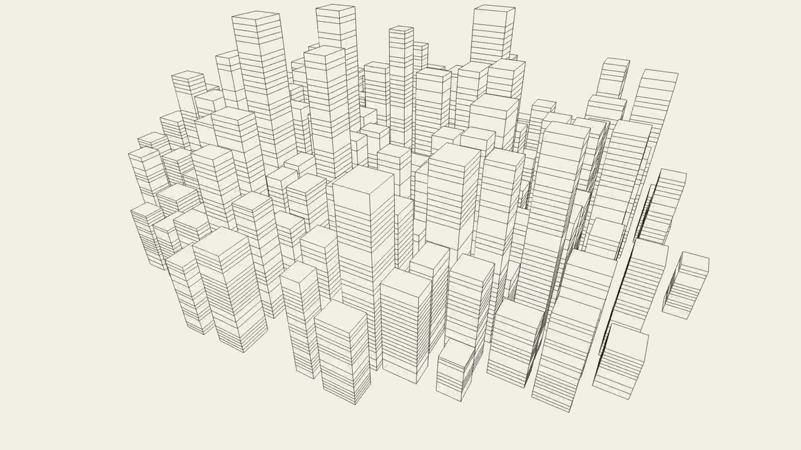](../../public/recipe-previews/motion-sketch-3d/result.mp4)

Describe any scene and it is built from simple 3D shapes, drawn in ink as it rises into place, then the camera flies, circles or rises through it. Normal speed; the city draws in for 1.6 seconds, then the camera flies for 4 seconds.

**You supply**

| What the scene shows |
| --- |
| A city at dusk |

**DreamCut prepares**

| Another scene, same engine |
| --- |
| 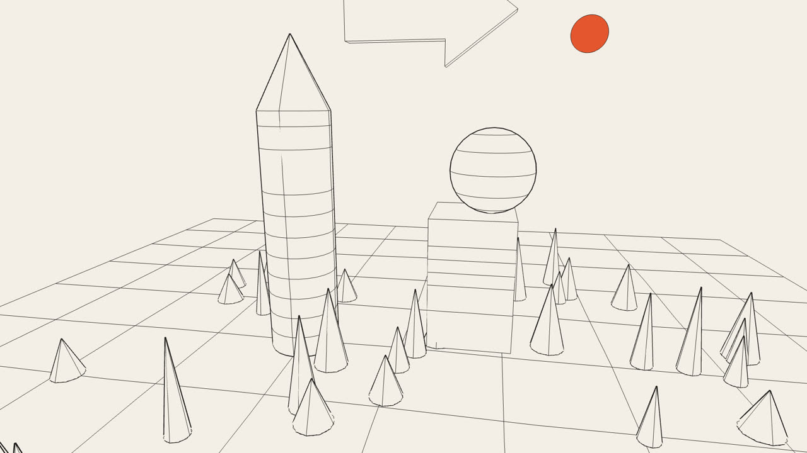 |

| 1 · Draws in | 2 · Camera flies in | 3 · Down the street |
| --- | --- | --- |
|  | 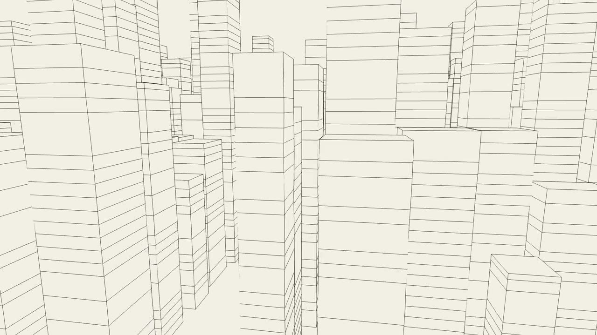 | 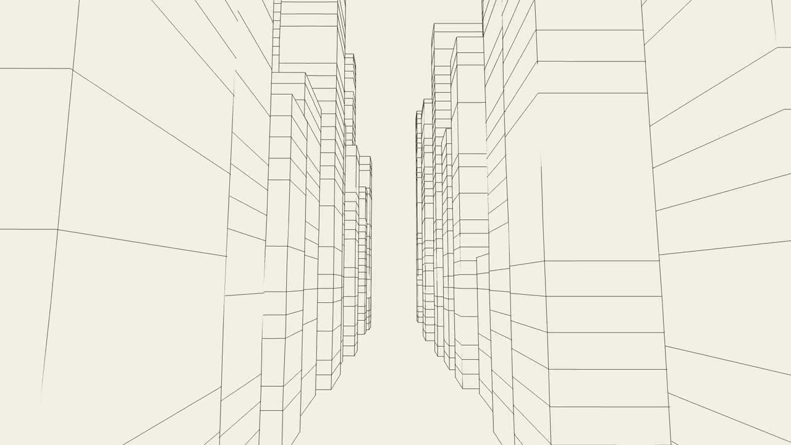 |

Built in DreamCut as an editable code-built 3D motion graphic; no footage, generated imagery or people. Catalog evidence below is separate.

Any 3D scene you can describe, drawn in ink as it builds, then flown through by the camera: a city, a forest, a product on a plinth, a logo, a map of your street.

### What you supply

- **What the scene shows:** Describe it in words: the objects, roughly where they stand and how big they are, and where the camera should go (fly through, circle or rise) and land. Logos and letters are drawn as extruded outlines.

### Supply your own or generate inputs

Nothing is generated; the scene is drawn from code in DreamCut. Turn Paper fill off to lay it over your own footage.

Generation suitability is guidance, not proof of a tested generated-input workflow. Ask the agent to stage any needed assets in Library → Generate, then review the model, prompt and settings before generating.

### How the effect is built

1. Build the scene from simple 3D shapes and generators (city, forest, ground grid).
2. Draw it in as ink, then move the camera through it.
3. Expose camera, timing, density, height, wobble, ink, paper and paper fill as controls.

### Ask your agent

Select this template in Templates, then tell your agent which files to use. Your agent works from this request; it prepares a proposal for you to review, never an edit or a generation on its own.

```text
Use the motion-graphics skill for "3D Sketch Scene" (recipe: FX-MOTION-SKETCH-3D).
Read the FX-MOTION-SKETCH-3D construction brief in src/lib/effects/promoted-recipes.ts and its owning skill before preparing the edit.
Build a 3D Sketch Scene of [WHAT THE SCENE SHOWS], with the camera [FLYING THROUGH / CIRCLING / RISING OVER] it[, landing on WHAT OR WHEN]. Follow the 3D Sketch Scene template in the motion-graphics skill: write a scene.js for my subject from simple shapes (boxes, cylinders, cones, spheres, extruded outlines for logos and letters, ground grids, city and forest generators) and keep the shared engine unchanged. Expose Camera, Camera time, Build time, Density, Height, Wobble and Variation as the main dials, and Detail, Hold, Ink, Paper and Paper fill under Advanced; turn Paper fill off if it should lay over my footage. Propose it for me to review.
My inputs and target: [attach or identify my files, target clips, order and desired timing].
What the scene shows: Describe it in words: the objects, roughly where they stand and how big they are, and where the camera should go (fly through, circle or rise) and land. Logos and letters are drawn as extruded outlines.
How it works: Build the scene from simple 3D shapes and generators (city, forest, ground grid). Draw it in as ink, then move the camera through it. Expose camera, timing, density, height, wobble, ink, paper and paper fill as controls.
Input generation guidance: Nothing is generated; the scene is drawn from code in DreamCut. Turn Paper fill off to lay it over your own footage.
Read the current timeline, applicable preferences and available media. Ask for missing inputs; do not assume example assets are mine. If generation is needed, prepare a visible draft and wait for my generation authorization.
Preserve original sources and unrelated edits. Keep meaningful layers and tuning controls editable. For an existing edit, propose changes for my review; do not apply or approve them.
Known limitations: Everything is built from simple shapes; imported 3D models and photos are not supported, and words are extruded outlines rather than typed text. It draws as ink lines; Looks do not apply to it yet, so restyle it with Ink, Paper, Paper fill and Wobble. Lines are one pixel wide at 1920 × 1080.
Preview the result, check the full transition or animation and report anything unverified.
```

### Evidence and limits

- Everything is built from simple shapes; imported 3D models and photos are not supported, and words are extruded outlines rather than typed text.
- It draws as ink lines; Looks do not apply to it yet, so restyle it with Ink, Paper, Paper fill and Wobble.
- Lines are one pixel wide at 1920 × 1080.

<a id="fx-clone-flash"></a>

## Clone Flash

**FX-CLONE-FLASH · Implemented template · built with your agent** · [Owning skill](../../.agents/skills/video-compositing/SKILL.md)

**Home:** Properties → Templates.

### Demonstration

[](../../public/recipe-previews/clone-flash/result.mp4)

Copies of the running bobblehead, cut out from other moments of the same take, appear beside it one at a time; each arrives as a white silhouette and settles into color. Normal speed; each copy is white for 0.1 s and in color by 0.2 s.

**You supply**

| Still shot |
| --- |
|  |

**DreamCut prepares**

| Moving cutout |
| --- |
|  |

| 1 · Original | 2 · First copy flashes | 3 · Second copy flashes | 4 · Three of them |
| --- | --- | --- | --- |
|  |  |  |  |

Shot and copies: the bobblehead (owned). Built as an editable DreamCut timeline. Effect reference: @willrvail breakdown of a video by @nvision.media. Catalog evidence below is separate.

Copies of your subject from later in the same take appear beside them, each arriving with a white flash and camera shutter.

### What you supply

- **A still shot of a person:** Keep the camera still and leave room beside the person. Film a few extra seconds so later moments can supply the copies. A plain, even background hides cutout edges best.

### Supply your own or generate inputs

A still shot can be generated; keep the background stable. The copies and flashes are made in DreamCut.

Generation suitability is guidance, not proof of a tested generated-input workflow. Ask the agent to stage any needed assets in Library → Generate, then review the model, prompt and settings before generating.

### How the effect is built

1. Cut out the person from later in the same take.
2. Place two or three copies beside them on their own lanes.
3. Flash each copy white as it arrives, with Camera 02 Shutter Click attached to its entrance.
4. Keep each shutter linked to its copy; expose position, source moment and shutter volume, including mute. The visual demo stays silent.

### Ask your agent

Select this template in Templates, then tell your agent which files to use. Your agent works from this request; it prepares a proposal for you to review, never an edit or a generation on its own.

```text
Use the video-compositing skill for "Clone Flash" (recipe: FX-CLONE-FLASH).
Read the FX-CLONE-FLASH construction brief in src/lib/effects/promoted-recipes.ts and its owning skill before preparing the edit.
Build Clone Flash on [SHOT]. Follow the Clone Flash template in the video-compositing skill: prepare a moving cutout of the person from later in the same take, place two or three copies beside them on their own lanes, and give each a white silhouette for its first 0.1 s that fades to color by 0.2 s. Include Camera 02 Shutter Click from the shared Library at every clone entrance, linked to that clone so it follows timing changes, in the same proposal. Expose each clone's position, source moment and shutter volume, including mute, as controls. Keep the visual teaching demo silent. Propose it for me to review.
My inputs and target: [attach or identify my files, target clips, order and desired timing].
A still shot of a person: Keep the camera still and leave room beside the person. Film a few extra seconds so later moments can supply the copies. A plain, even background hides cutout edges best.
How it works: Cut out the person from later in the same take. Place two or three copies beside them on their own lanes. Flash each copy white as it arrives, with Camera 02 Shutter Click attached to its entrance. Keep each shutter linked to its copy; expose position, source moment and shutter volume, including mute. The visual demo stays silent.
Input generation guidance: A still shot can be generated; keep the background stable. The copies and flashes are made in DreamCut.
Read the current timeline, applicable preferences and available media. Ask for missing inputs; do not assume example assets are mine. If generation is needed, prepare a visible draft and wait for my generation authorization.
Preserve original sources and unrelated edits. Keep meaningful layers and tuning controls editable. For an existing edit, propose changes for my review; do not apply or approve them.
Known limitations: The camera must stay still; a moving camera makes the clones slide. Only the person is copied, so whatever they sit or lean on is not. Clone start times are set in the proposal; the card offers position, source moment and shutter volume. An agent assembles this effect; there is no dedicated compiled preset. The silent demo shows the picture only; applying the effect includes shutters from the members’ sound Library.
Preview the result, check the full transition or animation and report anything unverified.
```

### Evidence and limits

- The camera must stay still; a moving camera makes the clones slide.
- Only the person is copied, so whatever they sit or lean on is not.
- Clone start times are set in the proposal; the card offers position, source moment and shutter volume.
- An agent assembles this effect; there is no dedicated compiled preset. The silent demo shows the picture only; applying the effect includes shutters from the members’ sound Library.

<a id="fx-silhouette-window"></a>

## Silhouette Window

**FX-SILHOUETTE-WINDOW · Implemented template · built with your agent** · [Owning skill](../../.agents/skills/video-compositing/SKILL.md)

**Home:** Properties → Templates.

### Demonstration

[](../../public/recipe-previews/silhouette-window/result.mp4)

Short clips play one after another inside the bobblehead's moving silhouette while the studio around it stays as filmed. Normal speed; a new clip every 0.5 seconds.

**You supply**

| Shot of the subject | Fill clip | Fill clip | Fill clip | Fill clip |
| --- | --- | --- | --- | --- |
|  |  | 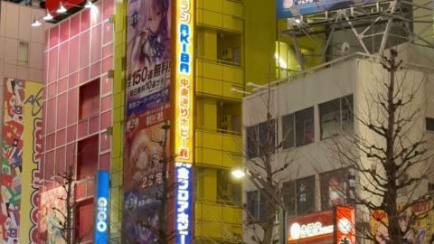 | 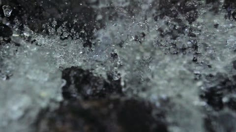 | 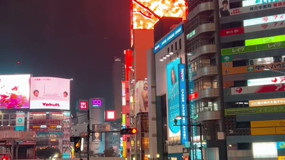 |

**DreamCut prepares**

| Moving mask |
| --- |
|  |

| 1 · First clip inside | 2 · Next clip | 3 · Next clip | 4 · Window follows it |
| --- | --- | --- | --- |
| 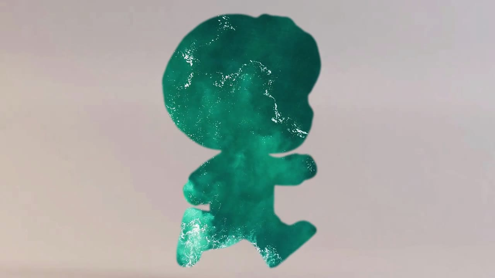 | 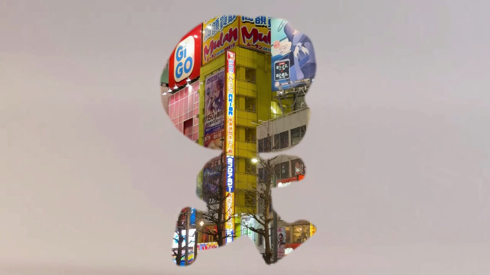 | 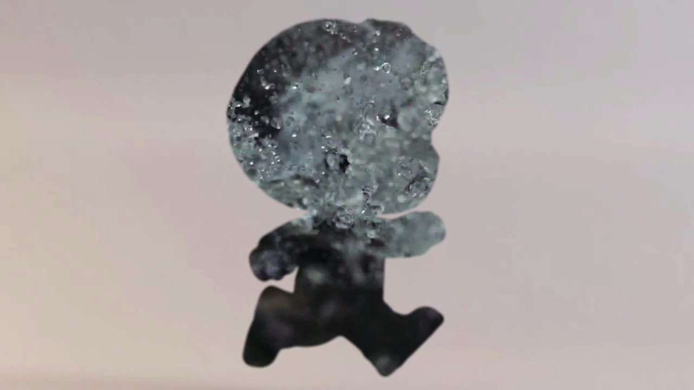 | 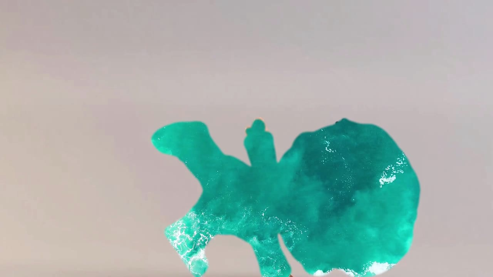 |

Subject and shot: the bobblehead (owned). Fill clips: Pexels videos 20082249, 30996082, 4208237, 32287884 and 18830028 (Pexels License). Built as an editable DreamCut timeline. Effect reference: @willrvail breakdown of a video by @nvision.media. Catalog evidence below is separate.

A run of short clips plays only inside your subject's moving silhouette; the rest of the shot stays as it is.

### What you supply

- **A shot of a person:** A clear silhouette works best: a profile against the sky, or a figure against a plain background.
- **Several short fill clips:** Supply clips with strong color or texture; about 0.6 seconds of each is used, in the order you give.

### Supply your own or generate inputs

Fill clips can be filmed or generated. The window is made in DreamCut from the person's cutout.

Generation suitability is guidance, not proof of a tested generated-input workflow. Ask the agent to stage any needed assets in Library → Generate, then review the model, prompt and settings before generating.

### How the effect is built

1. Prepare a moving cutout mask of the person.
2. Place the fill clips in order above the shot, each windowed to the person's silhouette.
3. Tune edge softness, edge size and window strength.

### Ask your agent

Select this template in Templates, then tell your agent which files to use. Your agent works from this request; it prepares a proposal for you to review, never an edit or a generation on its own.

```text
Use the video-compositing skill for "Silhouette Window" (recipe: FX-SILHOUETTE-WINDOW).
Read the FX-SILHOUETTE-WINDOW construction brief in src/lib/effects/promoted-recipes.ts and its owning skill before preparing the edit.
Build Silhouette Window on [SHOT] with these fill clips: [CLIPS]. Follow the Silhouette Window template in the video-compositing skill: prepare the person's moving cutout mask, then place the fills in order (about 0.6 s each) as Subject Window clips shown inside the person. Expose edge softness, edge size and window strength as controls. Propose it for me to review.
My inputs and target: [attach or identify my files, target clips, order and desired timing].
A shot of a person: A clear silhouette works best: a profile against the sky, or a figure against a plain background.
Several short fill clips: Supply clips with strong color or texture; about 0.6 seconds of each is used, in the order you give.
How it works: Prepare a moving cutout mask of the person. Place the fill clips in order above the shot, each windowed to the person's silhouette. Tune edge softness, edge size and window strength.
Input generation guidance: Fill clips can be filmed or generated. The window is made in DreamCut from the person's cutout.
Read the current timeline, applicable preferences and available media. Ask for missing inputs; do not assume example assets are mine. If generation is needed, prepare a visible draft and wait for my generation authorization.
Preserve original sources and unrelated edits. Keep meaningful layers and tuning controls editable. For an existing edit, propose changes for my review; do not apply or approve them.
Known limitations: The window follows the prepared cutout; anything it misses, such as a raised hand, stays unfilled. Fill order and rhythm are set in the proposal; the card offers edge softness, edge size and window strength.
Preview the result, check the full transition or animation and report anything unverified.
```

### Evidence and limits

- The window follows the prepared cutout; anything it misses, such as a raised hand, stays unfilled.
- Fill order and rhythm are set in the proposal; the card offers edge softness, edge size and window strength.

<a id="fx-cross-negative"></a>

## Cross into Negative

**FX-CROSS-NEGATIVE · Implemented template · built with your agent** · [Owning skill](../../.agents/skills/video-compositing/SKILL.md)

**Home:** Properties → Templates.

### Demonstration

[](../../public/recipe-previews/cross-negative/result.mp4)

As the bobblehead runs, a bar slides in from the right and another drops from the top, opening a cross onto its cartwheel as a black-and-white negative; the cross widens until the negative fills the frame. Normal speed; the cross opens over 1.5 seconds.

**You supply**

| Shot A | Shot B |
| --- | --- |
|  |  |

**DreamCut prepares**

| Shot B as a negative |
| --- |
|  |

| 1 · Shot A | 2 · First bar | 3 · Cross opens | 4 · Negative fills the frame |
| --- | --- | --- | --- |
|  |  |  |  |

Both shots: the bobblehead (owned). Built as an editable DreamCut timeline. Effect reference: @willrvail breakdown of a video by @nvision.media. Catalog evidence below is separate.

A cross-shaped window opens over one shot onto the next as a black-and-white negative, then widens to fill the frame.

### What you supply

- **Two shots:** Supply the outgoing shot and the shot it cuts to. A shot B with strong light and shadow reads best as a negative.

### Supply your own or generate inputs

Either shot can be filmed or generated; the cross and negative are made in DreamCut.

Generation suitability is guidance, not proof of a tested generated-input workflow. Ask the agent to stage any needed assets in Library → Generate, then review the model, prompt and settings before generating.

### How the effect is built

1. Turn shot B black and white and invert it with a white difference layer.
2. Open a bar from the right and a bar from the top, each showing the negative.
3. Widen both bars until the negative fills the frame at the cut; expose the gap between bars and contrast.

### Ask your agent

Select this template in Templates, then tell your agent which files to use. Your agent works from this request; it prepares a proposal for you to review, never an edit or a generation on its own.

```text
Use the video-compositing skill for "Cross into Negative" (recipe: FX-CROSS-NEGATIVE).
Read the FX-CROSS-NEGATIVE construction brief in src/lib/effects/promoted-recipes.ts and its owning skill before preparing the edit.
Build Cross into Negative from [SHOT A] into [SHOT B]. Follow the Cross into Negative template in the video-compositing skill: show shot B as a black-and-white negative inside a cross (a bar wipes in from the right, a bar drops from the top), then widen both until the negative fills the frame at the cut. Expose the gap between the bars, contrast and shot B's start as controls. Propose it for me to review.
My inputs and target: [attach or identify my files, target clips, order and desired timing].
Two shots: Supply the outgoing shot and the shot it cuts to. A shot B with strong light and shadow reads best as a negative.
How it works: Turn shot B black and white and invert it with a white difference layer. Open a bar from the right and a bar from the top, each showing the negative. Widen both bars until the negative fills the frame at the cut; expose the gap between bars and contrast.
Input generation guidance: Either shot can be filmed or generated; the cross and negative are made in DreamCut.
Read the current timeline, applicable preferences and available media. Ask for missing inputs; do not assume example assets are mine. If generation is needed, prepare a visible draft and wait for my generation authorization.
Preserve original sources and unrelated edits. Keep meaningful layers and tuning controls editable. For an existing edit, propose changes for my review; do not apply or approve them.
Known limitations: The cross widens smoothly; the reference breaks into blocks as it opens. Bar placement and widening are keyframes in the proposal; the card offers the gap between bars, contrast and shot B's start. The bars are placed for a 16:9 frame.
Preview the result, check the full transition or animation and report anything unverified.
```

### Evidence and limits

- The cross widens smoothly; the reference breaks into blocks as it opens.
- Bar placement and widening are keyframes in the proposal; the card offers the gap between bars, contrast and shot B's start.
- The bars are placed for a 16:9 frame.

<a id="fx-video-letters"></a>

## Video Letters

**FX-VIDEO-LETTERS · Implemented template · built with your agent** · [Owning skill](../../.agents/skills/video-letters/SKILL.md)

**Home:** Properties → Templates.

### Demonstration

[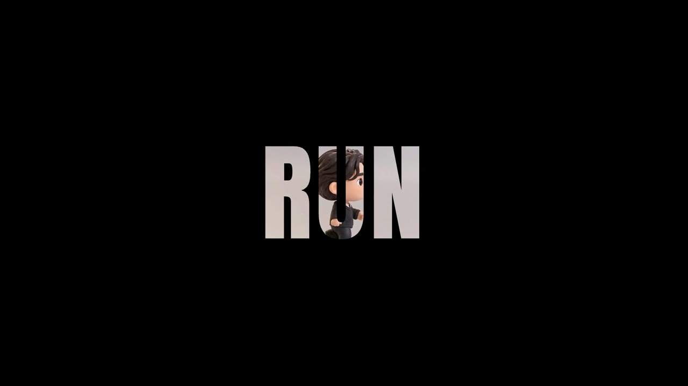](../../public/recipe-previews/video-letters/result.mp4)

A big, thick word fades in on a black frame, and the bobblehead's run plays only inside its letters. Normal speed; the word fades in over 0.2 seconds and the video keeps playing inside it.

**You supply**

| The word | Video to show through it |
| --- | --- |
| RUN |  |

**DreamCut prepares**

| The letters as a window |
| --- |
| 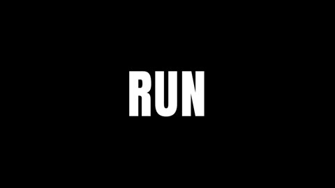 |

| 1 · Word fades in | 2 · Video inside the letters | 3 · Video keeps playing |
| --- | --- | --- |
| 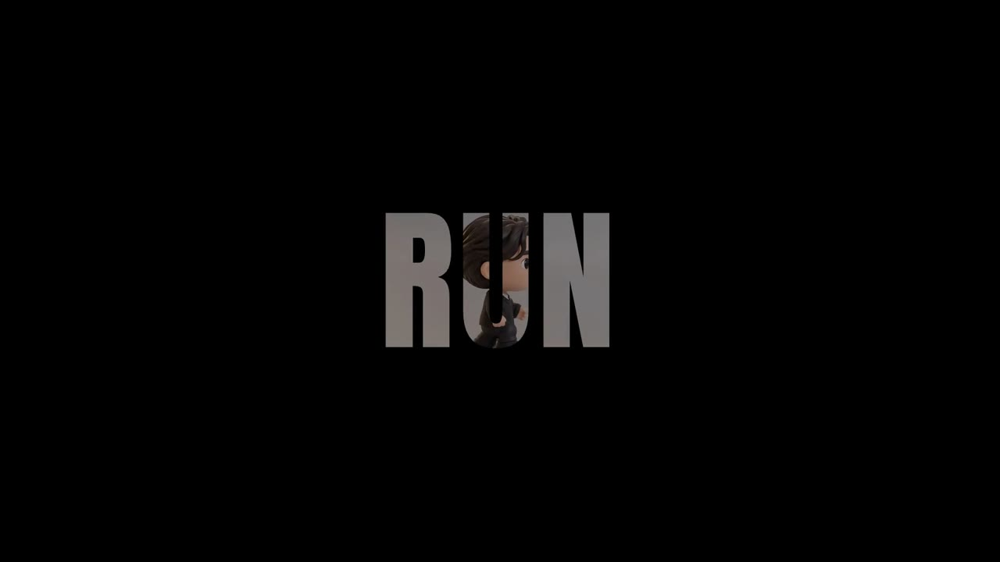 | 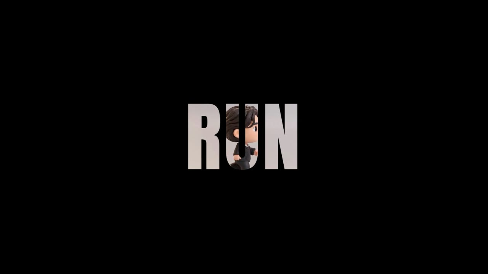 | 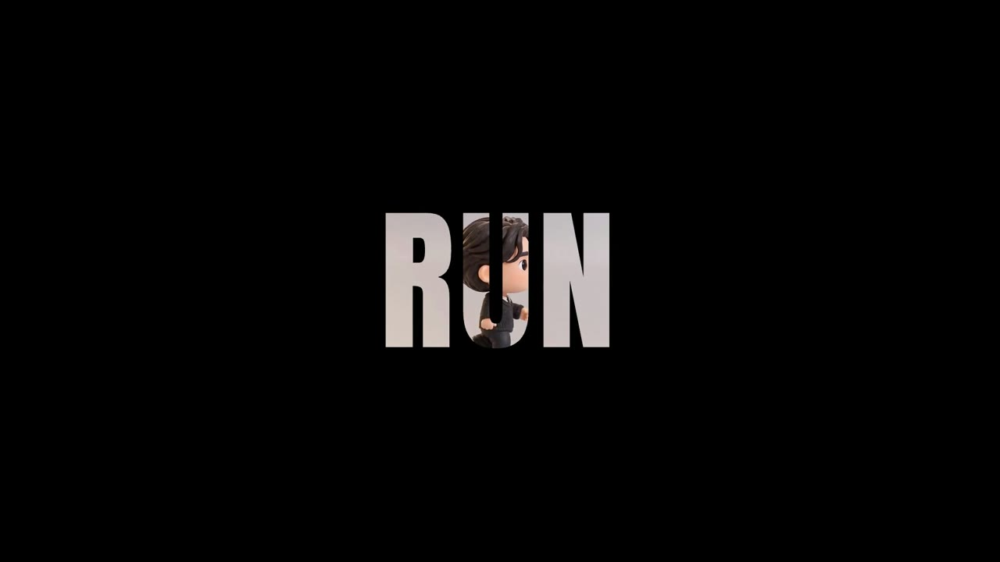 |

Footage inside the letters: the bobblehead (owned). Built as an editable DreamCut timeline. Catalog evidence below is separate.

A big, thick word fills the frame and a video plays only inside its letters.

### What you supply

- **A short word:** One short word reads best: the bigger the letters, the more of the video shows.
- **A video:** Supply the clip to play inside the letters. Busy, colourful footage reads best; the video fills the word, centred.

### Supply your own or generate inputs

The video can be filmed or generated; the letters are made in DreamCut as editable text.

Generation suitability is guidance, not proof of a tested generated-input workflow. Ask the agent to stage any needed assets in Library → Generate, then review the model, prompt and settings before generating.

### How the effect is built

1. Set the word in heavy block letters.
2. Fill the letters with the video, playing in step with the edit.
3. Tune the size, how long it stays on screen and how it fades in and out.

### Ask your agent

Select this template in Templates, then tell your agent which files to use. Your agent works from this request; it prepares a proposal for you to review, never an edit or a generation on its own.

```text
Use the video-letters skill for "Video Letters" (recipe: FX-VIDEO-LETTERS).
Read the FX-VIDEO-LETTERS construction brief in src/lib/effects/promoted-recipes.ts and its owning skill before preparing the edit.
Build Video Letters with the word [WORD] and [VIDEO] playing inside it. Follow the video-letters skill: one native title in heavy block letters (Anton by default) with the video as its fill, using the video's prepared preview, on its own text lane above the other layers. Give me Size, Extra time on screen, Animation in, Fill speed and Animation out as controls. Propose it for me to review.
My inputs and target: [attach or identify my files, target clips, order and desired timing].
A short word: One short word reads best: the bigger the letters, the more of the video shows.
A video: Supply the clip to play inside the letters. Busy, colourful footage reads best; the video fills the word, centred.
How it works: Set the word in heavy block letters. Fill the letters with the video, playing in step with the edit. Tune the size, how long it stays on screen and how it fades in and out.
Input generation guidance: The video can be filmed or generated; the letters are made in DreamCut as editable text.
Read the current timeline, applicable preferences and available media. Ask for missing inputs; do not assume example assets are mine. If generation is needed, prepare a visible draft and wait for my generation authorization.
Preserve original sources and unrelated edits. Keep meaningful layers and tuning controls editable. For an existing edit, propose changes for my review; do not apply or approve them.
Known limitations: Which part of the video shows inside the letters is not a control yet; the video fills the word, centred. Letter spacing is not a control yet; Size sets the word's width, up to 300 px at 1080 wide. Thick block fonts read best; thin or script fonts leave too little letter to watch the video through.
Preview the result, check the full transition or animation and report anything unverified.
```

### Evidence and limits

- Which part of the video shows inside the letters is not a control yet; the video fills the word, centred.
- Letter spacing is not a control yet; Size sets the word's width, up to 300 px at 1080 wide.
- Thick block fonts read best; thin or script fonts leave too little letter to watch the video through.

<a id="layered-paper-cutout"></a>

## Layered Paper Cutout

**layered-paper-cutout · Demonstration · not catalog-verified** · [Owning skill](../../.agents/skills/layered-paper-cutout/SKILL.md)

**Home:** Properties → Templates.

### Demonstration

[Demonstration](../../public/guide/effects/contour-first-half.mp4)

Example credit: DreamCut · creator-supplied portrait.

Colored paper layers appear on selected music hits. Opening 6.4 seconds.

### What you supply

- **Portrait:** Supply one clear portrait with the subject edges visible.
- **Music and hits:** Supply the music and identify the hits to emphasize, or ask in chat to suggest them.

### Supply your own or generate inputs

The portrait or paper textures can be generated. Keep the subject consistent and derive the paper layers from its silhouette.

Generation suitability is guidance, not proof of a tested generated-input workflow. Ask the agent to stage any needed assets in Library → Generate, then review the model, prompt and settings before generating.

### How the effect is built

1. Separate the portrait from its background.
2. Build color paper layers behind the subject.
3. Reveal layers back to front on the selected music hits.

### Ask your agent

Select this template in Templates, then tell your agent which files to use. Your agent works from this request; it prepares a proposal for you to review, never an edit or a generation on its own.

```text
Use the layered-paper-cutout skill for "Layered Paper Cutout" (recipe: layered-paper-cutout).
Use the layered-paper-cutout skill with this portrait and my selected music hits. Build the colored paper layers behind me and reveal them back to front on the selected hits. Keep each layer editable.
My inputs and target: [attach or identify my files, target clips, order and desired timing].
Portrait: Supply one clear portrait with the subject edges visible.
Music and hits: Supply the music and identify the hits to emphasize, or ask in chat to suggest them.
How it works: Separate the portrait from its background. Build color paper layers behind the subject. Reveal layers back to front on the selected music hits.
Input generation guidance: The portrait or paper textures can be generated. Keep the subject consistent and derive the paper layers from its silhouette.
Read the current timeline, applicable preferences and available media. Ask for missing inputs; do not assume example assets are mine. If generation is needed, prepare a visible draft and wait for my generation authorization.
Preserve original sources and unrelated edits. Keep meaningful layers and tuning controls editable. For an existing edit, propose changes for my review; do not apply or approve them.
Preview the result, check the full transition or animation and report anything unverified.
```

### Evidence and limits

This workflow has not been promoted to a verified complete catalog recipe.

<a id="talking-head-cutout"></a>

## Background removal

**talking-head-cutout · Demo not available yet** · [Owning skill](../../.agents/skills/talking-head-cutout/SKILL.md)

**Home:** Properties → Templates.

### Demonstration

[](../../public/recipe-previews/talking-head-cutout/result.mp4)

The studio behind the bobblehead disappears while it keeps running; its hair, hands and shoes stay, now in front of a plain backdrop. Normal speed; the studio shows for 1.6 seconds, then the backdrop changes.

**You supply**

| Photo or video |
| --- |
| 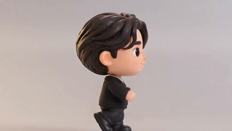 |

**DreamCut prepares**

| Moving cutout |
| --- |
|  |

| 1 · Original | 2 · Background removed | 3 · Hair and hands kept |
| --- | --- | --- |
|  |  |  |

Subject and shot: the bobblehead (owned). Built as an editable DreamCut timeline. Catalog evidence below is separate.

Remove the background behind a person, character or object in a photo or video, keeping its whole outline and, for video, its sound in sync.

### What you supply

- **Photo or video:** Supply the photo, or the full video with the section to use, and the subject to keep. For video, retain the original audio; do not send only a screenshot.

### Supply your own or generate inputs

Use the real recording when preserving a subject and its sound. A generated replacement is a different input and must not silently replace the subject.

Generation suitability is guidance, not proof of a tested generated-input workflow. Ask the agent to stage any needed assets in Library → Generate, then review the model, prompt and settings before generating.

### How the effect is built

1. Isolate the visible subject over the chosen section.
2. Preserve moving hair, hands and fine edges.
3. Keep the transparent picture synchronized with the original sound.

### Ask your agent

Select this template in Templates, then tell your agent which files to use. Your agent works from this request; it prepares a proposal for you to review, never an edit or a generation on its own.

```text
Use the talking-head-cutout skill for "Background removal" (recipe: talking-head-cutout).
Use the talking-head-cutout skill to remove the background from this photo or video (for video, over my selected section). Preserve all visible hair, hands, clothing and edges of the subject. For video, keep the cutout synchronized with the original sound and preserve the original recording. Leave the cutout without a white outline. Check the edges and prepare a previewable proposal before using it in my edit.
My inputs and target: [attach or identify my files, target clips, order and desired timing].
Photo or video: Supply the photo, or the full video with the section to use, and the subject to keep. For video, retain the original audio; do not send only a screenshot.
How it works: Isolate the visible subject over the chosen section. Preserve moving hair, hands and fine edges. Keep the transparent picture synchronized with the original sound.
Input generation guidance: Use the real recording when preserving a subject and its sound. A generated replacement is a different input and must not silently replace the subject.
Read the current timeline, applicable preferences and available media. Ask for missing inputs; do not assume example assets are mine. If generation is needed, prepare a visible draft and wait for my generation authorization.
Preserve original sources and unrelated edits. Keep meaningful layers and tuning controls editable. For an existing edit, propose changes for my review; do not apply or approve them.
Preview the result, check the full transition or animation and report anything unverified.
```

### Evidence and limits

This workflow has not been promoted to a verified complete catalog recipe.

