# Make an effect with your own assets

Every recipe includes an input brief and build instructions. Demonstrations are optional; when present, they show the actual construction. Copy its request into your agent chat and identify your files. The agent prepares the construction; you review the proposed edit and fine-tune its persistent controls. Generation needs a separate reviewed draft and authorization.

[All effects](../../README.md#effect-catalog) · [Contribute an effect](creator-template.md) · [Evidence and packaging](README.md)

<a id="fx-12"></a>

## Shopping basket fills as items are picked

**FX-12 · Reference example** · [Owning skill](../../.agents/skills/video-compositing/SKILL.md)

**Home:** Properties → Templates.

### Demonstration

No recreated demo yet. · [Reference](media/FX-12.mp4)

Reference credit: @celfstudies; https://www.instagram.com/reel/DdN_aljAIY0/. Rights basis: licensed.

Basket remains stable across cuts and each selected product appears once, stays inside the basket and persists through following shots.

### What you supply

- **Shopping footage:** Supply the shopping clips in order and identify each pickup.
- **Basket and products:** Supply a basket image and a clear image of each product. DreamCut can prepare separate cutouts; identify which items should accumulate.

### Supply your own or generate inputs

A basket or product artwork can be generated. Use consistent perspective and lighting; real product labels need supplied artwork.

Generation suitability is guidance, not proof of a tested generated-input workflow. Ask the agent to stage any needed assets in Library → Generate, then review the model, prompt and settings before generating.

### How the effect is built

1. Prepare the basket and product cutouts.
2. Keep the basket in one position across shots and add each product on its pickup.
3. Check that earlier products remain inside the basket.

### Copy to your agent

Replace the bracketed input line with your files and target. Copying is a handoff, not an edit or a generation submission.

```text
Use the video-compositing skill for "Shopping basket fills as items are picked" (recipe: FX-12).
For a shared catalog recipe, read docs/effects/catalog.json entry FX-12 and its owning skill before preparing the edit.
Follow the FX-12 recipe and its success criteria, adapting the construction to my supplied assets.
My inputs and target: [attach or identify my files, target clips, order and desired timing].
Shopping footage: Supply the shopping clips in order and identify each pickup.
Basket and products: Supply a basket image and a clear image of each product. DreamCut can prepare separate cutouts; identify which items should accumulate.
How it works: Prepare the basket and product cutouts. Keep the basket in one position across shots and add each product on its pickup. Check that earlier products remain inside the basket.
Input generation guidance: A basket or product artwork can be generated. Use consistent perspective and lighting; real product labels need supplied artwork.
Read the current timeline, applicable preferences and available media. Ask for missing inputs; do not assume example assets are mine. If generation is needed, prepare a visible draft and wait for my generation authorization.
Preserve original sources and unrelated edits. Keep meaningful layers and tuning controls editable. For an existing edit, propose changes for my review; do not apply or approve them.
This is a reference-only candidate. Assess feasibility and explain capability gaps before promising a recreation.
Known limitations: Reference analyzed; no verified recreation packaged.
Preview the result, check the full transition or animation and report anything unverified.
```

### Evidence and limits

- Reference analyzed; no verified recreation packaged.

[Technical recipe and evidence](catalog.json) · [Skill receipt](../../.agents/skills/video-compositing/references/effect-evidence.json)

<a id="fx-14"></a>

## Floating translucent project screen

**FX-14 · Reference example** · [Owning skill](../../.agents/skills/video-compositing/SKILL.md)

**Home:** Properties → Templates.

### Demonstration

No recreated demo yet. · [Reference](media/FX-14.mp4)

Reference credit: @celfstudies; https://www.instagram.com/reel/DdN_aljAIY0/. Rights basis: licensed.

Screen is readable, translucent and does not cover the subject unintentionally.

### What you supply

- **Laptop footage:** Supply a shot with room for a floating screen above the laptop.
- **Screen content:** Supply the original screen recording or screenshot and the interval to show.

### Supply your own or generate inputs

A generic laptop background can be generated. Supply actual screen content when text or interface accuracy matters.

Generation suitability is guidance, not proof of a tested generated-input workflow. Ask the agent to stage any needed assets in Library → Generate, then review the model, prompt and settings before generating.

### How the effect is built

1. Fit the screen content above the laptop.
2. Adjust transparency and placement while keeping it readable.
3. Preserve the timing of a moving screen recording.

### Copy to your agent

Replace the bracketed input line with your files and target. Copying is a handoff, not an edit or a generation submission.

```text
Use the video-compositing skill for "Floating translucent project screen" (recipe: FX-14).
For a shared catalog recipe, read docs/effects/catalog.json entry FX-14 and its owning skill before preparing the edit.
Follow the FX-14 recipe and its success criteria, adapting the construction to my supplied assets.
My inputs and target: [attach or identify my files, target clips, order and desired timing].
Laptop footage: Supply a shot with room for a floating screen above the laptop.
Screen content: Supply the original screen recording or screenshot and the interval to show.
How it works: Fit the screen content above the laptop. Adjust transparency and placement while keeping it readable. Preserve the timing of a moving screen recording.
Input generation guidance: A generic laptop background can be generated. Supply actual screen content when text or interface accuracy matters.
Read the current timeline, applicable preferences and available media. Ask for missing inputs; do not assume example assets are mine. If generation is needed, prepare a visible draft and wait for my generation authorization.
Preserve original sources and unrelated edits. Keep meaningful layers and tuning controls editable. For an existing edit, propose changes for my review; do not apply or approve them.
This is a reference-only candidate. Assess feasibility and explain capability gaps before promising a recreation.
Known limitations: Reference analyzed; no verified recreation packaged.
Preview the result, check the full transition or animation and report anything unverified.
```

### Evidence and limits

- Reference analyzed; no verified recreation packaged.

[Technical recipe and evidence](catalog.json) · [Skill receipt](../../.agents/skills/video-compositing/references/effect-evidence.json)

<a id="fx-06"></a>

## Gesture-matched outfit change

**FX-06 · Reference example** · [Owning skill](../../.agents/skills/visual-timing/SKILL.md)

**Home:** Properties → Templates.

### Demonstration

No recreated demo yet. · [Reference](media/FX-06.mp4)

Reference credit: @celfstudies; https://www.instagram.com/reel/DdN_aljAIY0/. Rights basis: licensed.

Hand continuity disguises the outfit change; no accidental motion reversal.

### What you supply

- **Two outfit takes:** Film the same hand gesture in both outfits with the camera, framing and lighting unchanged. Leave footage before and after the gesture.

### Supply your own or generate inputs

Paired generated takes may not preserve hands, identity or motion. Filmed matching takes are the more controllable input; inspect any generated pair before planning the cut.

Generation suitability is guidance, not proof of a tested generated-input workflow. Ask the agent to stage any needed assets in Library → Generate, then review the model, prompt and settings before generating.

### How the effect is built

1. Find matching points in the hand gesture.
2. Align the body and hand positions, then cut at the gesture peak.
3. Check the movement through the join.

### Copy to your agent

Replace the bracketed input line with your files and target. Copying is a handoff, not an edit or a generation submission.

```text
Use the visual-timing skill for "Gesture-matched outfit change" (recipe: FX-06).
For a shared catalog recipe, read docs/effects/catalog.json entry FX-06 and its owning skill before preparing the edit.
Follow the FX-06 recipe and its success criteria, adapting the construction to my supplied assets.
My inputs and target: [attach or identify my files, target clips, order and desired timing].
Two outfit takes: Film the same hand gesture in both outfits with the camera, framing and lighting unchanged. Leave footage before and after the gesture.
How it works: Find matching points in the hand gesture. Align the body and hand positions, then cut at the gesture peak. Check the movement through the join.
Input generation guidance: Paired generated takes may not preserve hands, identity or motion. Filmed matching takes are the more controllable input; inspect any generated pair before planning the cut.
Read the current timeline, applicable preferences and available media. Ask for missing inputs; do not assume example assets are mine. If generation is needed, prepare a visible draft and wait for my generation authorization.
Preserve original sources and unrelated edits. Keep meaningful layers and tuning controls editable. For an existing edit, propose changes for my review; do not apply or approve them.
This is a reference-only candidate. Assess feasibility and explain capability gaps before promising a recreation.
Known limitations: Reference analyzed; no verified recreation packaged.
Preview the result, check the full transition or animation and report anything unverified.
```

### Evidence and limits

- Reference analyzed; no verified recreation packaged.

[Technical recipe and evidence](catalog.json) · [Skill receipt](../../.agents/skills/visual-timing/references/effect-evidence.json)

<a id="fx-07"></a>

## Foot-to-camera location change

**FX-07 · Reference example** · [Owning skill](../../.agents/skills/visual-timing/SKILL.md)

**Home:** Properties → Templates.

### Demonstration

No recreated demo yet. · [Reference](media/FX-07.mp4)

Reference credit: @celfstudies; https://www.instagram.com/reel/DdN_aljAIY0/. Rights basis: licensed.

Shoe trajectory and camera angle connect without a conspicuous jump.

### What you supply

- **Two location takes:** Film a low-angle shoe approach in the first location and retreat in the second. Match direction and apparent shoe size; retain the full approach and retreat.

### Supply your own or generate inputs

Generated paired motion needs inspection for shoe shape, direction and scale continuity. Matching filmed takes are preferable for an exact join.

Generation suitability is guidance, not proof of a tested generated-input workflow. Ask the agent to stage any needed assets in Library → Generate, then review the model, prompt and settings before generating.

### How the effect is built

1. Match the shoe coverage and camera angle.
2. Cut while the shoe obscures the scene.
3. Check that the retreat continues the incoming movement.

### Copy to your agent

Replace the bracketed input line with your files and target. Copying is a handoff, not an edit or a generation submission.

```text
Use the visual-timing skill for "Foot-to-camera location change" (recipe: FX-07).
For a shared catalog recipe, read docs/effects/catalog.json entry FX-07 and its owning skill before preparing the edit.
Follow the FX-07 recipe and its success criteria, adapting the construction to my supplied assets.
My inputs and target: [attach or identify my files, target clips, order and desired timing].
Two location takes: Film a low-angle shoe approach in the first location and retreat in the second. Match direction and apparent shoe size; retain the full approach and retreat.
How it works: Match the shoe coverage and camera angle. Cut while the shoe obscures the scene. Check that the retreat continues the incoming movement.
Input generation guidance: Generated paired motion needs inspection for shoe shape, direction and scale continuity. Matching filmed takes are preferable for an exact join.
Read the current timeline, applicable preferences and available media. Ask for missing inputs; do not assume example assets are mine. If generation is needed, prepare a visible draft and wait for my generation authorization.
Preserve original sources and unrelated edits. Keep meaningful layers and tuning controls editable. For an existing edit, propose changes for my review; do not apply or approve them.
This is a reference-only candidate. Assess feasibility and explain capability gaps before promising a recreation.
Known limitations: Reference analyzed; no verified recreation packaged.
Preview the result, check the full transition or animation and report anything unverified.
```

### Evidence and limits

- Reference analyzed; no verified recreation packaged.

[Technical recipe and evidence](catalog.json) · [Skill receipt](../../.agents/skills/visual-timing/references/effect-evidence.json)

<a id="fx-08"></a>

## Objects float in → scene switches → white blips

**FX-08 · Partial recreation · read limitations** · [Owning skill](../../.agents/skills/mask-glitch/SKILL.md)

**Home:** Properties → Templates.

### Demonstration

[Recreated demo](media/FX-08-recreation.mp4) · [Reference](media/FX-08.mp4)

Reference credit: @celfstudies; https://www.instagram.com/reel/DdN_aljAIY0/. Rights basis: licensed.

Recreation credit: DreamCut dinosaur/bird example; supplied photos. Rights basis: owned.

Objects enter separately over the outgoing shot, land without jumping when the background switches, then blip white within their own silhouettes. Reuse with a different number and type of objects.

### What you supply

- **Starting scene:** Supply one photo or video to begin on.
- **Destination scene:** Supply one scene with the objects already in their final arrangement. Identify the objects and their entrance order; DreamCut prepares their cutouts.

### Supply your own or generate inputs

Either scene can be generated. Generate the destination composition first and extract its objects so their positions match at the handoff.

Generation suitability is guidance, not proof of a tested generated-input workflow. Ask the agent to stage any needed assets in Library → Generate, then review the model, prompt and settings before generating.

### How the effect is built

1. Separate the chosen objects from the destination scene.
2. Bring them over the starting scene in the chosen order.
3. Switch to the destination after they land, then flash their silhouettes white.

### Copy to your agent

Replace the bracketed input line with your files and target. Copying is a handoff, not an edit or a generation submission.

```text
Use the mask-glitch skill for "Objects float in → scene switches → white blips" (recipe: FX-08).
For a shared catalog recipe, read docs/effects/catalog.json entry FX-08 and its owning skill before preparing the edit.
Follow the FX-08 recipe and its success criteria, adapting the construction to my supplied assets.
My inputs and target: [attach or identify my files, target clips, order and desired timing].
Starting scene: Supply one photo or video to begin on.
Destination scene: Supply one scene with the objects already in their final arrangement. Identify the objects and their entrance order; DreamCut prepares their cutouts.
How it works: Separate the chosen objects from the destination scene. Bring them over the starting scene in the chosen order. Switch to the destination after they land, then flash their silhouettes white.
Input generation guidance: Either scene can be generated. Generate the destination composition first and extract its objects so their positions match at the handoff.
Read the current timeline, applicable preferences and available media. Ask for missing inputs; do not assume example assets are mine. If generation is needed, prepare a visible draft and wait for my generation authorization.
Preserve original sources and unrelated edits. Keep meaningful layers and tuning controls editable. For an existing edit, propose changes for my review; do not apply or approve them.
Known limitations: Batched pop-ins adapt the reference rather than reproducing its individual float trajectories. No new input trial or fresh frame-by-frame fidelity review was performed for this packaging.
Preview the result, check the full transition or animation and report anything unverified.
```

### Evidence and limits

- Batched pop-ins adapt the reference rather than reproducing its individual float trajectories.
- No new input trial or fresh frame-by-frame fidelity review was performed for this packaging.

[Technical recipe and evidence](catalog.json) · [Skill receipt](../../.agents/skills/mask-glitch/references/effect-evidence.json)

<a id="fx-11"></a>

## Drinks enter before their background

**FX-11 · Reference example** · [Owning skill](../../.agents/skills/video-compositing/SKILL.md)

**Home:** Properties → Templates.

### Demonstration

No recreated demo yet. · [Reference](media/FX-11.mp4)

Reference credit: @celfstudies; https://www.instagram.com/reel/DdN_aljAIY0/. Rights basis: licensed.

No clipped fingers, changing edges or jump when destination shot takes over.

### What you supply

- **Starting and drinks shots:** Supply the outgoing shot and an incoming shot of hands holding the drinks. Keep hands and cups fully in frame and retain movement around the intended cut.

### Supply your own or generate inputs

Generated hands and cups must remain consistent across frames. Still images can support a simpler cutout version, but will not recreate moving hands.

Generation suitability is guidance, not proof of a tested generated-input workflow. Ask the agent to stage any needed assets in Library → Generate, then review the model, prompt and settings before generating.

### How the effect is built

1. Isolate the moving hands and drinks from the incoming shot.
2. Show those layers over the outgoing shot.
3. Switch the background when the layers align with the incoming picture.

### Copy to your agent

Replace the bracketed input line with your files and target. Copying is a handoff, not an edit or a generation submission.

```text
Use the video-compositing skill for "Drinks enter before their background" (recipe: FX-11).
For a shared catalog recipe, read docs/effects/catalog.json entry FX-11 and its owning skill before preparing the edit.
Follow the FX-11 recipe and its success criteria, adapting the construction to my supplied assets.
My inputs and target: [attach or identify my files, target clips, order and desired timing].
Starting and drinks shots: Supply the outgoing shot and an incoming shot of hands holding the drinks. Keep hands and cups fully in frame and retain movement around the intended cut.
How it works: Isolate the moving hands and drinks from the incoming shot. Show those layers over the outgoing shot. Switch the background when the layers align with the incoming picture.
Input generation guidance: Generated hands and cups must remain consistent across frames. Still images can support a simpler cutout version, but will not recreate moving hands.
Read the current timeline, applicable preferences and available media. Ask for missing inputs; do not assume example assets are mine. If generation is needed, prepare a visible draft and wait for my generation authorization.
Preserve original sources and unrelated edits. Keep meaningful layers and tuning controls editable. For an existing edit, propose changes for my review; do not apply or approve them.
This is a reference-only candidate. Assess feasibility and explain capability gaps before promising a recreation.
Known limitations: Reference analyzed; no verified recreation packaged.
Preview the result, check the full transition or animation and report anything unverified.
```

### Evidence and limits

- Reference analyzed; no verified recreation packaged.

[Technical recipe and evidence](catalog.json) · [Skill receipt](../../.agents/skills/video-compositing/references/effect-evidence.json)

<a id="fx-16"></a>

## Restaurant builds over the shot, then becomes the scene

**FX-16 · Reference example** · [Owning skill](../../.agents/skills/video-compositing/SKILL.md)

**Home:** Properties → Templates.

### Demonstration

No recreated demo yet. · [Reference](media/FX-16.mp4)

Reference credit: @celfstudies; https://www.instagram.com/reel/DdN_aljAIY0/. Rights basis: licensed.

Staged objects align to the incoming exterior; the glitch and flash resolve cleanly as part of the same scene handoff.

### What you supply

- **Walking and restaurant shots:** Supply the outgoing walk and destination exterior. Identify the signs or lanterns that should appear first; keep them unobstructed in the destination.

### Supply your own or generate inputs

A restaurant exterior can be generated; exact signs need supplied artwork. Extract reveal pieces from the same exterior so they fit when the scene switches.

Generation suitability is guidance, not proof of a tested generated-input workflow. Ask the agent to stage any needed assets in Library → Generate, then review the model, prompt and settings before generating.

### How the effect is built

1. Extract the chosen exterior details.
2. Reveal the pieces over the walk in order.
3. Align them to the exterior, switch scenes and add the requested glitch or flash accent.

### Copy to your agent

Replace the bracketed input line with your files and target. Copying is a handoff, not an edit or a generation submission.

```text
Use the video-compositing skill for "Restaurant builds over the shot, then becomes the scene" (recipe: FX-16).
For a shared catalog recipe, read docs/effects/catalog.json entry FX-16 and its owning skill before preparing the edit.
Follow the FX-16 recipe and its success criteria, adapting the construction to my supplied assets.
My inputs and target: [attach or identify my files, target clips, order and desired timing].
Walking and restaurant shots: Supply the outgoing walk and destination exterior. Identify the signs or lanterns that should appear first; keep them unobstructed in the destination.
How it works: Extract the chosen exterior details. Reveal the pieces over the walk in order. Align them to the exterior, switch scenes and add the requested glitch or flash accent.
Input generation guidance: A restaurant exterior can be generated; exact signs need supplied artwork. Extract reveal pieces from the same exterior so they fit when the scene switches.
Read the current timeline, applicable preferences and available media. Ask for missing inputs; do not assume example assets are mine. If generation is needed, prepare a visible draft and wait for my generation authorization.
Preserve original sources and unrelated edits. Keep meaningful layers and tuning controls editable. For an existing edit, propose changes for my review; do not apply or approve them.
This is a reference-only candidate. Assess feasibility and explain capability gaps before promising a recreation.
Known limitations: Reference analyzed; no verified recreation packaged.
Preview the result, check the full transition or animation and report anything unverified.
```

### Evidence and limits

- Reference analyzed; no verified recreation packaged.

[Technical recipe and evidence](catalog.json) · [Skill receipt](../../.agents/skills/video-compositing/references/effect-evidence.json)

<a id="fx-15"></a>

## Laptop-edge scene wipe

**FX-15 · Reference example** · [Owning skill](../../.agents/skills/recreate-effect/SKILL.md)

**Home:** Properties → Templates.

### Demonstration

No recreated demo yet. · [Reference](media/FX-15.mp4)

Reference credit: @celfstudies; https://www.instagram.com/reel/DdN_aljAIY0/. Rights basis: licensed.

Reveal hugs the moving laptop edge without exposing wrong-side pixels.

### What you supply

- **Closing laptop shot:** Film the lid closing with its moving edge visible throughout the intended wipe. Leave time before and after the action.
- **Destination shot:** Supply the scene that should appear behind the lid.

### Supply your own or generate inputs

The destination can be generated. A generated laptop shot must have a continuous, trackable lid edge; inspect it before using it.

Generation suitability is guidance, not proof of a tested generated-input workflow. Ask the agent to stage any needed assets in Library → Generate, then review the model, prompt and settings before generating.

### How the effect is built

1. Track the moving lid edge.
2. Reveal the destination only on the uncovered side.
3. Check the edge and foreground occlusion through the whole wipe.

### Copy to your agent

Replace the bracketed input line with your files and target. Copying is a handoff, not an edit or a generation submission.

```text
Use the recreate-effect skill for "Laptop-edge scene wipe" (recipe: FX-15).
For a shared catalog recipe, read docs/effects/catalog.json entry FX-15 and its owning skill before preparing the edit.
Follow the FX-15 recipe and its success criteria, adapting the construction to my supplied assets.
My inputs and target: [attach or identify my files, target clips, order and desired timing].
Closing laptop shot: Film the lid closing with its moving edge visible throughout the intended wipe. Leave time before and after the action.
Destination shot: Supply the scene that should appear behind the lid.
How it works: Track the moving lid edge. Reveal the destination only on the uncovered side. Check the edge and foreground occlusion through the whole wipe.
Input generation guidance: The destination can be generated. A generated laptop shot must have a continuous, trackable lid edge; inspect it before using it.
Read the current timeline, applicable preferences and available media. Ask for missing inputs; do not assume example assets are mine. If generation is needed, prepare a visible draft and wait for my generation authorization.
Preserve original sources and unrelated edits. Keep meaningful layers and tuning controls editable. For an existing edit, propose changes for my review; do not apply or approve them.
This is a reference-only candidate. Assess feasibility and explain capability gaps before promising a recreation.
Known limitations: Reference analyzed; no verified recreation packaged.
Preview the result, check the full transition or animation and report anything unverified.
```

### Evidence and limits

- Reference analyzed; no verified recreation packaged.

[Technical recipe and evidence](catalog.json) · [Skill receipt](../../.agents/skills/recreate-effect/references/effect-evidence.json)

<a id="fx-02"></a>

## Paper unfolds across cuts, then becomes a handheld title

**FX-02 · Reference example** · [Owning skill](../../.agents/skills/recreate-effect/SKILL.md)

**Home:** Properties → Templates.

### Demonstration

No recreated demo yet. · [Reference](media/FX-02.mp4)

Reference credit: @celfstudies; https://www.instagram.com/reel/DdN_aljAIY0/. Rights basis: licensed.

Paper opens into readable artwork and transitions into the handheld card without a visible positional jump.

### What you supply

- **Title artwork and scenes:** Supply the exact title artwork and ordered background shots.
- **Paper and handoff footage:** Supply an unfolding paper sequence or ask in chat for a plan. For a handoff into a real card, film the same artwork at the intended size and angle.

### Supply your own or generate inputs

Paper textures or unfolding frames can be generated, but text, folds and the handoff pose need verification. Keep exact title lettering as supplied artwork.

Generation suitability is guidance, not proof of a tested generated-input workflow. Ask the agent to stage any needed assets in Library → Generate, then review the model, prompt and settings before generating.

### How the effect is built

1. Prepare unfolding paper states around the title artwork.
2. Time the unfolding across the selected shots.
3. Match the final paper pose to the filmed card, preserving any hand in front.

### Copy to your agent

Replace the bracketed input line with your files and target. Copying is a handoff, not an edit or a generation submission.

```text
Use the recreate-effect skill for "Paper unfolds across cuts, then becomes a handheld title" (recipe: FX-02).
For a shared catalog recipe, read docs/effects/catalog.json entry FX-02 and its owning skill before preparing the edit.
Follow the FX-02 recipe and its success criteria, adapting the construction to my supplied assets.
My inputs and target: [attach or identify my files, target clips, order and desired timing].
Title artwork and scenes: Supply the exact title artwork and ordered background shots.
Paper and handoff footage: Supply an unfolding paper sequence or ask in chat for a plan. For a handoff into a real card, film the same artwork at the intended size and angle.
How it works: Prepare unfolding paper states around the title artwork. Time the unfolding across the selected shots. Match the final paper pose to the filmed card, preserving any hand in front.
Input generation guidance: Paper textures or unfolding frames can be generated, but text, folds and the handoff pose need verification. Keep exact title lettering as supplied artwork.
Read the current timeline, applicable preferences and available media. Ask for missing inputs; do not assume example assets are mine. If generation is needed, prepare a visible draft and wait for my generation authorization.
Preserve original sources and unrelated edits. Keep meaningful layers and tuning controls editable. For an existing edit, propose changes for my review; do not apply or approve them.
This is a reference-only candidate. Assess feasibility and explain capability gaps before promising a recreation.
Known limitations: Reference analyzed; no verified recreation packaged.
Preview the result, check the full transition or animation and report anything unverified.
```

### Evidence and limits

- Reference analyzed; no verified recreation packaged.

[Technical recipe and evidence](catalog.json) · [Skill receipt](../../.agents/skills/recreate-effect/references/effect-evidence.json)

<a id="fx-05"></a>

## Persistent time and activity labels

**FX-05 · Reference example** · [Owning skill](../../.agents/skills/video-typography/SKILL.md)

**Home:** Properties → Templates.

### Demonstration

No recreated demo yet. · [Reference](media/FX-05.mp4)

Reference credit: @celfstudies; https://www.instagram.com/reel/DdN_aljAIY0/. Rights basis: licensed.

Labels remain legible and update exactly on chapter boundaries.

### What you supply

- **Footage and chapter labels:** Supply the footage, the exact time and activity text for each chapter, and when each chapter begins and ends.

### Supply your own or generate inputs

Background footage may be generated. Keep time and activity labels as editable text instead of generating them into the picture.

Generation suitability is guidance, not proof of a tested generated-input workflow. Ask the agent to stage any needed assets in Library → Generate, then review the model, prompt and settings before generating.

### How the effect is built

1. Create separate time and activity text layers.
2. Keep their position consistent across chapters.
3. Update the text at each chapter boundary and check legibility.

### Copy to your agent

Replace the bracketed input line with your files and target. Copying is a handoff, not an edit or a generation submission.

```text
Use the video-typography skill for "Persistent time and activity labels" (recipe: FX-05).
For a shared catalog recipe, read docs/effects/catalog.json entry FX-05 and its owning skill before preparing the edit.
Follow the FX-05 recipe and its success criteria, adapting the construction to my supplied assets.
My inputs and target: [attach or identify my files, target clips, order and desired timing].
Footage and chapter labels: Supply the footage, the exact time and activity text for each chapter, and when each chapter begins and ends.
How it works: Create separate time and activity text layers. Keep their position consistent across chapters. Update the text at each chapter boundary and check legibility.
Input generation guidance: Background footage may be generated. Keep time and activity labels as editable text instead of generating them into the picture.
Read the current timeline, applicable preferences and available media. Ask for missing inputs; do not assume example assets are mine. If generation is needed, prepare a visible draft and wait for my generation authorization.
Preserve original sources and unrelated edits. Keep meaningful layers and tuning controls editable. For an existing edit, propose changes for my review; do not apply or approve them.
This is a reference-only candidate. Assess feasibility and explain capability gaps before promising a recreation.
Known limitations: Reference analyzed; no verified recreation packaged.
Preview the result, check the full transition or animation and report anything unverified.
```

### Evidence and limits

- Reference analyzed; no verified recreation packaged.

[Technical recipe and evidence](catalog.json) · [Skill receipt](../../.agents/skills/video-typography/references/effect-evidence.json)

<a id="fx-10"></a>

## Lunch before/after match cut

**FX-10 · Reference example** · [Owning skill](../../.agents/skills/visual-timing/SKILL.md)

**Home:** Properties → Templates.

### Demonstration

No recreated demo yet. · [Reference](media/FX-10.mp4)

Reference credit: @celfstudies; https://www.instagram.com/reel/DdN_aljAIY0/. Rights basis: licensed.

Plate positions feel continuous while food state changes.

### What you supply

- **Before and after lunch:** Film both states from the same angle with the plates in matching positions. Leave extra footage around the planned join.

### Supply your own or generate inputs

Paired images can be generated, but plate placement and viewpoint must match. Inspect the pair before committing to a match cut.

Generation suitability is guidance, not proof of a tested generated-input workflow. Ask the agent to stage any needed assets in Library → Generate, then review the model, prompt and settings before generating.

### How the effect is built

1. Choose corresponding frames.
2. Align plate positions and scale.
3. Cut between the food states while retaining the original footage.

### Copy to your agent

Replace the bracketed input line with your files and target. Copying is a handoff, not an edit or a generation submission.

```text
Use the visual-timing skill for "Lunch before/after match cut" (recipe: FX-10).
For a shared catalog recipe, read docs/effects/catalog.json entry FX-10 and its owning skill before preparing the edit.
Follow the FX-10 recipe and its success criteria, adapting the construction to my supplied assets.
My inputs and target: [attach or identify my files, target clips, order and desired timing].
Before and after lunch: Film both states from the same angle with the plates in matching positions. Leave extra footage around the planned join.
How it works: Choose corresponding frames. Align plate positions and scale. Cut between the food states while retaining the original footage.
Input generation guidance: Paired images can be generated, but plate placement and viewpoint must match. Inspect the pair before committing to a match cut.
Read the current timeline, applicable preferences and available media. Ask for missing inputs; do not assume example assets are mine. If generation is needed, prepare a visible draft and wait for my generation authorization.
Preserve original sources and unrelated edits. Keep meaningful layers and tuning controls editable. For an existing edit, propose changes for my review; do not apply or approve them.
This is a reference-only candidate. Assess feasibility and explain capability gaps before promising a recreation.
Known limitations: Reference analyzed; no verified recreation packaged.
Preview the result, check the full transition or animation and report anything unverified.
```

### Evidence and limits

- Reference analyzed; no verified recreation packaged.

[Technical recipe and evidence](catalog.json) · [Skill receipt](../../.agents/skills/visual-timing/references/effect-evidence.json)

<a id="fx-19"></a>

## Dinner before/after match cut

**FX-19 · Reference example** · [Owning skill](../../.agents/skills/visual-timing/SKILL.md)

**Home:** Properties → Templates.

### Demonstration

No recreated demo yet. · [Reference](media/FX-19.mp4)

Reference credit: @celfstudies; https://www.instagram.com/reel/DdN_aljAIY0/. Rights basis: licensed.

Bowl center and scale agree across the cut.

### What you supply

- **Before and after dinner:** Film the full and empty bowl from the same viewpoint with the bowl centered in the same place. Leave footage around the join.

### Supply your own or generate inputs

Paired images can be generated if bowl shape, center and camera angle stay consistent; inspect those details before use.

Generation suitability is guidance, not proof of a tested generated-input workflow. Ask the agent to stage any needed assets in Library → Generate, then review the model, prompt and settings before generating.

### How the effect is built

1. Choose matching bowl views.
2. Align center and size.
3. Cut between states and check the visual continuity.

### Copy to your agent

Replace the bracketed input line with your files and target. Copying is a handoff, not an edit or a generation submission.

```text
Use the visual-timing skill for "Dinner before/after match cut" (recipe: FX-19).
For a shared catalog recipe, read docs/effects/catalog.json entry FX-19 and its owning skill before preparing the edit.
Follow the FX-19 recipe and its success criteria, adapting the construction to my supplied assets.
My inputs and target: [attach or identify my files, target clips, order and desired timing].
Before and after dinner: Film the full and empty bowl from the same viewpoint with the bowl centered in the same place. Leave footage around the join.
How it works: Choose matching bowl views. Align center and size. Cut between states and check the visual continuity.
Input generation guidance: Paired images can be generated if bowl shape, center and camera angle stay consistent; inspect those details before use.
Read the current timeline, applicable preferences and available media. Ask for missing inputs; do not assume example assets are mine. If generation is needed, prepare a visible draft and wait for my generation authorization.
Preserve original sources and unrelated edits. Keep meaningful layers and tuning controls editable. For an existing edit, propose changes for my review; do not apply or approve them.
This is a reference-only candidate. Assess feasibility and explain capability gaps before promising a recreation.
Known limitations: Reference analyzed; no verified recreation packaged.
Preview the result, check the full transition or animation and report anything unverified.
```

### Evidence and limits

- Reference analyzed; no verified recreation packaged.

[Technical recipe and evidence](catalog.json) · [Skill receipt](../../.agents/skills/visual-timing/references/effect-evidence.json)

<a id="fx-20"></a>

## Remove-to-show title reveal — provisional

**FX-20 · Reference example** · [Owning skill](../../.agents/skills/video-typography/SKILL.md)

**Home:** Properties → Templates.

### Demonstration

No recreated demo yet. · [Reference](media/FX-20.mp4)

Reference credit: @celfstudies; https://www.instagram.com/reel/DdN_aljAIY0/. Rights basis: licensed.

Define what is removed or moved away and what it reveals, then verify the revealed title follows that interaction. Exact mechanism remains pending.

### What you supply

- **Background and title:** Supply the background, exact title and secondary text. Describe what should move away to reveal the title; this reference mechanism is still provisional.

### Supply your own or generate inputs

The background or covering object can be generated. Keep lettering editable and settle the reveal action before generating assets.

Generation suitability is guidance, not proof of a tested generated-input workflow. Ask the agent to stage any needed assets in Library → Generate, then review the model, prompt and settings before generating.

### How the effect is built

1. Agree on the object or action that uncovers the title.
2. Create editable title layers.
3. Build and inspect the reveal; report any departure from the reference.

### Copy to your agent

Replace the bracketed input line with your files and target. Copying is a handoff, not an edit or a generation submission.

```text
Use the video-typography skill for "Remove-to-show title reveal — provisional" (recipe: FX-20).
For a shared catalog recipe, read docs/effects/catalog.json entry FX-20 and its owning skill before preparing the edit.
Follow the FX-20 recipe and its success criteria, adapting the construction to my supplied assets.
My inputs and target: [attach or identify my files, target clips, order and desired timing].
Background and title: Supply the background, exact title and secondary text. Describe what should move away to reveal the title; this reference mechanism is still provisional.
How it works: Agree on the object or action that uncovers the title. Create editable title layers. Build and inspect the reveal; report any departure from the reference.
Input generation guidance: The background or covering object can be generated. Keep lettering editable and settle the reveal action before generating assets.
Read the current timeline, applicable preferences and available media. Ask for missing inputs; do not assume example assets are mine. If generation is needed, prepare a visible draft and wait for my generation authorization.
Preserve original sources and unrelated edits. Keep meaningful layers and tuning controls editable. For an existing edit, propose changes for my review; do not apply or approve them.
This is a reference-only candidate. Assess feasibility and explain capability gaps before promising a recreation.
Known limitations: Reference analyzed; no verified recreation packaged.
Preview the result, check the full transition or animation and report anything unverified.
```

### Evidence and limits

- Reference analyzed; no verified recreation packaged.

[Technical recipe and evidence](catalog.json) · [Skill receipt](../../.agents/skills/video-typography/references/effect-evidence.json)

<a id="fx-scratchpad"></a>

## White paper outline

**FX-SCRATCHPAD · Partial recreation · read limitations** · [Owning skill](../../.agents/skills/scratchpad-treatment/SKILL.md)

**Home:** Properties → Templates.

### Demonstration

[Recreated demo](../../public/guide/effects/scratchpad-silhouette-after.png) · [Reference](../../public/guide/effects/scratchpad-silhouette-before.png)

Reference credit: Madeleine Price Ball / Wikimedia Commons, CC0 1.0. Rights basis: licensed.

Recreation credit: Existing DreamCut image-generated variant of the CC0 silhouette. Rights basis: synthetic.

White edge wraps the full silhouette without clipping. Subject pixels and pose remain unchanged when applying the current skill.

### What you supply

- **Artwork:** Supply a cutout, logo or silhouette. If it has a background, ask in chat to cut it out first.
- **Border preference:** Describe the border width and whether the paper edge should look smooth or rough.

### Supply your own or generate inputs

The base artwork can be generated. Applying the outline should preserve its pixels and pose; the historical example changes pose and is not a fidelity pass.

Generation suitability is guidance, not proof of a tested generated-input workflow. Ask the agent to stage any needed assets in Library → Generate, then review the model, prompt and settings before generating.

### How the effect is built

1. Preserve the original artwork.
2. Add a continuous white border with room around the edges.
3. Check corners and crop edges for clipping.

### Copy to your agent

Replace the bracketed input line with your files and target. Copying is a handoff, not an edit or a generation submission.

```text
Use the scratchpad-treatment skill for "White paper outline" (recipe: FX-SCRATCHPAD).
For a shared catalog recipe, read docs/effects/catalog.json entry FX-SCRATCHPAD and its owning skill before preparing the edit.
Follow the FX-SCRATCHPAD recipe and its success criteria, adapting the construction to my supplied assets.
My inputs and target: [attach or identify my files, target clips, order and desired timing].
Artwork: Supply a cutout, logo or silhouette. If it has a background, ask in chat to cut it out first.
Border preference: Describe the border width and whether the paper edge should look smooth or rough.
How it works: Preserve the original artwork. Add a continuous white border with room around the edges. Check corners and crop edges for clipping.
Input generation guidance: The base artwork can be generated. Applying the outline should preserve its pixels and pose; the historical example changes pose and is not a fidelity pass.
Read the current timeline, applicable preferences and available media. Ask for missing inputs; do not assume example assets are mine. If generation is needed, prepare a visible draft and wait for my generation authorization.
Preserve original sources and unrelated edits. Keep meaningful layers and tuning controls editable. For an existing edit, propose changes for my review; do not apply or approve them.
Known limitations: Historical generated example changes the source pose; it is a style example, not a passing source-preservation trial. Static effect uses image evidence rather than a video clip.
Preview the result, check the full transition or animation and report anything unverified.
```

### Evidence and limits

- Historical generated example changes the source pose; it is a style example, not a passing source-preservation trial.
- Static effect uses image evidence rather than a video clip.

[Technical recipe and evidence](catalog.json) · [Skill receipt](../../.agents/skills/scratchpad-treatment/references/effect-evidence.json)

<a id="fx-inverse-captions"></a>

## Inverse Video captions — Blue steel option

**FX-INVERSE-CAPTIONS · Reference example** · [Owning skill](../../.agents/skills/video-typography/SKILL.md)

**Home:** Properties → Templates.

### Demonstration

No recreated demo yet. · [Reference](../../public/guide/effects/blue-steel-caption-reference.png)

Reference credit: @anderson.taii / Anderson Tai; https://www.instagram.com/reel/Da0d8suu6kJ/; source frame 2 at 24 fps. Rights basis: licensed.

Glyphs invert the composed background, producing blue steel over warm skin and charcoal over light clothing. Text remains native and speech timing remains source-bound. Verify new-footage contrast and word-change motion before claiming the reference recreated.

### What you supply

- **Background and words:** Supply the background footage and exact caption text. For speech, supply the original recording; DreamCut prepares reviewed word timing.

### Supply your own or generate inputs

Background visuals can be generated. Captions remain native text; speech timing comes from the actual recording.

Generation suitability is guidance, not proof of a tested generated-input workflow. Ask the agent to stage any needed assets in Library → Generate, then review the model, prompt and settings before generating.

### How the effect is built

1. Prepare caption text and timing.
2. Apply the Inverse Video treatment with the Blue steel option.
3. Check readability over changing backgrounds.

### Copy to your agent

Replace the bracketed input line with your files and target. Copying is a handoff, not an edit or a generation submission.

```text
Use the video-typography skill for "Inverse Video captions — Blue steel option" (recipe: FX-INVERSE-CAPTIONS).
For a shared catalog recipe, read docs/effects/catalog.json entry FX-INVERSE-CAPTIONS and its owning skill before preparing the edit.
Follow the FX-INVERSE-CAPTIONS recipe and its success criteria, adapting the construction to my supplied assets.
My inputs and target: [attach or identify my files, target clips, order and desired timing].
Background and words: Supply the background footage and exact caption text. For speech, supply the original recording; DreamCut prepares reviewed word timing.
How it works: Prepare caption text and timing. Apply the Inverse Video treatment with the Blue steel option. Check readability over changing backgrounds.
Input generation guidance: Background visuals can be generated. Captions remain native text; speech timing comes from the actual recording.
Read the current timeline, applicable preferences and available media. Ask for missing inputs; do not assume example assets are mine. If generation is needed, prepare a visible draft and wait for my generation authorization.
Preserve original sources and unrelated edits. Keep meaningful layers and tuning controls editable. For an existing edit, propose changes for my review; do not apply or approve them.
This is a reference-only candidate. Assess feasibility and explain capability gaps before promising a recreation.
Known limitations: No new-footage recreation packaged for this recipe. Exact original font and blend preset are unconfirmed. Aligned single-word captions do not yet support a downward entrance at each word; independently timed word clips can approximate it. Colour depends on the underlying footage; this is not a fixed blue gradient.
Preview the result, check the full transition or animation and report anything unverified.
```

### Evidence and limits

- No new-footage recreation packaged for this recipe.
- Exact original font and blend preset are unconfirmed.
- Aligned single-word captions do not yet support a downward entrance at each word; independently timed word clips can approximate it.
- Colour depends on the underlying footage; this is not a fixed blue gradient.

[Technical recipe and evidence](catalog.json) · [Skill receipt](../../.agents/skills/video-typography/references/effect-evidence.json)

<a id="fx-film-burn"></a>

## Film Burn

**FX-FILM-BURN · Partial recreation · read limitations** · [Owning skill](../../.agents/skills/recreate-effect/SKILL.md)

**Home:** Properties → transition join.

### Demonstration

[Recreated demo](media/stock-transitions/film-burn-practice.mp4) · [Reference](media/anderson-taii/film-burn-reference.mp4)

Reference credit: @anderson.taii / Anderson Tai; https://www.instagram.com/reel/Da0d8suu6kJ/; muted reference excerpt. Rights basis: licensed.

Recreation credit: Pexels footage (Pexels License): pexels.com/video/8148429/, pexels.com/video/34736308/; DreamCut recreation with the native transition, rendered from a pending demo proposal.. Rights basis: pexels-license.

Preserve sources and editable layers; reproduce the observed scene handoff on new inputs. Compare reference-relative entrance, peak, cut and settled frames at normal speed.

### What you supply

- **Two shots:** Supply both original shots with extra footage around the cut.
- **Optional burn texture:** Supply a cleared film-burn texture if you want a particular look; otherwise describe the warmth and strength.

### Supply your own or generate inputs

An abstract burn texture can be generated if desired. Generation is optional; the flare timing and intensity remain editable.

Generation suitability is guidance, not proof of a tested generated-input workflow. Ask the agent to stage any needed assets in Library → Generate, then review the model, prompt and settings before generating.

### How the effect is built

1. Layer a warm flare across the join.
2. Cut near its peak.
3. Fade the flare away to reveal the incoming shot.

### Copy to your agent

Replace the bracketed input line with your files and target. Copying is a handoff, not an edit or a generation submission.

```text
Use the recreate-effect skill for "Film Burn" (recipe: FX-FILM-BURN).
For a shared catalog recipe, read docs/effects/catalog.json entry FX-FILM-BURN and its owning skill before preparing the edit.
Follow the FX-FILM-BURN recipe and its success criteria, adapting the construction to my supplied assets.
My inputs and target: [attach or identify my files, target clips, order and desired timing].
Two shots: Supply both original shots with extra footage around the cut.
Optional burn texture: Supply a cleared film-burn texture if you want a particular look; otherwise describe the warmth and strength.
How it works: Layer a warm flare across the join. Cut near its peak. Fade the flare away to reveal the incoming shot.
Input generation guidance: An abstract burn texture can be generated if desired. Generation is optional; the flare timing and intensity remain editable.
Read the current timeline, applicable preferences and available media. Ask for missing inputs; do not assume example assets are mine. If generation is needed, prepare a visible draft and wait for my generation authorization.
Preserve original sources and unrelated edits. Keep meaningful layers and tuning controls editable. For an existing edit, propose changes for my review; do not apply or approve them.
Known limitations: Procedural gradient approximates the flare; a photographed burn texture is not used. Study envelope is 0.6 s, an intentional timing adaptation. Normal-speed fidelity to the reference and dedicated creator-flow acceptance remain incomplete. Reference excerpts are muted; isolated sound cues were not analysed.
Preview the result, check the full transition or animation and report anything unverified.
```

### Evidence and limits

- Procedural gradient approximates the flare; a photographed burn texture is not used.
- Study envelope is 0.6 s, an intentional timing adaptation.
- Normal-speed fidelity to the reference and dedicated creator-flow acceptance remain incomplete.
- Reference excerpts are muted; isolated sound cues were not analysed.

[Technical recipe and evidence](catalog.json) · [Skill receipt](../../.agents/skills/recreate-effect/references/effect-evidence.json)

<a id="fx-mask-glitch"></a>

## Mask Glitch

**FX-MASK-GLITCH · Partial recreation · read limitations** · [Owning skill](../../.agents/skills/mask-glitch/SKILL.md)

**Home:** Properties → Templates.

### Demonstration

[](../../public/recipe-previews/mask-glitch/result.mp4)

Each next subject appears over the current scene in white, returns to its original color, then its own scene replaces the background. Real footage at normal speed; each lead-in lasts 0.3 seconds. Footage: Pexels (Pexels License).

**You supply**

| Starting scene | Next scene · walker | Next scene · skater |
| --- | --- | --- |
| 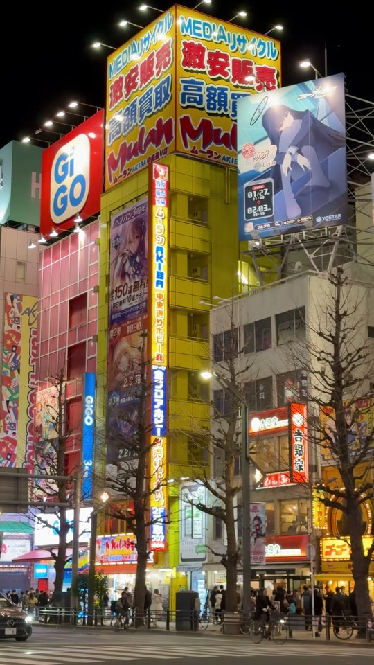 | 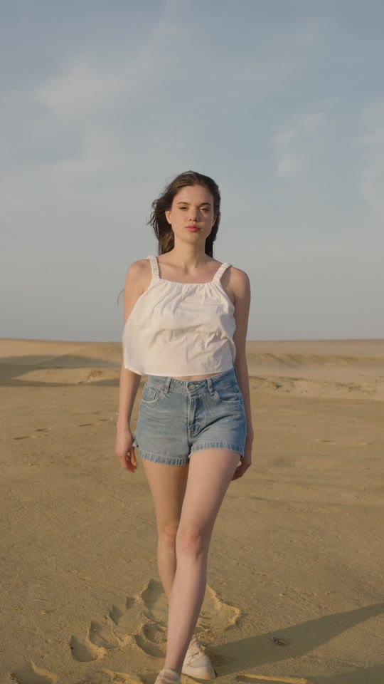 | 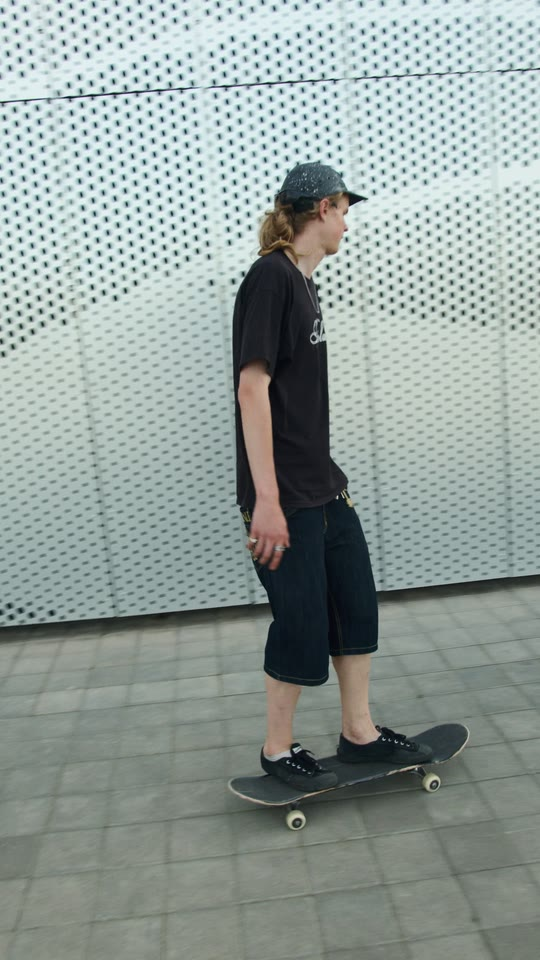 |

**DreamCut prepares**

| Moving mask · walker | Moving mask · skater |
| --- | --- |
| 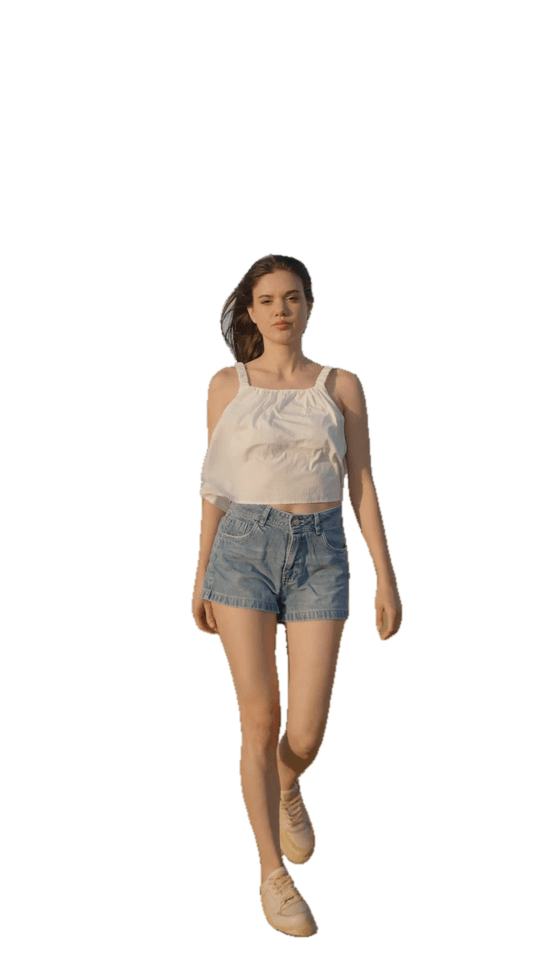 | 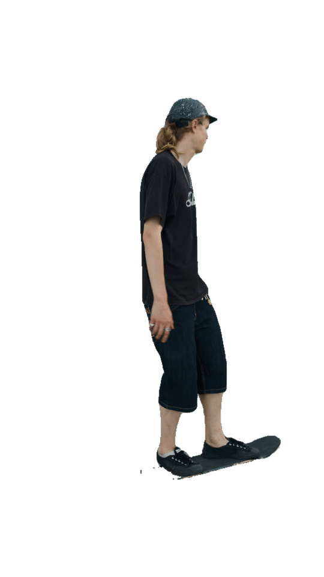 |

| 1 · Start | 2 · White subject | 3 · Original color | 4 · Scene changes |
| --- | --- | --- | --- |
|  |  | 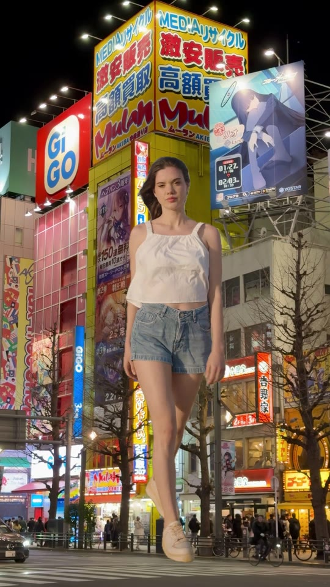 |  |

Footage: Pexels videos 30996082, 19279353 and 4824399 (Pexels License), built as an editable DreamCut timeline. Catalog evidence below is separate.

[Recreated demo](../../public/recipe-previews/mask-glitch/result.mp4) · [Reference](media/anderson-taii/mask-glitch-reference.mp4)

Reference credit: @anderson.taii / Anderson Tai; https://www.instagram.com/reel/Da0d8suu6kJ/; muted reference excerpt. Rights basis: licensed.

Recreation credit: Pexels footage (Pexels License): pexels.com/video/30996082, pexels.com/video/19279353, pexels.com/video/4824399; DreamCut Mask Glitch template teaching media (native cutout clips with keyframed subject_flash).. Rights basis: pexels-license.

Every lead-in frame contains the white silhouette or original-color subject mask; no disappearance before the incoming scene. White and colour masks share alpha and geometry and match the incoming picture; preserve unchanged sources and editable layers. Verify on another incoming subject before promoting the recipe to complete.

### What you supply

- **Ordered shots:** Supply the outgoing and incoming footage in order. Identify the subject to appear early; it should have visible, separable edges. DreamCut prepares the matching cutouts.

### Supply your own or generate inputs

Source scenes can be generated. Derive both the white and original-color subject from the same incoming footage so their silhouettes match.

Generation suitability is guidance, not proof of a tested generated-input workflow. Ask the agent to stage any needed assets in Library → Generate, then review the model, prompt and settings before generating.

### How the effect is built

1. Isolate the incoming subject.
2. Show its white silhouette, then its original color over the outgoing shot.
3. Switch to the incoming scene without a gap or positional jump.

### Copy to your agent

Replace the bracketed input line with your files and target. Copying is a handoff, not an edit or a generation submission.

```text
Use the mask-glitch skill for "Mask Glitch" (recipe: FX-MASK-GLITCH).
For a shared catalog recipe, read docs/effects/catalog.json entry FX-MASK-GLITCH and its owning skill before preparing the edit.
Follow the FX-MASK-GLITCH recipe and its success criteria, adapting the construction to my supplied assets.
My inputs and target: [attach or identify my files, target clips, order and desired timing].
Ordered shots: Supply the outgoing and incoming footage in order. Identify the subject to appear early; it should have visible, separable edges. DreamCut prepares the matching cutouts.
How it works: Isolate the incoming subject. Show its white silhouette, then its original color over the outgoing shot. Switch to the incoming scene without a gap or positional jump.
Input generation guidance: Source scenes can be generated. Derive both the white and original-color subject from the same incoming footage so their silhouettes match.
Read the current timeline, applicable preferences and available media. Ask for missing inputs; do not assume example assets are mine. If generation is needed, prepare a visible draft and wait for my generation authorization.
Preserve original sources and unrelated edits. Keep meaningful layers and tuning controls editable. For an existing edit, propose changes for my review; do not apply or approve them.
Known limitations: Lead-in is lengthened from the 5-frame default to 9 frames so the steps read at gallery size; continuous coverage intentionally differs from the reference pulse/off cadence. No dedicated Mask Glitch preset; matte preparation and native layer composition remain the supported route. Exact source-reference fidelity remains incomplete.
Preview the result, check the full transition or animation and report anything unverified.
```

### Evidence and limits

- Lead-in is lengthened from the 5-frame default to 9 frames so the steps read at gallery size; continuous coverage intentionally differs from the reference pulse/off cadence.
- No dedicated Mask Glitch preset; matte preparation and native layer composition remain the supported route.
- Exact source-reference fidelity remains incomplete.

[Technical recipe and evidence](catalog.json) · [Skill receipt](../../.agents/skills/mask-glitch/references/effect-evidence.json)

<a id="fx-camera-flash"></a>

## Camera Flash

**FX-CAMERA-FLASH · Partial recreation · read limitations** · [Owning skill](../../.agents/skills/recreate-effect/SKILL.md)

**Home:** Properties → transition join.

### Demonstration

[Recreated demo](media/stock-transitions/camera-flash-practice.mp4) · [Reference](media/anderson-taii/camera-flash-reference.mp4)

Reference credit: @anderson.taii / Anderson Tai; https://www.instagram.com/reel/Da0d8suu6kJ/; muted reference excerpt. Rights basis: licensed.

Recreation credit: Pexels footage (Pexels License): pexels.com/video/8970054/, pexels.com/video/3010130/; DreamCut recreation with the native transition, rendered from a pending demo proposal.. Rights basis: pexels-license.

Preserve sources and editable layers; reproduce the observed scene handoff on new inputs. Compare reference-relative entrance, peak, cut and settled frames at normal speed.

### What you supply

- **Two shots and cut point:** Supply the outgoing and incoming shots and identify where the switch should happen.

### Supply your own or generate inputs

No generated flash asset is needed. Either source shot can be generated separately if desired.

Generation suitability is guidance, not proof of a tested generated-input workflow. Ask the agent to stage any needed assets in Library → Generate, then review the model, prompt and settings before generating.

### How the effect is built

1. Build a brief white wash.
2. Switch shots at the flash peak.
3. Clear the wash quickly so the new scene reads.

### Copy to your agent

Replace the bracketed input line with your files and target. Copying is a handoff, not an edit or a generation submission.

```text
Use the recreate-effect skill for "Camera Flash" (recipe: FX-CAMERA-FLASH).
For a shared catalog recipe, read docs/effects/catalog.json entry FX-CAMERA-FLASH and its owning skill before preparing the edit.
Follow the FX-CAMERA-FLASH recipe and its success criteria, adapting the construction to my supplied assets.
My inputs and target: [attach or identify my files, target clips, order and desired timing].
Two shots and cut point: Supply the outgoing and incoming shots and identify where the switch should happen.
How it works: Build a brief white wash. Switch shots at the flash peak. Clear the wash quickly so the new scene reads.
Input generation guidance: No generated flash asset is needed. Either source shot can be generated separately if desired.
Read the current timeline, applicable preferences and available media. Ask for missing inputs; do not assume example assets are mine. If generation is needed, prepare a visible draft and wait for my generation authorization.
Preserve original sources and unrelated edits. Keep meaningful layers and tuning controls editable. For an existing edit, propose changes for my review; do not apply or approve them.
Known limitations: Seven-frame 30 fps study is shorter than the reference interval; exact exposure curve remains unverified. Normal-speed fidelity to the reference and dedicated creator-flow acceptance remain incomplete. Reference excerpts are muted; isolated sound cues were not analysed.
Preview the result, check the full transition or animation and report anything unverified.
```

### Evidence and limits

- Seven-frame 30 fps study is shorter than the reference interval; exact exposure curve remains unverified.
- Normal-speed fidelity to the reference and dedicated creator-flow acceptance remain incomplete.
- Reference excerpts are muted; isolated sound cues were not analysed.

[Technical recipe and evidence](catalog.json) · [Skill receipt](../../.agents/skills/recreate-effect/references/effect-evidence.json)

<a id="fx-blackout"></a>

## Blackout

**FX-BLACKOUT · Partial recreation · read limitations** · [Owning skill](../../.agents/skills/recreate-effect/SKILL.md)

**Home:** Properties → transition join.

### Demonstration

[Recreated demo](media/stock-transitions/blackout-practice.mp4) · [Reference](media/anderson-taii/blackout-reference.mp4)

Reference credit: @anderson.taii / Anderson Tai; https://www.instagram.com/reel/Da0d8suu6kJ/; muted reference excerpt. Rights basis: licensed.

Recreation credit: Pexels footage (Pexels License): pexels.com/video/18005884/, pexels.com/video/9130084/; DreamCut recreation with the native transition, rendered from a pending demo proposal.. Rights basis: pexels-license.

Preserve sources and editable layers; reproduce the observed scene handoff on new inputs. Compare reference-relative entrance, peak, cut and settled frames at normal speed.

### What you supply

- **Cover and uncover takes:** End the first take by fully covering the lens. Start the next with the lens covered, then uncover it. Match hand direction and retain the covered portions.

### Supply your own or generate inputs

Generated takes must actually reach full coverage and keep consistent movement. A simple fade to black is a different treatment from the demonstrated lens-cover join.

Generation suitability is guidance, not proof of a tested generated-input workflow. Ask the agent to stage any needed assets in Library → Generate, then review the model, prompt and settings before generating.

### How the effect is built

1. Find full darkness in both takes.
2. Join them while the lens is covered.
3. Check that covering and uncovering feel like one motion.

### Copy to your agent

Replace the bracketed input line with your files and target. Copying is a handoff, not an edit or a generation submission.

```text
Use the recreate-effect skill for "Blackout" (recipe: FX-BLACKOUT).
For a shared catalog recipe, read docs/effects/catalog.json entry FX-BLACKOUT and its owning skill before preparing the edit.
Follow the FX-BLACKOUT recipe and its success criteria, adapting the construction to my supplied assets.
My inputs and target: [attach or identify my files, target clips, order and desired timing].
Cover and uncover takes: End the first take by fully covering the lens. Start the next with the lens covered, then uncover it. Match hand direction and retain the covered portions.
How it works: Find full darkness in both takes. Join them while the lens is covered. Check that covering and uncovering feel like one motion.
Input generation guidance: Generated takes must actually reach full coverage and keep consistent movement. A simple fade to black is a different treatment from the demonstrated lens-cover join.
Read the current timeline, applicable preferences and available media. Ask for missing inputs; do not assume example assets are mine. If generation is needed, prepare a visible draft and wait for my generation authorization.
Preserve original sources and unrelated edits. Keep meaningful layers and tuning controls editable. For an existing edit, propose changes for my review; do not apply or approve them.
Known limitations: The outgoing cover is a body passing the lens, not a hand; the incoming uncover is a pack moving out of frame rather than a hand pulled away. Black hold timing at 30 fps differs from the reference's eight frames at 24 fps. Normal-speed fidelity to the reference and dedicated creator-flow acceptance remain incomplete. Reference excerpts are muted; isolated sound cues were not analysed.
Preview the result, check the full transition or animation and report anything unverified.
```

### Evidence and limits

- The outgoing cover is a body passing the lens, not a hand; the incoming uncover is a pack moving out of frame rather than a hand pulled away.
- Black hold timing at 30 fps differs from the reference's eight frames at 24 fps.
- Normal-speed fidelity to the reference and dedicated creator-flow acceptance remain incomplete.
- Reference excerpts are muted; isolated sound cues were not analysed.

[Technical recipe and evidence](catalog.json) · [Skill receipt](../../.agents/skills/recreate-effect/references/effect-evidence.json)

<a id="fx-whip-pan"></a>

## Whip Pan

**FX-WHIP-PAN · Partial recreation · read limitations** · [Owning skill](../../.agents/skills/recreate-effect/SKILL.md)

**Home:** Properties → transition join.

### Demonstration

[Recreated demo](media/stock-transitions/whip-pan-practice.mp4) · [Reference](media/anderson-taii/whip-pan-reference.mp4)

Reference credit: @anderson.taii / Anderson Tai; https://www.instagram.com/reel/Da0d8suu6kJ/; muted reference excerpt. Rights basis: licensed.

Recreation credit: Pexels footage (Pexels License): pexels.com/video/32287884/, pexels.com/video/31397167/; DreamCut recreation with the native transition, rendered from a pending demo proposal.. Rights basis: pexels-license.

Blend follows real incoming camera-turn motion, rather than a held first frame before the turn starts. Full-frame shots overlap without a travelling dividing edge or exposed gutter. Incoming source clock continues across the join without frozen or repeated motion; preserve full original sources. Review at normal speed and repeat with another shot pair before marking complete.

### What you supply

- **Matching camera turns:** Supply the full outgoing and incoming shots with camera travel in the same screen direction. Include the incoming turn before the intended start, not only an already-trimmed clip.

### Supply your own or generate inputs

Generated footage needs real, continuous directional movement and spare frames before the incoming start. Blur alone cannot supply that motion.

Generation suitability is guidance, not proof of a tested generated-input workflow. Ask the agent to stage any needed assets in Library → Generate, then review the model, prompt and settings before generating.

### How the effect is built

1. Choose the developed camera turn in the incoming shot.
2. Blend into its moving lead-in frames while matching direction.
3. Tune duration and blur; check that motion continues without a frozen or repeated boundary.

### Copy to your agent

Replace the bracketed input line with your files and target. Copying is a handoff, not an edit or a generation submission.

```text
Use the recreate-effect skill for "Whip Pan" (recipe: FX-WHIP-PAN).
For a shared catalog recipe, read docs/effects/catalog.json entry FX-WHIP-PAN and its owning skill before preparing the edit.
Follow the FX-WHIP-PAN recipe and its success criteria, adapting the construction to my supplied assets.
My inputs and target: [attach or identify my files, target clips, order and desired timing].
Matching camera turns: Supply the full outgoing and incoming shots with camera travel in the same screen direction. Include the incoming turn before the intended start, not only an already-trimmed clip.
How it works: Choose the developed camera turn in the incoming shot. Blend into its moving lead-in frames while matching direction. Tune duration and blur; check that motion continues without a frozen or repeated boundary.
Input generation guidance: Generated footage needs real, continuous directional movement and spare frames before the incoming start. Blur alone cannot supply that motion.
Read the current timeline, applicable preferences and available media. Ask for missing inputs; do not assume example assets are mine. If generation is needed, prepare a visible draft and wait for my generation authorization.
Preserve original sources and unrelated edits. Keep meaningful layers and tuning controls editable. For an existing edit, propose changes for my review; do not apply or approve them.
Known limitations: Neither shot contains a captured camera whip; the native smear supplies all sideways motion. Precise fidelity to the Instagram reference remains incomplete. Moving overlap requires sufficient incoming head handles; with insufficient handles the renderer holds the head frame.
Preview the result, check the full transition or animation and report anything unverified.
```

### Evidence and limits

- Neither shot contains a captured camera whip; the native smear supplies all sideways motion.
- Precise fidelity to the Instagram reference remains incomplete.
- Moving overlap requires sufficient incoming head handles; with insufficient handles the renderer holds the head frame.

[Technical recipe and evidence](catalog.json) · [Skill receipt](../../.agents/skills/recreate-effect/references/effect-evidence.json)

<a id="fx-negative-pop"></a>

## Negative Pop

**FX-NEGATIVE-POP · Reference example** · [Owning skill](../../.agents/skills/mask-glitch/SKILL.md)

**Home:** Properties → Templates.

### Demonstration

No recreated demo yet. · [Reference](media/sunglasses/negative-reference.jpg)

Reference credit: @cgouldfish / Cade; https://www.instagram.com/reel/DbA5MAIthut/. Rights basis: licensed.

Match the chosen negative/original timing map Preserve alpha and silhouette alignment Keep the negative treatment scoped to the portrait

### What you supply

- **Subject and background:** Supply the original image or footage and identify the subject. DreamCut prepares an isolated version and a matching negative.

### Supply your own or generate inputs

The source can be generated. Derive the negative from that same source rather than generating a second, potentially different subject.

Generation suitability is guidance, not proof of a tested generated-input workflow. Ask the agent to stage any needed assets in Library → Generate, then review the model, prompt and settings before generating.

### How the effect is built

1. Isolate the subject and prepare a registered negative.
2. Show the negative briefly.
3. Return to the original color while leaving the background independently editable.

### Copy to your agent

Replace the bracketed input line with your files and target. Copying is a handoff, not an edit or a generation submission.

```text
Use the mask-glitch skill for "Negative Pop" (recipe: FX-NEGATIVE-POP).
For a shared catalog recipe, read docs/effects/catalog.json entry FX-NEGATIVE-POP and its owning skill before preparing the edit.
Follow the FX-NEGATIVE-POP recipe and its success criteria, adapting the construction to my supplied assets.
My inputs and target: [attach or identify my files, target clips, order and desired timing].
Subject and background: Supply the original image or footage and identify the subject. DreamCut prepares an isolated version and a matching negative.
How it works: Isolate the subject and prepare a registered negative. Show the negative briefly. Return to the original color while leaving the background independently editable.
Input generation guidance: The source can be generated. Derive the negative from that same source rather than generating a second, potentially different subject.
Read the current timeline, applicable preferences and available media. Ask for missing inputs; do not assume example assets are mine. If generation is needed, prepare a visible draft and wait for my generation authorization.
Preserve original sources and unrelated edits. Keep meaningful layers and tuning controls editable. For an existing edit, propose changes for my review; do not apply or approve them.
This is a reference-only candidate. Assess feasibility and explain capability gaps before promising a recreation.
Known limitations: No redistributable recreation is packaged yet; recreate on cleared footage before marking this partial again. The earlier private recreation baked the inversion into the derivative; there is no native negative-amount dial. Exposure and contrast are reviewable shading controls. Reference negative duration is eight frames at 30 fps; a one-second hold is only an inspection aid.
Preview the result, check the full transition or animation and report anything unverified.
```

### Evidence and limits

- No redistributable recreation is packaged yet; recreate on cleared footage before marking this partial again.
- The earlier private recreation baked the inversion into the derivative; there is no native negative-amount dial. Exposure and contrast are reviewable shading controls.
- Reference negative duration is eight frames at 30 fps; a one-second hold is only an inspection aid.

[Technical recipe and evidence](catalog.json) · [Skill receipt](../../.agents/skills/mask-glitch/references/effect-evidence.json)

<a id="fx-scene-portal"></a>

## Scene Portal

**FX-SCENE-PORTAL · Reference example** · [Owning skill](../../.agents/skills/video-compositing/SKILL.md)

**Home:** Properties → Templates.

### Demonstration

No recreated demo yet. · [Reference](media/sunglasses/portal-reference.jpg)

Reference credit: @cgouldfish / Cade; https://www.instagram.com/reel/DbA5MAIthut/. Rights basis: licensed.

Inserted video follows the region without rim spill Wrapping remains legible during motion No empty frame at scene handoff

### What you supply

- **Host footage:** Supply footage with a clearly bounded region where the other scene should appear. Keep that region visible through the transition.
- **Insert and destination:** Supply the moving insert and destination footage. Describe when the portal should become the full scene; DreamCut prepares tracking and masks.

### Supply your own or generate inputs

Host or insert footage can be generated. The host needs a stable, trackable region; inspect geometry before attempting the portal.

Generation suitability is guidance, not proof of a tested generated-input workflow. Ask the agent to stage any needed assets in Library → Generate, then review the model, prompt and settings before generating.

### How the effect is built

1. Track and mask the chosen region.
2. Fit the moving insert inside it.
3. Coordinate the zoom and full-scene handoff, checking edges throughout.

### Copy to your agent

Replace the bracketed input line with your files and target. Copying is a handoff, not an edit or a generation submission.

```text
Use the video-compositing skill for "Scene Portal" (recipe: FX-SCENE-PORTAL).
For a shared catalog recipe, read docs/effects/catalog.json entry FX-SCENE-PORTAL and its owning skill before preparing the edit.
Follow the FX-SCENE-PORTAL recipe and its success criteria, adapting the construction to my supplied assets.
My inputs and target: [attach or identify my files, target clips, order and desired timing].
Host footage: Supply footage with a clearly bounded region where the other scene should appear. Keep that region visible through the transition.
Insert and destination: Supply the moving insert and destination footage. Describe when the portal should become the full scene; DreamCut prepares tracking and masks.
How it works: Track and mask the chosen region. Fit the moving insert inside it. Coordinate the zoom and full-scene handoff, checking edges throughout.
Input generation guidance: Host or insert footage can be generated. The host needs a stable, trackable region; inspect geometry before attempting the portal.
Read the current timeline, applicable preferences and available media. Ask for missing inputs; do not assume example assets are mine. If generation is needed, prepare a visible draft and wait for my generation authorization.
Preserve original sources and unrelated edits. Keep meaningful layers and tuning controls editable. For an existing edit, propose changes for my review; do not apply or approve them.
This is a reference-only candidate. Assess feasibility and explain capability gaps before promising a recreation.
Known limitations: No redistributable recreation is packaged yet; recreate on cleared footage before marking this partial again. The earlier private recreation used prepared tracking/warping rather than native adjustable geometry. That recreation's alpha overlay began visibly 34 source frames late; inspect baked alpha onsets, since a timing-only correction does not remove a baked delay. Reference scene changes and timing were not matched exactly.
Preview the result, check the full transition or animation and report anything unverified.
```

### Evidence and limits

- No redistributable recreation is packaged yet; recreate on cleared footage before marking this partial again.
- The earlier private recreation used prepared tracking/warping rather than native adjustable geometry.
- That recreation's alpha overlay began visibly 34 source frames late; inspect baked alpha onsets, since a timing-only correction does not remove a baked delay.
- Reference scene changes and timing were not matched exactly.

[Technical recipe and evidence](catalog.json) · [Skill receipt](../../.agents/skills/video-compositing/references/effect-evidence.json)

<a id="fx-speed-entrance-exit"></a>

## Speed Entrance & Exit

**FX-SPEED-ENTRANCE-EXIT · Implemented template · built with your agent** · [Owning skill](../../.agents/skills/video-compositing/SKILL.md)

**Home:** Properties → Templates.

### Demonstration

[](../../public/recipe-previews/speed-entrance-exit/result.mp4)

The man streaks into the empty set in a horizontal blur, lands sharp and performs, then streaks out the other side while the set stays still. Real footage at normal speed; each streak lasts 0.2 seconds.

**You supply**

| Performance, camera locked | Same shot, empty |
| --- | --- |
| 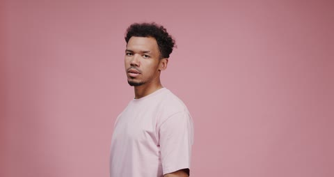 |  |

**DreamCut prepares**

| Moving cutout |
| --- |
| 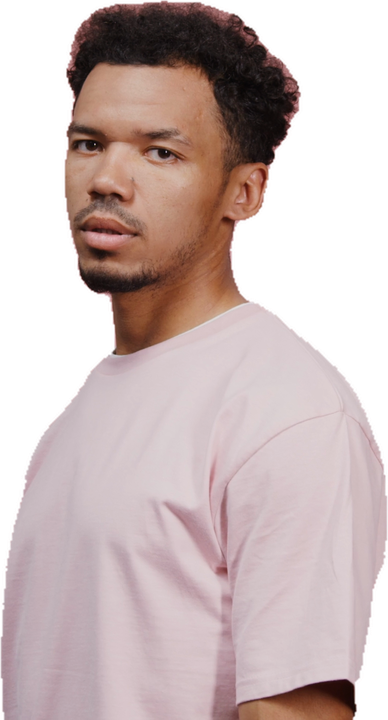 |

| 1 · Empty set | 2 · Streaks in | 3 · Lands and performs | 4 · Streaks out |
| --- | --- | --- | --- |
|  | 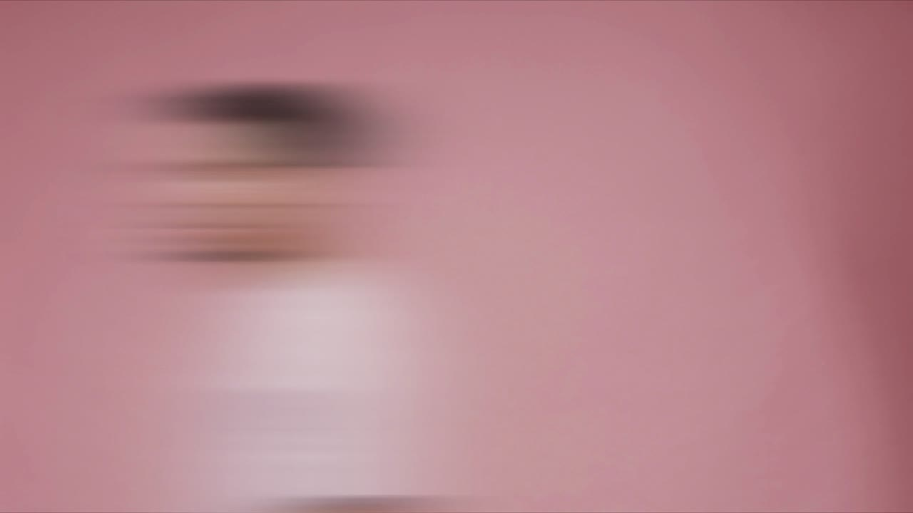 |  | 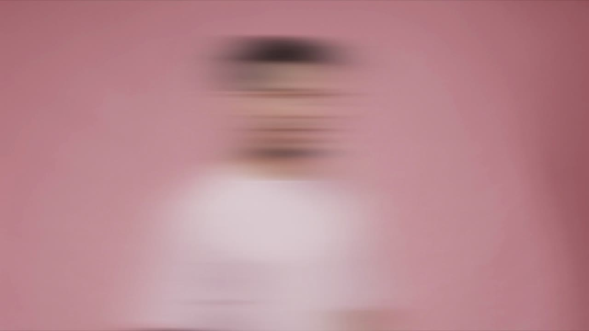 |

Footage: Pexels video 8798070 (Pexels License), built as an editable DreamCut timeline. Catalog evidence below is separate.

Demo not available yet.

A moving subject streaks into or out of a fixed scene while the background stays still.

### What you supply

- **Performance footage:** Use a locked camera and keep the whole subject visible. Record the gesture before each entrance or exit and leave time on both sides.
- **Matching empty background:** Record the same scene without the subject, preserving camera position, lighting and framing.

### Supply your own or generate inputs

Use the reference to plan a fully clothed fictional performer in a fixed scene. Generate clean ordinary motion and a matching background; build the speed movement and blur in DreamCut, not into the generated footage.

Generation suitability is guidance, not proof of a tested generated-input workflow. Ask the agent to stage any needed assets in Library → Generate, then review the model, prompt and settings before generating.

### How the effect is built

1. Prepare moving subject masks on the original source clock.
2. Place the subject over the matching empty scene.
3. Animate entrance and exit travel with directional blur; check the full movement and expose timing controls.

### Copy to your agent

Replace the bracketed input line with your files and target. Copying is a handoff, not an edit or a generation submission.

```text
Use the video-compositing skill for "Speed Entrance & Exit" (recipe: FX-SPEED-ENTRANCE-EXIT).
Read the FX-SPEED-ENTRANCE-EXIT construction brief in src/lib/effects/promoted-recipes.ts and its owning skill before preparing the edit.
Build Speed Entrance & Exit from my performance footage and matching empty background. Follow the Speed Entrance & Exit template in the video-compositing skill. Prepare source-timed moving subject masks, preserve the original performance, and animate the separate subject with directional motion blur. Expose entrance and exit timing, direction, travel and blur using supported controls. Keep the background and subject editable. Check the complete motion at normal speed and propose changes to my existing edit.
My inputs and target: [attach or identify my files, target clips, order and desired timing].
Performance footage: Use a locked camera and keep the whole subject visible. Record the gesture before each entrance or exit and leave time on both sides.
Matching empty background: Record the same scene without the subject, preserving camera position, lighting and framing.
How it works: Prepare moving subject masks on the original source clock. Place the subject over the matching empty scene. Animate entrance and exit travel with directional blur; check the full movement and expose timing controls.
Input generation guidance: Use the reference to plan a fully clothed fictional performer in a fixed scene. Generate clean ordinary motion and a matching background; build the speed movement and blur in DreamCut, not into the generated footage.
Read the current timeline, applicable preferences and available media. Ask for missing inputs; do not assume example assets are mine. If generation is needed, prepare a visible draft and wait for my generation authorization.
Preserve original sources and unrelated edits. Keep meaningful layers and tuning controls editable. For an existing edit, propose changes for my review; do not apply or approve them.
Known limitations: Whatever the camera cropped stays cropped: a subject cut off at the frame edge streaks in cut off. A fixed camera and matching empty background are the supported starting point. Moving cameras require additional tracking. Fresh-input reuse and complete unaided editing acceptance remain to be checked.
Preview the result, check the full transition or animation and report anything unverified.
```

### Evidence and limits

- Whatever the camera cropped stays cropped: a subject cut off at the frame edge streaks in cut off.
- A fixed camera and matching empty background are the supported starting point. Moving cameras require additional tracking.
- Fresh-input reuse and complete unaided editing acceptance remain to be checked.

<a id="fx-mask-glitch-glow"></a>

## Mask Glitch · Glow

**FX-MASK-GLITCH-GLOW · Implemented template · built with your agent** · [Owning skill](../../.agents/skills/mask-glitch/SKILL.md)

**Home:** Properties → Templates.

### Demonstration

[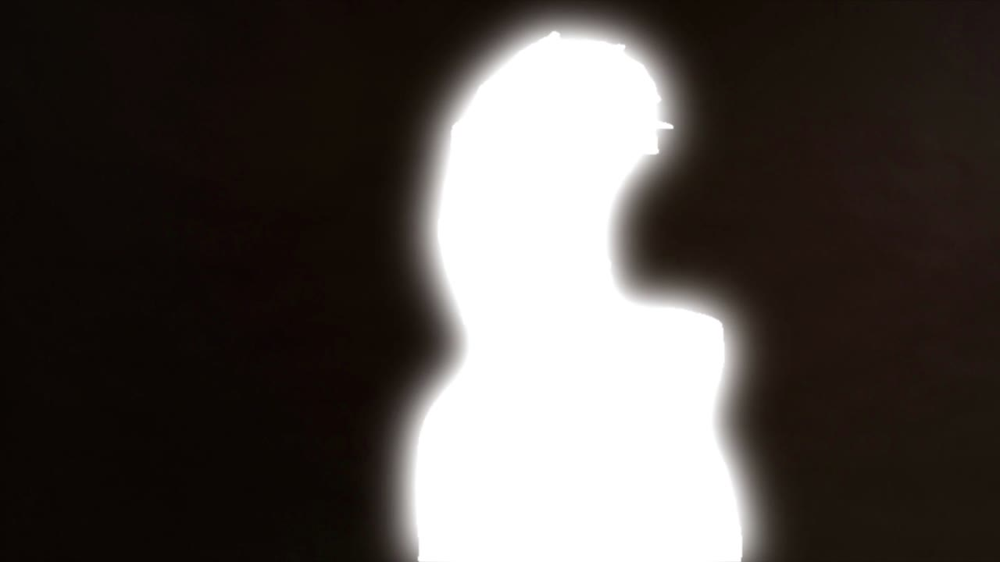](../../public/recipe-previews/mask-glitch-glow/result.mp4)

Each next pose of the man appears over the empty set as a glowing white silhouette, then shows its original color as the halo fades. Real footage at normal speed; each pose is white for 0.12 seconds and a new one arrives every 0.8 seconds.

**You supply**

| Pose 1 | Pose 2 | Pose 3 | Same shot, empty |
| --- | --- | --- | --- |
| 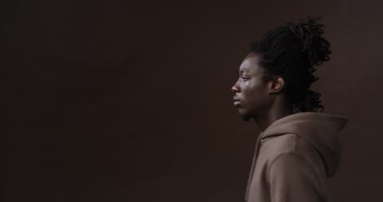 | 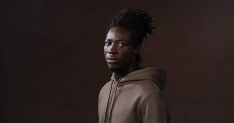 | 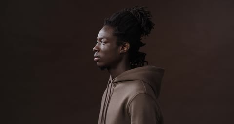 |  |

**DreamCut prepares**

| Moving cutout |
| --- |
|  |

| 1 · White with a halo | 2 · Original color | 3 · Next pose flashes in | 4 · Last pose holds |
| --- | --- | --- | --- |
| 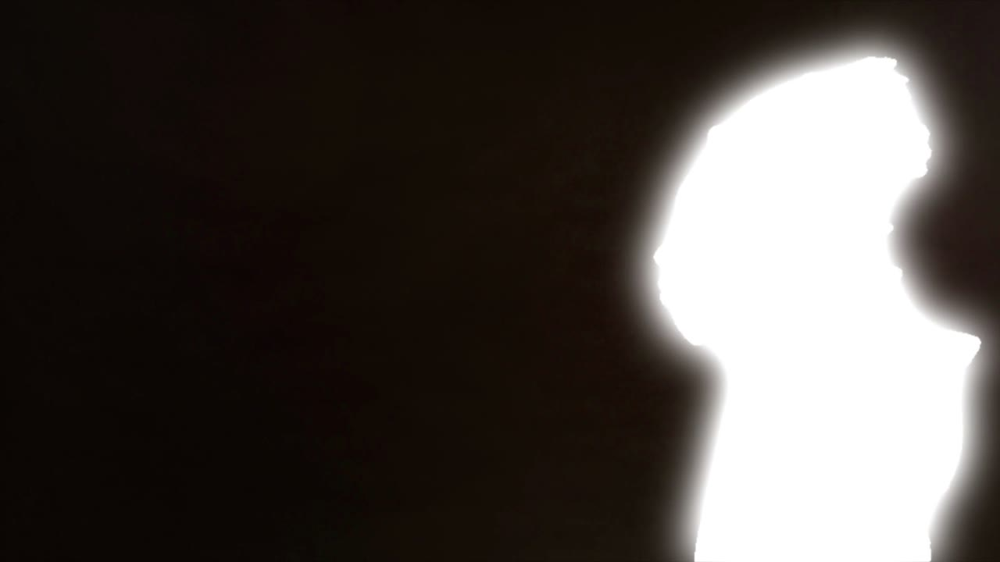 | 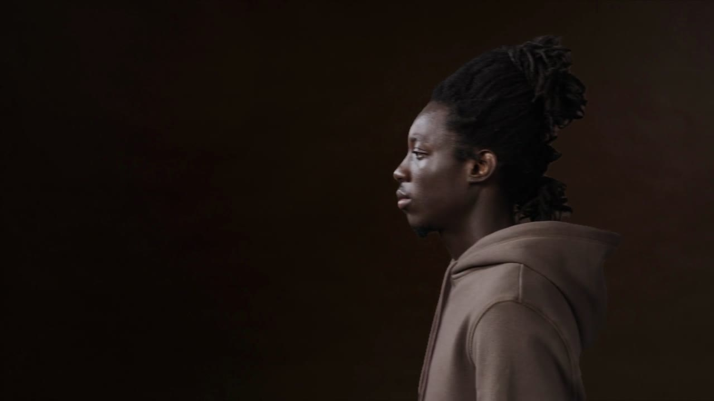 | 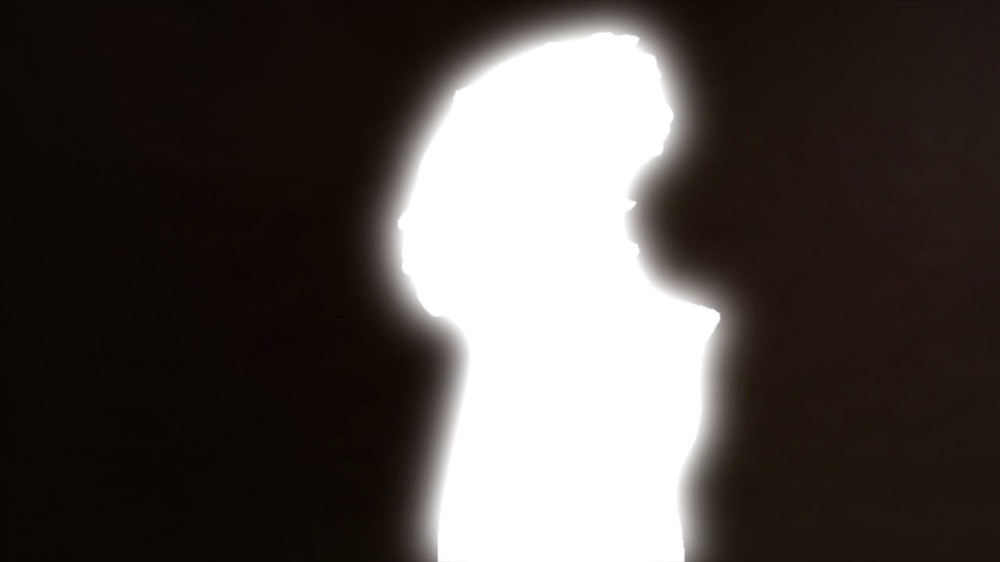 | 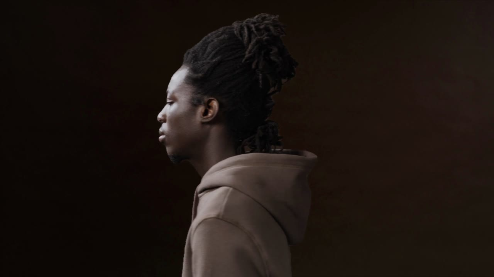 |

Footage: Pexels video 10210101 (Pexels License), built as an editable DreamCut timeline. Catalog evidence below is separate.

Demo not available yet.

Successive subjects appear as brief white silhouettes with a soft halo, then reveal their original color.

### What you supply

- **Ordered pose or performance takes:** Film several distinct poses with the camera locked, preserving the whole body and hands.
- **Matching empty background:** Keep the camera and lighting fixed while recording the scene without the performer.

### Supply your own or generate inputs

Generate a fictional fully clothed performer with clear separated poses and a stable background. Use the reference for staging; create the flashes, glow and reveal timing as editable DreamCut controls.

Generation suitability is guidance, not proof of a tested generated-input workflow. Ask the agent to stage any needed assets in Library → Generate, then review the model, prompt and settings before generating.

### How the effect is built

1. Isolate each subject or pose with source-timed masks.
2. Sequence the subjects over the separate background.
3. Time a brief white flash and optional glow, then restore original color; expose spacing and glow controls.

### Copy to your agent

Replace the bracketed input line with your files and target. Copying is a handoff, not an edit or a generation submission.

```text
Use the mask-glitch skill for "Mask Glitch · Glow" (recipe: FX-MASK-GLITCH-GLOW).
Read the FX-MASK-GLITCH-GLOW construction brief in src/lib/effects/promoted-recipes.ts and its owning skill before preparing the edit.
Use the Mask Glitch · Glow template in the mask-glitch skill to build successive pose reveals from my footage over the matching empty background. Prepare source-timed subject masks. Time a short white flash and optional alpha-derived glow on each editable subject, then reveal its normal color. Expose spacing, flash timing, glow strength and radius through supported controls. Keep each subject and the background editable, inspect moving edges and normal-speed playback, and propose changes to my existing edit.
My inputs and target: [attach or identify my files, target clips, order and desired timing].
Ordered pose or performance takes: Film several distinct poses with the camera locked, preserving the whole body and hands.
Matching empty background: Keep the camera and lighting fixed while recording the scene without the performer.
How it works: Isolate each subject or pose with source-timed masks. Sequence the subjects over the separate background. Time a brief white flash and optional glow, then restore original color; expose spacing and glow controls.
Input generation guidance: Generate a fictional fully clothed performer with clear separated poses and a stable background. Use the reference for staging; create the flashes, glow and reveal timing as editable DreamCut controls.
Read the current timeline, applicable preferences and available media. Ask for missing inputs; do not assume example assets are mine. If generation is needed, prepare a visible draft and wait for my generation authorization.
Preserve original sources and unrelated edits. Keep meaningful layers and tuning controls editable. For an existing edit, propose changes for my review; do not apply or approve them.
Known limitations: Thin details the cutout misses, such as fine chains or loose strands, show the background through the white silhouette and its halo. The halo follows subject alpha; it is not an exact reproduction of a third-party glow kernel. Fresh-input reuse and independent unaided editing acceptance remain to be checked.
Preview the result, check the full transition or animation and report anything unverified.
```

### Evidence and limits

- Thin details the cutout misses, such as fine chains or loose strands, show the background through the white silhouette and its halo.
- The halo follows subject alpha; it is not an exact reproduction of a third-party glow kernel.
- Fresh-input reuse and independent unaided editing acceptance remain to be checked.

<a id="fx-moving-grid-matte"></a>

## Moving Grid Matte

**FX-MOVING-GRID-MATTE · Implemented template · built with your agent** · [Owning skill](../../.agents/skills/video-compositing/SKILL.md)

**Home:** Properties → Templates.

### Demonstration

[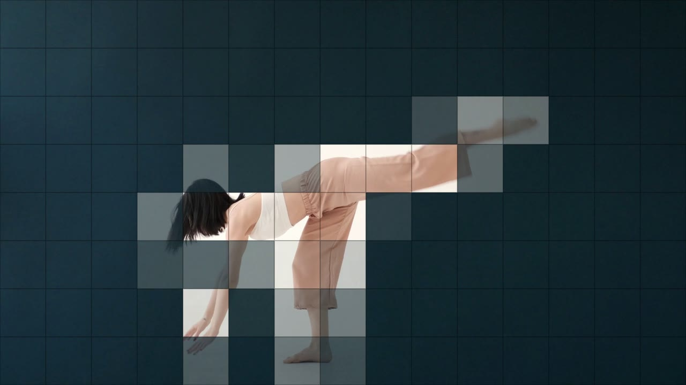](../../public/recipe-previews/moving-grid-matte/result.mp4)

The dancer's sharp footage shows only through square cells that follow her silhouette as she moves, over a separate dark background. Real footage at normal speed; the cells follow her frame by frame.

**You supply**

| Moving subject | Background |
| --- | --- |
|  |  |

**DreamCut prepares**

| Moving mask |
| --- |
| 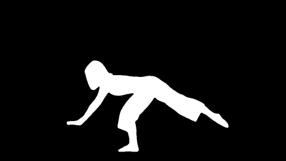 |

| 1 · Cells follow her shape | 2 · She moves, the cells move | 3 · New pose, new cells |
| --- | --- | --- |
| 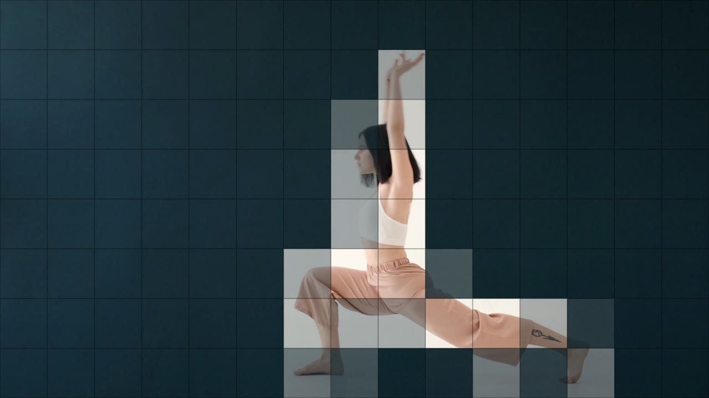 | 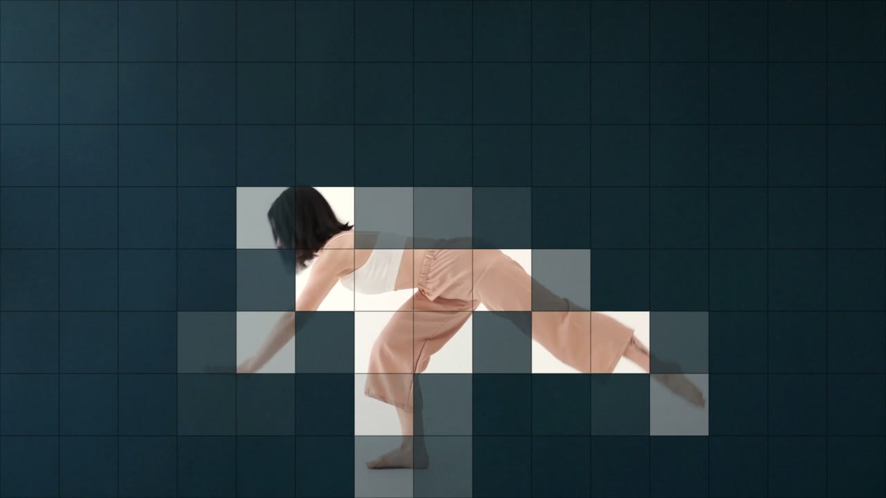 | 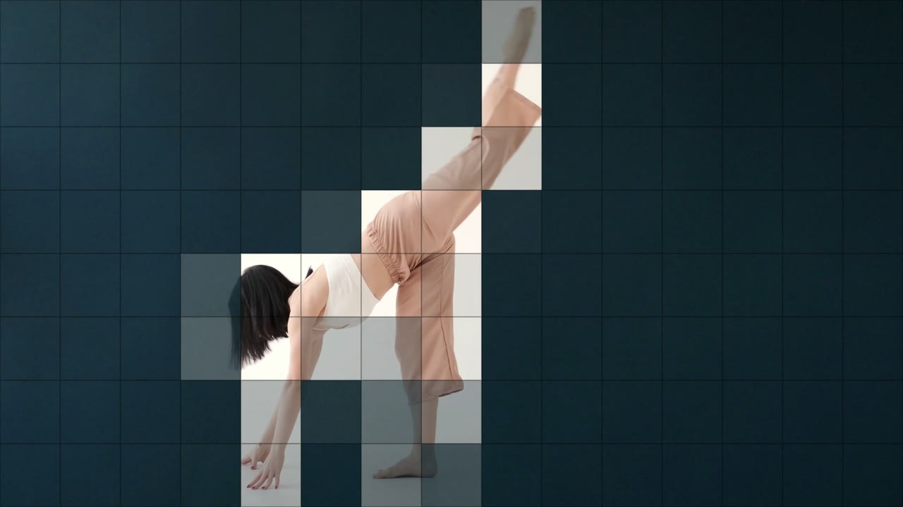 |

Footage: Pexels videos 7424171 and 9732065 (Pexels License), built as an editable DreamCut timeline. Catalog evidence below is separate.

Demo not available yet.

Sharp moving footage appears through square cells that follow the subject silhouette, over a separate background.

### What you supply

- **Moving subject footage:** Supply a continuous shot with a clear silhouette and spare space around the moving subject.
- **Background:** Choose the separate scene or image visible outside the grid silhouette.

### Supply your own or generate inputs

Generate an ordinary continuous shot with stable anatomy and framing. Prepare its matching mask, then create the square-cell treatment in DreamCut; do not generate the grid into the footage.

Generation suitability is guidance, not proof of a tested generated-input workflow. Ask the agent to stage any needed assets in Library → Generate, then review the model, prompt and settings before generating.

### How the effect is built

1. Prepare a grayscale subject mask covering the complete source interval.
2. Bind the mask to the continuous original clip and enable Moving Grid Matte.
3. Tune cell size, coverage and grid lines while retaining a separate background.

### Copy to your agent

Replace the bracketed input line with your files and target. Copying is a handoff, not an edit or a generation submission.

```text
Use the video-compositing skill for "Moving Grid Matte" (recipe: FX-MOVING-GRID-MATTE).
Read the FX-MOVING-GRID-MATTE construction brief in src/lib/effects/promoted-recipes.ts and its owning skill before preparing the edit.
Build Moving Grid Matte from my moving subject clip and chosen background. Follow the Moving Grid Matte template in the video-compositing skill. Prepare a grayscale rotoscope bound to the source clock, retain one continuous sharp original clip, and use the native Moving Grid Matte controls. Expose cell size, mask coverage, grid strength and grid width. Keep the background separate, verify mask coverage throughout the interval, and propose changes to my existing edit.
My inputs and target: [attach or identify my files, target clips, order and desired timing].
Moving subject footage: Supply a continuous shot with a clear silhouette and spare space around the moving subject.
Background: Choose the separate scene or image visible outside the grid silhouette.
How it works: Prepare a grayscale subject mask covering the complete source interval. Bind the mask to the continuous original clip and enable Moving Grid Matte. Tune cell size, coverage and grid lines while retaining a separate background.
Input generation guidance: Generate an ordinary continuous shot with stable anatomy and framing. Prepare its matching mask, then create the square-cell treatment in DreamCut; do not generate the grid into the footage.
Read the current timeline, applicable preferences and available media. Ask for missing inputs; do not assume example assets are mine. If generation is needed, prepare a visible draft and wait for my generation authorization.
Preserve original sources and unrelated edits. Keep meaningful layers and tuning controls editable. For an existing edit, propose changes for my review; do not apply or approve them.
Known limitations: Each cell shows the original shot as filmed, including its own background inside the square. Replacing footage requires a matching mask covering the selected source interval. The four grid controls are static. Exact reference fidelity and continuous fine-edge quality are not certified.
Preview the result, check the full transition or animation and report anything unverified.
```

### Evidence and limits

- Each cell shows the original shot as filmed, including its own background inside the square.
- Replacing footage requires a matching mask covering the selected source interval.
- The four grid controls are static. Exact reference fidelity and continuous fine-edge quality are not certified.

<a id="fx-word-search-trace"></a>

## Word Search Trace

**FX-WORD-SEARCH-TRACE · Implemented template · built with your agent** · [Owning skill](../../.agents/skills/motion-graphics/SKILL.md)

**Home:** Properties → Templates.

### Demonstration

[](../../public/recipe-previews/word-search/result.mp4)

A letter grid sits over your footage. On each cut, a hand-drawn outline circles one hidden word, and every outline stays on screen. Real footage at normal speed; each outline draws in 0.6 seconds.

**You supply**

| Shot 1 | Shot 2 | Shot 3 | Shot 4 | One word per shot |
| --- | --- | --- | --- | --- |
| 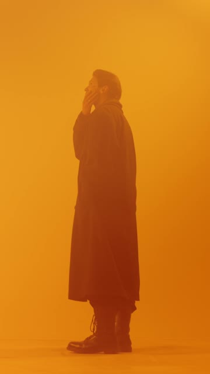 | 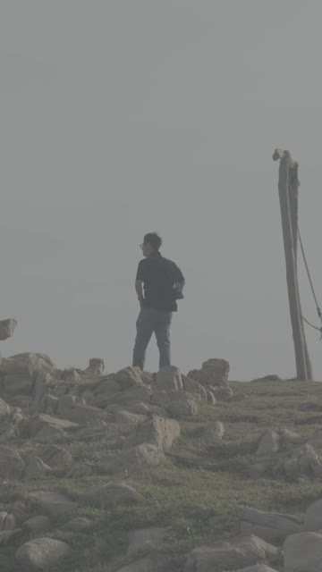 |  | 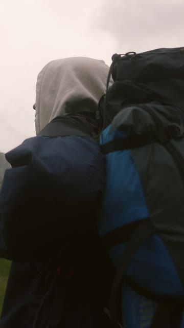 | FOG · HILL · DUSK · TRAIL |

**DreamCut prepares**

| Letter grid and outlines |
| --- |
| 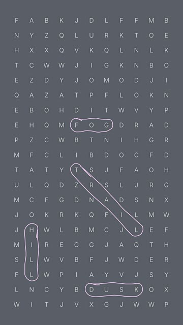 |

| 1 · Letter grid | 2 · First word circled | 3 · Every word circled |
| --- | --- | --- |
| 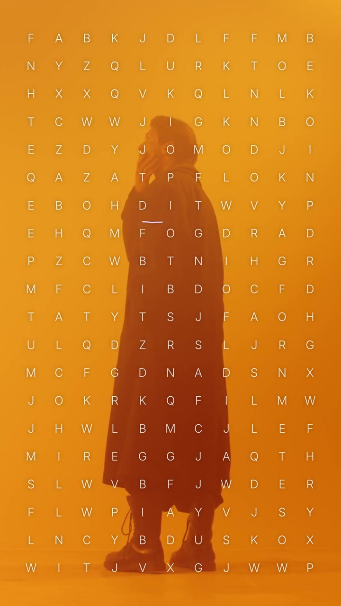 | 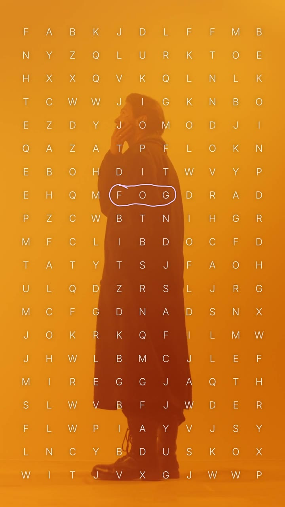 | 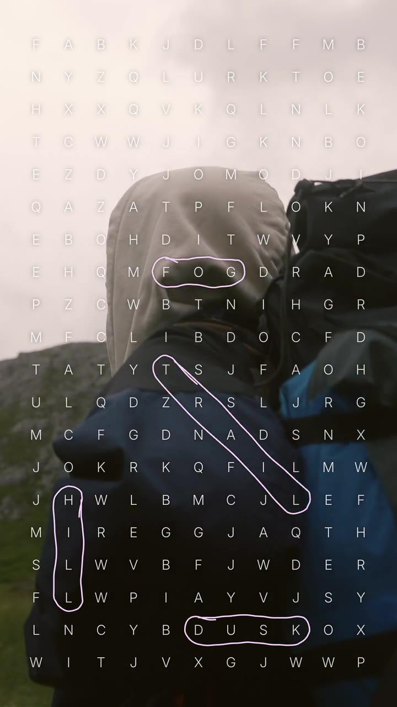 |

Footage: Pexels videos 8680224, 35811255, 34736308 and 9130084 (Pexels License). Inspired by a "connect the letters" tutorial by Camila Tunoni. Catalog evidence below is separate.

Demo not available yet.

A letter grid over your footage; on each cut a hand-drawn outline circles one hidden word.

### What you supply

- **Two to four short shots:** Supply one shot for each word, roughly one to two seconds each. Busy or bright backgrounds still work; the letters carry a soft shadow.
- **One word per shot:** Choose a short word for each shot, A to Z only, up to 12 letters. Say if a word should run across, down or diagonally.

### Supply your own or generate inputs

Shots can be filmed or generated; the letter grid and outlines are made in DreamCut, so never generate them into the footage.

Generation suitability is guidance, not proof of a tested generated-input workflow. Ask the agent to stage any needed assets in Library → Generate, then review the model, prompt and settings before generating.

### How the effect is built

1. Hide each word in a letter grid sized to the canvas.
2. Start each outline just after its cut and let it draw around the word.
3. Expose the words, directions, trace timing, letter size and color as controls.

### Copy to your agent

Replace the bracketed input line with your files and target. Copying is a handoff, not an edit or a generation submission.

```text
Use the motion-graphics skill for "Word Search Trace" (recipe: FX-WORD-SEARCH-TRACE).
Read the FX-WORD-SEARCH-TRACE construction brief in src/lib/effects/promoted-recipes.ts and its owning skill before preparing the edit.
Build Word Search Trace on my edit with these words: [WORD 1], [WORD 2], [WORD 3], [WORD 4]. Follow the Word Search Trace template in the motion-graphics skill: render the letter grid as a transparent motion graphic, hide one word per shot (across, down or diagonal), and time each outline to start just after its cut. Keep the footage as native clips and expose the words, directions, trace timing, letter size and color as controls. Propose it for me to review.
My inputs and target: [attach or identify my files, target clips, order and desired timing].
Two to four short shots: Supply one shot for each word, roughly one to two seconds each. Busy or bright backgrounds still work; the letters carry a soft shadow.
One word per shot: Choose a short word for each shot, A to Z only, up to 12 letters. Say if a word should run across, down or diagonally.
How it works: Hide each word in a letter grid sized to the canvas. Start each outline just after its cut and let it draw around the word. Expose the words, directions, trace timing, letter size and color as controls.
Input generation guidance: Shots can be filmed or generated; the letter grid and outlines are made in DreamCut, so never generate them into the footage.
Read the current timeline, applicable preferences and available media. Ask for missing inputs; do not assume example assets are mine. If generation is needed, prepare a visible draft and wait for my generation authorization.
Preserve original sources and unrelated edits. Keep meaningful layers and tuning controls editable. For an existing edit, propose changes for my review; do not apply or approve them.
Known limitations: The overlay is a rendered motion graphic: words, timing and color are tuned on the proposal card before approval, not in the inspector afterwards. Words use the letters A–Z, up to 12 letters each, up to four words. The grid is drawn for a portrait 9:16 canvas.
Preview the result, check the full transition or animation and report anything unverified.
```

### Evidence and limits

- The overlay is a rendered motion graphic: words, timing and color are tuned on the proposal card before approval, not in the inspector afterwards.
- Words use the letters A–Z, up to 12 letters each, up to four words.
- The grid is drawn for a portrait 9:16 canvas.

<a id="fx-motion-explainer"></a>

## Explainer Sequence

**FX-MOTION-EXPLAINER · Implemented template · built with your agent** · [Owning skill](../../.agents/skills/motion-graphics/SKILL.md)

**Home:** Properties → Templates.

### Demonstration

[](../../public/recipe-previews/motion-explainer/result.mp4)

A title, a key point with its words marked, a number counting up, three steps and a closing line, one after another. Default content at normal speed; the number counts up over 1.4 seconds.

**You supply**

| Number and three steps |
| --- |
| 68% · Import · Columns · Progress |

**DreamCut prepares**

| One graphic, five looks |
| --- |
|  |

| 1 · Title | 2 · Key point | 3 · Number counts up | 4 · Three steps |
| --- | --- | --- | --- |
| 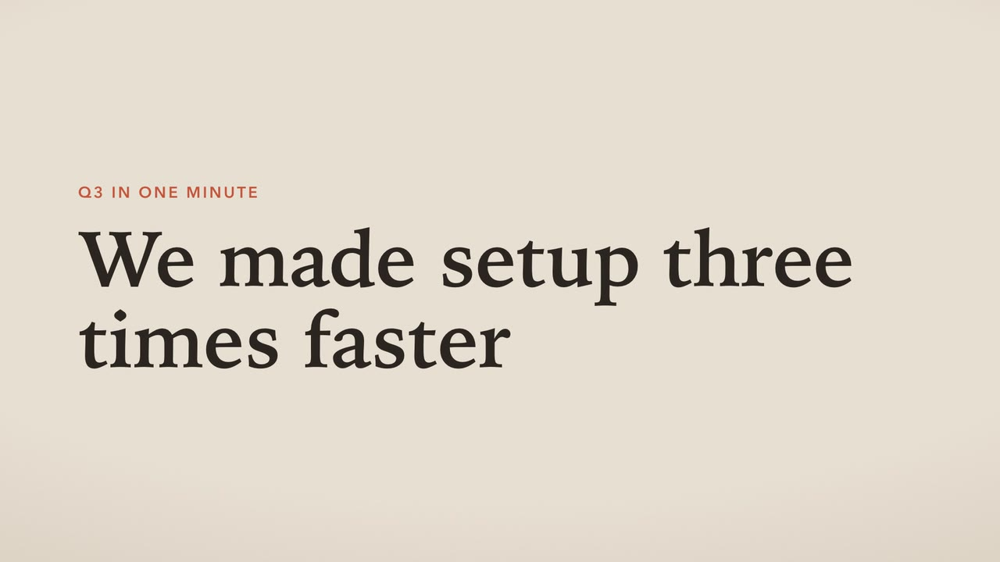 | 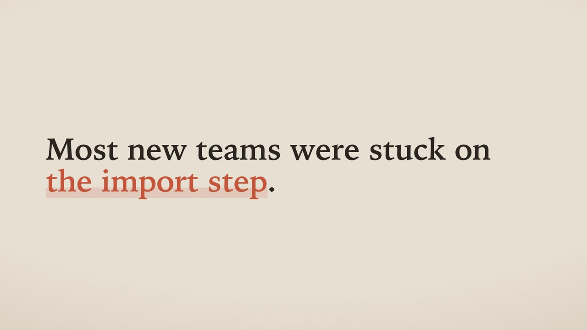 |  | 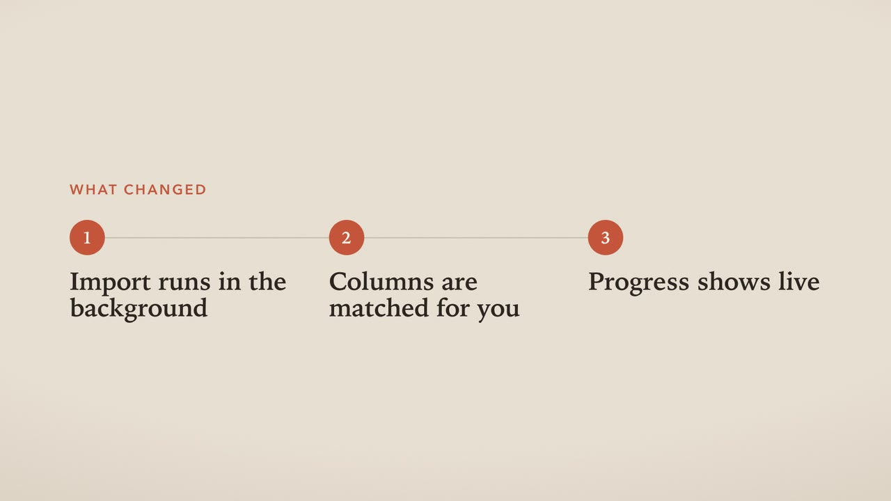 |

Built in DreamCut as an editable code-built motion graphic; no footage, generated imagery or people. Catalog evidence below is separate.

Demo not available yet.

A short code-built explainer: title, key point, a number that counts up, three steps and a closing line.

### What you supply

- **Your title and key point:** One short title and the single point you want remembered. Name the words in it to mark.
- **One number:** The figure that proves the point, with what comes before or after it (%, ×, $) and a short caption.
- **Three steps and a closing line:** Three short steps of up to about six words each, and the line to end on.

### Supply your own or generate inputs

The graphic is built from code in DreamCut, so nothing is generated: no footage, people or imagery. Pick a look (Paper, Keynote, Swiss, Terminal or Chalk) and an accent color, or switch the backdrop off to lay it over your own footage.

Generation suitability is guidance, not proof of a tested generated-input workflow. Ask the agent to stage any needed assets in Library → Generate, then review the model, prompt and settings before generating.

### How the effect is built

1. Lay out five scenes in the chosen look and sized to the project.
2. Bring each scene in with the look's own motion; mark the key words and count the number up.
3. Expose every word, the number and each scene time as controls.

### Copy to your agent

Replace the bracketed input line with your files and target. Copying is a handoff, not an edit or a generation submission.

```text
Use the motion-graphics skill for "Explainer Sequence" (recipe: FX-MOTION-EXPLAINER).
Read the FX-MOTION-EXPLAINER construction brief in src/lib/effects/promoted-recipes.ts and its owning skill before preparing the edit.
Build an Explainer Sequence from [REPORT OR NOTES]: title [TITLE], key point [POINT] with [MARKED WORDS] marked, big number [NUMBER] meaning [CAPTION], steps [STEP 1], [STEP 2], [STEP 3], closing line [CLOSING]. Follow the Explainer Sequence template in the motion-graphics skill, in the [LOOK] look, sized to my project. Expose every word, the number and each scene time as controls. Propose it for me to review.
My inputs and target: [attach or identify my files, target clips, order and desired timing].
Your title and key point: One short title and the single point you want remembered. Name the words in it to mark.
One number: The figure that proves the point, with what comes before or after it (%, ×, $) and a short caption.
Three steps and a closing line: Three short steps of up to about six words each, and the line to end on.
How it works: Lay out five scenes in the chosen look and sized to the project. Bring each scene in with the look's own motion; mark the key words and count the number up. Expose every word, the number and each scene time as controls.
Input generation guidance: The graphic is built from code in DreamCut, so nothing is generated: no footage, people or imagery. Pick a look (Paper, Keynote, Swiss, Terminal or Chalk) and an accent color, or switch the backdrop off to lay it over your own footage.
Read the current timeline, applicable preferences and available media. Ask for missing inputs; do not assume example assets are mine. If generation is needed, prepare a visible draft and wait for my generation authorization.
Preserve original sources and unrelated edits. Keep meaningful layers and tuning controls editable. For an existing edit, propose changes for my review; do not apply or approve them.
Known limitations: Words, numbers, look, accent and every scene time are tuned on the proposal card and in Properties → Animation → Motion graphic; the canvas shape follows the project. Exactly five scenes and three steps; a longer story uses two graphics in a row. No voice or music is added; place a voice-over or track separately.
Preview the result, check the full transition or animation and report anything unverified.
```

### Evidence and limits

- Words, numbers, look, accent and every scene time are tuned on the proposal card and in Properties → Animation → Motion graphic; the canvas shape follows the project.
- Exactly five scenes and three steps; a longer story uses two graphics in a row.
- No voice or music is added; place a voice-over or track separately.

<a id="fx-motion-chart"></a>

## Animated Chart

**FX-MOTION-CHART · Implemented template · built with your agent** · [Owning skill](../../.agents/skills/motion-graphics/SKILL.md)

**Home:** Properties → Templates.

### Demonstration

[](../../public/recipe-previews/motion-chart/result.mp4)

Bars rise one after another while their values count up, then everything but the highlighted month steps back. Default data at normal speed; bars start 0.18 seconds apart.

**You supply**

| Values |
| --- |
| 12 · 19 · 27 · 34 · 48 |

**DreamCut prepares**

| One graphic, five looks |
| --- |
|  |

| 1 · Title | 2 · Bars grow | 3 · Every bar lands | 4 · One stands out |
| --- | --- | --- | --- |
| 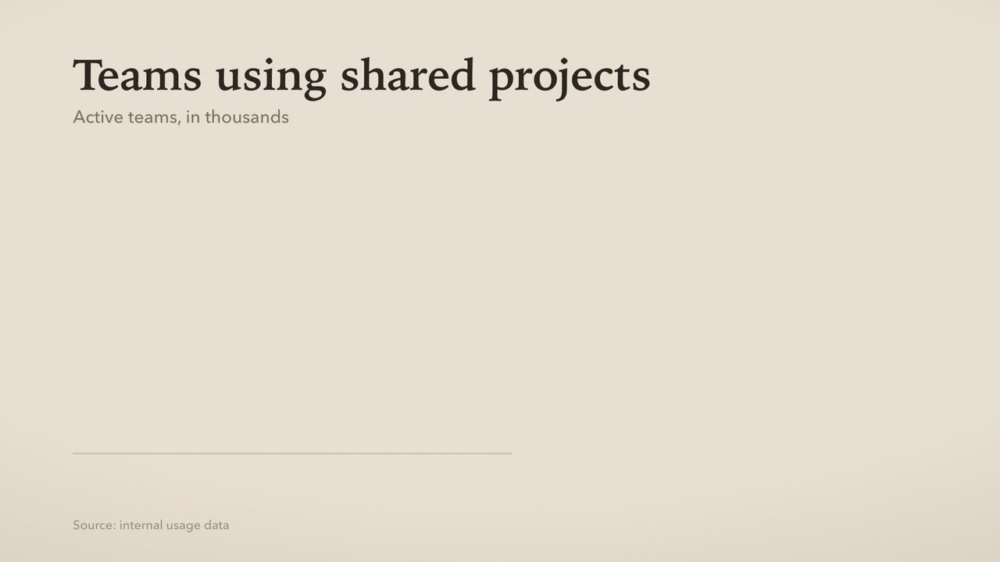 | 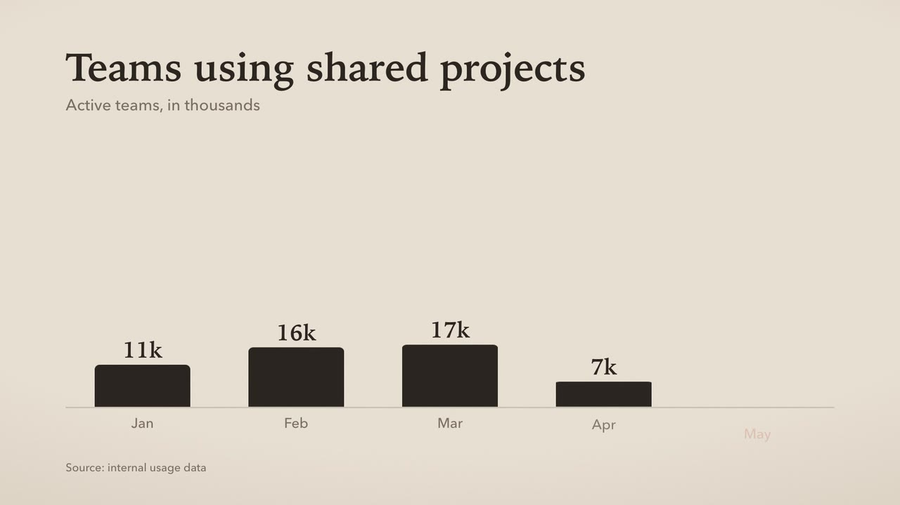 | 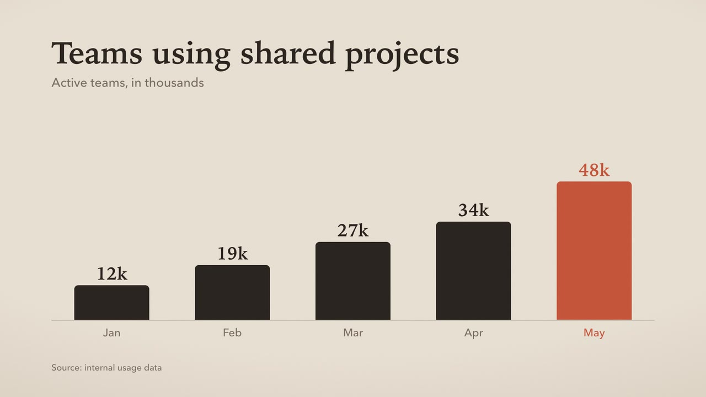 | 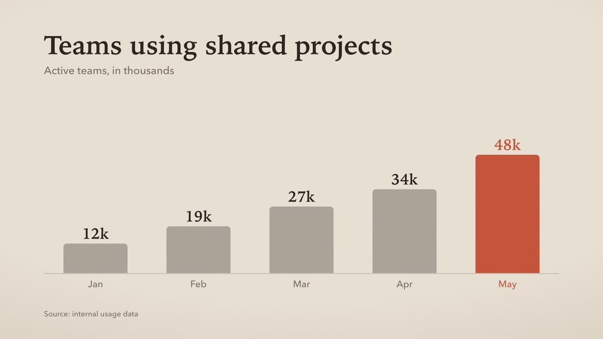 |

Built in DreamCut as an editable code-built motion graphic; no footage, generated imagery or people. Catalog evidence below is separate.

Demo not available yet.

Bars or a line build up one value at a time, each number counts up, then one item is highlighted.

### What you supply

- **A title:** Say what is measured, plus an optional subtitle and source note.
- **Two to six labels and values:** One label and one number per bar or point, the unit (k, %, $) and which item to highlight. Choose bars or a line.

### Supply your own or generate inputs

The graphic is built from code in DreamCut, so nothing is generated: no footage, people or imagery. Pick a look (Paper, Keynote, Swiss, Terminal or Chalk) and an accent color, or switch the backdrop off to lay it over your own footage.

Generation suitability is guidance, not proof of a tested generated-input workflow. Ask the agent to stage any needed assets in Library → Generate, then review the model, prompt and settings before generating.

### How the effect is built

1. Scale the chart to a rounded maximum and lay it out for the canvas shape.
2. Grow each item in turn while its value counts up, then let the highlighted item stand out.
3. Expose every label, value, unit, highlight and timing as controls.

### Copy to your agent

Replace the bracketed input line with your files and target. Copying is a handoff, not an edit or a generation submission.

```text
Use the motion-graphics skill for "Animated Chart" (recipe: FX-MOTION-CHART).
Read the FX-MOTION-CHART construction brief in src/lib/effects/promoted-recipes.ts and its owning skill before preparing the edit.
Build an Animated Chart titled [TITLE] with these values: [LABEL 1] [VALUE 1], [LABEL 2] [VALUE 2], [LABEL 3] [VALUE 3]. Follow the Animated Chart template in the motion-graphics skill as [BARS OR A LINE] in the [LOOK] look, with values shown as [UNIT], and highlight [ITEM]. Expose every label, value, unit and timing as controls. Propose it for me to review.
My inputs and target: [attach or identify my files, target clips, order and desired timing].
A title: Say what is measured, plus an optional subtitle and source note.
Two to six labels and values: One label and one number per bar or point, the unit (k, %, $) and which item to highlight. Choose bars or a line.
How it works: Scale the chart to a rounded maximum and lay it out for the canvas shape. Grow each item in turn while its value counts up, then let the highlighted item stand out. Expose every label, value, unit, highlight and timing as controls.
Input generation guidance: The graphic is built from code in DreamCut, so nothing is generated: no footage, people or imagery. Pick a look (Paper, Keynote, Swiss, Terminal or Chalk) and an accent color, or switch the backdrop off to lay it over your own footage.
Read the current timeline, applicable preferences and available media. Ask for missing inputs; do not assume example assets are mine. If generation is needed, prepare a visible draft and wait for my generation authorization.
Preserve original sources and unrelated edits. Keep meaningful layers and tuning controls editable. For an existing edit, propose changes for my review; do not apply or approve them.
Known limitations: Up to six items, one series; values start from zero. Values are typed numbers on the card; the chart does not read a spreadsheet. The canvas shape follows the project; tall canvases turn bars sideways.
Preview the result, check the full transition or animation and report anything unverified.
```

### Evidence and limits

- Up to six items, one series; values start from zero.
- Values are typed numbers on the card; the chart does not read a spreadsheet.
- The canvas shape follows the project; tall canvases turn bars sideways.

<a id="fx-motion-plans"></a>

## Plan Comparison

**FX-MOTION-PLANS · Implemented template · built with your agent** · [Owning skill](../../.agents/skills/motion-graphics/SKILL.md)

**Home:** Properties → Templates.

### Demonstration

[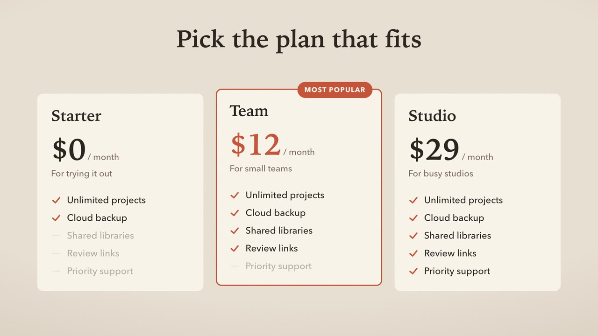](../../public/recipe-previews/motion-plans/result.mp4)

Three plan cards arrive, prices count up, feature ticks draw in row by row, then one plan is ringed with a badge. Default plans at normal speed; ticks draw 0.22 seconds apart.

**You supply**

| Prices |
| --- |
| $0 · $12 · $29 |

**DreamCut prepares**

| One graphic, five looks |
| --- |
|  |

| 1 · Cards arrive | 2 · Ticks draw in | 3 · One plan highlighted |
| --- | --- | --- |
| 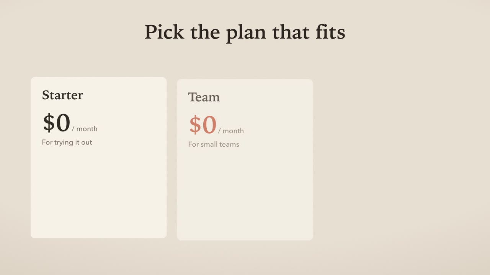 | 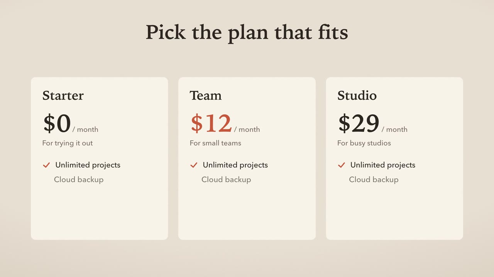 |  |

Built in DreamCut as an editable code-built motion graphic; no footage, generated imagery or people. Catalog evidence below is separate.

Demo not available yet.

Two or three plans side by side; prices count up, feature ticks draw in and one plan is ringed with a badge.

### What you supply

- **Plan names and prices:** Two or three plans with a price each, the currency and what the price is per (month, class).
- **Up to five features:** List features from basic to premium and say how many each plan includes. Name the plan to highlight and its badge.

### Supply your own or generate inputs

The graphic is built from code in DreamCut, so nothing is generated: no footage, people or imagery. Pick a look (Paper, Keynote, Swiss, Terminal or Chalk) and an accent color, or switch the backdrop off to lay it over your own footage.

Generation suitability is guidance, not proof of a tested generated-input workflow. Ask the agent to stage any needed assets in Library → Generate, then review the model, prompt and settings before generating.

### How the effect is built

1. Set the plans side by side, or stacked on a tall canvas.
2. Bring the cards in, count up the prices and draw the ticks row by row.
3. Ring the highlighted plan with its badge; expose names, prices, features and timing as controls.

### Copy to your agent

Replace the bracketed input line with your files and target. Copying is a handoff, not an edit or a generation submission.

```text
Use the motion-graphics skill for "Plan Comparison" (recipe: FX-MOTION-PLANS).
Read the FX-MOTION-PLANS construction brief in src/lib/effects/promoted-recipes.ts and its owning skill before preparing the edit.
Build a Plan Comparison of [PLAN 1] at [PRICE 1], [PLAN 2] at [PRICE 2] and [PLAN 3] at [PRICE 3] per [PERIOD], with features [FEATURE 1], [FEATURE 2], [FEATURE 3] (say how many each plan includes). Follow the Plan Comparison template in the motion-graphics skill in the [LOOK] look and highlight [PLAN] as [BADGE]. Expose names, prices, features, highlight and timing as controls. Propose it for me to review.
My inputs and target: [attach or identify my files, target clips, order and desired timing].
Plan names and prices: Two or three plans with a price each, the currency and what the price is per (month, class).
Up to five features: List features from basic to premium and say how many each plan includes. Name the plan to highlight and its badge.
How it works: Set the plans side by side, or stacked on a tall canvas. Bring the cards in, count up the prices and draw the ticks row by row. Ring the highlighted plan with its badge; expose names, prices, features and timing as controls.
Input generation guidance: The graphic is built from code in DreamCut, so nothing is generated: no footage, people or imagery. Pick a look (Paper, Keynote, Swiss, Terminal or Chalk) and an accent color, or switch the backdrop off to lay it over your own footage.
Read the current timeline, applicable preferences and available media. Ask for missing inputs; do not assume example assets are mine. If generation is needed, prepare a visible draft and wait for my generation authorization.
Preserve original sources and unrelated edits. Keep meaningful layers and tuning controls editable. For an existing edit, propose changes for my review; do not apply or approve them.
Known limitations: Features are tiered: each plan includes the first N features in the list. Two or three plans, up to five features. The canvas shape follows the project; tall canvases stack the plans.
Preview the result, check the full transition or animation and report anything unverified.
```

### Evidence and limits

- Features are tiered: each plan includes the first N features in the list.
- Two or three plans, up to five features.
- The canvas shape follows the project; tall canvases stack the plans.

<a id="fx-motion-walkthrough"></a>

## Walkthrough Steps

**FX-MOTION-WALKTHROUGH · Implemented template · built with your agent** · [Owning skill](../../.agents/skills/motion-graphics/SKILL.md)

**Home:** Properties → Templates.

### Demonstration

[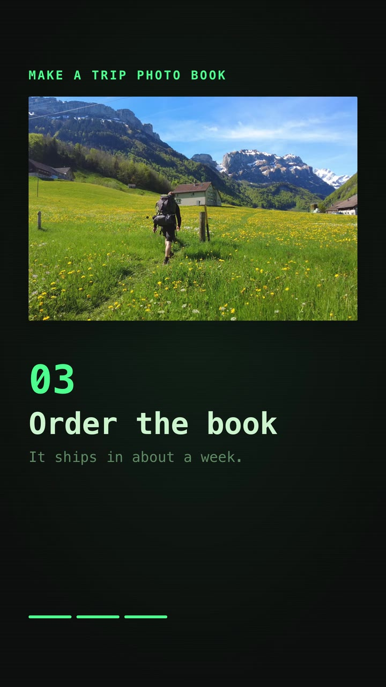](../../public/recipe-previews/motion-walkthrough/result.mp4)

Numbered steps come up one at a time, each with its own picture sliding onto the screen while a progress bar fills. Three supplied pictures, 9:16, at normal speed; each step holds 2.4 seconds.

**You supply**

| Step 1 picture | Step 2 picture | Step 3 picture | One line per step |
| --- | --- | --- | --- |
| 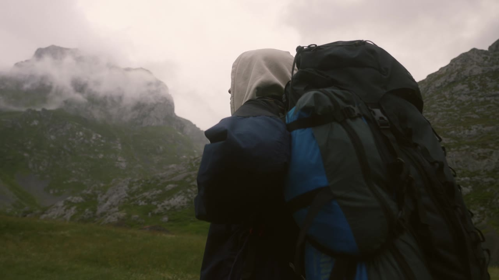 | 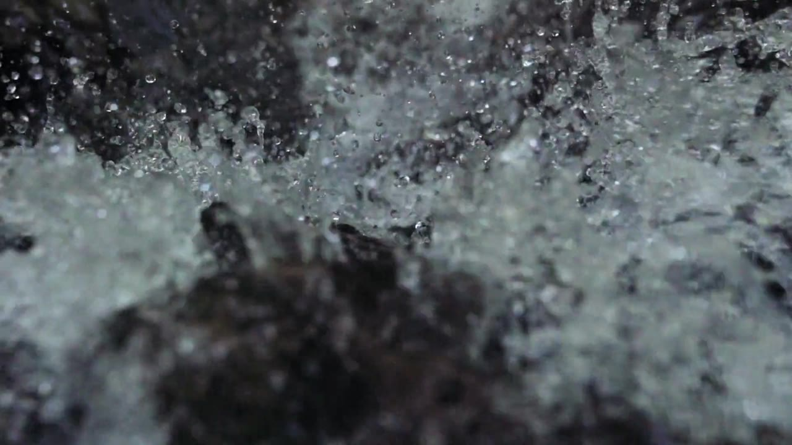 |  | Pick · Caption · Order |

**DreamCut prepares**

| One graphic, five looks |
| --- |
| 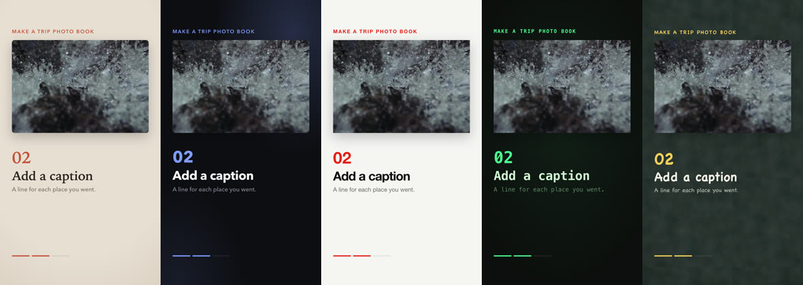 |

| 1 · First step | 2 · Next picture slides in | 3 · Last step |
| --- | --- | --- |
| 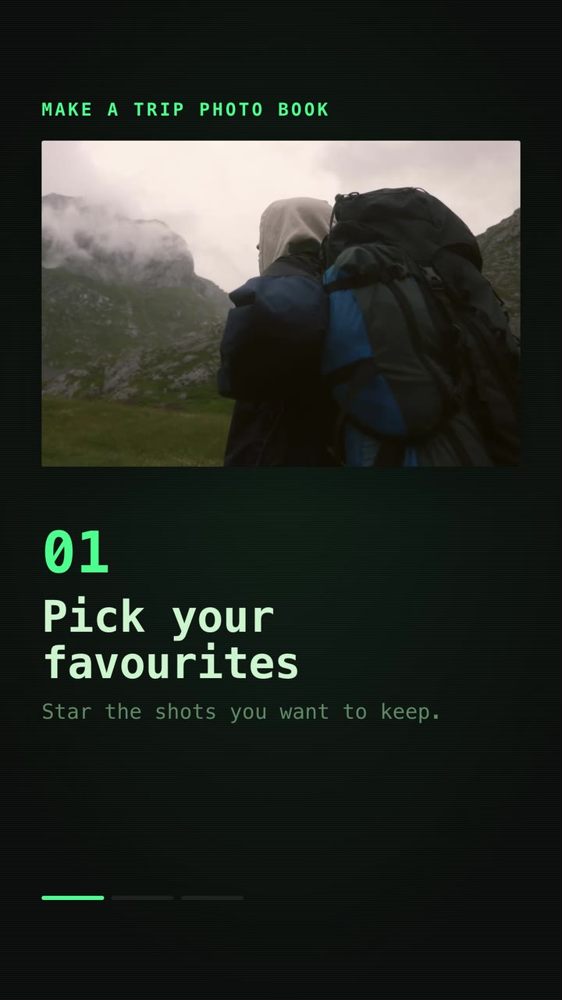 | 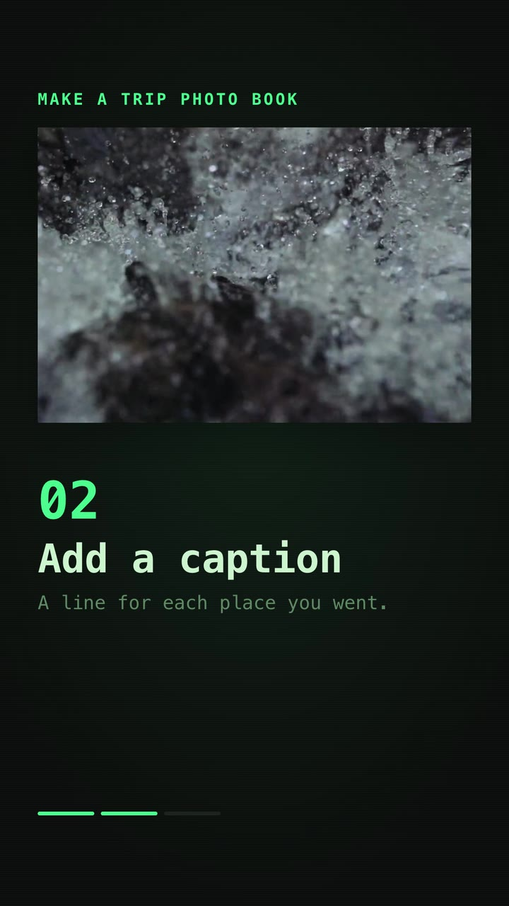 |  |

Step pictures: stills from Pexels videos 9130084, 4208237 and 8148429 (Pexels License). Screen, steps and motion built in DreamCut as an editable motion graphic. Catalog evidence below is separate.

Demo not available yet.

Numbered steps, one at a time, each with its own screenshot or picture on a screen and a progress bar.

### What you supply

- **Two to four steps:** A short title and one line of detail for each step, plus a heading.
- **A screenshot per step (optional):** Clear screenshots or pictures, landscape works best. Steps without one show a drawn stand-in screen.

### Supply your own or generate inputs

Screenshots are your own; the screen, numbers, progress bar and motion are built from code in DreamCut. Pick a look and an accent color.

Generation suitability is guidance, not proof of a tested generated-input workflow. Ask the agent to stage any needed assets in Library → Generate, then review the model, prompt and settings before generating.

### How the effect is built

1. Copy each screenshot into the graphic and frame it on a screen.
2. Show one numbered step at a time; slide the next picture in and fill the progress bar.
3. Expose the words, look, step time and change time as controls.

### Copy to your agent

Replace the bracketed input line with your files and target. Copying is a handoff, not an edit or a generation submission.

```text
Use the motion-graphics skill for "Walkthrough Steps" (recipe: FX-MOTION-WALKTHROUGH).
Read the FX-MOTION-WALKTHROUGH construction brief in src/lib/effects/promoted-recipes.ts and its owning skill before preparing the edit.
Build Walkthrough Steps titled [HEADING] with these steps: [STEP 1] ([DETAIL 1]), [STEP 2] ([DETAIL 2]), [STEP 3] ([DETAIL 3]). Use my screenshots [PICTURES] for the steps. Follow the Walkthrough Steps template in the motion-graphics skill in the [LOOK] look. Expose the words, step time and look as controls. Propose it for me to review.
My inputs and target: [attach or identify my files, target clips, order and desired timing].
Two to four steps: A short title and one line of detail for each step, plus a heading.
A screenshot per step (optional): Clear screenshots or pictures, landscape works best. Steps without one show a drawn stand-in screen.
How it works: Copy each screenshot into the graphic and frame it on a screen. Show one numbered step at a time; slide the next picture in and fill the progress bar. Expose the words, look, step time and change time as controls.
Input generation guidance: Screenshots are your own; the screen, numbers, progress bar and motion are built from code in DreamCut. Pick a look and an accent color.
Read the current timeline, applicable preferences and available media. Ask for missing inputs; do not assume example assets are mine. If generation is needed, prepare a visible draft and wait for my generation authorization.
Preserve original sources and unrelated edits. Keep meaningful layers and tuning controls editable. For an existing edit, propose changes for my review; do not apply or approve them.
Known limitations: Screenshots are copied into the graphic when it is prepared; swapping one needs a new preparation, not a dial. Steps without a screenshot show a drawn stand-in screen. Graphics with pictures cannot yet be saved to your Library for reuse.
Preview the result, check the full transition or animation and report anything unverified.
```

### Evidence and limits

- Screenshots are copied into the graphic when it is prepared; swapping one needs a new preparation, not a dial.
- Steps without a screenshot show a drawn stand-in screen.
- Graphics with pictures cannot yet be saved to your Library for reuse.

<a id="fx-motion-kinetic"></a>

## Kinetic Type

**FX-MOTION-KINETIC · Implemented template · built with your agent** · [Owning skill](../../.agents/skills/motion-graphics/SKILL.md)

**Home:** Properties → Templates.

### Demonstration

[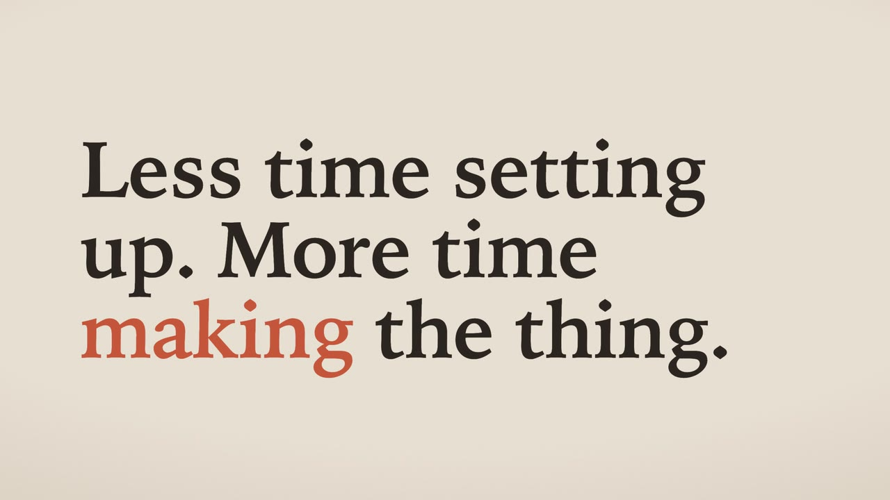](../../public/recipe-previews/motion-kinetic/result.mp4)

A phrase lands word by word on an even beat and builds into lines, with the accent word in color. Default phrase at normal speed; one word every 0.32 seconds.

**You supply**

| Phrase and accent word |
| --- |
| Less · time · making |

**DreamCut prepares**

| One graphic, five looks |
| --- |
| 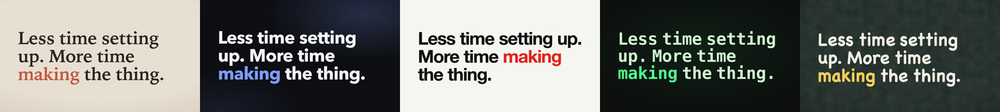 |

| 1 · First words | 2 · The line builds | 3 · Every word landed |
| --- | --- | --- |
| 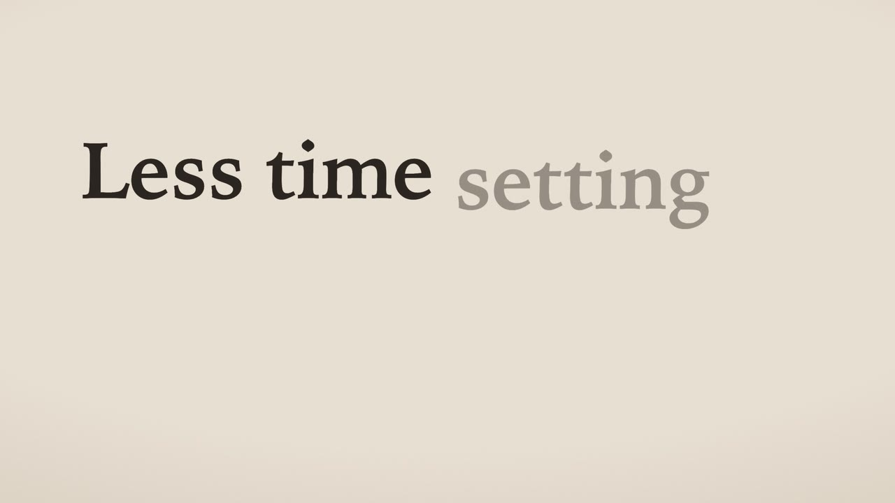 | 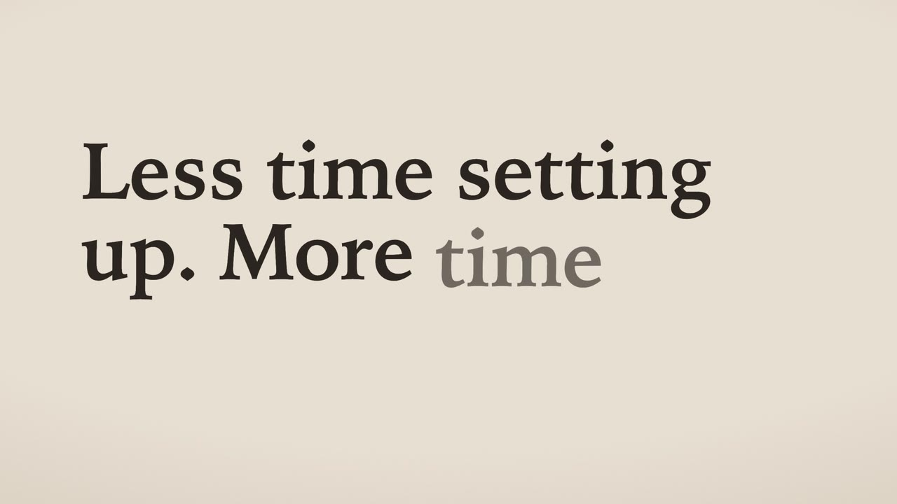 |  |

Built in DreamCut as an editable code-built motion graphic; no footage, generated imagery or people. Catalog evidence below is separate.

Demo not available yet.

A phrase lands word by word on a beat, building into lines or one big word at a time, with accent words in color.

### What you supply

- **A short phrase:** Up to about twelve words. Name any words to show in the accent color.
- **The beat or word times (optional):** An even beat between words, or exact seconds for each word to follow music or speech.

### Supply your own or generate inputs

The graphic is built from code in DreamCut, so nothing is generated: no footage, people or imagery. Pick a look (Paper, Keynote, Swiss, Terminal or Chalk) and an accent color, or switch the backdrop off to lay it over your own footage.

Generation suitability is guidance, not proof of a tested generated-input workflow. Ask the agent to stage any needed assets in Library → Generate, then review the model, prompt and settings before generating.

### How the effect is built

1. Set the phrase to build into lines, or one large word at a time.
2. Land each word on its beat with the chosen landing.
3. Expose the phrase, beat, word times, landing and size as controls.

### Copy to your agent

Replace the bracketed input line with your files and target. Copying is a handoff, not an edit or a generation submission.

```text
Use the motion-graphics skill for "Kinetic Type" (recipe: FX-MOTION-KINETIC).
Read the FX-MOTION-KINETIC construction brief in src/lib/effects/promoted-recipes.ts and its owning skill before preparing the edit.
Build Kinetic Type for [PHRASE] with [ACCENT WORDS] in the accent color, [BUILDING THE LINE OR ONE WORD AT A TIME], landing on [BEAT OR WORD TIMES]. Follow the Kinetic Type template in the motion-graphics skill in the [LOOK] look. Expose the phrase, beat, word times, landing and size as controls. Propose it for me to review.
My inputs and target: [attach or identify my files, target clips, order and desired timing].
A short phrase: Up to about twelve words. Name any words to show in the accent color.
The beat or word times (optional): An even beat between words, or exact seconds for each word to follow music or speech.
How it works: Set the phrase to build into lines, or one large word at a time. Land each word on its beat with the chosen landing. Expose the phrase, beat, word times, landing and size as controls.
Input generation guidance: The graphic is built from code in DreamCut, so nothing is generated: no footage, people or imagery. Pick a look (Paper, Keynote, Swiss, Terminal or Chalk) and an accent color, or switch the backdrop off to lay it over your own footage.
Read the current timeline, applicable preferences and available media. Ask for missing inputs; do not assume example assets are mine. If generation is needed, prepare a visible draft and wait for my generation authorization.
Preserve original sources and unrelated edits. Keep meaningful layers and tuning controls editable. For an existing edit, propose changes for my review; do not apply or approve them.
Known limitations: Up to 40 words; long phrases shrink to fit. Word times are typed seconds; they do not yet follow a beat grid automatically. Its length follows the words, so the card shows the render length rather than a formula.
Preview the result, check the full transition or animation and report anything unverified.
```

### Evidence and limits

- Up to 40 words; long phrases shrink to fit.
- Word times are typed seconds; they do not yet follow a beat grid automatically.
- Its length follows the words, so the card shows the render length rather than a formula.

<a id="fx-masking-hook"></a>

## Masking Hook

**FX-MASKING-HOOK · Implemented template · built with your agent** · [Owning skill](../../.agents/skills/mask-glitch/SKILL.md)

**Home:** Properties → Templates.

### Demonstration

[](../../public/recipe-previews/masking-hook/result.mp4)

The shot opens on black with three quick cut-out flashes of the person (white, red, then just the head), and the real shot carries on from the exact moment the flashes end. Real footage at normal speed; each flash lasts 4 frames with one black frame between.

**You supply**

| Shot of a person |
| --- |
|  |

**DreamCut prepares**

| Moving cutout |
| --- |
|  |

| 1 · White | 2 · Color | 3 · Head only | 4 · Shot plays on |
| --- | --- | --- | --- |
|  |  |  |  |

Footage: Pexels video 8970054 (Pexels License), built as an editable DreamCut timeline. Effect reference: @willrvail breakdown of a video by @nvision.media. Catalog evidence below is separate.

Demo not available yet.

Three quick cut-out flashes of your subject on black (white, color, head only), then the shot plays on from the same moment.

### What you supply

- **One shot of a person:** Supply the shot the video opens on. The person should be clearly separable from the background for the half second before the shot starts; a bright sky behind a white shirt makes a noisy cutout.

### Supply your own or generate inputs

The shot can be filmed or generated; the cutout and flashes are made in DreamCut, so never generate the flashes into the footage.

Generation suitability is guidance, not proof of a tested generated-input workflow. Ask the agent to stage any needed assets in Library → Generate, then review the model, prompt and settings before generating.

### How the effect is built

1. Cut out the person for the half second before the shot starts.
2. Flash the cutout white, then in color, then just the head, 4 frames each on black with one black frame between.
3. Start the shot from the exact source moment the flashes end; expose flash strength, color and color amount.

### Copy to your agent

Replace the bracketed input line with your files and target. Copying is a handoff, not an edit or a generation submission.

```text
Use the mask-glitch skill for "Masking Hook" (recipe: FX-MASKING-HOOK).
Read the FX-MASKING-HOOK construction brief in src/lib/effects/promoted-recipes.ts and its owning skill before preparing the edit.
Build Masking Hook as the opener of [SHOT]. Follow the Masking Hook template in the mask-glitch skill: prepare a moving cutout of the person for the half second before the shot starts, add three 4-frame flashes on black (white, [COLOR], then head only) with one black frame between, and start the shot from the exact source moment the flashes end. Expose the white strength, flash color and color amount as controls. Propose it for me to review.
My inputs and target: [attach or identify my files, target clips, order and desired timing].
One shot of a person: Supply the shot the video opens on. The person should be clearly separable from the background for the half second before the shot starts; a bright sky behind a white shirt makes a noisy cutout.
How it works: Cut out the person for the half second before the shot starts. Flash the cutout white, then in color, then just the head, 4 frames each on black with one black frame between. Start the shot from the exact source moment the flashes end; expose flash strength, color and color amount.
Input generation guidance: The shot can be filmed or generated; the cutout and flashes are made in DreamCut, so never generate the flashes into the footage.
Read the current timeline, applicable preferences and available media. Ask for missing inputs; do not assume example assets are mine. If generation is needed, prepare a visible draft and wait for my generation authorization.
Preserve original sources and unrelated edits. Keep meaningful layers and tuning controls editable. For an existing edit, propose changes for my review; do not apply or approve them.
Known limitations: Needs a clean cutout: holes in the cutout show as gaps in the silhouettes. The head-only flash is a rectangular crop, so arms or hands close to the head show too. Flash timing and the head crop are set in the proposal; the card offers white strength, color and color amount.
Preview the result, check the full transition or animation and report anything unverified.
```

### Evidence and limits

- Needs a clean cutout: holes in the cutout show as gaps in the silhouettes.
- The head-only flash is a rectangular crop, so arms or hands close to the head show too.
- Flash timing and the head crop are set in the proposal; the card offers white strength, color and color amount.

<a id="fx-clone-flash"></a>

## Clone Flash

**FX-CLONE-FLASH · Implemented template · built with your agent** · [Owning skill](../../.agents/skills/video-compositing/SKILL.md)

**Home:** Properties → Templates.

### Demonstration

[](../../public/recipe-previews/clone-flash/result.mp4)

Copies of the man, cut out from later in the same take, appear beside him one at a time; each arrives as a white silhouette and settles into color. Real footage at normal speed; each clone is white for 0.1 s and in color by 0.2 s.

**You supply**

| Still shot |
| --- |
|  |

**DreamCut prepares**

| Moving cutout |
| --- |
|  |

| 1 · Original | 2 · First clone flashes | 3 · Second clone flashes | 4 · Three of him |
| --- | --- | --- | --- |
|  |  |  |  |

Footage: Pexels video 8680224 (Pexels License), built as an editable DreamCut timeline. Effect reference: @willrvail breakdown of a video by @nvision.media. Catalog evidence below is separate.

Demo not available yet.

Copies of your subject from later in the same take appear beside them, each arriving with a white flash.

### What you supply

- **A still shot of a person:** Keep the camera still and leave room beside the person. Film a few extra seconds so later moments can supply the copies. A plain, even background hides cutout edges best.

### Supply your own or generate inputs

A still shot can be generated; keep the background stable. The copies and flashes are made in DreamCut.

Generation suitability is guidance, not proof of a tested generated-input workflow. Ask the agent to stage any needed assets in Library → Generate, then review the model, prompt and settings before generating.

### How the effect is built

1. Cut out the person from later in the same take.
2. Place two or three copies beside them on their own lanes.
3. Flash each copy white as it arrives, then let it settle into color; expose each copy's position and source moment.

### Copy to your agent

Replace the bracketed input line with your files and target. Copying is a handoff, not an edit or a generation submission.

```text
Use the video-compositing skill for "Clone Flash" (recipe: FX-CLONE-FLASH).
Read the FX-CLONE-FLASH construction brief in src/lib/effects/promoted-recipes.ts and its owning skill before preparing the edit.
Build Clone Flash on [SHOT]. Follow the Clone Flash template in the video-compositing skill: prepare a moving cutout of the person from later in the same take, place two or three copies beside them on their own lanes, and give each a white silhouette for its first 0.1 s that fades to color by 0.2 s. Expose each clone's position and source moment as controls. Propose it for me to review.
My inputs and target: [attach or identify my files, target clips, order and desired timing].
A still shot of a person: Keep the camera still and leave room beside the person. Film a few extra seconds so later moments can supply the copies. A plain, even background hides cutout edges best.
How it works: Cut out the person from later in the same take. Place two or three copies beside them on their own lanes. Flash each copy white as it arrives, then let it settle into color; expose each copy's position and source moment.
Input generation guidance: A still shot can be generated; keep the background stable. The copies and flashes are made in DreamCut.
Read the current timeline, applicable preferences and available media. Ask for missing inputs; do not assume example assets are mine. If generation is needed, prepare a visible draft and wait for my generation authorization.
Preserve original sources and unrelated edits. Keep meaningful layers and tuning controls editable. For an existing edit, propose changes for my review; do not apply or approve them.
Known limitations: The camera must stay still; a moving camera makes the clones slide. Only the person is copied, so whatever they sit or lean on is not. Clone start times are set in the proposal; the card offers position and source moment.
Preview the result, check the full transition or animation and report anything unverified.
```

### Evidence and limits

- The camera must stay still; a moving camera makes the clones slide.
- Only the person is copied, so whatever they sit or lean on is not.
- Clone start times are set in the proposal; the card offers position and source moment.

<a id="fx-silhouette-window"></a>

## Silhouette Window

**FX-SILHOUETTE-WINDOW · Implemented template · built with your agent** · [Owning skill](../../.agents/skills/video-compositing/SKILL.md)

**Home:** Properties → Templates.

### Demonstration

[](../../public/recipe-previews/silhouette-window/result.mp4)

Short clips play one after another inside the man's moving silhouette while the dusk sky and sea around him stay as filmed. Real footage at normal speed; a new clip every 0.6 seconds.

**You supply**

| Shot of a person | Fill clip | Fill clip | Fill clip | Fill clip |
| --- | --- | --- | --- | --- |
|  |  |  |  |  |

**DreamCut prepares**

| Moving mask |
| --- |
|  |

| 1 · First clip inside | 2 · Next clip | 3 · Next clip | 4 · Window follows him |
| --- | --- | --- | --- |
|  |  |  |  |

Footage: Pexels videos 34736308, 4208237, 8148429, 9130084, 10989548, 5977487, 3010130, 7348329 and 35811255 (Pexels License), built as an editable DreamCut timeline. Effect reference: @willrvail breakdown of a video by @nvision.media. Catalog evidence below is separate.

Demo not available yet.

A run of short clips plays only inside your subject's moving silhouette; the rest of the shot stays as it is.

### What you supply

- **A shot of a person:** A clear silhouette works best: a profile against the sky, or a figure against a plain background.
- **Several short fill clips:** Supply clips with strong color or texture; about 0.6 seconds of each is used, in the order you give.

### Supply your own or generate inputs

Fill clips can be filmed or generated. The window is made in DreamCut from the person's cutout.

Generation suitability is guidance, not proof of a tested generated-input workflow. Ask the agent to stage any needed assets in Library → Generate, then review the model, prompt and settings before generating.

### How the effect is built

1. Prepare a moving cutout mask of the person.
2. Place the fill clips in order above the shot, each windowed to the person's silhouette.
3. Tune edge softness, edge size and window strength.

### Copy to your agent

Replace the bracketed input line with your files and target. Copying is a handoff, not an edit or a generation submission.

```text
Use the video-compositing skill for "Silhouette Window" (recipe: FX-SILHOUETTE-WINDOW).
Read the FX-SILHOUETTE-WINDOW construction brief in src/lib/effects/promoted-recipes.ts and its owning skill before preparing the edit.
Build Silhouette Window on [SHOT] with these fill clips: [CLIPS]. Follow the Silhouette Window template in the video-compositing skill: prepare the person's moving cutout mask, then place the fills in order (about 0.6 s each) as Subject Window clips shown inside the person. Expose edge softness, edge size and window strength as controls. Propose it for me to review.
My inputs and target: [attach or identify my files, target clips, order and desired timing].
A shot of a person: A clear silhouette works best: a profile against the sky, or a figure against a plain background.
Several short fill clips: Supply clips with strong color or texture; about 0.6 seconds of each is used, in the order you give.
How it works: Prepare a moving cutout mask of the person. Place the fill clips in order above the shot, each windowed to the person's silhouette. Tune edge softness, edge size and window strength.
Input generation guidance: Fill clips can be filmed or generated. The window is made in DreamCut from the person's cutout.
Read the current timeline, applicable preferences and available media. Ask for missing inputs; do not assume example assets are mine. If generation is needed, prepare a visible draft and wait for my generation authorization.
Preserve original sources and unrelated edits. Keep meaningful layers and tuning controls editable. For an existing edit, propose changes for my review; do not apply or approve them.
Known limitations: The window follows the prepared cutout; anything it misses, such as a raised hand, stays unfilled. Fill order and rhythm are set in the proposal; the card offers edge softness, edge size and window strength.
Preview the result, check the full transition or animation and report anything unverified.
```

### Evidence and limits

- The window follows the prepared cutout; anything it misses, such as a raised hand, stays unfilled.
- Fill order and rhythm are set in the proposal; the card offers edge softness, edge size and window strength.

<a id="fx-lyric-pop"></a>

## Lyric Pop

**FX-LYRIC-POP · Implemented template · built with your agent** · [Owning skill](../../.agents/skills/video-typography/SKILL.md)

**Home:** Properties → Templates.

### Demonstration

[](../../public/recipe-previews/lyric-pop/result.mp4)

On the beat, one gold serif word springs onto the shot, holds, then cuts away. Real footage at normal speed; the word springs on in 0.25 seconds and holds 1.4 seconds.

**You supply**

| Shot | The word |
| --- | --- |
|  | CRAZY |

**DreamCut prepares**

| Gold serif word |
| --- |
|  |

| 1 · Before the beat | 2 · Word springs on | 3 · Word holds |
| --- | --- | --- |
|  |  |  |

Footage: Pexels video 3010130 (Pexels License), built as an editable DreamCut timeline. Effect reference: @willrvail breakdown of a video by @nvision.media. Catalog evidence below is separate.

Demo not available yet.

One word in a bold gold serif springs onto the shot on a beat and holds.

### What you supply

- **A shot:** Leave clear space beside the subject for the word.
- **The word:** One short word, and the beat or moment it should land on.

### Supply your own or generate inputs

The shot can be filmed or generated; the word is native editable text, so never generate it into the footage.

Generation suitability is guidance, not proof of a tested generated-input workflow. Ask the agent to stage any needed assets in Library → Generate, then review the model, prompt and settings before generating.

### How the effect is built

1. Place the word as native text in DM Serif Display, gold.
2. Spring it on over a quarter second on the beat and hold it about 1.4 seconds.
3. Expose hold, size and spring time.

### Copy to your agent

Replace the bracketed input line with your files and target. Copying is a handoff, not an edit or a generation submission.

```text
Use the video-typography skill for "Lyric Pop" (recipe: FX-LYRIC-POP).
Read the FX-LYRIC-POP construction brief in src/lib/effects/promoted-recipes.ts and its owning skill before preparing the edit.
Build Lyric Pop on [SHOT] with the word [WORD] on the beat at [TIME]. Follow the Lyric Pop template in the video-typography skill: one native text layer in DM Serif Display, gold #E8B547, springing on over 0.25 s and holding about 1.4 s. Expose hold, size and spring time as controls. Propose it for me to review.
My inputs and target: [attach or identify my files, target clips, order and desired timing].
A shot: Leave clear space beside the subject for the word.
The word: One short word, and the beat or moment it should land on.
How it works: Place the word as native text in DM Serif Display, gold. Spring it on over a quarter second on the beat and hold it about 1.4 seconds. Expose hold, size and spring time.
Input generation guidance: The shot can be filmed or generated; the word is native editable text, so never generate it into the footage.
Read the current timeline, applicable preferences and available media. Ask for missing inputs; do not assume example assets are mine. If generation is needed, prepare a visible draft and wait for my generation authorization.
Preserve original sources and unrelated edits. Keep meaningful layers and tuning controls editable. For an existing edit, propose changes for my review; do not apply or approve them.
Known limitations: The word's start is set in the proposal and moved on the timeline; the card offers hold, size and spring time. One word per card; repeat the template for each beat.
Preview the result, check the full transition or animation and report anything unverified.
```

### Evidence and limits

- The word's start is set in the proposal and moved on the timeline; the card offers hold, size and spring time.
- One word per card; repeat the template for each beat.

<a id="fx-cross-negative"></a>

## Cross into Negative

**FX-CROSS-NEGATIVE · Implemented template · built with your agent** · [Owning skill](../../.agents/skills/video-compositing/SKILL.md)

**Home:** Properties → Templates.

### Demonstration

[](../../public/recipe-previews/cross-negative/result.mp4)

A bar slides in from the right and another drops from the top, opening a cross onto the next shot as a black-and-white negative; the cross widens until the negative fills the frame. Real footage at normal speed; the cross opens over 1.5 seconds.

**You supply**

| Shot A | Shot B |
| --- | --- |
|  |  |

**DreamCut prepares**

| Shot B as a negative |
| --- |
|  |

| 1 · Shot A | 2 · First bar | 3 · Cross opens | 4 · Negative fills the frame |
| --- | --- | --- | --- |
|  |  |  |  |

Footage: Pexels videos 5977487 and 35811255 (Pexels License), built as an editable DreamCut timeline. Effect reference: @willrvail breakdown of a video by @nvision.media. Catalog evidence below is separate.

Demo not available yet.

A cross-shaped window opens over one shot onto the next as a black-and-white negative, then widens to fill the frame.

### What you supply

- **Two shots:** Supply the outgoing shot and the shot it cuts to. A shot B with strong light and shadow reads best as a negative.

### Supply your own or generate inputs

Either shot can be filmed or generated; the cross and negative are made in DreamCut.

Generation suitability is guidance, not proof of a tested generated-input workflow. Ask the agent to stage any needed assets in Library → Generate, then review the model, prompt and settings before generating.

### How the effect is built

1. Turn shot B black and white and invert it with a white difference layer.
2. Open a bar from the right and a bar from the top, each showing the negative.
3. Widen both bars until the negative fills the frame at the cut; expose the gap between bars and contrast.

### Copy to your agent

Replace the bracketed input line with your files and target. Copying is a handoff, not an edit or a generation submission.

```text
Use the video-compositing skill for "Cross into Negative" (recipe: FX-CROSS-NEGATIVE).
Read the FX-CROSS-NEGATIVE construction brief in src/lib/effects/promoted-recipes.ts and its owning skill before preparing the edit.
Build Cross into Negative from [SHOT A] into [SHOT B]. Follow the Cross into Negative template in the video-compositing skill: show shot B as a black-and-white negative inside a cross (a bar wipes in from the right, a bar drops from the top), then widen both until the negative fills the frame at the cut. Expose the gap between the bars, contrast and shot B's start as controls. Propose it for me to review.
My inputs and target: [attach or identify my files, target clips, order and desired timing].
Two shots: Supply the outgoing shot and the shot it cuts to. A shot B with strong light and shadow reads best as a negative.
How it works: Turn shot B black and white and invert it with a white difference layer. Open a bar from the right and a bar from the top, each showing the negative. Widen both bars until the negative fills the frame at the cut; expose the gap between bars and contrast.
Input generation guidance: Either shot can be filmed or generated; the cross and negative are made in DreamCut.
Read the current timeline, applicable preferences and available media. Ask for missing inputs; do not assume example assets are mine. If generation is needed, prepare a visible draft and wait for my generation authorization.
Preserve original sources and unrelated edits. Keep meaningful layers and tuning controls editable. For an existing edit, propose changes for my review; do not apply or approve them.
Known limitations: The cross widens smoothly; the reference breaks into blocks as it opens. Bar placement and widening are keyframes in the proposal; the card offers the gap between bars, contrast and shot B's start. The bars are placed for a 16:9 frame.
Preview the result, check the full transition or animation and report anything unverified.
```

### Evidence and limits

- The cross widens smoothly; the reference breaks into blocks as it opens.
- Bar placement and widening are keyframes in the proposal; the card offers the gap between bars, contrast and shot B's start.
- The bars are placed for a 16:9 frame.

<a id="layered-paper-cutout"></a>

## Layered Paper Cutout

**layered-paper-cutout · Demonstration · not catalog-verified** · [Owning skill](../../.agents/skills/layered-paper-cutout/SKILL.md)

**Home:** Properties → Templates.

### Demonstration

[Demonstration](../../public/guide/effects/contour-first-half.mp4)

Example credit: DreamCut · creator-supplied portrait.

Colored paper layers appear on selected music hits. Opening 6.4 seconds.

### What you supply

- **Portrait:** Supply one clear portrait with the subject edges visible.
- **Music and hits:** Supply the music and identify the hits to emphasize, or ask in chat to suggest them.

### Supply your own or generate inputs

The portrait or paper textures can be generated. Keep the subject consistent and derive the paper layers from its silhouette.

Generation suitability is guidance, not proof of a tested generated-input workflow. Ask the agent to stage any needed assets in Library → Generate, then review the model, prompt and settings before generating.

### How the effect is built

1. Separate the portrait from its background.
2. Build color paper layers behind the subject.
3. Reveal layers back to front on the selected music hits.

### Copy to your agent

Replace the bracketed input line with your files and target. Copying is a handoff, not an edit or a generation submission.

```text
Use the layered-paper-cutout skill for "Layered Paper Cutout" (recipe: layered-paper-cutout).
Use the layered-paper-cutout skill with this portrait and my selected music hits. Build the colored paper layers behind me and reveal them back to front on the selected hits. Keep each layer editable.
My inputs and target: [attach or identify my files, target clips, order and desired timing].
Portrait: Supply one clear portrait with the subject edges visible.
Music and hits: Supply the music and identify the hits to emphasize, or ask in chat to suggest them.
How it works: Separate the portrait from its background. Build color paper layers behind the subject. Reveal layers back to front on the selected music hits.
Input generation guidance: The portrait or paper textures can be generated. Keep the subject consistent and derive the paper layers from its silhouette.
Read the current timeline, applicable preferences and available media. Ask for missing inputs; do not assume example assets are mine. If generation is needed, prepare a visible draft and wait for my generation authorization.
Preserve original sources and unrelated edits. Keep meaningful layers and tuning controls editable. For an existing edit, propose changes for my review; do not apply or approve them.
Preview the result, check the full transition or animation and report anything unverified.
```

### Evidence and limits

This workflow has not been promoted to a verified complete catalog recipe.

<a id="talking-head-cutout"></a>

## Talking-Head Background Removal

**talking-head-cutout · Demo not available yet** · [Owning skill](../../.agents/skills/talking-head-cutout/SKILL.md)

**Home:** Properties → Templates.

### Demonstration

[](../../public/recipe-previews/talking-head-cutout/result.mp4)

The room behind her disappears while she keeps talking; her hair, hands and necklace stay, now in front of a plain backdrop. Real footage at normal speed; the room shows for 1.6 seconds, then the backdrop changes.

**You supply**

| Talking-head video |
| --- |
|  |

**DreamCut prepares**

| Moving cutout |
| --- |
|  |

| 1 · Original room | 2 · Room removed | 3 · Hands and hair kept |
| --- | --- | --- |
|  |  |  |

Footage: Pexels videos 8814086 and 8798070 (Pexels License), built as an editable DreamCut timeline. Catalog evidence below is separate.

Demo not available yet.

Remove the room behind a talking head while preserving the visible person and keeping the picture synchronized with speech.

### What you supply

- **Original recording:** Supply the full talking-head video, the section to use and the person to keep. Retain the original audio; do not send only a screenshot.

### Supply your own or generate inputs

Use the real recording when preserving a speaker and their speech. A generated replacement is a different input and must not silently replace the person.

Generation suitability is guidance, not proof of a tested generated-input workflow. Ask the agent to stage any needed assets in Library → Generate, then review the model, prompt and settings before generating.

### How the effect is built

1. Isolate the visible person over the chosen section.
2. Preserve moving hair, hands and clothing edges.
3. Keep the transparent picture synchronized with the original speech.

### Copy to your agent

Replace the bracketed input line with your files and target. Copying is a handoff, not an edit or a generation submission.

```text
Use the talking-head-cutout skill for "Talking-Head Background Removal" (recipe: talking-head-cutout).
Use the talking-head-cutout skill to remove the background from this talking-head video over my selected section. Preserve all visible hair, hands, clothing, and body edges. Keep the cutout synchronized with the original speech, preserve the original recording, and leave the cutout without a white outline. Check the moving edges and prepare a previewable proposal before using it in my edit.
My inputs and target: [attach or identify my files, target clips, order and desired timing].
Original recording: Supply the full talking-head video, the section to use and the person to keep. Retain the original audio; do not send only a screenshot.
How it works: Isolate the visible person over the chosen section. Preserve moving hair, hands and clothing edges. Keep the transparent picture synchronized with the original speech.
Input generation guidance: Use the real recording when preserving a speaker and their speech. A generated replacement is a different input and must not silently replace the person.
Read the current timeline, applicable preferences and available media. Ask for missing inputs; do not assume example assets are mine. If generation is needed, prepare a visible draft and wait for my generation authorization.
Preserve original sources and unrelated edits. Keep meaningful layers and tuning controls editable. For an existing edit, propose changes for my review; do not apply or approve them.
Preview the result, check the full transition or animation and report anything unverified.
```

### Evidence and limits

This workflow has not been promoted to a verified complete catalog recipe.

