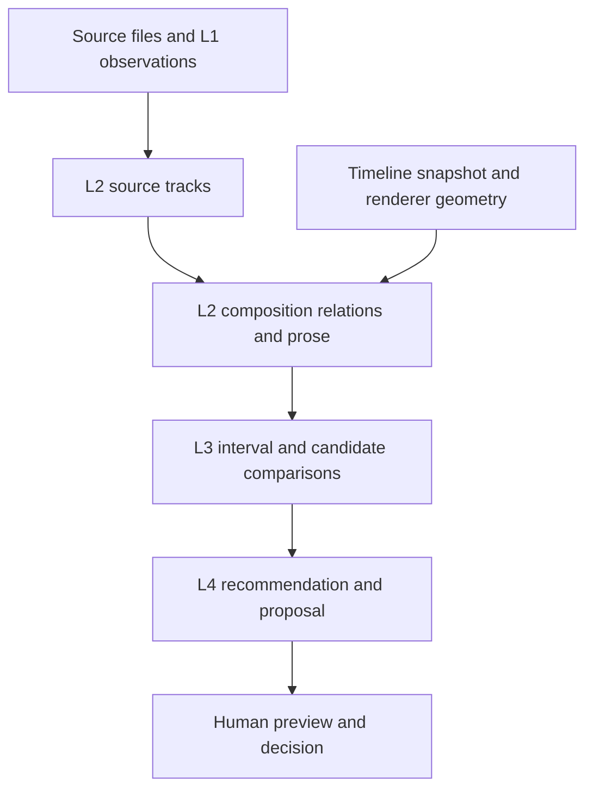

# Spatial evidence for video-editing agents

Status: interpretation plus an implemented first integration. The full pipeline has not shipped. See the [current implementation boundaries](../architecture/spatial-engine.md), [external findings](../research/2026-09-12-spatial-reasoning-and-agent-design.md), and [architecture proposal](../spatial-evidence-architecture.md).

## The problem

An agent arranging a video needs to know whether text, imagery, or effects intersect meaningful content. It should distinguish intentional overlap from accidental obstruction and from a region it has not examined. Reading coordinates or looking at a single screenshot is not enough to establish that knowledge across time.

Our interpretation of the spatial-reasoning evidence is that numerical perception and explicit uncertainty deserve their own tools; a more elaborate reasoning prompt is not sufficient proof of better spatial judgment. This is an engineering inference from [R01–R02](../research/2026-09-12-spatial-reasoning-and-agent-design.md#visual-spatial-reasoning), not a universal claim about future models.

## What we can reuse

The source-context store already distinguishes observations and deterministic derivations, and the stage cache records dependencies. Source-time projection and caption/mask prose exist. The caption ranker exists but has no production caller in the searched code, and local detection remains unpromoted. See the [current implementation boundaries](../architecture/spatial-engine.md).

The baseline audit identified coverage honesty as the first repair: the worker capped detection samples yet could publish full-duration completeness. The first integration now publishes discrete examined-frame coverage. We infer that connecting the current query to automatic clearance claims would risk treating unexamined time as empty space. This is a coverage argument; it is not a claim that a production incident has been reproduced.

## Proposed knowledge model

| Level | Owns | Does not establish |
| --- | --- | --- |
| L1 observation | Measurements, detector/ASR outputs, source frame/time, method and provenance | That a model observation is necessarily correct |
| L2 derivation | Track association, geometry relationships, descriptive prose tied to inputs | That an overlap is editorially bad |
| L3 comparison | Summaries over intervals and comparisons among candidates | Which preference should govern the edit |
| L4 recommendation | Intent, taste, ranking policy, and a proposed choice | Authority to rewrite observations or bypass review |

This preserves the existing source-level split while proposing **scope** as a separate field: source, composition, or project. Composition L2 is an explicit extension to the current per-source L2 contract. It stays project-local and depends on the exact timeline/metadata snapshot; source L1/L2 remains reusable across edits. See the [architecture's level and scope contract](../spatial-evidence-architecture.md#preserve-the-methodology-add-an-independent-scope-dimension).

Prose belongs at L2 when it describes derived evidence. Prose containing a recommendation belongs at L4. Representation format does not determine the level.

## Architecture reasoning

We recommend a composition assessment that separates geometric intersection, possible occlusion from layer order, and visible pixel coverage. A face box and a silhouette are different representations. A hollow graphic may intersect a box while leaving the face visible. A speaker association is another observation; a visible face alone does not identify the speaker.

The case for a derived read representation is reproducibility: changing a caption invalidates composition evidence, while changing taste invalidates ranking policy. Neither action should require retranscribing unchanged audio. This application draws on [provenance and read-model guidance, R06–R07](../research/2026-09-12-spatial-reasoning-and-agent-design.md#provenance-and-read-representations); no graph database or distributed services are proposed.

The agent should receive compact facts and templated descriptions, with drill-down to source records. This applies [R04–R05](../research/2026-09-12-spatial-reasoning-and-agent-design.md#agent-workflow-and-tool-design) to the editor. A server-generated assessment should accompany relevant proposal options; it need not forbid overlap or block a draft when evidence is unknown.

## Limits and review obligations

The proposal cannot eliminate detector misses, segmentation drift, or unknown visual effects. More precise prose does not improve a wrong detector observation. An “unknown” state is honest but can be frustrating; assessment latency and unnecessary abstention must be measured alongside false-clear claims.

Use the [architecture validation and rollout criteria](../spatial-evidence-architecture.md#validation-and-rollout) to evaluate the wider pipeline. The [implementation map](../architecture/spatial-engine.md) distinguishes current capabilities from that target.

## Update triggers

Revisit this article when coverage semantics change, the detector qualifies locally, the assessment gains a production caller, the renderer adds unsupported transforms, or new end-to-end evaluations change the balance between deterministic tools and model perception. Update the dated evidence and design status together.
