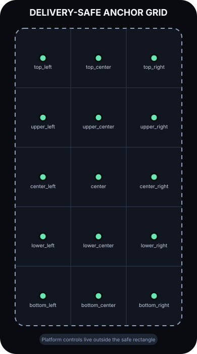
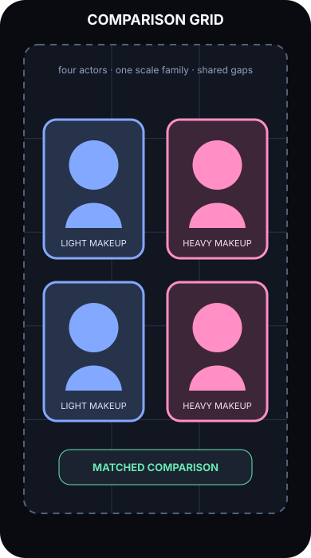
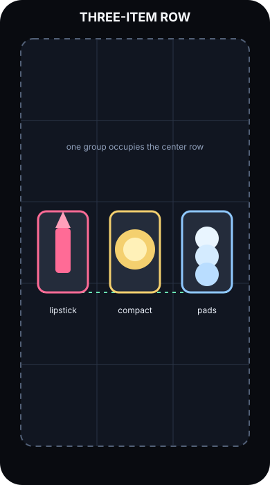
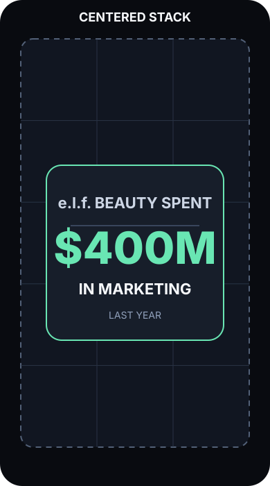
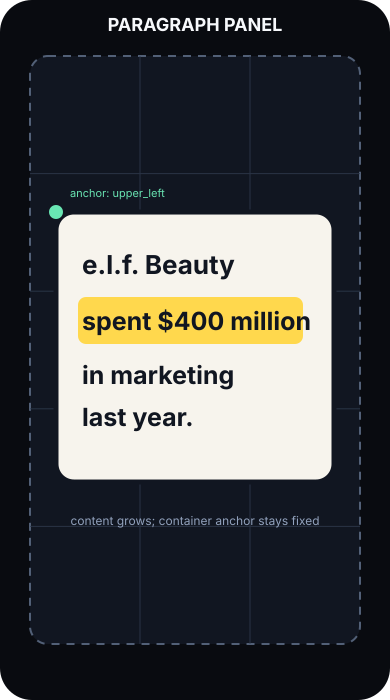
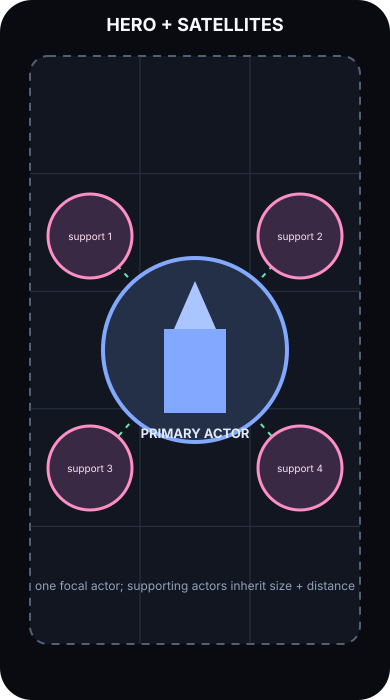

# Semantic spatial layout guide

Status: the 3×5 caption anchors and single-actor semantic slot/motion resolver are implemented. Coordinated multi-actor group recipes remain the next implementation layer.

## Anchor vocabulary

The anchor grid is a named coordinate vocabulary over the delivery-safe rectangle. Agents select names; deterministic code owns the actual canvas coordinates. The first version uses three columns and five rows because it is compact enough to reason about while providing more vertical control than a conventional 3×3 grid.



The grid is intentionally a starting resolution. Later versions can add intermediate nodes without changing the rule that agents name locations instead of supplying X/Y values.

Placement has two separate anchors:

- **Slot** names the destination on the canvas, such as `upper_left` or `center_right`.
- **Attachment** names the point on the actor connected to that slot, such as `center`, `top_left`, `bottom_center`, or `speech_bubble_tail`.

Keeping these separate avoids the ambiguity where “0.5” might mean an actor's centre, its left edge, or a canvas midpoint.

## What a group layout is

A group layout is a reusable arrangement rule for several independently editable actors. It reserves a set of grid regions and gives the actors shared sizing, alignment, spacing, hierarchy, and collision behavior. It does not flatten the actors into one image.

For example, “four women in a comparison grid” is one group instruction. The resolver assigns all four women together. It does not place four unrelated elements independently and hope they align.

### Comparison grid

Use for matched before/after examples, two-by-two contrasts, or four related people/products. All members share a size family; rows and columns share baselines and gaps.



### Item row

Use for a short list of peer objects. The group owns the baseline, equal spacing, and common visual size even when source images have different dimensions.



### Centered stack

Use when several text actors form one hierarchy: setup, dominant statistic, qualifier, and source. The stack owns vertical rhythm and relative type scale.



### Paragraph panel

Use for accumulating text. The container keeps one stable anchor and width while successive native-text states add content. The resolver controls wrapping, leading, margins, and reflow.

The minimal shipped authoring contract is `groupLayout: { kind: "paragraph_panel", row, rows }` on native caption text. Every row shares one delivery-safe left edge; the resolver distributes rows deterministically from the top to the lower safe boundary. Agents choose only the zero-based row and total row count. They do not supply X/Y coordinates. This supports persistent spoken-text builds like the AI-safety reference while keeping preview, export, and spatial assessment on the same geometry authority.



### Hero with satellites

Use when one actor must read first and several supporting actors explain or decorate it. The layout makes the hierarchy explicit and gives every satellite a shared size and distance rule.



## Semantic authoring shape

An agent should express a coordinated scene like this:

```json
{
  "layout": "comparison_grid",
  "region": "center",
  "members": ["woman_light_1", "woman_heavy_1", "woman_light_2", "woman_heavy_2"],
  "ordering": "row_major",
  "gap": "standard",
  "size": "peer",
  "collision_policy": "avoid_protected_regions"
}
```

Motion is expressed as travel between named slots or as a relationship change:

```json
{
  "actor": "lipstick",
  "from": { "slot": "upper_left", "attach": "center" },
  "to": { "slot": "upper_right", "attach": "center" },
  "path": "straight",
  "easing": "snappy"
}
```

The resolver converts these instructions into renderer geometry, evaluates the complete actor set, and records its version and inputs. If the group cannot fit without violating safe or protected regions, it reports a conflict instead of silently centering or overlapping the actors.

## Initial layout vocabulary

Start with a small, testable set:

- `single_actor`
- `comparison_pair`
- `comparison_grid`
- `item_row`
- `centered_stack`
- `paragraph_panel`
- `hero_with_satellites`
- `speech_bubble_pair`

New recipes should be added only when they encode a genuinely reusable relationship. A one-off composition remains a scene plan built from named slots and relationships.

## Implementation boundary

Caption position presets follow the semantic-authoring rule. Agent proposals can now place or move one visual through `props.semanticLayout`, which resolves named slots and size classes into internal editable transforms and records a versioned semantic-layout receipt. The coordinated group recipes in this guide still document the next contract layer. Manual drag coordinates remain explicit human overrides.
